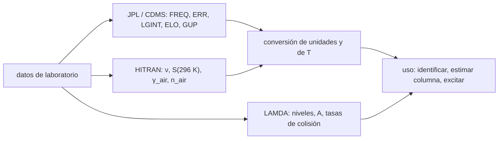

# B62-C07 — Bancos de datos moleculares: CDMS, JPL, HITRAN y LAMDA

<!-- nav:top -->
[🏠 Programa](../../../../README.md) · [📚 Bloque B62](../../../tronco-comun/B62-espectroscopia-molecular-para-astroquimica.md) · [← Anterior: B62-C06 — Ensanchamiento de líneas moleculares: natural, Doppler y por presión](../B62-C06-ensanchamiento-de-lineas-moleculares-natural-doppler-y-por-presion/CLASE.md) · [Siguiente: B62-C08 — Mezclas moleculares y confusión de líneas →](../B62-C08-mezclas-moleculares-y-confusion-de-lineas/CLASE.md)
<!-- /nav -->

## 1. Ubicación, nivel y alcance

Clase 7 del bloque B62. Nivel N3. Ya sabes calcular frecuencias, intensidades y anchos; en la práctica casi nunca los calculas tú: los lees de un **banco de datos**. Esta clase enseña a leer una línea de catálogo (formato JPL de 80 caracteres), a relacionarla con los niveles y coeficientes de LAMDA, a convertir unidades de intensidad y temperatura, y a reconocer qué ofrece cada banco: CDMS, JPL, HITRAN y LAMDA. Usas [B62-C04](../B62-C04-momentos-dipolares-y-fuerza-de-linea/CLASE.md) para la intensidad. La molécula conductora sigue siendo el ¹²C¹⁶O, con seis líneas del catálogo JPL consultadas.

## 2. Por qué esta clase existe

Una identificación depende de una frecuencia, y esa frecuencia viene de un archivo que alguien ajustó y versionó. Si no sabes leer la columna de error, la unidad de la intensidad o la temperatura de referencia, importarás un error silencioso. La decisión central: **¿qué banco corresponde a qué pregunta y qué hay que verificar antes de usar un dato?**

## 3. Lo que podrás hacer al terminar

1. Leer los campos de una línea JPL (`FREQ`, `ERR`, `LGINT`, `DR`, `ELO`, `GUP`, `TAG`, `QNFMT`, cuantos).
2. Interpretar `TAG` negativo (frecuencia medida) y comprobar `GUP = 2J+1`.
3. Convertir `LGINT` a cm⁻¹/(molécula·cm⁻²) y reescalar la intensidad de 300 K a 296 K o a 20 K.
4. Comparar niveles de LAMDA con las frecuencias de JPL y detectar discrepancias.
5. Describir qué contiene y para qué sirve cada banco (CDMS, JPL, HITRAN, LAMDA).
6. Rechazar una línea mal formada en lugar de ignorarla.

La evidencia es la **ficha de lectura de catálogos** del ejercicio 12.

## 4. Con qué llegas y cómo comprobarlo

1. ¿Qué es un logaritmo decimal?
2. ¿Qué es la degeneración `2J+1`?
3. ¿Qué es un número de onda en cm⁻¹?
4. ¿Qué es la función de partición (B62-C01)?
5. ¿Qué es una versión de un catálogo?

<details>
<summary>Ver respuestas</summary>

1. El exponente de 10 que da el número. 2. Las orientaciones del momento angular. 3. El inverso de la longitud de onda en cm. 4. La suma de poblaciones relativas. 5. El estado del archivo en una fecha, que cambia al actualizarse.
</details>

Con cuatro o cinco aciertos, sigue; si no, repasa los prerrequisitos.

## 5. Un caso de contexto y casos de referencia

La primera línea del archivo JPL del CO es `115271.2018  .0005  -5.0105  2  .0000  3  -28001  101  1  0`. ¿Qué dice cada campo, y cuánto vale su intensidad a 296 K, que es la temperatura de referencia de HITRAN? Es el **ejemplo conductor**.

## 6. Vocabulario

Un **banco de datos espectroscópicos** reúne frecuencias, intensidades y niveles con procedencia. **CDMS** (Cologne Database for Molecular Spectroscopy) y **JPL** son catálogos de líneas milimétricas y submilimétricas. **HITRAN** reúne parámetros por línea para atmósferas y astrofísica, con intensidad en cm⁻¹/(molécula·cm⁻²) a 296 K. **LAMDA** (Leiden Atomic and Molecular Database) da niveles, pesos, coeficientes de Einstein y tasas de colisión para códigos de transferencia radiativa. El **TAG** identifica la especie; su signo negativo indica frecuencia medida. **QNFMT** declara el formato de los números cuánticos.

## 7. Modelo mental: una biblioteca con fichas

Cada banco es una biblioteca con su propio sistema de fichas: algunas dan la posición de la línea, otras su fuerza, otras cómo la excitan las colisiones. Límite: las fichas de bancos distintos pueden partir de los mismos datos de laboratorio, pero con ajustes y versiones diferentes.



*Descripción textual:* los datos de laboratorio alimentan cada banco con campos distintos; las conversiones de unidades y temperatura permiten usar los campos conjuntamente.

## 8. La explicación, paso a paso

### 8.1 Una línea JPL, campo por campo

El documento del catálogo (Pickett et al., ed. 2003) define líneas de 80 caracteres con formato `(F13.4, F8.4, F8.4, I2, F10.4, I3, I7, I4, 6I2, 6I2)`: `FREQ` (MHz), `ERR` (MHz), `LGINT` (log₁₀ de la intensidad en nm²·MHz a 300 K), `DR` (grados de libertad de rotación: 2 si es lineal), `ELO` (cm⁻¹), `GUP` (degeneración superior), `TAG`, `QNFMT` y los cuantos. El laboratorio las lee con ancho fijo y comprueba, para las seis líneas, que `GUP = 2J'+1`, que `TAG = −28001` (negativo: frecuencia medida en laboratorio) y que `DR = 2`.

| `FREQ` (MHz) | `ERR` (MHz) | `LGINT` | `ELO` (cm⁻¹) | `GUP` | J'→J'' | `E_sup` (cm⁻¹) |
|---|---|---|---|---|---|---|
| 115271,2018 | 0,0005 | −5,0105 | 0,0000 | 3 | 1→0 | 3,8450 |
| 230538,0000 | 0,0005 | −4,1197 | 3,8450 | 5 | 2→1 | 11,5349 |
| 345795,9899 | 0,0005 | −3,6118 | 11,5350 | 7 | 3→2 | 23,0695 |
| 461040,7682 | 0,0005 | −3,2657 | 23,0695 | 9 | 4→3 | 38,4482 |
| 576267,9305 | 0,0005 | −3,0118 | 38,4481 | 11 | 5→4 | 57,6703 |
| 691473,0763 | 0,0005 | −2,8193 | 57,6704 | 13 | 6→5 | 80,7355 |

`E_sup` es cálculo propio: `ELO + FREQ/29979,2458`.

### 8.2 JPL frente a LAMDA

LAMDA da las energías de los niveles; la diferencia entre dos niveles debería reproducir la frecuencia de JPL. Con las energías **tal como se consultaron**, 1→0 coincide a `2×10⁻¹¹`, pero 2→1 difiere `1,0 MHz` (`4,3×10⁻⁶`) y 3→2 difiere `2,4 MHz` (`6,9×10⁻⁶`). Las frecuencias de transición que LAMDA lista aparte (`230,5380000` y `345,7959899 GHz`) sí coinciden con JPL: la discrepancia está en la precisión de las energías de nivel, no en las frecuencias de línea. **Lección práctica:** para localizar una línea usa la frecuencia del catálogo, no restes energías de nivel. (Estas energías proceden de una lectura de la cabecera del archivo; no se revisó el artículo original de datos de LAMDA.)

### 8.3 Intensidad y temperatura

`LGINT = −5,0105` equivale a `9,7611×10⁻⁶ nm²·MHz`, que dividido por `2,99792458×10¹⁸` da `3,2560×10⁻²⁴ cm⁻¹/(molécula·cm⁻²)` a 300 K. Con la Ec. (3) del documento (exacta en poblaciones) y la `Q` del rotor, a 296 K resulta `3,3440×10⁻²⁴`; la aproximación Ec. (4) da `3,3446×10⁻²⁴` (0,02 % de diferencia). A 20 K la línea 1→0 vale `1,8557×10⁻³ nm²·MHz` por la Ec. (3), mientras que la Ec. (4) da `2,1963×10⁻³`: la aproximación exige `E'−E'' ≪ kT` y a 20 K ya no se cumple.

| `J'` | 300 K (cm⁻¹/(mol·cm⁻²)) | 296 K, Ec. (3) | 296 K, Ec. (4) | dif. |
|---|---|---|---|---|
| 1 | 3,2560×10⁻²⁴ | 3,3440×10⁻²⁴ | 3,3446×10⁻²⁴ | 0,02 % |
| 2 | 2,5321×10⁻²³ | 2,5996×10⁻²³ | 2,6003×10⁻²³ | 0,03 % |
| 3 | 8,1542×10⁻²³ | 8,3664×10⁻²³ | 8,3698×10⁻²³ | 0,04 % |

### 8.4 Qué ofrece cada banco

| Banco | Contenido (según las páginas consultadas) | Intensidad / unidad | Uso típico |
|---|---|---|---|
| JPL | Catálogo de líneas 0–10 000 GHz con frecuencia, error, intensidad, `ELO`, cuantos | nm²·MHz a 300 K | planificar e identificar líneas |
| CDMS | Catálogo de Colonia; portada con wiki y citas (Müller et al. 2001, 2005; Endres et al. 2016) | no consultado | identificar líneas; **entradas no consultadas** |
| HITRAN | Parámetros por línea para atmósfera y astrofísica; `S` en cm⁻¹/(mol·cm⁻²), `γ_air` en cm⁻¹/atm (HWHM), `n_air` | 296 K, 1 atm | atmósferas y gases |
| LAMDA | Niveles, pesos, `A` y tasas de colisión (55 moléculas y 7 átomos/iones según la portada) | `A` en s⁻¹ | transferencia radiativa no-LTE (RADEX) |

Para cada banco hay que citar la versión y la fecha de consulta; la portada de HITRAN consultada anuncia HITRAN2024 y recomienda indicar la versión usada.

## 9. Magnitudes, símbolos y unidades

| Símbolo | Qué es | Unidad | Valor / nota |
|---|---|---|---|
| `FREQ` | frecuencia | MHz | 115271,2018 |
| `ERR` | error experimental | MHz | 0,0005 |
| `LGINT` | log₁₀ de la intensidad a 300 K | log₁₀(nm²·MHz) | −5,0105 |
| `ELO` | energía inferior | cm⁻¹ | 0,0000 |
| `GUP` | degeneración superior | adimensional | 3 |
| `S` (HITRAN) | intensidad por molécula | cm⁻¹/(molécula·cm⁻²) | 3,3440×10⁻²⁴ (296 K) |

## 10. Convenciones y referencias

Frecuencias de reposo; `ELO` relativa al nivel fundamental; el catálogo JPL usa `T = 300 K`, HITRAN `T = 296 K`; las intensidades del catálogo no incluyen partición vibracional (nota del documento). Constantes CODATA 2022.

## 11. De dónde sale lo que afirmamos

| ID | Fuente | Localizador | Respalda | Consulta | Estado |
|---|---|---|---|---|---|
| S1 | NIST, CODATA 2022 | physics.nist.gov/cuu/Constants/Table/allascii.txt | `h`, `c`, `k` | 2026-11-09 | Consultada |
| S3 | Pickett et al., documento del catálogo JPL (ed. 2 mayo 2003) | spec.jpl.nasa.gov/ftp/pub/catalog/doc/catintro.pdf | formato de línea, Ec. (3)–(4) | 2026-11-09 | Consultada (PDF completo con PyMuPDF) |
| S4 | Catálogo JPL, `c028001.cat` | spec.jpl.nasa.gov/ftp/pub/catalog/c028001.cat | seis líneas | 2026-11-09 | Consultada |
| S5 | LAMDA (portada y `co.dat`; Schöier et al. 2005, A&A 432, 369) | home.strw.leidenuniv.nl/~moldata/ | niveles, `A`, descripción | 2026-11-09 | Consultada (portada y primeros 100 000 caracteres de `co.dat`) |
| S6 | CDMS (portada) | cdms.astro.uni-koeln.de/classic/ | citas y existencia | 2026-11-09 | Consultada (solo portada) |
| S7 | HITRAN (portada y definiciones) | hitran.org/ ; hitran.org/docs/definitions-and-units/ | definiciones de `S`, `γ_air`, `n_air`, versión | 2026-11-09 | Consultada (solo portada y definiciones) |

Límites: no se consultaron entradas de CDMS ni archivos de HITRAN; las energías de LAMDA son las de la cabecera leída; el valor de `Q` es propio.

## 12. Cómo ver la lectura

| Magnitud | Valor |
|---|---|
| `GUP` frente a `2J'+1` | coinciden en 6 de 6 |
| JPL frente a LAMDA (3→2) | 2,4 MHz de diferencia en niveles |
| Ec. (4) frente a Ec. (3), 296 K | ≤ 0,04 % |
| Ec. (4) frente a Ec. (3), 20 K | +18 % |

Descripción larga: la aproximación de la Ec. (4) es excelente cerca de 300 K y se degrada al enfriar.

## 13. Ejemplo trabajado: la línea 2→1

**Paso 1 · Lectura.** `FREQ = 230538,0000`, `LGINT = −4,1197`, `ELO = 3,8450`, `GUP = 5`.

**Paso 2 · Intensidad.** `10^−4,1197 = 7,591×10⁻⁵ nm²·MHz`; entre `2,998×10¹⁸`: `2,532×10⁻²³ cm⁻¹/(mol·cm⁻²)`.

**Paso 3 · A 296 K.** Con la Ec. (3), `2,5996×10⁻²³`.

**Paso 4 · Comprobación de J.** `GUP = 5 = 2·2 + 1`, el nivel superior es `J = 2`.

## 14. Distintas formas de describir una línea

**Por catálogo JPL:** campos de 80 caracteres. **Por HITRAN:** `ν`, `S`, `γ`, `n`. **Por LAMDA:** nivel superior e inferior con `A`. **Por derivación:** `E_sup = ELO + ν`.

## 15. Práctica guiada

**Ejercicio 1 · con los pasos indicados.** Convierte `LGINT = −3,6118` a nm²·MHz. *Pasos:* `10^x`.

<details><summary>Solución comentada</summary>

`2,4446×10⁻⁴ nm²·MHz` (tabla 8.3 y sección 17).
</details>

**Ejercicio 2 · con una pista.** Calcula `E_sup` de la línea 1→0. *Pista:* `ELO + FREQ/29979,2458`.

<details><summary>Solución comentada</summary>

`0 + 115271,2018/29979,2458 = 3,8450 cm⁻¹`.
</details>

**Ejercicio 3 · casi autónomo.** ¿Qué significa un `TAG` negativo?

<details><summary>Solución comentada</summary>

Frecuencia medida en laboratorio; `ERR` es el error experimental (8.1).
</details>

## 16. Práctica autónoma, transferencia e integrador

**Ejercicio 4.** ¿Qué `J` superior corresponde a `GUP = 9`?

<details><summary>Solución comentada</summary>

`J = 4` (`2J+1 = 9`).
</details>

**Ejercicio 5.** Pasa `7,5910×10⁻⁵ nm²·MHz` a cm⁻¹/(molécula·cm⁻²).

<details><summary>Solución comentada</summary>

`2,532×10⁻²³` (8.3).
</details>

**Ejercicio 6.** ¿Por qué se rechaza una línea de 40 caracteres?

<details><summary>Solución comentada</summary>

Le faltan campos; ignorarla ocultaría un error de lectura (sección 17).
</details>

**Ejercicio 7.** ¿Qué diferencia hay entre `T_ref` de JPL y de HITRAN?

<details><summary>Solución comentada</summary>

300 K frente a 296 K; hay que reescalar con la Ec. (3) (8.3).
</details>

**Ejercicio 8.** ¿Qué banco elegirías para modelar el exceso de población de J = 2 en una nube con colisiones?

<details><summary>Solución comentada</summary>

LAMDA, porque trae tasas de colisión y coeficientes `A` (8.4).
</details>

**Ejercicio 9 · transferencia.** **Transferencia.** Una línea tiene 2,4 MHz de diferencia entre dos fuentes. ¿Qué verificas antes de decidir cuál usar?

<details><summary>Solución comentada</summary>

Si cada dato es una frecuencia de línea o una diferencia de niveles, el error declarado y la versión (8.2).
</details>

**Ejercicio 10 · transferencia.** **Transferencia.** ¿Por qué no basta citar «JPL» sin fecha?

<details><summary>Solución comentada</summary>

El catálogo se actualiza; hay que citar versión y fecha de consulta (8.4).
</details>

**Ejercicio 11 · transferencia.** **Transferencia.** ¿Por qué la Ec. (4) falla a 20 K?

<details><summary>Solución comentada</summary>

Exige `E'−E'' ≪ kT`; para 1→0, `hν/k = 5,5 K` no es pequeño frente a 20 K (8.3).
</details>

**Ejercicio 12 · integrador.** **Integrador.** Elabora tu *ficha de lectura de catálogos*: tabla de campos de las seis líneas, conversión de unidades a 296 K, comparación con LAMDA y tabla de bancos con lo consultado y lo no consultado.

<details><summary>Solución modelo</summary>

Secciones 8.1–8.4 con la salida de la sección 17.
</details>

## 17. Laboratorio: leer catálogos del CO

El script [catalogos.py](catalogos.py) analiza las seis líneas con ancho fijo, las contrasta con LAMDA, convierte unidades y temperaturas y **comprueba** `GUP = 2J'+1`, la reversibilidad de la Ec. (3) (10⁻¹²), la Ec. (4) a 296 K (< 5 %), la razón de los `A` de LAMDA con el modelo `ν³·J/(2J+1)` (2×10⁻³) y el rechazo de líneas defectuosas.

**Datos:** líneas JPL y niveles LAMDA **reales**, copiados literalmente de lo consultado. **Predice antes de ejecutar:** ¿coincidirán los niveles de LAMDA con JPL? (no del todo en 2→1 y 3→2.) **Ejecución del 2026-11-09 (Python 3.12.9):**

```text
Python 3.12.9 (biblioteca estandar)
Lineas REALES del catalogo JPL (c028001.cat) y niveles de LAMDA (co.dat), consultados el 2026-11-09
FREQ [MHz]     ERR [MHz]  LGINT    DR  ELO [cm^-1]  GUP  TAG     QNFMT  J'  J''  nu [GHz]  E_sup [cm^-1]
  115271.2018   0.0005  -5.0105   2     0.0000    3   -28001   101   1   0   115.2712      3.8450
  230538.0000   0.0005  -4.1197   2     3.8450    5   -28001   101   2   1   230.5380     11.5349
  345795.9899   0.0005  -3.6118   2    11.5350    7   -28001   101   3   2   345.7960     23.0695
  461040.7682   0.0005  -3.2657   2    23.0695    9   -28001   101   4   3   461.0408     38.4482
  576267.9305   0.0005  -3.0118   2    38.4481   11   -28001   101   5   4   576.2679     57.6703
  691473.0763   0.0005  -2.8193   2    57.6704   13   -28001   101   6   5   691.4731     80.7355
Comprobaciones de formato: GUP = 2J'+1, TAG negativo (frecuencia medida en laboratorio) y DR = 2 (molecula lineal): correctas
Frecuencia a partir de las DIFERENCIAS de niveles de LAMDA (energias tal como se consultaron) frente a JPL:
  J=1->0: LAMDA    115271.2018 MHz ; JPL    115271.2018 MHz ; dif. rel. = 2.13e-11 ; g_sup LAMDA = 3
  J=2->1: LAMDA    230536.9983 MHz ; JPL    230538.0000 MHz ; dif. rel. = 4.35e-06 ; g_sup LAMDA = 5
  J=3->2: LAMDA    345798.3901 MHz ; JPL    345795.9899 MHz ; dif. rel. = 6.94e-06 ; g_sup LAMDA = 7
Intensidad: LGINT (nm^2 MHz, 300 K) -> cm^-1/(molecula cm^-2) y a 296 K (referencia de HITRAN)
  J'=1: 9.7611e-06 nm^2 MHz = 3.2560e-24 cm^-1/(mol cm^-2) a 300 K ; a 296 K (Ec. 3) = 3.3440e-24 ; Ec. (4) = 3.3446e-24 (0.02 %)
  J'=2: 7.5910e-05 nm^2 MHz = 2.5321e-23 cm^-1/(mol cm^-2) a 300 K ; a 296 K (Ec. 3) = 2.5996e-23 ; Ec. (4) = 2.6003e-23 (0.03 %)
  J'=3: 2.4446e-04 nm^2 MHz = 8.1542e-23 cm^-1/(mol cm^-2) a 300 K ; a 296 K (Ec. 3) = 8.3664e-23 ; Ec. (4) = 8.3698e-23 (0.04 %)
Escalado a 20 K, linea 1->0: Ec. (3) = 1.8557e-03 ; Ec. (4) = 2.1963e-03 nm^2 MHz (la Ec. (4) exige E'-E'' << kT y a 20 K ya no es buena)
A de Einstein: LAMDA vs relaciones entre lineas (cociente A(J)/A(1) frente al modelo (nu/nu1)^3 (J/(2J+1))/(1/3)):
  J=1: A = 7.203e-08 s^-1 ; cociente LAMDA = 1.000 ; modelo = 1.000
  J=2: A = 6.910e-07 s^-1 ; cociente LAMDA = 9.593 ; modelo = 9.599
  J=3: A = 2.497e-06 s^-1 ; cociente LAMDA = 34.666 ; modelo = 34.709
Linea defectuosa rechazada: linea demasiado corta
Linea defectuosa rechazada: campo no valido: could not convert string to float: '   abc  '
Pruebas superadas.
```

```bash
python programa/clases/B62/B62-C07-bancos-de-datos-moleculares-cdms-jpl-hitran-y-lamda/catalogos.py
```

**Límites:** seis líneas y tres niveles; sin estructura hiperfina; `Q` aproximada; no se consultaron entradas de CDMS ni de HITRAN.

## 18. Errores frecuentes y cómo corregirlos

**Mezclar nm²·MHz con cm⁻¹/(molécula·cm⁻²).** Se corrige con 8.3.

**Comparar intensidades de bancos con temperaturas de referencia distintas.** Se corrige con el ejercicio 7.

**Restar niveles en lugar de usar la frecuencia del catálogo.** Se corrige con 8.2.

**Citar un banco sin versión ni fecha.** Se corrige con 8.4.

## 19. Cómo sabrás que vas bien

Tras la sección 8: ¿qué `J` superior tenía `GUP = 7`? Si dudas, repasa el ejemplo 13. Tras el laboratorio: ¿qué comprueba? (ver la sección 17).

## 20. Qué entregas y cómo se evalúa

El producto es tu **ficha de lectura de catálogos** (ejercicio 12).

| Criterio | Inicial | En desarrollo | Logrado | Destacado |
|---|---|---|---|---|
| Conceptos | Los confunde | Parciales | campos, bancos y unidades | Explica la procedencia |
| Cálculo | Sin unidades | Con errores | conversiones correctas | Reescala con la Ec. (3) |
| Numérico | Sin comprobar | Un caso | Contraste JPL/LAMDA | Interpreta la discrepancia |
| Fuentes | Sin fuente | Sin fecha | Fuentes con fecha y versión | Rotula lo no consultado |
| Límites | No los nombra | Uno | Tres | Discute qué falta |

**Condiciones críticas (no se compensan con promedio):** citar versión y fecha; rotular lo no consultado (CDMS, HITRAN); no tratar un banco como verdad absoluta.

## 21. Ética, seguridad y límites

Clase educativa: se reproducen solo seis líneas con su fuente, no el catálogo. Antes de identificar una especie en datos reales hay que consultar la versión vigente del banco. Accesibilidad: tablas equivalentes a las gráficas, fórmulas en texto, ejercicios sin conexión.

## 22. Para cerrar y seguir

Seis líneas JPL se leen, se convierten y se contrastan con LAMDA; la comparación mostró una diferencia de hasta `2,4 MHz` en las energías de nivel. Queda una pregunta: ¿qué pasa cuando hay cientos de especies y las líneas se mezclan?

**Glosario español–inglés.** banco de datos · *database*; catálogo de líneas · *line catalog*; intensidad integrada · *integrated intensity*; temperatura de referencia · *reference temperature*; degeneración · *degeneracy*; etiqueta de especie · *species tag*.

**Continuidad.** [B62-C08](../B62-C08-mezclas-moleculares-y-confusion-de-lineas/CLASE.md) estudia las mezclas y la confusión de líneas.

**Referencias:** ver sección 11.

<!-- nav:bottom -->
---

[← Anterior: B62-C06 — Ensanchamiento de líneas moleculares: natural, Doppler y por presión](../B62-C06-ensanchamiento-de-lineas-moleculares-natural-doppler-y-por-presion/CLASE.md) · [📚 Bloque B62](../../../tronco-comun/B62-espectroscopia-molecular-para-astroquimica.md) · [Siguiente: B62-C08 — Mezclas moleculares y confusión de líneas →](../B62-C08-mezclas-moleculares-y-confusion-de-lineas/CLASE.md)
<!-- /nav -->
