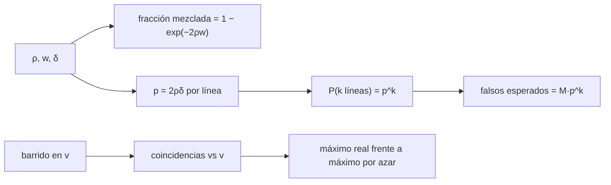

# B62-C08 — Mezclas moleculares y confusión de líneas

<!-- nav:top -->
[🏠 Programa](../../../../README.md) · [📚 Bloque B62](../../../tronco-comun/B62-espectroscopia-molecular-para-astroquimica.md) · [← Anterior: B62-C07 — Bancos de datos moleculares: CDMS, JPL, HITRAN y LAMDA](../B62-C07-bancos-de-datos-moleculares-cdms-jpl-hitran-y-lamda/CLASE.md) · [Siguiente: B63-C01 — Instrumentación de sondas y rovers planetarios →](../../../tronco-comun/B63-exploracion-in-situ-y-analisis-de-muestras-planetarias.md#b63-c01)
<!-- /nav -->

## 1. Ubicación, nivel y alcance

Clase 8 y última del bloque B62. Nivel N3. En una fuente rica en moléculas hay muchas especies y miles de líneas; algunas caen una sobre otra. Aquí cuantificas la **confusión**: cuántas líneas quedan mezcladas con otra, con qué probabilidad una identificación con pocas líneas es falsa y cómo una búsqueda en velocidad con varias líneas de una misma molécula separa la señal del azar. Usas probabilidad básica ([B12](../../../tronco-comun/B12-probabilidad-estadistica-e-incertidumbre.md)), el ajuste de [B62-C05](../B62-C05-constantes-espectroscopicas-y-ajuste-de-espectros/CLASE.md) y los catálogos de [B62-C07](../B62-C07-bancos-de-datos-moleculares-cdms-jpl-hitran-y-lamda/CLASE.md). El espectro de la clase es **sintético**; solo las seis frecuencias de reposo del CO son datos reales de catálogo.

## 2. Por qué esta clase existe

Una línea que coincide con una frecuencia de catálogo no identifica una molécula: puede ser casualidad. La decisión central: **¿cuántas líneas hacen falta para afirmar una identificación con riesgo bajo de falsa alarma?**

## 3. Lo que podrás hacer al terminar

1. Calcular la fracción de líneas mezcladas con otra para una densidad y un ancho dados.
2. Verificar la fórmula con una simulación Monte Carlo de semilla fija.
3. Estimar la probabilidad de una falsa identificación con `k` líneas y el número esperado entre `M` especies candidatas.
4. Buscar una velocidad común que alinee varias líneas de un catálogo con un espectro sintético.
5. Distinguir la significancia de una coincidencia aislada de la de una escalera de líneas.
6. Rotular lo sintético y no confundirlo con una observación.

La evidencia es la **ficha de confusión de líneas** del ejercicio 12.

## 4. Con qué llegas y cómo comprobarlo

1. ¿Qué es un proceso de Poisson?
2. ¿Qué es la probabilidad de un suceso independiente repetido `k` veces?
3. ¿Cómo se pasa de MHz a km/s a una frecuencia dada?
4. ¿Qué es un error estándar de una media?
5. ¿Qué es la corrección por «mirar en muchos lugares»?

<details>
<summary>Ver respuestas</summary>

1. Puntos al azar con densidad media constante. 2. `p^k`. 3. `v = c·Δν/ν`. 4. `σ/√N`. 5. Si se hacen `M` pruebas, los falsos positivos esperados se multiplican por `M`.
</details>

Con cuatro o cinco aciertos, sigue; si no, repasa los prerrequisitos.

## 5. Un caso de contexto y casos de referencia

Imagina una banda de 10 GHz con 100 líneas intrusas (10 por GHz, densidad **ilustrativa** de una fuente rica) y las seis primeras líneas del CO desplazadas por una velocidad desconocida. ¿Cuántas coincidencias se esperan por azar y qué velocidad se recupera? Es el **ejemplo conductor**: todo es simulado, salvo las seis frecuencias de reposo.

## 6. Vocabulario

La **densidad de líneas** `ρ` es el número medio de líneas por MHz. Una **línea mezclada** (*blend*) tiene otra a menos de un ancho `w`. La **confusión** es la dificultad de asignar una línea a una especie. La **tolerancia** `δ` es la diferencia máxima entre frecuencia predicha y observada para aceptar una coincidencia. Una **escalera** es el conjunto de líneas de una misma molécula (como las transiciones `J→J−1` del CO) que comparten una velocidad. La **búsqueda en velocidad** barre `v` y cuenta cuántas líneas predichas tienen una observada a menos de `δ`.

## 7. Modelo mental: buscar un nombre en una guía telefónica

Una coincidencia aislada es como encontrar un apellido común: no prueba nada. Encontrar seis apellidos de una familia, todos desfasados lo mismo, ya no es casualidad. Límite: aquí las líneas intrusas están distribuidas al azar; en una fuente real están correlacionadas (series de la misma molécula, isotopólogos, estados vibracionales).



*Descripción textual:* `ρ`, `w` y `δ` fijan la fracción de mezcla y la probabilidad de coincidencia; la probabilidad conjunta de `k` líneas y el número de candidatas dan las falsas identificaciones; el barrido en velocidad compara el máximo real con el azar.

## 8. La explicación, paso a paso

### 8.1 Líneas mezcladas

Con `ρ = 0,01 líneas/MHz`, una línea de ancho `w` tiene otra a menos de `w` con probabilidad `1 − exp(−2ρw)` (Poisson) o `1 − (1 − 2w/L)^(N−1)` (exacta para `N` líneas uniformes en `L`). El Monte Carlo (500 realizaciones de 100 líneas en 10 GHz) coincide dentro del error:

| `w` (MHz) | `w` a 225 GHz (km/s) | Poisson | exacta | Monte Carlo |
|---|---|---|---|---|
| 0,50 | 0,666 | 0,0100 | 0,0099 | 0,0091 ± 0,0006 |
| 1,50 | 1,999 | 0,0296 | 0,0293 | 0,0288 ± 0,0011 |
| 3,75 | 4,997 | 0,0723 | 0,0716 | 0,0703 ± 0,0016 |
| 7,50 | 9,993 | 0,1393 | 0,1381 | 0,1382 ± 0,0021 |

Con líneas de 5 km/s de ancho, 7 % de las líneas ya tienen una vecina a menos de un ancho.

### 8.2 Falsas identificaciones

Con tolerancia `δ = 0,5 MHz`, la probabilidad de que una línea predicha de una especie ajena coincida con alguna intrusa es `p = 2ρδ = 0,01`. Para `k` líneas independientes: `p^k`. Con `M = 300` especies candidatas:

| `k` | `p^k` | falsas esperadas (`M·p^k`) |
|---|---|---|
| 1 | 1,0×10⁻² | 3,0 |
| 2 | 1,0×10⁻⁴ | 3,0×10⁻² |
| 3 | 1,0×10⁻⁶ | 3,0×10⁻⁴ |
| 4 | 1,0×10⁻⁸ | 3,0×10⁻⁶ |

Con una sola línea se esperan tres falsas identificaciones; con tres, prácticamente ninguna. La simulación (400 000 pruebas) da `0,00975` para `k = 1` y `0,00013` para `k = 2`, compatibles con la cobertura de la realización (`0,00988` y `0,00010`).

### 8.3 Búsqueda de velocidad con una escalera

Se simula una observación de 6906 líneas en 60–750 GHz: 6900 intrusas más las seis del CO con `v = 7,30 km/s` y ruido de `0,05 km/s`. Se barre `v` de −50 a +50 km/s con paso `0,02 km/s` y tolerancia de `0,30 km/s`. Resultado: las seis líneas coinciden a la vez en el intervalo `7,06–7,54 km/s` (centro `7,30`); en las demás 4901 velocidades el máximo por azar es 1 línea y ninguna velocidad llega a 3. Histograma por azar (0, 1, 2, 3, 4+ líneas): `4721, 180, 0, 0, 0`.

### 8.4 Qué cambia en una fuente real

Las intrusas reales no son Poisson: vienen en series (moléculas complejas, isotopólogos, estados vibracionales excitados) y el número de candidatas `M` depende del catálogo. La densidad de este ejemplo (10 líneas/GHz) es ilustrativa. La regla práctica se mantiene: exigir varias líneas con velocidad común, intensidades coherentes con una temperatura (B62-C04) y ningún faltante que debería ser fuerte.

## 9. Magnitudes, símbolos y unidades

| Símbolo | Qué es | Unidad | Valor / nota |
|---|---|---|---|
| `ρ` | densidad de líneas | líneas/MHz | 0,01 (sintético) |
| `w` | ancho de línea | MHz o km/s | 3,75 MHz = 5 km/s a 225 GHz |
| `δ` | tolerancia de coincidencia | MHz o km/s | 0,5 MHz; 0,30 km/s |
| `p` | probabilidad de coincidencia | adimensional | 0,01 |
| `M` | especies candidatas | adimensional | 300 (ilustrativo) |
| `v` | velocidad de la fuente | km/s | 7,30 (simulada) |

## 10. Convenciones y referencias

Velocidad no relativista `ν_obs = ν₀(1 − v/c)`; frecuencias en MHz; líneas puntuales; intrusas uniformes (proceso de Poisson); semilla 20261109; `c = 299792,458 km/s`.

## 11. De dónde sale lo que afirmamos

| ID | Fuente | Localizador | Respalda | Consulta | Estado |
|---|---|---|---|---|---|
| S1 | NIST, CODATA 2022 | physics.nist.gov/cuu/Constants/Table/allascii.txt | `c` | 2026-11-09 | Consultada |
| S4 | Catálogo JPL, `c028001.cat` | spec.jpl.nasa.gov/ftp/pub/catalog/c028001.cat | seis frecuencias de reposo del CO | 2026-11-09 | Consultada |

Límites: la densidad de líneas, el número de especies y el espectro son sintéticos; no se consultó ninguna observación ni estudio de confusión en fuentes reales; las fórmulas de probabilidad son estándar y se verifican por simulación.

## 12. Cómo ver la confusión

| Magnitud | Valor |
|---|---|
| fracción mezclada, 3,75 MHz | 0,072 |
| falsas con 1 línea (M = 300) | 3,0 |
| falsas con 3 líneas (M = 300) | 3×10⁻⁴ |
| máximo por azar con el CO (barrido) | 1 de 6 |

Descripción larga: el número de coincidencias en función de `v` es casi plano en 0 o 1 y presenta un pico estrecho de 6 en `7,3 km/s`.

## 13. Ejemplo trabajado: fracción mezclada a 5 km/s

**Paso 1 · Ancho.** `w = 3,75 MHz` (5 km/s a 225 GHz).

**Paso 2 · Producto.** `2ρw = 2·0,01·3,75 = 0,075`.

**Paso 3 · Poisson.** `1 − e^(−0,075) = 0,0723`.

**Paso 4 · Lectura.** 7 % de las líneas tienen vecina a menos de un ancho.

## 14. Distintas formas de describir la confusión

**Por densidad:** `ρ·w` (líneas por ancho). **Por probabilidad:** `p^k`. **Por conteo:** falsas esperadas `M·p^k`. **Por barrido:** coincidencias frente a `v`.

## 15. Práctica guiada

**Ejercicio 1 · con los pasos indicados.** Calcula `2ρw` con `ρ = 0,01` y `w = 1,5 MHz`.

<details><summary>Solución comentada</summary>

`0,03`; la fracción mezclada es `1 − e^(−0,03) = 0,0296` (tabla 8.1).
</details>

**Ejercicio 2 · con una pista.** Calcula `p` con `δ = 1 MHz`. *Pista:* `p = 2ρδ`.

<details><summary>Solución comentada</summary>

`0,02`.
</details>

**Ejercicio 3 · casi autónomo.** ¿Cuántas falsas esperas con `k = 2`, `p = 0,02` y `M = 300`?

<details><summary>Solución comentada</summary>

`300·0,02² = 0,12` (8.2).
</details>

## 16. Práctica autónoma, transferencia e integrador

**Ejercicio 4.** Pasa 3,75 MHz a km/s a 225 GHz.

<details><summary>Solución comentada</summary>

`299792,458·3,75/225000 = 4,997 km/s` (tabla 8.1).
</details>

**Ejercicio 5.** Con `ρ` duplicada, ¿qué pasa con `p^k` para `k = 3`?

<details><summary>Solución comentada</summary>

Se multiplica por `2³ = 8`.
</details>

**Ejercicio 6.** ¿Cuántas líneas hacen falta para tener menos de 0,01 falsas con `M = 300`, `p = 0,01`?

<details><summary>Solución comentada</summary>

`300·p^k < 0,01` → `p^k < 3,3×10⁻⁵` → `k ≥ 3` (con `k = 2` da 0,03).
</details>

**Ejercicio 7.** El barrido encontró un pico de 6 coincidencias de ancho `0,48 km/s`. ¿Por qué no 0,6 km/s (= 2δ)?

<details><summary>Solución comentada</summary>

El ruido (0,05 km/s) y la dispersión de las seis líneas reducen la intersección común de las ventanas (8.3).
</details>

**Ejercicio 8.** ¿Por qué la fórmula exacta da 0,0716 y no 0,0723?

<details><summary>Solución comentada</summary>

Con `N` finito la probabilidad usa `(1 − 2w/L)^(N−1)` en lugar de la exponencial límite (8.1).
</details>

**Ejercicio 9 · transferencia.** **Transferencia.** Un colega identifica una molécula con una línea y 3 de 3 candidatas «posibles». ¿Qué le pides?

<details><summary>Solución comentada</summary>

Más líneas con la misma velocidad, y comprobar la intensidad coherente con `T` (8.2, 8.4).
</details>

**Ejercicio 10 · transferencia.** **Transferencia.** ¿Por qué un catálogo con más especies aumenta las falsas identificaciones?

<details><summary>Solución comentada</summary>

Crece `M` (corrección por «mirar en muchos lugares», 8.2).
</details>

**Ejercicio 11 · transferencia.** **Transferencia.** ¿Qué limita el uso del modelo de Poisson en una fuente real?

<details><summary>Solución comentada</summary>

Las líneas están correlacionadas (series, isotopólogos) y no son uniformes (8.4).
</details>

**Ejercicio 12 · integrador.** **Integrador.** Elabora tu *ficha de confusión de líneas*: fracción mezclada, falsas esperadas por `k`, resultado de la búsqueda en velocidad y límites del modelo, rotulando lo sintético.

<details><summary>Solución modelo</summary>

Secciones 8.1–8.4 con la salida de la sección 17.
</details>

## 17. Laboratorio: confusión y búsqueda en velocidad

El script [confusion.py](confusion.py) simula intrusas, mide la fracción mezclada, estima falsas identificaciones y busca la velocidad del CO simulado. **Comprueba** el Monte Carlo con la fórmula exacta (3 errores estándar), la falsa identificación (4σ) y la recuperación de `v` (0,15 km/s).

**Datos:** frecuencias de reposo **reales** (JPL); campo de intrusas y observación **sintéticos** (semilla 20261109). **Predice antes de ejecutar:** ¿cuántas coincidencias por azar esperas fuera de la velocidad verdadera? (como máximo 1.) **Ejecución del 2026-11-09 (Python 3.12.9, numpy 2.4.4):**

```text
Python 3.12.9, numpy 2.4.4
Datos SINTETICOS (semilla 20261109): campo de lineas intrusas rho = 0.01 /MHz y observacion simulada del CO; las seis frecuencias de reposo son REALES (JPL, 2026-11-09)
(1) Banda de 10 GHz con N = 100 lineas intrusas (rho = 0.01 /MHz)
    FWHM [MHz]  velocidad a 225 GHz [km/s]  analitica Poisson  exacta  Monte Carlo (+- error est.)
        0.50          0.666                0.0100       0.0099    0.0091 +- 0.0006
        1.50          1.999                0.0296       0.0293    0.0288 +- 0.0011
        3.75          4.997                0.0723       0.0716    0.0703 +- 0.0016
        7.50          9.993                0.1393       0.1381    0.1382 +- 0.0021
(2) Tolerancia +-0.5 MHz: probabilidad de coincidencia por linea p = 2 rho delta = 0.0100
    k = 1 lineas: P(todas coinciden) = 1.000e-02 ; con M = 300 especies candidatas, falsas identificaciones esperadas = 3.000e+00
    k = 2 lineas: P(todas coinciden) = 1.000e-04 ; con M = 300 especies candidatas, falsas identificaciones esperadas = 3.000e-02
    k = 3 lineas: P(todas coinciden) = 1.000e-06 ; con M = 300 especies candidatas, falsas identificaciones esperadas = 3.000e-04
    k = 4 lineas: P(todas coinciden) = 1.000e-08 ; con M = 300 especies candidatas, falsas identificaciones esperadas = 3.000e-06
    MC k = 1: 0.00975 (modelo p^k = 0.01000; cobertura de esta realizacion^k = 0.00988; sigma = 0.00016)
    MC k = 2: 0.00013 (modelo p^k = 0.00010; cobertura de esta realizacion^k = 0.00010; sigma = 0.00002)
(3) Observacion SIMULADA: 6906 lineas en 60-750 GHz (6900 intrusas + 6 del CO con v = 7.3 km/s)
    maximo de coincidencias: 6 de 6 en el intervalo v = 7.06 a 7.54 km/s (centro 7.30; verdadera: 7.3)
    fuera de +-1 km/s de la verdad: maximo por azar = 1 ; velocidades con 3 o mas coincidencias por azar = 0 de 4901
    histograma de coincidencias por azar (0,1,2,3,4+ lineas): [4721, 180, 0, 0, 0]
Pruebas superadas.
```

```bash
python programa/clases/B62/B62-C08-mezclas-moleculares-y-confusion-de-lineas/confusion.py
```

**Límites:** intrusas uniformes, líneas puntuales, sin intensidades y sin isotopólogos.

## 18. Errores frecuentes y cómo corregirlos

**Identificar con una sola línea.** Se corrige con 8.2.

**Olvidar el número de candidatas.** Se corrige con el ejercicio 10.

**Presentar la observación simulada como real.** Se corrige con la sección 5.

**Usar la densidad ilustrativa como si fuera de una fuente real.** Se corrige con 8.4.

## 19. Cómo sabrás que vas bien

Tras la sección 8: ¿cuántas líneas necesitas con `M = 300` y `p = 0,01` para menos de 0,01 falsas? Si dudas, repasa el ejemplo 13. Tras el laboratorio: ¿qué comprueba? (ver la sección 17).

## 20. Qué entregas y cómo se evalúa

El producto es tu **ficha de confusión de líneas** (ejercicio 12).

| Criterio | Inicial | En desarrollo | Logrado | Destacado |
|---|---|---|---|---|
| Conceptos | Los confunde | Parciales | densidad, blend, `p^k` | Explica correlaciones reales |
| Cálculo | Sin unidades | Con errores | Tablas completas | Calcula casos nuevos |
| Numérico | Sin comprobar | Un caso | Monte Carlo contra fórmula | Interpreta el barrido |
| Fuentes | Sin fuente | Sin fecha | Fuentes con fecha | Rotula lo sintético |
| Límites | No los nombra | Uno | Tres | Discute qué falta |

**Condiciones críticas (no se compensan con promedio):** rotular el espectro como sintético; no presentar la simulación como observación; citar solo lo consultado.

## 21. Ética, seguridad y límites

Clase educativa: ninguna identificación real se realiza. Accesibilidad: tablas equivalentes a las gráficas, fórmulas en texto, ejercicios sin conexión.

## 22. Para cerrar y seguir

Una línea aislada no identifica una molécula (3 falsas esperadas entre 300 candidatas); tres o más con velocidad común sí reducen el riesgo a `3×10⁻⁴` en este modelo. Cierra el bloque: de los niveles de energía a la identificación en una mezcla.

**Glosario español–inglés.** confusión de líneas · *line confusion*; línea mezclada · *blended line*; densidad de líneas · *line density*; falsa identificación · *false identification*; búsqueda en velocidad · *velocity search*; escalera de líneas · *line ladder*.

**Continuidad.** Fin del bloque B62; la guía del bloque está en [B62](../../../tronco-comun/B62-espectroscopia-molecular-para-astroquimica.md).

**Referencias:** ver sección 11.

<!-- nav:bottom -->
---

[← Anterior: B62-C07 — Bancos de datos moleculares: CDMS, JPL, HITRAN y LAMDA](../B62-C07-bancos-de-datos-moleculares-cdms-jpl-hitran-y-lamda/CLASE.md) · [📚 Bloque B62](../../../tronco-comun/B62-espectroscopia-molecular-para-astroquimica.md) · [Siguiente: B63-C01 — Instrumentación de sondas y rovers planetarios →](../../../tronco-comun/B63-exploracion-in-situ-y-analisis-de-muestras-planetarias.md#b63-c01)
<!-- /nav -->
