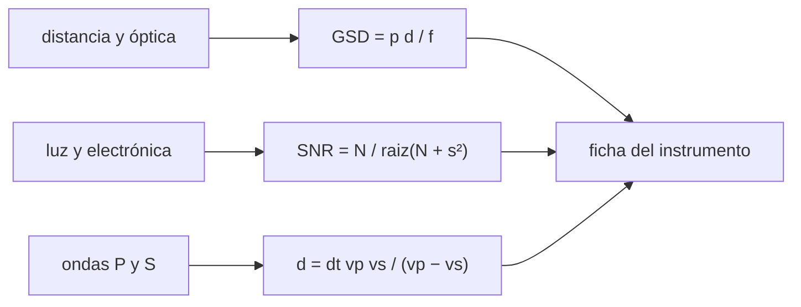

# B63-C01 — Instrumentación de sondas y rovers planetarios

<!-- nav:top -->
[🏠 Programa](../../../../README.md) · [📚 Bloque B63](../../../tronco-comun/B63-exploracion-in-situ-y-analisis-de-muestras-planetarias.md) · [← Anterior: B62-C08 — Mezclas moleculares y confusión de líneas](../../B62/B62-C08-mezclas-moleculares-y-confusion-de-lineas/CLASE.md) · [Siguiente: B63-C02 — Muestreo superficial y estrategias de recolección →](../B63-C02-muestreo-superficial-y-estrategias-de-recoleccion/CLASE.md)
<!-- /nav -->

## 1. Ubicación, nivel y alcance

Clase 1 del bloque B63, área A05. Nivel N3. [B47](../../../tronco-comun/B47-instrumentacion-y-observatorios-espaciales.md) es orbital; aquí pasas a la superficie. Presentas tres familias de instrumentos in situ (cámaras, espectrómetros, sismómetros) y calculas tres cosas elementales de cada una: cuánto mide un píxel sobre el terreno, qué relación señal/ruido da un detector y a qué distancia ocurrió un sismo con una sola estación. Todos los valores son **sintéticos e ilustrativos**; no describen ningún instrumento real.

## 2. Por qué esta clase existe

Un rover no puede volver a medir lo que midió mal. Antes de elegir qué observar hay que saber qué puede resolver cada instrumento. La decisión central: **¿qué parte de lo que ves es información del terreno y qué parte es límite del instrumento?**

## 3. Lo que podrás hacer al terminar

1. Calcular el tamaño de píxel en el suelo (`GSD`) a partir de la focal, el paso de píxel y el rango.
2. Calcular la relación señal/ruido de un detector limitado por fotones y por lectura.
3. Contrastar una fórmula de ruido con una simulación Monte Carlo de semilla fija.
4. Ubicar un sismo a una distancia con una sola estación usando el retardo S−P.
5. Identificar qué instrumento responde a qué pregunta (forma, composición, estructura interna).
6. Rotular qué cifras son de un modelo sintético y cuáles proceden de una fuente consultada.

La evidencia es la **ficha de un instrumento in situ** del ejercicio 12 (sección 20).

## 4. Con qué llegas y cómo comprobarlo

1. ¿Qué es una razón señal/ruido?
2. ¿Qué es un fotoelectrón?
3. ¿Qué es una simulación con semilla fija?
4. ¿Qué es una onda P y una S?
5. ¿Qué es un valor sintético?

<details>
<summary>Ver respuestas</summary>

1. El cociente entre la señal media y su desviación estándar. 2. Un electrón liberado por un fotón detectado. 3. Una simulación aleatoria reproducible. 4. Ondas sísmicas de compresión (más rápida) y de corte. 5. Un valor propuesto para el ejemplo, no medido.
</details>

Con cuatro o cinco aciertos, sigue; si no, repasa los prerrequisitos.

## 5. Un caso de contexto y casos de referencia

Un rover imaginario lleva una cámara de mástil con focal de `34 mm` y píxeles de `7,4 µm`, un detector de espectrómetro con `N = 1000` fotoelectrones por píxel y ruido de lectura de `10 e⁻`, y un sismómetro que registra un retardo S−P de `30 s` con `vp = 5,0 km/s` y `vs = 2,9 km/s`. Es el **ejemplo conductor** y es **sintético**. Como contexto real, la página de NASA sobre los componentes de Perseverance (S4) describe dos imágenes en el mástil (Mastcam-Z) y un instrumento (SuperCam) que usa un láser para vaporizar pequeñas zonas de roca, con cámara, espectrómetros y un micrófono que graba el chasquido del láser; los valores numéricos de esos instrumentos **no se consultaron** y no se usan aquí.

## 6. Vocabulario

El **GSD** (*ground sample distance*) es el tamaño sobre el terreno que cubre un píxel. La **focal** `f` es la distancia óptica entre la lente y el detector. El **paso de píxel** `p` es el lado de un píxel. La **relación señal/ruido** (`SNR`) es la señal media dividida por la desviación estándar del ruido. El **ruido de fotones** sigue una ley de Poisson: su varianza es igual a la señal. El **ruido de lectura** es el ruido electrónico en electrones. El **retardo S−P** es la diferencia entre las llegadas de la onda S y la onda P.

## 7. Modelo mental: contar gotas de lluvia en una taza

Un detector cuenta fotones como una taza cuenta gotas: cuantas más caen, más estable es el promedio, pero siempre hay una fluctuación de orden raíz del conteo. Límite: la taza no tiene ruido propio; el detector sí (lectura).



*Descripción textual:* tres cálculos independientes (óptico, de ruido y sísmico) alimentan una misma ficha del instrumento.

## 8. La explicación, paso a paso

### 8.1 Cuánto mide un píxel en el suelo

Con óptica de orificio y un objeto lejano, un píxel de lado `p` subtiende el ángulo `p/f`; a un rango `d` cubre `GSD = p·d/f`. Con `p = 7,4 µm` y `f = 34 mm`, el ángulo es `2,176 × 10⁻⁴ rad`.

| Rango (m) | GSD (mm/píxel) |
|---|---|
| 2 | 0,4353 |
| 10 | 2,1765 |
| 50 | 10,8824 |
| 100 | 21,7647 |

El GSD crece linealmente con el rango; la prueba del laboratorio comprueba que a 100 m es exactamente diez veces el de 10 m.

### 8.2 Ruido de fotones y de lectura

Si el detector registra `N` fotoelectrones en promedio, la varianza del ruido de fotones es `N` (Poisson) y la del ruido de lectura es `σ²`. Entonces `SNR = N / √(N + σ²)`. Con `σ = 10 e⁻`:

| N (e⁻) | SNR analítico | SNR Monte Carlo |
|---|---|---|
| 100 | 7,071 | 7,084 |
| 1000 | 30,151 | 30,200 |
| 10 000 | 99,504 | 99,643 |

La diferencia relativa máxima fue `0,0019`. El Monte Carlo usa una aproximación normal de la ley de Poisson (válida para `N ≥ 100`); la diferencia es del orden de `1/√(2n) ≈ 0,0016` para `n = 2 × 10⁵` repeticiones.

### 8.3 Una estación sísmica

Las ondas P y S salen juntas del foco y llegan con un retardo `Δt = d/vs − d/vp`. Despejando, `d = Δt · vp·vs/(vp − vs)`. Con `vp = 5,0` y `vs = 2,9 km/s`, el factor vale `6,905 km/s`: un retardo de `30 s` da `207,14 km`.

### 8.4 Lectura

El GSD y el SNR se calculan con la geometría y la electrónica; la distancia sísmica depende de un modelo de velocidades. En ningún caso se conoce la dirección del sismo con una sola estación de una componente: la distancia define una circunferencia. Y la aproximación de medio homogéneo, que es la de este modelo, es una simplificación.

## 9. Magnitudes, símbolos y unidades

| Símbolo | Qué es | Unidad | Valor / nota |
|---|---|---|---|
| `p` | paso de píxel | µm | 7,4 (ilustrativo) |
| `f` | focal | mm | 34 (ilustrativo) |
| `d` | rango | m | 2–100 |
| `GSD` | tamaño de píxel en el suelo | mm/píxel | 2,1765 a 10 m |
| `N` | fotoelectrones medios | e⁻ | 100–10 000 |
| `σ` | ruido de lectura | e⁻ | 10 (ilustrativo) |
| `SNR` | relación señal/ruido | — | 30,15 con N = 1000 |
| `vp`, `vs` | velocidades de ondas P y S | km/s | 5,0 y 2,9 (ilustrativos) |
| `Δt` | retardo S−P | s | 30 |
| `d_s` | distancia al foco sísmico | km | 207,14 |

## 10. Convenciones y referencias

Distancias a lo largo de la visual en metros y sobre el terreno en kilómetros; óptica de orificio sin distorsión; medio sísmico homogéneo. Los valores del ejemplo son sintéticos.

## 11. De dónde sale lo que afirmamos

| ID | Fuente | Localizador | Respalda | Consulta | Estado |
|---|---|---|---|---|---|
| S4 | NASA, *Perseverance: componentes del rover* | https://science.nasa.gov/mission/mars-2020-perseverance/rover-components/ | describe de forma cualitativa la cámara de mástil y el instrumento láser con espectrómetros y micrófono de Perseverance | 2026-11-09 | página web; el recuento de tubos es internamente inconsistente (43 y 39) |

Límites: las fórmulas son relaciones estándar que verifica el laboratorio; no se consultó una fuente con parámetros numéricos de instrumentos reales, y ninguno de los valores de la clase pertenece a Perseverance ni a otra misión.

## 12. Cómo ver la ficha de un instrumento

| Magnitud | Valor |
|---|---|
| GSD a 10 m | 2,1765 mm/píxel |
| SNR con N = 1000 y σ = 10 | 30,15 |
| Distancia con Δt = 30 s | 207,14 km |

Descripción larga: el GSD crece como una recta con el rango, el SNR crece como la raíz de N cuando domina el ruido de fotones y la distancia sísmica crece linealmente con el retardo.

## 13. Ejemplo trabajado: el sismo a 30 segundos

**Paso 1 · Factor.** `vp·vs/(vp − vs) = 5,0 × 2,9 / 2,1 = 6,9048 km/s`.

**Paso 2 · Distancia.** `d = 30 s × 6,9048 km/s = 207,14 km`.

**Paso 3 · Comprobación.** `207,14/2,9 − 207,14/5,0 = 71,43 − 41,43 = 30,0 s`.

## 14. Distintas formas de describir un instrumento in situ

**Por geometría:** GSD. **Por estadística:** SNR. **Por tiempo de llegada:** retardo S−P. **Por simulación:** Monte Carlo con semilla fija, que valida la fórmula sin sustituirla.

## 15. Práctica guiada

**Ejercicio 1 · con los pasos indicados.** Calcula el GSD a `20 m` con `p = 7,4 µm` y `f = 34 mm`. *Pasos:* aplica `GSD = p·d/f` y convierte a milímetros.

<details><summary>Solución comentada</summary>

`7,4×10⁻⁶ × 20 / 0,034 = 4,353×10⁻³ m = 4,353 mm`, el doble que a 10 m (sección 8.1).
</details>

**Ejercicio 2 · con una pista.** Un detector sin ruido de lectura recibe `N = 400` fotoelectrones. Calcula su SNR. *Pista:* solo hay ruido de fotones.

<details><summary>Solución comentada</summary>

`SNR = N/√N = √N = 20`.
</details>

**Ejercicio 3 · casi autónomo.** Con el retardo S−P de `20 s`, calcula la distancia. *Pasos:* usa el factor `6,9048 km/s`.

<details><summary>Solución comentada</summary>

`20 × 6,9048 = 138,1 km` (sección 8.3).
</details>

## 16. Práctica autónoma, transferencia e integrador

**Ejercicio 4 · autónomo.** ¿A qué rango el píxel cubre exactamente `1 mm`?

<details><summary>Solución comentada</summary>

`d = GSD·f/p = 10⁻³ × 0,034 / 7,4×10⁻⁶ = 4,595 m`.
</details>

**Ejercicio 5 · autónomo.** Con `N = 2500 e⁻` y `σ = 50 e⁻`, calcula el SNR.

<details><summary>Solución comentada</summary>

`2500/√(2500 + 2500) = 2500/70,71 = 35,36`.
</details>

**Ejercicio 6 · autónomo.** ¿Qué `N` da `SNR = 100` si solo hay ruido de fotones?

<details><summary>Solución comentada</summary>

`SNR = √N = 100`, luego `N = 10 000 e⁻`.
</details>

**Ejercicio 7 · autónomo.** Con `vp = 5,0` y `vs = 3,0 km/s` y `Δt = 40 s`, calcula la distancia.

<details><summary>Solución comentada</summary>

Factor `15/2 = 7,5 km/s`; `d = 300 km`.
</details>

**Ejercicio 8 · autónomo.** Si `vp` sube a `5,5 km/s` (con `vs = 2,9`) y `Δt = 30 s`, ¿cuánto cambia la distancia?

<details><summary>Solución comentada</summary>

Factor `5,5×2,9/2,6 = 6,1346`; `d = 184,04 km`: baja `23,10 km` (11,2 %). Una velocidad mal supuesta mueve la distancia.
</details>

**Ejercicio 9 · transferencia.** **Transferencia.** Si la focal se duplica con el mismo paso y rango, ¿qué pasa con el GSD y con el campo de visión?

<details><summary>Solución comentada</summary>

El GSD se reduce a la mitad (mejor resolución) y el campo de visión del detector también se reduce a la mitad: el cambio es un compromiso.
</details>

**Ejercicio 10 · transferencia.** **Transferencia.** ¿Puede una sola estación sísmica de una componente dar la dirección del sismo?

<details><summary>Solución comentada</summary>

No: da la distancia (una circunferencia). La dirección exige la polarización de la onda P con tres componentes u otra estación.
</details>

**Ejercicio 11 · transferencia.** **Transferencia.** El SNR de Monte Carlo difiere `0,19 %` del analítico. ¿Es un error del modelo?

<details><summary>Solución comentada</summary>

No: con `n = 2×10⁵` repeticiones la incertidumbre del estimador es del orden de `1/√(2n) ≈ 0,16 %`; está dentro del azar del Monte Carlo.
</details>

**Ejercicio 12 · integrador.** **Integrador.** Elabora tu *ficha de un instrumento in situ*: tabla de GSD, SNR y distancia sísmica, con unidades, supuestos y qué es sintético.

<details><summary>Solución comentada</summary>

Secciones 8.1–8.4 y el laboratorio; la ficha declara que todos los parámetros son ilustrativos.
</details>

## 17. Laboratorio: escala de píxel, ruido y distancia sísmica

El script [instrumentos.py](instrumentos.py) calcula el GSD, contrasta el SNR con Monte Carlo y calcula la distancia S−P (**comprueba** la linealidad del GSD, la diferencia < 1 % del SNR y la ida y vuelta de tiempos).

**Datos:** sintéticos e ilustrativos (sección 5), sin datos observados. **Predice antes de ejecutar:** ¿cuánto valdrá el GSD a 10 m? (2,1765 mm/píxel.) **Ejecución del 2026-11-09 (Python 3.12.9):**

```text
Python 3.12.9 (biblioteca estandar)
Camara ilustrativa: f = 34.0 mm, paso = 7.4 um
 rango [m]   GSD [mm/pix]
      2.0       0.4353
     10.0       2.1765
     50.0      10.8824
    100.0      21.7647
Escala lineal con el rango comprobada.
SNR de fotones (lectura = 10 e-):
  N [e-]   SNR analitico   SNR Monte Carlo   dif relativa
     100          7.071            7.084       0.0019
    1000         30.151           30.200       0.0016
   10000         99.504           99.643       0.0014
Diferencia maxima Monte Carlo/analitico = 0.0019 (< 0.01).
Sismica (vp = 5.0 km/s, vs = 2.9 km/s):
  S-P =  10.0 s  ->  distancia =    69.05 km
  S-P =  30.0 s  ->  distancia =   207.14 km
  S-P =  60.0 s  ->  distancia =   414.29 km
Ida y vuelta de tiempos de llegada comprobada (< 1e-9 s).
Pruebas superadas.
```

```bash
python programa/clases/B63/B63-C01-instrumentacion-de-sondas-y-rovers-planetarios/instrumentos.py
```

**Límites:** óptica ideal, aproximación normal de Poisson y medio sísmico homogéneo.

## 18. Errores frecuentes y cómo corregirlos

**Confundir GSD con resolución real.** El GSD es el muestreo; la resolución también depende de la óptica y del enfoque. Se corrige con 8.1.

**Sumar ruidos en lugar de sus varianzas.** Se suman varianzas (`N + σ²`), no desviaciones. Se corrige con 8.2.

**Usar el retardo como distancia.** La distancia es retardo por un factor de velocidades. Se corrige con 8.3.

**Presentar los valores como de un instrumento real.** Son sintéticos. Se corrige con la sección 10.

## 19. Cómo sabrás que vas bien

Tras la sección 8: ¿qué resultado esperabas y cuál obtuviste? Si dudas, repasa el ejemplo de la sección 13. Tras el laboratorio: ¿qué comprueba cada aserción? (ver la sección 17). Si algo no cuadra, revisa primero las unidades.

## 20. Qué entregas y cómo se evalúa

El producto es tu **ficha de un instrumento in situ** (ejercicio 12).

| Criterio | Inicial | En desarrollo | Logrado | Destacado |
|---|---|---|---|---|
| Conceptos | Los confunde | Parciales | Conceptos de la clase | Explica los límites |
| Cálculo | Sin unidades | Con errores | Tablas completas | Calcula casos nuevos |
| Numérico | Sin comprobar | Un caso | Contraste con el análisis | Interpreta las diferencias |
| Fuentes | Sin fuente | Sin fecha | Fuentes con fecha | Declara lo sintético |
| Límites | No los nombra | Uno | Tres | Discute qué falta del modelo |

**Condiciones críticas (no se compensan con promedio):** rotular lo sintético e ilustrativo; no presentar un modelo como valor observado, regulatorio o de una instalación real; citar solo lo consultado.

## 21. Ética, seguridad y límites

Se citan solo descripciones cualitativas de una página de NASA; no se atribuyen cifras a instrumentos reales. Clase educativa: los modelos son simplificados. Accesibilidad: tablas equivalentes a las gráficas, fórmulas en texto, ejercicios sin conexión.

## 22. Para cerrar y seguir

Una cámara sintética de 34 mm resuelve `2,18 mm/píxel` a 10 m, un detector con 1000 e⁻ da SNR `30,15` y un retardo de 30 s ubica un sismo a `207,14 km`. Queda una pregunta: ¿cómo se decide dónde tomar una muestra?

**Glosario español–inglés.** distancia de muestreo en el suelo · *ground sample distance*; relación señal/ruido · *signal-to-noise ratio*; ruido de lectura · *read noise*; retardo S−P · *S–P delay*; sismómetro · *seismometer*.

**Continuidad.** [B63-C02](../B63-C02-muestreo-superficial-y-estrategias-de-recoleccion/CLASE.md) estudia el muestreo superficial.

**Referencias:** ver sección 11.

<!-- nav:bottom -->
---

[← Anterior: B62-C08 — Mezclas moleculares y confusión de líneas](../../B62/B62-C08-mezclas-moleculares-y-confusion-de-lineas/CLASE.md) · [📚 Bloque B63](../../../tronco-comun/B63-exploracion-in-situ-y-analisis-de-muestras-planetarias.md) · [Siguiente: B63-C02 — Muestreo superficial y estrategias de recolección →](../B63-C02-muestreo-superficial-y-estrategias-de-recoleccion/CLASE.md)
<!-- /nav -->
