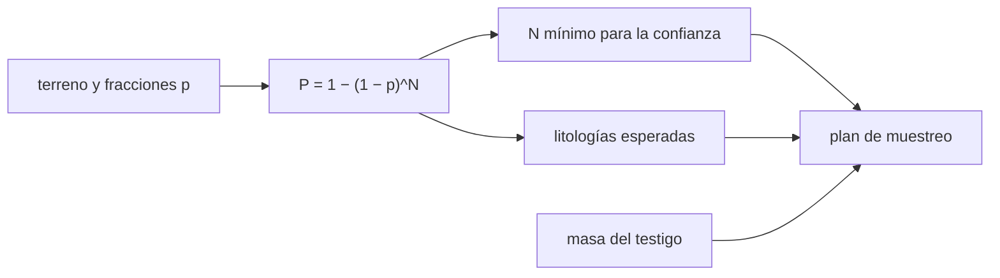

# B63-C02 — Muestreo superficial y estrategias de recolección

<!-- nav:top -->
[🏠 Programa](../../../../README.md) · [📚 Bloque B63](../../../tronco-comun/B63-exploracion-in-situ-y-analisis-de-muestras-planetarias.md) · [← Anterior: B63-C01 — Instrumentación de sondas y rovers planetarios](../B63-C01-instrumentacion-de-sondas-y-rovers-planetarios/CLASE.md) · [Siguiente: B63-C03 — Curaduría y cadena de custodia de muestras →](../B63-C03-curaduria-y-cadena-de-custodia-de-muestras/CLASE.md)
<!-- /nav -->

## 1. Ubicación, nivel y alcance

Clase 2 del bloque B63. Nivel N3. [B59](../../../tronco-comun/B59-recursos-in-situ-y-sostenibilidad-extraterrestre.md) trata la extracción de volátiles; aquí tratas el muestreo **científico**. Calculas la masa de un testigo y la probabilidad de cubrir las litologías de un terreno con `N` muestras. Todo el terreno es **sintético**.

## 2. Por qué esta clase existe

Un rover tiene un número limitado de tubos. La decisión central: **¿cuántas muestras hacen falta para no perderse una litología rara con una confianza dada?**

## 3. Lo que podrás hacer al terminar

1. Calcular la masa de un testigo cilíndrico a partir de sus dimensiones y densidad.
2. Calcular la probabilidad de capturar una litología de fracción `p` con `N` muestras independientes.
3. Hallar el número mínimo de muestras para una confianza dada.
4. Estimar cuántas litologías distintas se esperan con `N` muestras.
5. Contrastar la fórmula con una simulación Monte Carlo.
6. Reconocer cuándo la independencia de las muestras deja de ser razonable.

La evidencia es la **plan de muestreo con confianza** del ejercicio 12 (sección 20).

## 4. Con qué llegas y cómo comprobarlo

1. ¿Qué es una probabilidad complementaria?
2. ¿Cómo se calcula el volumen de un cilindro?
3. ¿Qué es la independencia?
4. ¿Qué es una litología?
5. ¿Qué es un valor esperado?

<details>
<summary>Ver respuestas</summary>

1. `1 − P`, la probabilidad de que no ocurra. 2. `π (d/2)² L`. 3. Que un resultado no cambia la probabilidad de otro. 4. Un tipo de roca por su composición y textura. 5. El promedio ponderado por probabilidades.
</details>

Con cuatro o cinco aciertos, sigue; si no, repasa los prerrequisitos.

## 5. Un caso de contexto y casos de referencia

Un terreno sintético tiene cuatro litologías con fracciones de área: basalto `0,55`, brecha `0,25`, evaporita `0,15` y veta `0,05`. Un testigo ilustrativo mide `13 mm` de diámetro y `60 mm` de largo y la roca tiene `2,7 g/cm³`. Es el **ejemplo conductor** y es **sintético**. Como contexto real, NASA describe (S4) que Perseverance perfora un testigo con una broca, que un brazo interior lo mueve a estaciones de inspección y sellado, que lo guarda sellado y que puede dejarlo en un depósito de muestras en superficie; también lleva tubos «testigo» (*witness tubes*) que capturan contaminantes terrestres. La fuente da 43 tubos y 5 tubos testigo, aunque un pie de foto menciona 39; por esa inconsistencia no se usa ninguna cifra para el cálculo. NASA documenta además (S3) que seis misiones Apolo trajeron `382 kg` de muestras lunares en unas `2200` muestras separadas.

## 6. Vocabulario

Un **testigo** es un cilindro de roca extraído con una broca. Una **litología** es un tipo de roca. La **fracción de área** `p` es la parte del terreno ocupada por una litología. La **confianza** `C` es la probabilidad de capturarla al menos una vez. Un **tubo testigo** (*witness tube*) es un tubo que registra contaminación de la propia nave. Un **depósito** es un lugar donde se dejan muestras selladas.

## 7. Modelo mental: sacar bolas de una urna

Muestrear un terreno se parece a sacar bolas de una urna con reposición: cada bola tiene la probabilidad `p` de ser de un color. Límite: en la realidad una muestra gasta el punto, el rover no llega a todas partes y las litologías no están repartidas al azar.



*Descripción textual:* las fracciones de área determinan la probabilidad de captura, de ella salen el número mínimo de muestras y las litologías esperadas, y con la masa del testigo se arma el plan.

## 8. La explicación, paso a paso

### 8.1 Masa de un testigo

`m = ρ · π (d/2)² · L`. Con `d = 1,3 cm`, `L = 6,0 cm` y `ρ = 2,7 g/cm³`, el volumen es `7,964 cm³` y la masa `21,503 g`. Un cilindro así es muy pequeño: por eso cada tubo vale mucho.

### 8.2 Probabilidad de capturar una litología

Con `N` muestras independientes, la probabilidad de no capturar una litología de fracción `p` es `(1 − p)^N`. Por tanto `P = 1 − (1 − p)^N`. Para una confianza `C`, `N ≥ ln(1 − C)/ln(1 − p)`.

| Litología | p | N (90 %) | N (95 %) | N (99 %) |
|---|---|---|---|---|
| basalto | 0,55 | 3 | 4 | 6 |
| brecha | 0,25 | 9 | 11 | 17 |
| evaporita | 0,15 | 15 | 19 | 29 |
| veta | 0,05 | 45 | 59 | 90 |

Lo raro cuesta: capturar la veta con 95 % de confianza exige 59 muestras, casi 15 veces lo que exige el basalto.

### 8.3 Con diez muestras

| Litología | P analítica | P Monte Carlo |
|---|---|---|
| basalto | 0,9997 | 0,9996 |
| brecha | 0,9437 | 0,9431 |
| evaporita | 0,8031 | 0,8046 |
| veta | 0,4013 | 0,4006 |

Las litologías distintas esperadas son `3,1477` (analítico) y `3,1479` (Monte Carlo): con diez muestras, la veta se pierde más de la mitad de las veces.

### 8.4 Lectura

Una estrategia no se juzga por cuántas muestras toma sino por qué litologías cubre con qué confianza. Cuando el presupuesto de tubos es menor que `N`, la decisión es elegir qué litología se sacrifica, y eso es una decisión científica, no estadística.

## 9. Magnitudes, símbolos y unidades

| Símbolo | Qué es | Unidad | Valor / nota |
|---|---|---|---|
| `m` | masa del testigo | g | 21,503 |
| `d`, `L` | diámetro y largo | mm | 13 y 60 (ilustrativos) |
| `ρ` | densidad | g/cm³ | 2,7 (ilustrativa) |
| `p` | fracción de área | — | 0,05–0,55 (sintética) |
| `N` | número de muestras | — | 10 |
| `C` | confianza | — | 0,90–0,99 |
| `P` | probabilidad de captura | — | ver 8.3 |

## 10. Convenciones y referencias

Muestras independientes y con reposición; terreno plano dividido en unidades discretas; masa en gramos y longitudes en milímetros. Todo el terreno es sintético.

## 11. De dónde sale lo que afirmamos

| ID | Fuente | Localizador | Respalda | Consulta | Estado |
|---|---|---|---|---|---|
| S4 | NASA, *Perseverance: componentes del rover* | https://science.nasa.gov/mission/mars-2020-perseverance/rover-components/ | describe el flujo de perforación, inspección, sellado y depósito de muestras, y los tubos testigo | 2026-11-09 | página web; el recuento de tubos es internamente inconsistente (43 y 39) |
| S3 | NASA Johnson Space Center, Astromaterials Acquisition and Curation, *portada y página lunar* | https://curator.jsc.nasa.gov/ y https://curator.jsc.nasa.gov/lunar/ | establece 382 kg de muestras lunares en unas 2200 muestras (cifra de contexto) | 2026-11-09 | dos páginas web; no describen manejo ni contaminación |

Límites: no se consultó el diseño de ninguna misión; la estrategia es un modelo estadístico sintético y no refleja cómo se eligen realmente las muestras.

## 12. Cómo ver el plan de muestreo

| Magnitud | Valor |
|---|---|
| Masa del testigo | 21,503 g |
| N para la veta (95 %) | 59 |
| P de la veta con N = 10 | 0,4013 |

Descripción larga: la probabilidad de captura sube con N de forma saturante; las litologías raras necesitan órdenes de magnitud más muestras que las comunes.

## 13. Ejemplo trabajado: la evaporita con 95 % de confianza

**Paso 1 · Planteo.** `p = 0,15`, `C = 0,95`.

**Paso 2 · Cálculo.** `N ≥ ln(0,05)/ln(0,85) = (−2,9957)/(−0,16252) = 18,43`.

**Paso 3 · Redondeo.** `N = 19`.

**Paso 4 · Comprobación.** `1 − 0,85¹⁹ = 0,9545 ≥ 0,95` y `1 − 0,85¹⁸ = 0,9464 < 0,95`.

## 14. Distintas formas de describir un plan de muestreo

**Por probabilidad:** `P(N)`. **Por confianza:** `N` mínimo. **Por diversidad:** litologías esperadas. **Por simulación:** Monte Carlo con semilla fija.

## 15. Práctica guiada

**Ejercicio 1 · con los pasos indicados.** Calcula la masa de un testigo de `10 mm × 50 mm` con `ρ = 2,7 g/cm³`. *Pasos:* volumen en cm³ y multiplica.

<details><summary>Solución comentada</summary>

`π × 0,5² × 5 = 3,927 cm³`; `m = 10,60 g`.
</details>

**Ejercicio 2 · con una pista.** Calcula la probabilidad de capturar el basalto (`p = 0,55`) con `N = 2`. *Pista:* complemento.

<details><summary>Solución comentada</summary>

`1 − 0,45² = 0,7975`.
</details>

**Ejercicio 3 · casi autónomo.** ¿Cuántas muestras captan la brecha con `90 %`? *Pasos:* usa la fórmula del `N` mínimo.

<details><summary>Solución comentada</summary>

`ln(0,10)/ln(0,75) = 8,004`, que se redondea hacia arriba a `N = 9` (sección 8.2).
</details>

## 16. Práctica autónoma, transferencia e integrador

**Ejercicio 4 · autónomo.** Para una litología de `p = 0,02`, calcula `N` con `95 %`.

<details><summary>Solución comentada</summary>

`ln(0,05)/ln(0,98) = 148,3`; `N = 149`.
</details>

**Ejercicio 5 · autónomo.** ¿Qué probabilidad tiene la veta con `N = 30`?

<details><summary>Solución comentada</summary>

`1 − 0,95³⁰ = 1 − 0,2146 = 0,7854`.
</details>

**Ejercicio 6 · autónomo.** Si solo hay `12` tubos, ¿qué confianza se alcanza para la evaporita?

<details><summary>Solución comentada</summary>

`1 − 0,85¹² = 1 − 0,1422 = 0,8578`.
</details>

**Ejercicio 7 · autónomo.** Calcula las litologías esperadas con `N = 1`.

<details><summary>Solución comentada</summary>

Es `Σ p = 1`: con una muestra se captura exactamente una litología.
</details>

**Ejercicio 8 · autónomo.** Calcula la masa de 12 testigos del caso (`21,503 g` cada uno).

<details><summary>Solución comentada</summary>

`258,0 g`.
</details>

**Ejercicio 9 · transferencia.** **Transferencia.** Un colega sugiere elegir los puntos de muestreo donde hay más roca expuesta. ¿Qué supuesto del modelo rompe?

<details><summary>Solución comentada</summary>

Rompe la independencia y la igualdad de probabilidades: el muestreo sesgado cambia las `p` efectivas, y las litologías cubiertas por regolito casi no aparecen.
</details>

**Ejercicio 10 · transferencia.** **Transferencia.** ¿Cómo cambia el plan si cada muestra deja inutilizado su punto?

<details><summary>Solución comentada</summary>

La captura es sin reposición: la probabilidad de no capturar baja más rápido y el plan se acerca al conteo de áreas disponibles.
</details>

**Ejercicio 11 · transferencia.** **Transferencia.** El Monte Carlo da `0,4006` y la fórmula `0,4013` para la veta. ¿Preocupa?

<details><summary>Solución comentada</summary>

No: la diferencia `0,0007` es del orden del error del Monte Carlo con `4×10⁴` repeticiones (`≈ 0,0025`).
</details>

**Ejercicio 12 · integrador.** **Integrador.** Elabora tu *plan de muestreo con confianza*: tabla de `N` para tres confianzas, probabilidades con `N = 10` y una decisión justificada si solo hay 12 tubos.

<details><summary>Solución comentada</summary>

Secciones 8.1–8.4; la ficha declara terreno sintético y supuestos de independencia.
</details>

## 17. Laboratorio: cobertura de litologías con N muestras

El script [muestreo.py](muestreo.py) calcula la masa del testigo, el `N` mínimo y las probabilidades de captura, y las contrasta con Monte Carlo (**comprueba** el umbral de `N` y la diferencia < 0,01).

**Datos:** sintéticos e ilustrativos (sección 5), sin datos observados. **Predice antes de ejecutar:** ¿cuántas muestras captan la veta con 95 %? (59.) **Ejecución del 2026-11-09 (Python 3.12.9):**

```text
Python 3.12.9 (biblioteca estandar)
Testigo ilustrativo 13.0 x 60.0 mm, rho = 2.7 g/cm3: masa = 21.503 g
Litologias sinteticas (fraccion de area): {'basalto': 0.55, 'brecha': 0.25, 'evaporita': 0.15, 'veta': 0.05}
 litologia   p     N(90%)  N(95%)  N(99%)
 basalto     0.55      3       4       6
 brecha      0.25      9      11      17
 evaporita   0.15     15      19      29
 veta        0.05     45      59      90
Umbral de N minimo comprobado para 95 %.
Con N = 10 muestras: P de captura analitica / Monte Carlo
  basalto    0.9997  0.9996
  brecha     0.9437  0.9431
  evaporita  0.8031  0.8046
  veta       0.4013  0.4006
Litologias distintas esperadas: analitico 3.1477, Monte Carlo 3.1479
Diferencia maxima de P = 0.0015 (< 0.01). Pruebas superadas.
```

```bash
python programa/clases/B63/B63-C02-muestreo-superficial-y-estrategias-de-recoleccion/muestreo.py
```

**Límites:** muestras independientes con reposición y terreno sintético.

## 18. Errores frecuentes y cómo corregirlos

**Creer que `N` más grande siempre corrige el sesgo de selección.** No: el sesgo cambia las `p`. Se corrige con 8.4.

**Olvidar redondear `N` hacia arriba.** Se corrige con el ejemplo 13.

**Usar la densidad en kg/m³ con el volumen en cm³.** Se corrige con la tabla de la sección 9.

**Tomar la fracción de área como fracción de masa.** Son cosas distintas.

## 19. Cómo sabrás que vas bien

Tras la sección 8: ¿qué resultado esperabas y cuál obtuviste? Si dudas, repasa el ejemplo de la sección 13. Tras el laboratorio: ¿qué comprueba cada aserción? (ver la sección 17). Si algo no cuadra, revisa primero las unidades.

## 20. Qué entregas y cómo se evalúa

El producto es tu **plan de muestreo con confianza** (ejercicio 12).

| Criterio | Inicial | En desarrollo | Logrado | Destacado |
|---|---|---|---|---|
| Conceptos | Los confunde | Parciales | Conceptos de la clase | Explica los límites |
| Cálculo | Sin unidades | Con errores | Tablas completas | Calcula casos nuevos |
| Numérico | Sin comprobar | Un caso | Contraste con el análisis | Interpreta las diferencias |
| Fuentes | Sin fuente | Sin fecha | Fuentes con fecha | Declara lo sintético |
| Límites | No los nombra | Uno | Tres | Discute qué falta del modelo |

**Condiciones críticas (no se compensan con promedio):** rotular lo sintético e ilustrativo; no presentar un modelo como valor observado, regulatorio o de una instalación real; citar solo lo consultado.

## 21. Ética, seguridad y límites

Se evita presentar el modelo como la estrategia de una misión real. Clase educativa: los modelos son simplificados. Accesibilidad: tablas equivalentes a las gráficas, fórmulas en texto, ejercicios sin conexión.

## 22. Para cerrar y seguir

Un testigo ilustrativo pesa `21,5 g`, la veta rara exige `59` muestras para el 95 % y con diez la pierdes más de la mitad de las veces. Queda una pregunta: ¿cómo se guarda, se cuenta y se sigue una muestra una vez tomada?

**Glosario español–inglés.** testigo · *core*; litología · *lithology*; confianza · *confidence*; tubo testigo · *witness tube*; depósito de muestras · *sample depot*.

**Continuidad.** [B63-C03](../B63-C03-curaduria-y-cadena-de-custodia-de-muestras/CLASE.md) estudia la curaduría y la cadena de custodia.

**Referencias:** ver sección 11.

<!-- nav:bottom -->
---

[← Anterior: B63-C01 — Instrumentación de sondas y rovers planetarios](../B63-C01-instrumentacion-de-sondas-y-rovers-planetarios/CLASE.md) · [📚 Bloque B63](../../../tronco-comun/B63-exploracion-in-situ-y-analisis-de-muestras-planetarias.md) · [Siguiente: B63-C03 — Curaduría y cadena de custodia de muestras →](../B63-C03-curaduria-y-cadena-de-custodia-de-muestras/CLASE.md)
<!-- /nav -->
