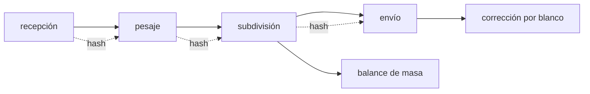

# B63-C03 — Curaduría y cadena de custodia de muestras

<!-- nav:top -->
[🏠 Programa](../../../../README.md) · [📚 Bloque B63](../../../tronco-comun/B63-exploracion-in-situ-y-analisis-de-muestras-planetarias.md) · [← Anterior: B63-C02 — Muestreo superficial y estrategias de recolección](../B63-C02-muestreo-superficial-y-estrategias-de-recoleccion/CLASE.md) · [Siguiente: B63-C04 — Misiones de retorno de muestras: salvaguardas históricas y regulatorias →](../B63-C04-misiones-de-retorno-de-muestras-salvaguardas-historicas-y-regulatorias/CLASE.md)
<!-- /nav -->

## 1. Ubicación, nivel y alcance

Clase 3 del bloque B63. Nivel N3. [B13-C02](../../B13/B13-C02-dimensiones-y-trazabilidad/CLASE.md) trata la trazabilidad métrica; aquí tratas la **curaduría** de muestras planetarias: registrar cada evento, repartir la masa sin perderla de vista y corregir la contaminación. Construyes un registro de custodia con encadenamiento por *hash*, un balance de masa y una corrección por mezcla. La muestra y los eventos son **sintéticos**.

## 2. Por qué esta clase existe

Una muestra planetaria es irrepetible y se estudia durante décadas. La decisión central: **¿cómo demuestras, años después, qué le pasó a una muestra y cuánto de lo que mides es suyo?**

## 3. Lo que podrás hacer al terminar

1. Explicar qué es un registro de custodia y qué debe contener cada evento.
2. Encadenar eventos con un resumen criptográfico (SHA-256) y detectar una alteración.
3. Cerrar el balance de masa de una subdivisión e identificar masa sin explicar.
4. Calcular la fracción de contaminante de una mezcla con un blanco y corregir la medida.
5. Reconocer por qué se reserva parte de una muestra sin consumir.
6. Distinguir integridad (que no se alteró) de autenticidad (quién lo escribió).

La evidencia es la **registro de custodia verificable** del ejercicio 12 (sección 20).

## 4. Con qué llegas y cómo comprobarlo

1. ¿Qué es una función hash?
2. ¿Qué es un balance de masa?
3. ¿Qué es un blanco?
4. ¿Qué es una alícuota?
5. ¿Qué es un valor sintético?

<details>
<summary>Ver respuestas</summary>

1. Una función que resume datos en un código de tamaño fijo; un cambio mínimo cambia el código. 2. Que lo que sale más lo que queda suma lo que había. 3. Una muestra sin analito que mide la contaminación del proceso. 4. Una porción de una muestra. 5. Un valor propuesto para el ejemplo, no medido.
</details>

Con cuatro o cinco aciertos, sigue; si no, repasa los prerrequisitos.

## 5. Un caso de contexto y casos de referencia

La muestra sintética `S-0001` llega con `5000 mg`; se pesa; se subdivide en alícuotas de `1200` y `800 mg`, deja un residuo archivado de `2990 mg` y una pérdida declarada de `10 mg`; y se envía a un laboratorio. Es el **ejemplo conductor** y es **sintético**. Como contexto real, la oficina de curaduría de astromateriales de NASA (S3) declara como máxima prioridad asegurar la disponibilidad futura de sus muestras para la comunidad científica mundial, presta muestras a escuelas y universidades y distribuye cerca de `400` muestras lunares al año; el registro de Apolo es de unos `382 kg` en unas `2200` muestras. Perseverance lleva además tubos testigo para capturar contaminantes de la propia nave (S4). La página de curaduría **no** detalla procedimientos de manejo ni de contaminación, y esos procedimientos no se describen aquí como reales.

## 6. Vocabulario

La **curaduría** es el cuidado, registro y distribución de una colección. La **cadena de custodia** es el registro continuo de quién tuvo la muestra, cuándo y qué hizo. Un **hash** es un resumen de tamaño fijo de unos datos. El **encadenamiento** hace que cada registro incluya el hash del anterior. Una **alícuota** es una porción. Un **blanco** (*blank*) es una referencia que mide contaminación. La **fracción de contaminante** `f` es la parte de la medida que no es de la muestra.

## 7. Modelo mental: un cuaderno de laboratorio con páginas selladas

Cada registro es una página que lleva en el pie la huella de la página anterior; si alguien reescribe la página 1, las huellas de todas las siguientes dejan de coincidir. Límite: el hash demuestra que algo cambió, no quién lo cambió ni si el contenido original era verdad.



*Descripción textual:* los eventos se suceden y cada uno guarda el hash del anterior; de la subdivisión sale el balance de masa y de las medidas, la corrección por blanco.

## 8. La explicación, paso a paso

### 8.1 Un registro encadenado

Cada evento (`t`, acción, persona, masa o destino) se guarda con `hash_i = SHA-256(hash_{i−1} + evento_i)`. El primero usa 64 ceros. Para verificar, se recalcula la cadena y se compara. La cadena sintética de cuatro registros dio:

| Fecha (UTC) | Acción | Hash (12 primeros caracteres) |
|---|---|---|
| 2026-01-10T09:00 | recepción | a49512eb1814 |
| 2026-01-10T09:30 | pesaje | c789c4521f7b |
| 2026-01-12T14:00 | subdivisión | 7e0723f26b60 |
| 2026-01-12T14:20 | envío | a3e474a22230 |

Al cambiar la masa del registro 1 de `5000` a `5100 mg`, la verificación falla y el primer registro inconsistente es el 1.

### 8.2 Balance de masa

`m₀ = Σ alícuotas + residuo + pérdida + sobrante`. Con `m₀ = 5000`, alícuotas `1200 + 800`, residuo `2990` y pérdida `10`, el sobrante es `0 mg`: toda la masa está explicada. Un sobrante distinto de cero es una alarma, no un redondeo (las masas se llevan en enteros de miligramo para que el balance sea exacto).

### 8.3 Contaminación por mezcla

Si el contaminante tiene concentración `c_b` (el blanco), la muestra `c_m` y la medida es `c`, la fracción de contaminante es `f = (c − c_m)/(c_b − c_m)`. Con `c = 3,2`, `c_m = 2,0` y `c_b = 50 ppm`, `f = 0,025`. La concentración corregida es `(c − f c_b)/(1 − f) = 2,000 ppm`.

### 8.4 Lectura

El registro encadenado prueba **integridad**, no **autenticidad**: para saber quién escribió cada evento hacen falta firmas. Y la corrección por blanco exige conocer `c_m`, que en la práctica no se conoce: se estima desde varios blancos. Aquí se conoce para poder comprobar el método.

## 9. Magnitudes, símbolos y unidades

| Símbolo | Qué es | Unidad | Valor / nota |
|---|---|---|---|
| `m₀` | masa inicial | mg | 5000 (sintética) |
| `m_a` | alícuotas | mg | 1200 y 800 |
| `m_r` | residuo archivado | mg | 2990 |
| `c`, `c_m`, `c_b` | medida, muestra y blanco | ppm | 3,2; 2,0; 50 (sintéticas) |
| `f` | fracción de contaminante | — | 0,025 |
| `hash` | resumen SHA-256 | 64 hex | ver 8.1 |

## 10. Convenciones y referencias

Tiempos en ISO 8601 UTC; masas en miligramos enteros; concentraciones en ppm; contaminación por mezcla lineal de dos componentes. Todo el registro es sintético.

## 11. De dónde sale lo que afirmamos

| ID | Fuente | Localizador | Respalda | Consulta | Estado |
|---|---|---|---|---|---|
| S3 | NASA Johnson Space Center, Astromaterials Acquisition and Curation, *portada y página lunar* | https://curator.jsc.nasa.gov/ y https://curator.jsc.nasa.gov/lunar/ | declara la prioridad de preservar la disponibilidad futura de las muestras y cifras de la colección lunar | 2026-11-09 | dos páginas web; no describen manejo ni contaminación |
| S4 | NASA, *Perseverance: componentes del rover* | https://science.nasa.gov/mission/mars-2020-perseverance/rover-components/ | describe los tubos testigo que capturan contaminantes terrestres | 2026-11-09 | página web; el recuento de tubos es internamente inconsistente (43 y 39) |

Límites: no se consultó ningún procedimiento real de curaduría ni la norma de ninguna colección; el registro, el balance y la corrección son un modelo didáctico sintético.

## 12. Cómo ver el registro de custodia

| Magnitud | Valor |
|---|---|
| Registros de la cadena | 4, íntegra |
| Tras alterar el registro 1 | inconsistente desde el 1 |
| Sobrante de masa | 0 mg |
| Fracción de contaminante | 0,025 |

Descripción larga: una cadena de cuatro bloques en que cada uno guarda la huella del anterior; al romper un bloque, todos los siguientes dejan de verificarse.

## 13. Ejemplo trabajado: verificar la subdivisión

**Paso 1 · Datos.** `m₀ = 5000`, alícuotas `1200 + 800 = 2000`, residuo `2990`, pérdida `10`.

**Paso 2 · Suma.** `2000 + 2990 + 10 = 5000`.

**Paso 3 · Sobrante.** `5000 − 5000 = 0 mg`: balance cerrado.

## 14. Distintas formas de describir una cadena de custodia

**Por registro:** lista de eventos. **Por integridad:** cadena de hashes. **Por masa:** balance. **Por contaminación:** fracción de mezcla con un blanco.

## 15. Práctica guiada

**Ejercicio 1 · con los pasos indicados.** Una muestra de `8000 mg` se divide en alícuotas de `3000` y `2500`, un residuo de `2400` y una pérdida de `20`. Calcula el sobrante. *Pasos:* suma y resta.

<details><summary>Solución comentada</summary>

`3000+2500+2400+20 = 7920`; sobrante `80 mg` sin explicar: hay que investigar.
</details>

**Ejercicio 2 · con una pista.** Una medida es `5,0 ppm`, la muestra `2,0` y el blanco `50`. Calcula `f`. *Pista:* sección 8.3.

<details><summary>Solución comentada</summary>

`f = 3/48 = 0,0625`.
</details>

**Ejercicio 3 · casi autónomo.** ¿Por qué cada registro incluye el hash del anterior?

<details><summary>Solución comentada</summary>

Para que alterar un registro invalide a todos los siguientes; con hashes independientes se podría reescribir uno solo sin que se note.
</details>

## 16. Práctica autónoma, transferencia e integrador

**Ejercicio 4 · autónomo.** Con `f = 0,0625` y la medida `5,0`, calcula la concentración corregida.

<details><summary>Solución comentada</summary>

`(5,0 − 0,0625×50)/(1−0,0625) = 1,875/0,9375 = 2,0 ppm`.
</details>

**Ejercicio 5 · autónomo.** ¿Qué `f` resulta si la medida coincide con la muestra?

<details><summary>Solución comentada</summary>

`f = 0`: sin contaminación detectable.
</details>

**Ejercicio 6 · autónomo.** De `5000 mg` se reparten `1500 mg` a tres laboratorios con una pérdida de `10 mg`. ¿Cuánto queda como reserva?

<details><summary>Solución comentada</summary>

`5000 − 4500 − 10 = 490 mg`.
</details>

**Ejercicio 7 · autónomo.** Se altera el registro 2 de una cadena de cuatro. ¿Desde qué índice falla la verificación?

<details><summary>Solución comentada</summary>

Desde el 2 (que no coincide con su hash); los registros 2 y 3 dejan de ser verificables.
</details>

**Ejercicio 8 · autónomo.** Un SHA-256 se escribe con 64 caracteres hexadecimales. ¿Cuántos bits son?

<details><summary>Solución comentada</summary>

Cada carácter hexadecimal son `4` bits: `64×4 = 256 bits`.
</details>

**Ejercicio 9 · transferencia.** **Transferencia.** ¿Basta la cadena de hashes para decir que un registro es auténtico?

<details><summary>Solución comentada</summary>

No: prueba que no se alteró después, no quién lo escribió ni que lo escrito fuera cierto; hacen falta firmas y controles de acceso.
</details>

**Ejercicio 10 · transferencia.** **Transferencia.** Obtienes `f < 0`. ¿Qué significa?

<details><summary>Solución comentada</summary>

La medida es menor que la muestra supuesta: el modelo de contaminación no aplica o la medida o `c_m` están mal.
</details>

**Ejercicio 11 · transferencia.** **Transferencia.** ¿Por qué conviene reservar una parte de la muestra sin consumir?

<details><summary>Solución comentada</summary>

Porque la preservación para el futuro es una prioridad declarada (S3) y las técnicas mejoran: una muestra consumida no se vuelve a estudiar.
</details>

**Ejercicio 12 · integrador.** **Integrador.** Elabora tu *registro de custodia verificable*: cuatro eventos, su cadena de hashes, el balance de masa y una corrección por blanco, con la declaración de lo sintético.

<details><summary>Solución comentada</summary>

Secciones 8.1–8.4 y el laboratorio; la ficha declara que la muestra es sintética.
</details>

## 17. Laboratorio: registro encadenado, balance y mezcla

El script [custodia.py](custodia.py) construye la cadena, detecta una alteración, cierra el balance de masa y corrige una mezcla (**comprueba** que la alteración se detecta en el índice 1, sobrante 0 y concentración recuperada a < 1e-12).

**Datos:** sintéticos (sección 5), sin muestras reales. **Predice antes de ejecutar:** ¿en qué índice falla la verificación al alterar el registro 1? (en el 1.) **Ejecución del 2026-11-09 (Python 3.12.9):**

```text
Python 3.12.9 (biblioteca estandar)
Cadena sintetica de 4 registros: integra = True
  2026-01-10T09:00:00Z  recepcion    a49512eb1814
  2026-01-10T09:30:00Z  pesaje       c789c4521f7b
  2026-01-12T14:00:00Z  subdivision  7e0723f26b60
  2026-01-12T14:20:00Z  envio        a3e474a22230
Tras alterar el registro 1: integra = False, primer registro inconsistente = 1
Balance de masa (5000 mg; alicuotas [1200, 800]; residuo 2990; perdida declarada 10): sobrante = 0 mg
Balance de masa cerrado (0 mg sin explicar).
Mezcla sintetica: medida 3.2 ppm, blanco 50.0 ppm, muestra verdadera 2.0 ppm -> fraccion de contaminante = 0.025000; concentracion corregida = 2.000000 ppm
Correccion por mezcla recupera el valor verdadero (< 1e-12). Pruebas superadas.
```

```bash
python programa/clases/B63/B63-C03-curaduria-y-cadena-de-custodia-de-muestras/custodia.py
```

**Límites:** el hash prueba integridad, no autenticidad; mezcla lineal de dos componentes.

## 18. Errores frecuentes y cómo corregirlos

**Creer que el hash prueba quién escribió.** Prueba integridad. Se corrige con 8.4.

**Redondear el balance de masa.** Se llevan miligramos enteros. Se corrige con 8.2.

**Corregir sin conocer el blanco.** Sin `c_b` no hay corrección. Se corrige con 8.3.

**Presentar el registro como el de una colección real.** Es sintético. Se corrige con la sección 10.

## 19. Cómo sabrás que vas bien

Tras la sección 8: ¿qué resultado esperabas y cuál obtuviste? Si dudas, repasa el ejemplo de la sección 13. Tras el laboratorio: ¿qué comprueba cada aserción? (ver la sección 17). Si algo no cuadra, revisa primero las unidades.

## 20. Qué entregas y cómo se evalúa

El producto es tu **registro de custodia verificable** (ejercicio 12).

| Criterio | Inicial | En desarrollo | Logrado | Destacado |
|---|---|---|---|---|
| Conceptos | Los confunde | Parciales | Conceptos de la clase | Explica los límites |
| Cálculo | Sin unidades | Con errores | Tablas completas | Calcula casos nuevos |
| Numérico | Sin comprobar | Un caso | Contraste con el análisis | Interpreta las diferencias |
| Fuentes | Sin fuente | Sin fecha | Fuentes con fecha | Declara lo sintético |
| Límites | No los nombra | Uno | Tres | Discute qué falta del modelo |

**Condiciones críticas (no se compensan con promedio):** rotular lo sintético e ilustrativo; no presentar un modelo como valor observado, regulatorio o de una instalación real; citar solo lo consultado.

## 21. Ética, seguridad y límites

No se describe ningún procedimiento real de una colección; se cita solo lo que S3 y S4 dicen. Clase educativa: los modelos son simplificados. Accesibilidad: tablas equivalentes a las gráficas, fórmulas en texto, ejercicios sin conexión.

## 22. Para cerrar y seguir

Una cadena sintética de cuatro registros detecta una alteración de un solo campo, el balance cierra en `0 mg` y la corrección por blanco recupera `2,000 ppm`. Queda una pregunta: ¿qué cambia cuando la muestra tiene que cruzar el espacio y llegar a la Tierra?

**Glosario español–inglés.** curaduría · *curation*; cadena de custodia · *chain of custody*; alícuota · *aliquot*; blanco · *blank*; resumen criptográfico · *cryptographic hash*.

**Continuidad.** [B63-C04](../B63-C04-misiones-de-retorno-de-muestras-salvaguardas-historicas-y-regulatorias/CLASE.md) estudia el retorno de muestras y sus salvaguardas.

**Referencias:** ver sección 11.

<!-- nav:bottom -->
---

[← Anterior: B63-C02 — Muestreo superficial y estrategias de recolección](../B63-C02-muestreo-superficial-y-estrategias-de-recoleccion/CLASE.md) · [📚 Bloque B63](../../../tronco-comun/B63-exploracion-in-situ-y-analisis-de-muestras-planetarias.md) · [Siguiente: B63-C04 — Misiones de retorno de muestras: salvaguardas históricas y regulatorias →](../B63-C04-misiones-de-retorno-de-muestras-salvaguardas-historicas-y-regulatorias/CLASE.md)
<!-- /nav -->
