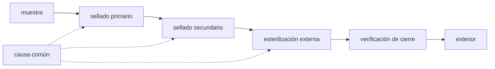

# B63-C04 — Misiones de retorno de muestras: salvaguardas históricas y regulatorias

<!-- nav:top -->
[🏠 Programa](../../../../README.md) · [📚 Bloque B63](../../../tronco-comun/B63-exploracion-in-situ-y-analisis-de-muestras-planetarias.md) · [← Anterior: B63-C03 — Curaduría y cadena de custodia de muestras](../B63-C03-curaduria-y-cadena-de-custodia-de-muestras/CLASE.md) · [Siguiente: B63-C05 — Contención de muestras extraterrestres: instalaciones y principios →](../B63-C05-contencion-de-muestras-extraterrestres-instalaciones-y-principios/CLASE.md)
<!-- /nav -->

## 1. Ubicación, nivel y alcance

Clase 4 del bloque B63. Nivel N3. B56-C18 (según el catálogo, aún sin redactar; ver el [bloque B56](../../../tronco-comun/B56-astrobiologia-y-vida-extraterrestre.md)) trata COSPAR en general; aquí tratas la **arquitectura de retorno de muestras** y sus salvaguardas, con enfoque regulatorio y defensivo. Lees qué exige la política para un retorno «restringido» y modelas, con números **ilustrativos**, cómo se combinan barreras independientes y qué cambia si comparten una causa. No se describen procedimientos biológicos.

## 2. Por qué esta clase existe

Traer material de otro cuerpo exige proteger a la Tierra y a la muestra. La decisión central: **¿cuántas barreras independientes hacen falta, y qué pasa si dejan de ser independientes?**

## 3. Lo que podrás hacer al terminar

1. Explicar las categorías de protección planetaria y qué distingue a la Categoría V restringida.
2. Enumerar las exigencias de contención y las revisiones de un retorno restringido.
3. Explicar qué significa «romper la cadena de contacto».
4. Calcular la probabilidad de fuga de barreras en serie independientes.
5. Calcular cuántas barreras iguales exige una meta y el efecto de una causa común.
6. Distinguir lo que la política exige de lo que es un número ilustrativo de la clase.

La evidencia es la **ficha de salvaguardas de un retorno** del ejercicio 12 (sección 20).

## 4. Con qué llegas y cómo comprobarlo

1. ¿Qué es una probabilidad condicionada?
2. ¿Qué es un producto de probabilidades?
3. ¿Qué es una causa común de fallo?
4. ¿Qué es una política?
5. ¿Qué es un valor ilustrativo?

<details>
<summary>Ver respuestas</summary>

1. La probabilidad de un suceso dado que ocurrió otro. 2. La probabilidad de que ocurran a la vez sucesos independientes. 3. Un evento que puede inutilizar varias barreras a la vez. 4. Un conjunto de requisitos aprobado por una institución. 5. Un valor propuesto para el ejemplo, no un requisito.
</details>

Con cuatro o cinco aciertos, sigue; si no, repasa los prerrequisitos.

## 5. Un caso de contexto y casos de referencia

La política de protección planetaria de COSPAR (S1) clasifica como Categoría V todas las misiones de retorno a la Tierra y distingue «retorno sin restricción» (cuerpos sin vida indígena según la opinión científica; por ejemplo Venus y la Luna, según su lista) de «retorno restringido» (Marte y Europa en su lista; la página de NASA añade Encélado, S2). Para el retorno restringido, la política establece la prohibición absoluta del impacto destructivo al regresar, contención durante todo el regreso del *hardware* que tocó el cuerpo y de toda muestra sin esterilizar, análisis oportunos bajo contención estricta con las técnicas más sensibles, y requisitos que incluyen los de la Categoría IV. Para Marte (§9.2) pide que la salida cumpla la Categoría IVb, que el contenedor esté cerrado con verificación, que la misión «rompa la cadena de contacto» con Marte y que haya revisiones antes del lanzamiento, antes de salir de Marte y antes de comprometer la reentrada. Como contexto histórico, la tripulación del Apolo 11 fue puesta en cuarentena (el titular consultado, S6, dice tres semanas; el cuerpo de esa página no se leyó). Los números de barrera que calculas son **sintéticos**.

## 6. Vocabulario

La **Categoría V** agrupa las misiones de retorno a la Tierra. «**Retorno restringido**» es la subcategoría de mayor preocupación. **Romper la cadena de contacto** es evitar que hardware que tocó el cuerpo regrese sin contención. Una **barrera** es una medida que impide un paso del material; su **probabilidad de fallo** `p` es ilustrativa aquí. Una **causa común** es un evento que falla varias barreras a la vez. El **factor beta** es la fracción de fallo de causa común.

## 7. Modelo mental: varias puertas en un pasillo

Cada barrera es una puerta: para que algo salga, todas deben fallar. Si las puertas son independientes, las probabilidades se multiplican; si comparten una llave (causa común), el producto engaña. Límite: las barreras reales fallan de formas distintas y no son una sola probabilidad.



*Descripción textual:* la muestra atraviesa cuatro barreras en serie hasta el exterior; una causa común puede afectar varias barreras a la vez.

## 8. La explicación, paso a paso

### 8.1 Qué exige la política

Según S1, para el retorno restringido: (1) se prohíbe de forma absoluta el impacto destructivo al regresar; (2) todo el hardware que contactó el cuerpo o material sin esterilizar se contiene durante el regreso; (3) toda muestra sin esterilizar se mantiene contenida; (4) se analiza con prontitud, bajo contención estricta y con las técnicas más sensibles; (5) si se detecta una entidad replicante no terrestre, la muestra permanece contenida salvo esterilización efectiva. Para Marte (§9.2), además: contenedor cerrado con verificación, ruptura de la cadena de contacto y revisiones en tres momentos (antes del lanzamiento, antes de salir de Marte y antes de la reentrada). Y para toda distribución de una muestra sin esterilizar, un programa de detección de vida y de pruebas de peligro biológico, o una esterilización probada, es precondición absoluta. S1 también dice que si la contención se considera comprometida y la esterilización es imposible, la muestra se abandona y la nave no debe volver a la Tierra ni a la Luna.

### 8.2 Barreras en serie

Con barreras independientes de fallo `pᵢ`, la probabilidad de que el material salga es `P = Π pᵢ`. Con las cuatro barreras **sintéticas** `0,01`, `0,02`, `0,05` y `0,10`, `P = 1,000 × 10⁻⁶`. Para barreras iguales de `p = 0,1`, hacen falta 4 para `P ≤ 10⁻⁴` y 6 para `P ≤ 10⁻⁶`. Un Monte Carlo con `2 × 10⁶` repeticiones sobre dos barreras (`0,1` y `0,2`) dio `0,01993` frente a `0,02000` analítico, dentro de los `0,00030` de tres sigmas.

### 8.3 Causa común

Con un factor beta `β`, una fracción del fallo de la barrera más débil afecta a todas:

| β | P_fuga |
|---|---|
| 0,00 | 1,000 × 10⁻⁶ |
| 0,01 | 1,010 × 10⁻⁴ |
| 0,10 | 1,001 × 10⁻³ |

Con `β = 0,01` la fuga es 100 veces mayor; con `β = 0,10`, mil veces. Las barreras dejan de ayudar: el límite es la causa común.

### 8.4 Lectura

Ninguna cifra de la tabla es un requisito de la política: S1 fija **qué** debe cumplirse (contención, verificación, revisiones), no una probabilidad de fuga en la parte consultada. El modelo sirve para razonar por qué la independencia de las barreras, y no solo su número, es lo que importa.

## 9. Magnitudes, símbolos y unidades

| Símbolo | Qué es | Unidad | Valor / nota |
|---|---|---|---|
| `pᵢ` | probabilidad de fallo de la barrera i | — | 0,01; 0,02; 0,05; 0,10 (sintéticas) |
| `P` | probabilidad de fuga | — | 1,000 × 10⁻⁶ |
| `β` | factor de causa común | — | 0; 0,01; 0,10 |
| `n` | número de barreras iguales | — | 4 y 6 para p = 0,1 |

## 10. Convenciones y referencias

Probabilidades por misión, adimensionales; barreras en serie, independientes salvo el caso de causa común. Los números no son requisitos de ninguna política.

## 11. De dónde sale lo que afirmamos

| ID | Fuente | Localizador | Respalda | Consulta | Estado |
|---|---|---|---|---|---|
| S1 | COSPAR, *Policy on Planetary Protection (junio de 2021)* | https://cosparhq.cnes.fr/assets/uploads/2021/07/PPPolicy_2021_3-June.pdf | categorías, Categoría V restringida, §9.2 de Marte, revisiones y abandono de la muestra | 2026-11-09 | PDF completo (14 páginas), texto extraído con PyMuPDF |
| S2 | NASA, Safety and Mission Assurance, *Planetary Protection (categorías I–V)* | https://sma.nasa.gov/sma-disciplines/planetary-protection | categorías I–V y lista de cuerpos restringidos (incluye Encélado) | 2026-11-09 | página web, primeros 100 000 caracteres |
| S6 | Space.com, *titular sobre la cuarentena de los astronautas del Apolo 11* | https://www.space.com/apollo-11-astronauts-quarantined-after-splashdown.html | titular de la cuarentena del Apolo 11 (contexto histórico) | 2026-11-09 | solo el titular (3 semanas); el cuerpo no se leyó |

Límites: S1 se leyó completa en texto; S2 en sus primeros 100 000 caracteres; S6 solo en su titular. No se consultó ninguna norma de diseño de naves ni de instalaciones, y las probabilidades de la clase son sintéticas.

## 12. Cómo ver las salvaguardas de un retorno

| Magnitud | Valor |
|---|---|
| Fuga con 4 barreras independientes | 1,000 × 10⁻⁶ |
| Barreras de p = 0,1 para 10⁻⁶ | 6 |
| Fuga con β = 0,01 | 1,010 × 10⁻⁴ |
| Revisiones en Marte (§9.2) | 3 |

Descripción larga: una cascada de puertas cuya probabilidad de fuga baja un orden de magnitud por barrera, salvo que una causa común las inutilice a la vez.

## 13. Ejemplo trabajado: tres barreras de 10 %

**Paso 1 · Datos.** Tres barreras independientes de `p = 0,1`.

**Paso 2 · Producto.** `P = 0,1³ = 10⁻³`.

**Paso 3 · Meta.** Para `10⁻⁶` hacen falta `ln(10⁻⁶)/ln(0,1) = 6` barreras.

**Paso 4 · Causa común.** Con `β = 0,1` el piso es del orden de `0,1 × p_min`, por más barreras que se agreguen.

## 14. Distintas formas de describir un retorno seguro

**Por política:** requisitos de la Categoría V. **Por probabilidad:** barreras en serie. **Por estructura:** ruptura de la cadena de contacto. **Por proceso:** revisiones antes de comprometer cada fase.

## 15. Práctica guiada

**Ejercicio 1 · con los pasos indicados.** Tres barreras independientes de fallo `0,1`. Calcula la fuga. *Pasos:* multiplica.

<details><summary>Solución comentada</summary>

`10⁻³`.
</details>

**Ejercicio 2 · con una pista.** ¿Cuántas barreras de `p = 0,01` hacen falta para `10⁻⁶`? *Pista:* usa el logaritmo.

<details><summary>Solución comentada</summary>

`ln(10⁻⁶)/ln(10⁻²) = 3`.
</details>

**Ejercicio 3 · casi autónomo.** ¿Es Marte «retorno restringido» o «sin restricción» según S1?

<details><summary>Solución comentada</summary>

Restringido (S1 lista Marte y Europa; S2 añade Encélado).
</details>

## 16. Práctica autónoma, transferencia e integrador

**Ejercicio 4 · autónomo.** Dos barreras de `0,05` cada una: calcula la fuga.

<details><summary>Solución comentada</summary>

`2,5 × 10⁻³`.
</details>

**Ejercicio 5 · autónomo.** Se agrega una barrera de `0,1` a las cuatro del caso. ¿Cuál es la fuga?

<details><summary>Solución comentada</summary>

`10⁻⁶ × 0,1 = 10⁻⁷`.
</details>

**Ejercicio 6 · autónomo.** Con `β = 0,05` y las cuatro barreras sintéticas, estima la fuga.

<details><summary>Solución comentada</summary>

`p_común = 0,05 × 0,01 = 5 × 10⁻⁴`; el término independiente es `≈ 8 × 10⁻⁷`; la fuga es `≈ 5,008 × 10⁻⁴`.
</details>

**Ejercicio 7 · autónomo.** ¿Cuánto crece la fuga al pasar de `β = 0` a `β = 0,10`?

<details><summary>Solución comentada</summary>

De `1,0 × 10⁻⁶` a `1,001 × 10⁻³`: unas 1001 veces.
</details>

**Ejercicio 8 · autónomo.** Enumera las tres revisiones de continuidad del §9.2 de S1.

<details><summary>Solución comentada</summary>

Antes del lanzamiento desde la Tierra, antes de salir de Marte y antes del compromiso con la reentrada.
</details>

**Ejercicio 9 · transferencia.** **Transferencia.** ¿Qué quiere decir «romper la cadena de contacto»?

<details><summary>Solución comentada</summary>

Que ningún hardware que tocó Marte, directa o indirectamente, regrese sin contención: se aísla durante la carga del contenedor, el lanzamiento y las transferencias en vuelo (S1).
</details>

**Ejercicio 10 · transferencia.** **Transferencia.** Tres sellos del mismo material fallan por una misma fatiga térmica. ¿Qué modelo usarías?

<details><summary>Solución comentada</summary>

Un modelo con causa común (factor beta): el producto independiente subestima la fuga.
</details>

**Ejercicio 11 · transferencia.** **Transferencia.** ¿Por qué la salida debe cumplir la Categoría IVb?

<details><summary>Solución comentada</summary>

Para evitar «falsos positivos» en la detección de vida y de peligro de la muestra, que podrían impedir su distribución y endurecer innecesariamente los requisitos futuros (S1).
</details>

**Ejercicio 12 · integrador.** **Integrador.** Elabora tu *ficha de salvaguardas de un retorno*: exigencias de la política con su fuente, tabla de barreras ilustrativas, efecto de `β` y los límites.

<details><summary>Solución comentada</summary>

Secciones 8.1–8.4; la ficha rotula las probabilidades como ilustrativas.
</details>

## 17. Laboratorio: barreras en serie y causa común

El script [barreras.py](barreras.py) calcula la fuga de barreras independientes, la contrasta con Monte Carlo, halla el número de barreras y el efecto de `β` (**comprueba** el producto, 3 sigmas y la recuperación del caso independiente con `β = 0`).

**Datos:** sintéticos e ilustrativos (sección 5); no son requisitos de ninguna política. **Predice antes de ejecutar:** ¿cuánto vale la fuga con las cuatro barreras independientes? (1,000 × 10⁻⁶.) **Ejecución del 2026-11-09 (Python 3.12.9):**

```text
Python 3.12.9 (biblioteca estandar)
Barreras sinteticas (probabilidad de fallo):
  sellado primario         0.01
  sellado secundario       0.02
  esterilizacion externa   0.05
  verificacion de cierre   0.1
P_fuga analitica (independientes) = 1.000e-06
Subconjunto [0.1, 0.2]: analitica = 0.02000, Monte Carlo = 0.01993, 3 sigma = 0.00030
Monte Carlo dentro de 3 sigma.
Barreras iguales de p = 0.1 para P_fuga <= 0.0001: 4
Barreras iguales de p = 0.1 para P_fuga <= 1e-06: 6
Efecto de causa comun (beta-factor) sobre las cuatro barreras:
  beta    P_fuga
  0.00   1.000e-06
  0.01   1.010e-04
  0.10   1.001e-03
Con beta = 0 se recupera el producto independiente. Pruebas superadas.
```

```bash
python programa/clases/B63/B63-C04-misiones-de-retorno-de-muestras-salvaguardas-historicas-y-regulatorias/barreras.py
```

**Límites:** un solo modo de fallo, barreras independientes salvo el bloque beta.

## 18. Errores frecuentes y cómo corregirlos

**Creer que más barreras siempre bajan la fuga.** Con causa común hay un piso. Se corrige con 8.3.

**Tomar las probabilidades como requisitos.** Son ilustrativas. Se corrige con 8.4.

**Confundir «sin restricción» con «sin requisitos».** Aún hay requisitos de salida. Se corrige con 8.1.

**Citar como cierta la cifra de cuarentena del Apolo 11.** Solo se leyó un titular. Se corrige en la sección 11.

## 19. Cómo sabrás que vas bien

Tras la sección 8: ¿qué resultado esperabas y cuál obtuviste? Si dudas, repasa el ejemplo de la sección 13. Tras el laboratorio: ¿qué comprueba cada aserción? (ver la sección 17). Si algo no cuadra, revisa primero las unidades.

## 20. Qué entregas y cómo se evalúa

El producto es tu **ficha de salvaguardas de un retorno** (ejercicio 12).

| Criterio | Inicial | En desarrollo | Logrado | Destacado |
|---|---|---|---|---|
| Conceptos | Los confunde | Parciales | Conceptos de la clase | Explica los límites |
| Cálculo | Sin unidades | Con errores | Tablas completas | Calcula casos nuevos |
| Numérico | Sin comprobar | Un caso | Contraste con el análisis | Interpreta las diferencias |
| Fuentes | Sin fuente | Sin fecha | Fuentes con fecha | Declara lo sintético |
| Límites | No los nombra | Uno | Tres | Discute qué falta del modelo |

**Condiciones críticas (no se compensan con promedio):** rotular lo sintético e ilustrativo; no presentar un modelo como valor observado, regulatorio o de una instalación real; citar solo lo consultado.

## 21. Ética, seguridad y límites

La clase es regulatoria y defensiva: protege a la Tierra y a la muestra, y no describe procedimientos con agentes biológicos. Clase educativa: los modelos son simplificados. Accesibilidad: tablas equivalentes a las gráficas, fórmulas en texto, ejercicios sin conexión.

## 22. Para cerrar y seguir

Cuatro barreras sintéticas independientes dan `10⁻⁶`, pero con un `1 %` de causa común la fuga sube a `1,0 × 10⁻⁴`. Queda una pregunta: ¿cómo se aísla físicamente una muestra una vez que llega?

**Glosario español–inglés.** Categoría V · *Category V*; retorno restringido · *restricted Earth return*; ruptura de la cadena de contacto · *breaking the chain of contact*; barrera · *barrier*; causa común · *common cause*.

**Continuidad.** [B63-C05](../B63-C05-contencion-de-muestras-extraterrestres-instalaciones-y-principios/CLASE.md) estudia la contención de muestras.

**Referencias:** ver sección 11.

<!-- nav:bottom -->
---

[← Anterior: B63-C03 — Curaduría y cadena de custodia de muestras](../B63-C03-curaduria-y-cadena-de-custodia-de-muestras/CLASE.md) · [📚 Bloque B63](../../../tronco-comun/B63-exploracion-in-situ-y-analisis-de-muestras-planetarias.md) · [Siguiente: B63-C05 — Contención de muestras extraterrestres: instalaciones y principios →](../B63-C05-contencion-de-muestras-extraterrestres-instalaciones-y-principios/CLASE.md)
<!-- /nav -->
