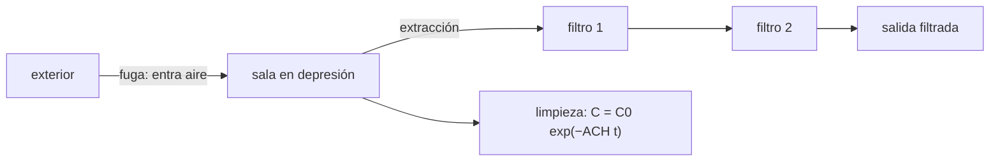

# B63-C05 — Contención de muestras extraterrestres: instalaciones y principios

<!-- nav:top -->
[🏠 Programa](../../../../README.md) · [📚 Bloque B63](../../../tronco-comun/B63-exploracion-in-situ-y-analisis-de-muestras-planetarias.md) · [← Anterior: B63-C04 — Misiones de retorno de muestras: salvaguardas históricas y regulatorias](../B63-C04-misiones-de-retorno-de-muestras-salvaguardas-historicas-y-regulatorias/CLASE.md) · [Siguiente: B63-C06 — Evaluación de riesgos biológicos de muestras: marcos de decisión →](../B63-C06-evaluacion-de-riesgos-biologicos-de-muestras-marcos-de-decision/CLASE.md)
<!-- /nav -->

## 1. Ubicación, nivel y alcance

Clase 5 del bloque B63. Nivel N3. Ninguna clase anterior trata contención de muestras; esta lo hace con **enfoque defensivo** y con principios físicos: una sala en depresión (presión negativa), la renovación de aire y los filtros en serie. Resuelves un balance de aire, un tiempo de limpieza y un caudal de fuga con una sala **sintética**. No se describen procedimientos con agentes biológicos ni se citan normas de bioseguridad, que no se consultaron.

## 2. Por qué esta clase existe

Contener no es un adjetivo: es un conjunto de diferencias de presión, flujos y filtros que se pueden calcular. La decisión central: **¿qué impide que el aire de la sala salga, y cuánto tarda en limpiarse si se contamina?**

## 3. Lo que podrás hacer al terminar

1. Explicar por qué una sala en depresión hace que el aire entre por las fugas y no salga.
2. Calcular el caudal por una fuga con `Q = Cd·A·√(2ΔP/ρ)`.
3. Calcular la concentración remanente y el tiempo de limpieza con `C(t) = C₀ e^(−ACH·t)`.
4. Calcular la reducción logarítmica de filtros en serie.
5. Contrastar un modelo analítico con una integración numérica.
6. Separar lo que cita la política (contención) de lo que es modelo físico de la clase.

La evidencia es la **ficha de principios de contención** del ejercicio 12 (sección 20).

## 4. Con qué llegas y cómo comprobarlo

1. ¿Qué es una diferencia de presión?
2. ¿Qué es una exponencial decreciente?
3. ¿Qué es el logaritmo decimal?
4. ¿Qué es un caudal?
5. ¿Qué es una aproximación de mezcla perfecta?

<details>
<summary>Ver respuestas</summary>

1. La diferencia entre las presiones a ambos lados de una pared. 2. Una función `e^(−kt)` que cae con tasa proporcional a su valor. 3. El exponente de 10 que da un número. 4. El volumen de fluido por unidad de tiempo. 5. Suponer que la concentración es igual en toda la sala.
</details>

Con cuatro o cinco aciertos, sigue; si no, repasa los prerrequisitos.

## 5. Un caso de contexto y casos de referencia

Una sala **sintética** de `60 m³` mantiene una diferencia de presión de `25 Pa` respecto al exterior, tiene una fuga de `1 cm²`, renueva el aire `12` veces por hora y filtra con eficiencia `0,9997` (todo ilustrativo, sin relación con ninguna instalación real). Es el **ejemplo conductor**. Como contexto de política, COSPAR (S1) exige para un retorno restringido que la muestra sin esterilizar permanezca contenida hasta un centro receptor donde pueda abrirse bajo contención, y que se analice con prontitud bajo contención estricta; NASA (S2) resume los mismos requisitos. Ninguna de esas fuentes especifica presiones, renovaciones ni eficiencias, y no se consultó ninguna norma de bioseguridad: estos números son ilustrativos.

## 6. Vocabulario

La **contención** es el conjunto de medidas que impiden que el material salga o entre. La **presión negativa** es una presión interior menor que la exterior. **ACH** es el número de renovaciones de aire por hora. La **mezcla perfecta** supone concentración uniforme. La **eficiencia** `E` de un filtro es la fracción retenida; la **penetración** es `1 − E`. La **reducción logarítmica** `LRV` es `−log₁₀(penetración)`. El **coeficiente de descarga** `Cd` corrige el caudal por una abertura.

## 7. Modelo mental: una habitación con la ventana succionando

Una sala en depresión se comporta como una habitación con un ventilador que extrae aire: todas las rendijas dejan entrar aire, ninguna lo deja salir. Límite: la depresión se mantiene mientras el sistema funcione; si falla el extractor, la protección desaparece, y una puerta abierta rompe el modelo de fuga pequeña.



*Descripción textual:* el aire entra por las fugas hacia la sala, se extrae por dos filtros en serie y la concentración interior decae exponencialmente con las renovaciones.

## 8. La explicación, paso a paso

### 8.1 Una fuga con la sala en depresión

El caudal por una abertura de área `A` con una diferencia de presión `ΔP` es `Q = Cd·A·√(2ΔP/ρ)`. Con `Cd = 0,6`, `A = 10⁻⁴ m²`, `ΔP = 25 Pa` y `ρ = 1,2 kg/m³`, `Q = 3,87 × 10⁻⁴ m³/s = 0,387 L/s` (1,39 m³/h), con una velocidad de entrada de `6,45 m/s`. El sentido es el que importa: **hacia adentro**. Si se cuadruplica `ΔP`, el caudal se duplica (`Q ∝ √ΔP`).

### 8.2 Limpieza por renovación de aire

Con mezcla perfecta, `dC/dt = −ACH·C`, luego `C(t) = C₀ e^(−ACH·t)`. Para reducir la concentración por un factor `R`, `t = ln R / ACH`.

| ACH (1/h) | t para reducir 10⁶ (min) | caudal de aire (m³/h) |
|---|---|---|
| 6 | 138,16 | 360 |
| 12 | 69,08 | 720 |
| 20 | 41,45 | 1200 |

La integración numérica de Euler (paso `0,01 s`) a `0,5 h` con `ACH = 12` dio `2,478504 × 10⁻³` frente al analítico `2,478752 × 10⁻³`: diferencia relativa de `1,0 × 10⁻⁴`.

### 8.3 Filtros en serie

Un filtro de eficiencia `0,9997` deja pasar `3 × 10⁻⁴`: `LRV = 3,5229`. Dos en serie: `LRV = 7,0458` (las LRV se suman).

### 8.4 Lectura

La fuga de `0,387 L/s` es `0,19 %` del caudal de aire de la sala (`0,2 m³/s` con `ACH = 12`): la contención no depende de que no haya fugas, sino de que el aire que atraviesa la envolvente siempre vaya hacia el interior. Y el modelo de mezcla perfecta es optimista: en una sala real hay zonas con aire estancado y el tiempo de limpieza es mayor.

## 9. Magnitudes, símbolos y unidades

| Símbolo | Qué es | Unidad | Valor / nota |
|---|---|---|---|
| `V` | volumen de la sala | m³ | 60 (ilustrativo) |
| `ΔP` | diferencia de presión | Pa | 25 (ilustrativa) |
| `A` | área de fuga | m² | 10⁻⁴ (1 cm²) |
| `Cd` | coeficiente de descarga | — | 0,6 (ilustrativo) |
| `ρ` | densidad del aire | kg/m³ | 1,2 (ilustrativa) |
| `Q` | caudal por la fuga | m³/s | 3,87 × 10⁻⁴ |
| `ACH` | renovaciones de aire | 1/h | 6, 12, 20 |
| `E` | eficiencia del filtro | — | 0,9997 (ilustrativa) |
| `LRV` | reducción logarítmica | — | 3,5229 por filtro |

## 10. Convenciones y referencias

Unidades SI; aire en reposo fuera de la sala; mezcla perfecta; flujo estacionario; partículas que siguen al aire. Los números son ilustrativos y no proceden de ninguna norma.

## 11. De dónde sale lo que afirmamos

| ID | Fuente | Localizador | Respalda | Consulta | Estado |
|---|---|---|---|---|---|
| S1 | COSPAR, *Policy on Planetary Protection (junio de 2021)* | https://cosparhq.cnes.fr/assets/uploads/2021/07/PPPolicy_2021_3-June.pdf | exige que la muestra sin esterilizar permanezca contenida hasta un centro receptor donde se abra bajo contención y que se analice con prontitud bajo contención estricta | 2026-11-09 | PDF completo (14 páginas), texto extraído con PyMuPDF |
| S2 | NASA, Safety and Mission Assurance, *Planetary Protection (categorías I–V)* | https://sma.nasa.gov/sma-disciplines/planetary-protection | resume los requisitos de contención del retorno restringido (Categoría V) | 2026-11-09 | página web, primeros 100 000 caracteres |

Límites: no se consultó ninguna norma de bioseguridad ni el diseño de una instalación de recepción de muestras (no consultado). Las relaciones físicas son estándar y las verifica el laboratorio; los valores de la sala son sintéticos.

## 12. Cómo ver los principios de contención

| Magnitud | Valor |
|---|---|
| Caudal de fuga (ΔP = 25 Pa, 1 cm²) | 0,387 L/s, hacia adentro |
| Tiempo para reducir 10⁶ con ACH = 12 | 69,08 min |
| LRV de un filtro de 0,9997 | 3,5229 |

Descripción larga: una exponencial decreciente de la concentración con la escala de tiempo `1/ACH`, un caudal de fuga que crece como raíz de la presión y filtros cuyas reducciones logarítmicas se suman.

## 13. Ejemplo trabajado: la limpieza con 12 renovaciones por hora

**Paso 1 · Meta.** Reducir `10⁶` veces.

**Paso 2 · Tiempo.** `t = ln(10⁶)/12 = 13,8155/12 = 1,1513 h`.

**Paso 3 · En minutos.** `1,1513 × 60 = 69,08 min`.

**Paso 4 · Comprobación.** `e^(−12 × 1,1513) = e^(−13,8155) = 10⁻⁶`.

## 14. Distintas formas de describir la contención de una sala

**Por presión:** el sentido de la fuga. **Por flujo:** renovaciones de aire. **Por filtración:** LRV. **Por tiempo:** limpieza exponencial.

## 15. Práctica guiada

**Ejercicio 1 · con los pasos indicados.** ¿Cuánto tarda en reducirse la concentración `10³` veces con `ACH = 12`? *Pasos:* `t = ln R/ACH`.

<details><summary>Solución comentada</summary>

`ln 1000/12 = 0,5756 h = 34,5 min`.
</details>

**Ejercicio 2 · con una pista.** ¿Qué LRV tiene un filtro de eficiencia `0,99`? *Pista:* penetración `0,01`.

<details><summary>Solución comentada</summary>

`−log₁₀ 0,01 = 2`.
</details>

**Ejercicio 3 · casi autónomo.** Duplica el área de fuga (`2 cm²`) con `ΔP = 25 Pa`. ¿Cuál es `Q`? *Pasos:* `Q ∝ A`.

<details><summary>Solución comentada</summary>

`0,775 L/s`.
</details>

## 16. Práctica autónoma, transferencia e integrador

**Ejercicio 4 · autónomo.** ¿Qué `ACH` da la limpieza `10⁶` en `30 min`?

<details><summary>Solución comentada</summary>

`ln(10⁶)/0,5 h = 27,6 renovaciones/h`.
</details>

**Ejercicio 5 · autónomo.** ¿Qué fracción queda tras `30 min` con `ACH = 12`?

<details><summary>Solución comentada</summary>

`e^(−6) = 2,479 × 10⁻³`.
</details>

**Ejercicio 6 · autónomo.** Con `ΔP = 100 Pa` y la misma fuga, ¿cuál es `Q`?

<details><summary>Solución comentada</summary>

`Q ∝ √ΔP`: se duplica a `0,775 L/s`.
</details>

**Ejercicio 7 · autónomo.** ¿Cuál es la penetración de dos filtros de `0,9997` en serie?

<details><summary>Solución comentada</summary>

`(3 × 10⁻⁴)² = 9 × 10⁻⁸`.
</details>

**Ejercicio 8 · autónomo.** Compara el caudal de fuga con el caudal de aire de la sala a `ACH = 12`.

<details><summary>Solución comentada</summary>

`3,87 × 10⁻⁴ / 0,2 = 0,0019` (0,19 %).
</details>

**Ejercicio 9 · transferencia.** **Transferencia.** ¿Por qué se prefiere presión negativa para contener, y qué falla si el extractor se detiene?

<details><summary>Solución comentada</summary>

Porque el aire entra por las fugas; si el extractor se detiene, la depresión desaparece y el aire puede salir por las mismas aberturas.
</details>

**Ejercicio 10 · transferencia.** **Transferencia.** El modelo de mezcla perfecta, ¿sobreestima o subestima la rapidez de limpieza en una sala real?

<details><summary>Solución comentada</summary>

La sobreestima: las zonas de aire estancado se limpian más lento, así que el tiempo real es mayor.
</details>

**Ejercicio 11 · transferencia.** **Transferencia.** Proteger a la Tierra (presión negativa) y proteger la muestra de la contaminación terrestre (aire limpio) pueden pedir cosas opuestas. ¿Cómo lo razonarías? *(razonamiento propio, no consultado)*

<details><summary>Solución comentada</summary>

Se separan las funciones por envolventes y flujos: la contención del peligro busca flujo hacia dentro, y la limpieza de la muestra se logra con filtración y trayectorias de aire dentro de la zona contenida; el diseño real exige normas que no se consultaron.
</details>

**Ejercicio 12 · integrador.** **Integrador.** Elabora tu *ficha de principios de contención*: caudal de fuga, tabla de limpieza por ACH, LRV y qué parte es política y cuál es modelo.

<details><summary>Solución comentada</summary>

Secciones 8.1–8.4; la ficha rotula la sala como sintética.
</details>

## 17. Laboratorio: fuga, renovación de aire y filtros

El script [contencion.py](contencion.py) calcula el caudal de fuga, el tiempo de limpieza, contrasta con una integración de Euler y suma las LRV (**comprueba** Euler dentro de 0,1 %, el valor `10⁻⁶` en `t = ln R/ACH` y la escala `√ΔP`).

**Datos:** sintéticos e ilustrativos (sección 5); no corresponden a ninguna instalación. **Predice antes de ejecutar:** ¿cuántos minutos tarda en bajar 10⁶ veces con ACH = 12? (69,08.) **Ejecución del 2026-11-09 (Python 3.12.9):**

```text
Python 3.12.9 (biblioteca estandar)
Sala ilustrativa V = 60.0 m3; filtro E = 0.9997
 ACH [1/h]   t(reduccion 1e6) [min]   caudal de aire [m3/h]
      6.0                 138.16                  360
     12.0                  69.08                  720
     20.0                  41.45                 1200
Euler vs analitico a 0.5 h (ACH = 12): 2.478504e-03 / 2.478752e-03  dif relativa = 1.00e-04
Concentracion tras t = ln(1e6)/ACH = 69.08 min es 1e-6 (comprobado).
LRV de un filtro = 3.5229; en serie (2 filtros) = 7.0458
Fuga de 1 cm2 con dP = 25.0 Pa: aire entrante = 0.387 L/s (1.39 m3/h); velocidad de entrada = 6.45 m/s
Escala Q ~ sqrt(dP) comprobada. Pruebas superadas.
```

```bash
python programa/clases/B63/B63-C05-contencion-de-muestras-extraterrestres-instalaciones-y-principios/contencion.py
```

**Límites:** mezcla perfecta, flujo estacionario y una sola fuga.

## 18. Errores frecuentes y cómo corregirlos

**Creer que contención es «cero fuga».** Es una fuga siempre hacia adentro. Se corrige con 8.4.

**Usar ACH en 1/h con el tiempo en segundos.** Se corrige con la tabla de la sección 9.

**Sumar penetraciones de filtros en serie.** Se multiplican (y las LRV se suman). Se corrige con 8.3.

**Presentar la sala como una instalación real.** Es sintética. Se corrige con la sección 10.

## 19. Cómo sabrás que vas bien

Tras la sección 8: ¿qué resultado esperabas y cuál obtuviste? Si dudas, repasa el ejemplo de la sección 13. Tras el laboratorio: ¿qué comprueba cada aserción? (ver la sección 17). Si algo no cuadra, revisa primero las unidades.

## 20. Qué entregas y cómo se evalúa

El producto es tu **ficha de principios de contención** (ejercicio 12).

| Criterio | Inicial | En desarrollo | Logrado | Destacado |
|---|---|---|---|---|
| Conceptos | Los confunde | Parciales | Conceptos de la clase | Explica los límites |
| Cálculo | Sin unidades | Con errores | Tablas completas | Calcula casos nuevos |
| Numérico | Sin comprobar | Un caso | Contraste con el análisis | Interpreta las diferencias |
| Fuentes | Sin fuente | Sin fecha | Fuentes con fecha | Declara lo sintético |
| Límites | No los nombra | Uno | Tres | Discute qué falta del modelo |

**Condiciones críticas (no se compensan con promedio):** rotular lo sintético e ilustrativo; no presentar un modelo como valor observado, regulatorio o de una instalación real; citar solo lo consultado.

## 21. Ética, seguridad y límites

Enfoque defensivo: se razona sobre aire y filtros, no se describen procedimientos con agentes biológicos ni se atribuyen parámetros a instalaciones reales. Clase educativa: los modelos son simplificados. Accesibilidad: tablas equivalentes a las gráficas, fórmulas en texto, ejercicios sin conexión.

## 22. Para cerrar y seguir

Una sala sintética en depresión deja entrar `0,387 L/s` por una fuga de 1 cm², se limpia `10⁶` veces en `69,08 min` con 12 renovaciones por hora y dos filtros suman `7,05` de LRV. Queda una pregunta: ¿cómo se decide con evidencia si una muestra puede salir de la contención?

**Glosario español–inglés.** contención · *containment*; presión negativa · *negative pressure*; renovaciones de aire por hora · *air changes per hour*; reducción logarítmica · *log reduction value*; coeficiente de descarga · *discharge coefficient*.

**Continuidad.** [B63-C06](../B63-C06-evaluacion-de-riesgos-biologicos-de-muestras-marcos-de-decision/CLASE.md) estudia los marcos de decisión sobre riesgo biológico.

**Referencias:** ver sección 11.

<!-- nav:bottom -->
---

[← Anterior: B63-C04 — Misiones de retorno de muestras: salvaguardas históricas y regulatorias](../B63-C04-misiones-de-retorno-de-muestras-salvaguardas-historicas-y-regulatorias/CLASE.md) · [📚 Bloque B63](../../../tronco-comun/B63-exploracion-in-situ-y-analisis-de-muestras-planetarias.md) · [Siguiente: B63-C06 — Evaluación de riesgos biológicos de muestras: marcos de decisión →](../B63-C06-evaluacion-de-riesgos-biologicos-de-muestras-marcos-de-decision/CLASE.md)
<!-- /nav -->
