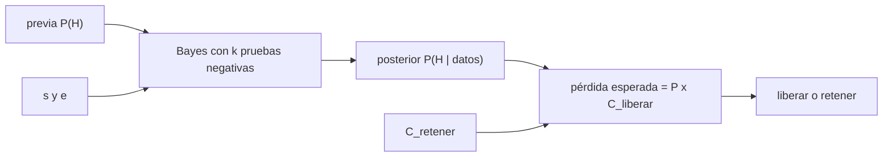

# B63-C06 — Evaluación de riesgos biológicos de muestras: marcos de decisión

<!-- nav:top -->
[🏠 Programa](../../../../README.md) · [📚 Bloque B63](../../../tronco-comun/B63-exploracion-in-situ-y-analisis-de-muestras-planetarias.md) · [← Anterior: B63-C05 — Contención de muestras extraterrestres: instalaciones y principios](../B63-C05-contencion-de-muestras-extraterrestres-instalaciones-y-principios/CLASE.md) · [Siguiente: B64-C01 — Radiotolerancia biológica y reparación del ADN →](../../../tronco-comun/B64-extremofilos-y-limites-de-la-vida.md#b64-c01)
<!-- /nav -->

## 1. Ubicación, nivel y alcance

Clase 6 y última del bloque B63. Nivel N3. Ninguna clase anterior trata los marcos de decisión sobre riesgo biológico de muestras. Aquí construyes, con enfoque defensivo y **datos sintéticos**, un marco bayesiano: cómo se actualiza la probabilidad de que una muestra sea peligrosa tras pruebas negativas y cuándo conviene liberar o retener. No es el protocolo oficial ni una guía de laboratorio.

## 2. Por qué esta clase existe

Ninguna prueba demuestra que no hay peligro; solo reduce la incertidumbre. La decisión central: **¿cuántas pruebas negativas hacen falta antes de que liberar sea preferible a retener, y de qué dependen?**

## 3. Lo que podrás hacer al terminar

1. Aplicar el teorema de Bayes a una prueba con sensibilidad y especificidad conocidas.
2. Actualizar la probabilidad de peligro tras `k` pruebas negativas independientes.
3. Decidir liberar o retener por pérdida esperada.
4. Calcular el `k` mínimo y su sensibilidad a la sensibilidad de la prueba, a la probabilidad previa y a los costos.
5. Contrastar el resultado con una simulación Monte Carlo.
6. Distinguir un modelo didáctico del protocolo oficial y nombrar sus límites.

La evidencia es la **marco de decisión con umbrales** del ejercicio 12 (sección 20).

## 4. Con qué llegas y cómo comprobarlo

1. ¿Qué es la sensibilidad de una prueba?
2. ¿Qué es la especificidad?
3. ¿Qué es una probabilidad previa?
4. ¿Qué es una pérdida esperada?
5. ¿Qué es la independencia condicional?

<details>
<summary>Ver respuestas</summary>

1. La probabilidad de dar positivo cuando el peligro existe. 2. La probabilidad de dar negativo cuando el peligro no existe. 3. La probabilidad antes de ver los datos. 4. La suma de costos ponderados por sus probabilidades. 5. Que, sabido el estado real, un resultado no cambia la probabilidad de otro.
</details>

Con cuatro o cinco aciertos, sigue; si no, repasa los prerrequisitos.

## 5. Un caso de contexto y casos de referencia

Un marco **sintético**: la probabilidad previa de peligro es `10⁻³`, cada prueba tiene sensibilidad `0,90` y especificidad `0,95`, y el costo de retener es `1` frente a `10⁵` de liberar una muestra peligrosa (unidades arbitrarias). Es el **ejemplo conductor**. Como contexto, un equipo conjunto de NASA y ESA propuso un protocolo de evaluación de seguridad de muestras de Marte, publicado por McDonnell y colaboradores en 2026 (S5); lo único leído es el resumen del registro del USGS, que dice que el protocolo tiene tres pasos, que el primero busca determinar si hay microorganismos y el segundo si podrían estar o haber estado vivos recientemente, y que incluye un marco estadístico para decidir si las muestras pueden salir de una contención alta. **No se leyó el artículo**, de modo que nada de lo que sigue es ese protocolo. COSPAR (S1) exige, antes de distribuir una muestra sin esterilizar, un programa de detección de vida y de pruebas de peligro biológico o una esterilización probada.

## 6. Vocabulario

La **probabilidad previa** `P(H)` es la que se tiene antes de las pruebas. La **sensibilidad** `s` es `P(positivo | H)`. La **especificidad** `e` es `P(negativo | no H)`. El **posterior** es `P(H | datos)`. Los **momios** (*odds*) son `P/(1 − P)`. La **pérdida esperada** de una decisión es la suma de costos por probabilidades. La **retención** («hold and review») es mantener la muestra contenida mientras se revisa.

## 7. Modelo mental: apagar un fuego sospechoso con varias comprobaciones

Cada prueba negativa es una comprobación más de que no queda brasa: ninguna da certeza, pero cada una la vuelve menos probable. Límite: si las comprobaciones miran lo mismo, se parecen a una sola; la independencia es un supuesto fuerte.



*Descripción textual:* la probabilidad previa y las características de las pruebas dan, por Bayes, el posterior; este se multiplica por el costo de liberar y se compara con el costo de retener.

## 8. La explicación, paso a paso

### 8.1 Actualización con pruebas negativas

Con `k` negativos independientes dado el estado real:

`P(H | k negativos) = P(H)(1 − s)^k / [P(H)(1 − s)^k + (1 − P(H)) e^k]`.

En forma de momios, cada negativo multiplica los momios por `(1 − s)/e = 0,10/0,95 = 0,1053`. Con la previa `10⁻³`:

| k | P(H dado k negativos) | pérdida esperada de liberar | decisión |
|---|---|---|---|
| 0 | 1,000 × 10⁻³ | 100,000 | retener |
| 1 | 1,054 × 10⁻⁴ | 10,536 | retener |
| 2 | 1,109 × 10⁻⁵ | 1,109 | retener |
| 3 | 1,168 × 10⁻⁶ | 0,117 | liberar |
| 4 | 1,229 × 10⁻⁷ | 0,012 | liberar |
| 5 | 1,294 × 10⁻⁸ | 0,001 | liberar |

### 8.2 El k mínimo

Se libera cuando `P(H | datos) · C_liberar < C_retener`, aquí `P < 10⁻⁵`. Con estos parámetros, `k = 3`. La forma de momios coincide con la fórmula directa a menos de `10⁻¹²`.

### 8.3 Contraste con Monte Carlo y sensibilidad

Con una previa de `0,2` y `k = 2` (para tener estadística) hubo `2 171 420` casos con dos negativos: el posterior analítico es `0,00276` y el simulado `0,00277`, dentro de `3σ = 0,00011`. Y el `k` mínimo depende de la sensibilidad de la prueba:

| s | k mínimo |
|---|---|
| 0,50 | 8 |
| 0,70 | 4 |
| 0,90 | 3 |
| 0,99 | 2 |

### 8.4 Lectura

Las pruebas más sensibles cuestan menos repeticiones. Pero la decisión depende igual de dos cosas que **no** son estadística: la previa, que es una evaluación de conocimiento, y el costo de liberar una muestra peligrosa, que es un valor social. Por eso el marco se publica con sus supuestos y la decisión final la toman los responsables, no el cálculo.

## 9. Magnitudes, símbolos y unidades

| Símbolo | Qué es | Unidad | Valor / nota |
|---|---|---|---|
| `P(H)` | probabilidad previa de peligro | — | 10⁻³ (sintética) |
| `s` | sensibilidad | — | 0,90 (sintética) |
| `e` | especificidad | — | 0,95 (sintética) |
| `k` | pruebas negativas | — | 0–5 |
| `C_ret`, `C_lib` | costos de retener y de liberar con peligro | arbitraria | 1 y 10⁵ |
| `P(H | k)` | posterior | — | ver 8.1 |

## 10. Convenciones y referencias

Probabilidades adimensionales; pruebas condicionalmente independientes; costos en unidades arbitrarias. Todo es sintético y no pertenece al protocolo oficial.

## 11. De dónde sale lo que afirmamos

| ID | Fuente | Localizador | Respalda | Consulta | Estado |
|---|---|---|---|---|---|
| S5 | McDonnell et al., *Mars Sample Return campaign: biological risk and a proposed Sample Safety Assessment Protocol (Appl. Environ. Microbiol., 2026; DOI 10.1128/aem.02461-25)* | https://www.usgs.gov/publications/mars-sample-return-campaign-biological-risk-and-a-proposed-sample-safety-assessment | resumen: protocolo de tres pasos y marco estadístico para salir de contención alta (solo resumen) | 2026-11-09 | solo el resumen del registro del USGS; el artículo no se leyó |
| S1 | COSPAR, *Policy on Planetary Protection (junio de 2021)* | https://cosparhq.cnes.fr/assets/uploads/2021/07/PPPolicy_2021_3-June.pdf | exige detección de vida y pruebas de peligro biológico, o esterilización probada, antes de distribuir una muestra sin esterilizar | 2026-11-09 | PDF completo (14 páginas), texto extraído con PyMuPDF |

Límites: S5 se leyó solo en su resumen; el artículo y su método bayesiano no se leyeron. Ningún parámetro de la clase pertenece a ese protocolo, y no se consultó ningún marco regulatorio de riesgo biológico.

## 12. Cómo ver el marco de decisión

| Magnitud | Valor |
|---|---|
| k mínimo para liberar | 3 |
| Posterior con k = 3 | 1,168 × 10⁻⁶ |
| k mínimo con s = 0,50 | 8 |

Descripción larga: el posterior cae casi un orden de magnitud por cada prueba negativa; el umbral de decisión corta esa caída en `k = 3`.

## 13. Ejemplo trabajado: el posterior con una prueba negativa

**Paso 1 · Numerador.** `10⁻³ × (1 − 0,90) = 1,0 × 10⁻⁴`.

**Paso 2 · Denominador.** `1,0 × 10⁻⁴ + 0,999 × 0,95 = 1,0 × 10⁻⁴ + 0,94905 = 0,94915`.

**Paso 3 · Posterior.** `1,0 × 10⁻⁴ / 0,94915 = 1,054 × 10⁻⁴`.

**Paso 4 · Decisión.** Pérdida de liberar `= 1,054 × 10⁻⁴ × 10⁵ = 10,5 > 1`: se retiene.

## 14. Distintas formas de describir una decisión bajo incertidumbre

**Por probabilidad:** posterior. **Por momios:** producto de factores. **Por pérdida:** valor esperado. **Por simulación:** Monte Carlo con semilla fija.

## 15. Práctica guiada

**Ejercicio 1 · con los pasos indicados.** Calcula `P(H | 1 negativo)` con los parámetros del caso. *Pasos:* aplica la fórmula.

<details><summary>Solución comentada</summary>

`1,054 × 10⁻⁴` (sección 13).
</details>

**Ejercicio 2 · con una pista.** ¿Por qué factor se multiplican los momios con cada negativo? *Pista:* `(1 − s)/e`.

<details><summary>Solución comentada</summary>

`0,10/0,95 = 0,1053`.
</details>

**Ejercicio 3 · casi autónomo.** Si `C_lib = 10³`, ¿cuál es el `k` mínimo? *Pasos:* exige `P·C_lib < 1`.

<details><summary>Solución comentada</summary>

Se necesita `P < 10⁻³`; con `k = 0` `P = 10⁻³` no cumple; con `k = 1` `P = 1,05 × 10⁻⁴` sí: `k = 1`.
</details>

## 16. Práctica autónoma, transferencia e integrador

**Ejercicio 4 · autónomo.** ¿Cuál es la pérdida esperada de liberar con `k = 3`?

<details><summary>Solución comentada</summary>

`1,168 × 10⁻⁶ × 10⁵ = 0,117`.
</details>

**Ejercicio 5 · autónomo.** Con `s = 0,50`, ¿cuántas pruebas hacen falta?

<details><summary>Solución comentada</summary>

`8` (tabla 8.3).
</details>

**Ejercicio 6 · autónomo.** Si la especificidad cae a `0,80`, ¿cambia el `k` mínimo? *(cálculo con `0,125^k < 0,00999`)*

<details><summary>Solución comentada</summary>

No: el factor por negativo es `0,1/0,8 = 0,125` y `k = 3` sigue bastando (`0,125³ = 0,00195 < 0,00999`). La especificidad pesa poco con pruebas negativas.
</details>

**Ejercicio 7 · autónomo.** Con `C_lib = 10⁶`, ¿cuál es el `k` mínimo?

<details><summary>Solución comentada</summary>

Se necesita `P < 10⁻⁶`; `k = 3` da `1,17 × 10⁻⁶` (no basta) y `k = 4`, `1,23 × 10⁻⁷`: `k = 4`.
</details>

**Ejercicio 8 · autónomo.** Con previa `10⁻²` y `C_lib = 10⁵`, ¿cuál es el `k`?

<details><summary>Solución comentada</summary>

Momios `0,0101 × 0,1053^k < 10⁻⁵` exige `k ≥ 4`.
</details>

**Ejercicio 9 · transferencia.** **Transferencia.** Tras `k = 5` negativos, ¿se puede decir que la muestra es segura?

<details><summary>Solución comentada</summary>

No: el posterior es `1,3 × 10⁻⁸`, no cero; la decisión es de riesgo aceptado, no de certeza.
</details>

**Ejercicio 10 · transferencia.** **Transferencia.** Si las pruebas miden casi lo mismo y fallan juntas, ¿qué pasa con el `k` efectivo?

<details><summary>Solución comentada</summary>

Es menor que el número de pruebas: la independencia se pierde y el posterior real es mayor que el calculado.
</details>

**Ejercicio 11 · transferencia.** **Transferencia.** ¿Quién fija `C_lib` y la previa, y por qué no puede fijarlos el cálculo?

<details><summary>Solución comentada</summary>

Los fijan responsables con criterios científicos y sociales; el cálculo solo propaga esos supuestos, que deben publicarse.
</details>

**Ejercicio 12 · integrador.** **Integrador.** Elabora tu *marco de decisión con umbrales*: tabla del posterior, `k` mínimo, sensibilidad a `s` y a los costos, y los límites del modelo.

<details><summary>Solución comentada</summary>

Secciones 8.1–8.4; la ficha rotula todo como sintético y distinto del protocolo oficial.
</details>

## 17. Laboratorio: pruebas negativas y decisión liberar/retener

El script [decision.py](decision.py) calcula el posterior, el `k` mínimo, la sensibilidad a `s` y lo contrasta con Monte Carlo (**comprueba** el umbral, la forma de momios a < 1e-12 y 3 sigmas).

**Datos:** sintéticos e ilustrativos (sección 5); no son parámetros de ningún protocolo oficial. **Predice antes de ejecutar:** ¿cuántas pruebas negativas hacen falta con estos parámetros? (3.) **Ejecución del 2026-11-09 (Python 3.12.9):**

```text
Python 3.12.9 (biblioteca estandar)
Parametros sinteticos: prior = 0.001, sensibilidad = 0.9, especificidad = 0.95, costos retener/liberar-con-peligro = 1/100000
  k   P(H | k negativas)   perdida esperada de liberar   decision
  0            1.000e-03                      100.000   retener
  1            1.054e-04                       10.536   retener
  2            1.109e-05                        1.109   retener
  3            1.168e-06                        0.117   liberar
  4            1.229e-07                        0.012   liberar
  5            1.294e-08                        0.001   liberar
k minimo para liberar con estos costos = 3
Forma de razon de momios (odds) coincide con la formula directa (< 1e-12).
Contraste Monte Carlo (prior 0.2, k = 2, 2171420 casos con 2 negativas): analitico = 0.00276, simulado = 0.00277, 3 sigma = 0.00011
k minimo segun la sensibilidad de cada prueba:
  s = 0.50  ->  k = 8
  s = 0.70  ->  k = 4
  s = 0.90  ->  k = 3
  s = 0.99  ->  k = 2
Pruebas superadas.
```

```bash
python programa/clases/B63/B63-C06-evaluacion-de-riesgos-biologicos-de-muestras-marcos-de-decision/decision.py
```

**Límites:** pruebas independientes, un solo peligro y costos arbitrarios.

## 18. Errores frecuentes y cómo corregirlos

**Leer «negativo» como «seguro».** Solo reduce la probabilidad. Se corrige con 8.1.

**Mezclar la previa con la sensibilidad.** Son cosas distintas. Se corrige con la sección 6.

**Dar por independientes pruebas que miden lo mismo.** Se corrige en el ejercicio 10.

**Atribuir el modelo al protocolo oficial.** Solo se leyó su resumen. Se corrige en la sección 11.

## 19. Cómo sabrás que vas bien

Tras la sección 8: ¿qué resultado esperabas y cuál obtuviste? Si dudas, repasa el ejemplo de la sección 13. Tras el laboratorio: ¿qué comprueba cada aserción? (ver la sección 17). Si algo no cuadra, revisa primero las unidades.

## 20. Qué entregas y cómo se evalúa

El producto es tu **marco de decisión con umbrales** (ejercicio 12).

| Criterio | Inicial | En desarrollo | Logrado | Destacado |
|---|---|---|---|---|
| Conceptos | Los confunde | Parciales | Conceptos de la clase | Explica los límites |
| Cálculo | Sin unidades | Con errores | Tablas completas | Calcula casos nuevos |
| Numérico | Sin comprobar | Un caso | Contraste con el análisis | Interpreta las diferencias |
| Fuentes | Sin fuente | Sin fecha | Fuentes con fecha | Declara lo sintético |
| Límites | No los nombra | Uno | Tres | Discute qué falta del modelo |

**Condiciones críticas (no se compensan con promedio):** rotular lo sintético e ilustrativo; no presentar un modelo como valor observado, regulatorio o de una instalación real; citar solo lo consultado.

## 21. Ética, seguridad y límites

Enfoque defensivo y de decisión: no incluye procedimientos con agentes biológicos. Los umbrales son didácticos y no sirven para decidir sobre muestras reales. Clase educativa: los modelos son simplificados. Accesibilidad: tablas equivalentes a las gráficas, fórmulas en texto, ejercicios sin conexión.

## 22. Para cerrar y seguir

Con previa `10⁻³`, sensibilidad `0,90` y especificidad `0,95`, tres negativos bajan el posterior a `1,17 × 10⁻⁶` y la decisión pasa a liberar; con sensibilidad `0,50` hacen falta ocho. Con esta clase cierra el bloque: del instrumento al muestreo, a la custodia, al retorno, a la contención y a la decisión.

**Glosario español–inglés.** probabilidad previa · *prior*; sensibilidad · *sensitivity*; especificidad · *specificity*; probabilidad posterior · *posterior*; pérdida esperada · *expected loss*.

**Continuidad.** Con [B63-C06](CLASE.md) termina el bloque B63; el siguiente tramo del área A05 sigue en el [programa completo](../../../../PROGRAMA_ACADEMICO_COMPLETO.md).

**Referencias:** ver sección 11.

<!-- nav:bottom -->
---

[← Anterior: B63-C05 — Contención de muestras extraterrestres: instalaciones y principios](../B63-C05-contencion-de-muestras-extraterrestres-instalaciones-y-principios/CLASE.md) · [📚 Bloque B63](../../../tronco-comun/B63-exploracion-in-situ-y-analisis-de-muestras-planetarias.md) · [Siguiente: B64-C01 — Radiotolerancia biológica y reparación del ADN →](../../../tronco-comun/B64-extremofilos-y-limites-de-la-vida.md#b64-c01)
<!-- /nav -->
