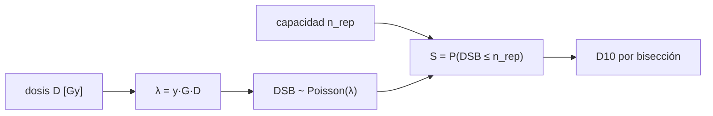

# B64-C01 — Radiotolerancia biológica y reparación del ADN

<!-- nav:top -->
[🏠 Programa](../../../../README.md) · [📚 Bloque B64](../../../tronco-comun/B64-extremofilos-y-limites-de-la-vida.md) · [← Anterior: B63-C06 — Evaluación de riesgos biológicos de muestras: marcos de decisión](../../B63/B63-C06-evaluacion-de-riesgos-biologicos-de-muestras-marcos-de-decision/CLASE.md) · [Siguiente: B64-C02 — Termófilos e hipertermófilos →](../B64-C02-termofilos-e-hipertermofilos/CLASE.md)
<!-- /nav -->

## 1. Ubicación, nivel y alcance

Clase 1 del bloque B64 (área A05). Nivel N3. Retoma la visión general de la radiación sobre la vida de B56-C05 y la profundiza: aquí cuantificas **cuántas roturas de doble cadena (DSB) produce una dosis** y **cuántas puede reparar una célula**. Usas probabilidad básica ([B12](../../../tronco-comun/B12-probabilidad-estadistica-e-incertidumbre.md)). Todos los parámetros del laboratorio son sintéticos.

## 2. Por qué esta clase existe

La radiación ionizante rompe el ADN, y una célula muere cuando el daño supera su capacidad de reparación. La pregunta motivadora: **¿por qué dos organismos con el mismo daño inicial por gray sobreviven a dosis tan distintas?** La decisión central: qué parte de la diferencia se explica por **cuánto daño se produce** y qué parte por **cuánto daño se repara con fidelidad**.

## 3. Lo que podrás hacer al terminar

1. Definir dosis absorbida en gray (J/kg) y convertirla en número medio de DSB por genoma.
2. Modelar el número de DSB como una variable de Poisson.
3. Calcular la supervivencia S(D) como la probabilidad de no superar la capacidad de reparación.
4. Hallar la dosis D10 por bisección y compararla entre organismos.
5. Verificar el modelo con el caso n_rep = 0 y con un Monte Carlo.
6. Nombrar los límites del modelo (tasa de dosis, daño distinto de DSB, fidelidad de la reparación).

La evidencia es la **ficha de la radiotolerancia** del ejercicio 12 (sección 20).

## 4. Con qué llegas y cómo comprobarlo

1. ¿Qué es la media de una variable aleatoria?
2. ¿Qué es una distribución de Poisson?
3. ¿Qué es un gray?
4. ¿Qué es un dato sintético?
5. ¿Qué es una prueba contra un caso analítico?

<details>
<summary>Ver respuestas</summary>

1. El promedio ponderado por probabilidad de sus valores. 2. La del número de sucesos independientes raros en un intervalo, con media λ. 3. Un joule de energía absorbida por kilogramo de materia. 4. Un valor propuesto para el ejemplo, no medido. 5. Comparar un cálculo con una solución exacta conocida.
</details>

Con cuatro o cinco aciertos, sigue; si no, repasa los prerrequisitos.

## 5. Un caso de contexto y casos de referencia

Cox y Battista [S1] resumen que *Deinococcus radiodurans* sobrevive a dosis de radiación ionizante que causan cientos de DSB, porque limita la degradación del ADN y la dispersión de los fragmentos tras la irradiación. Es el **ejemplo conductor** cualitativo. Para calcular, usas dos organismos **sintéticos**: uno *sensible* que repara hasta 2 DSB y uno *tolerante* que repara hasta 150, ambos con un genoma de 3,2 Mpb y un rendimiento de 0,005 DSB por gray y por Mpb. Con esos números, 1 Gy produce 0,016 DSB por genoma. Nada de esto es una medida de una cepa real.

## 6. Vocabulario

La **dosis absorbida** `D` se mide en gray. Una **rotura de doble cadena (DSB)** corta las dos hebras del ADN. El **rendimiento** `y` es el número de DSB por gray y por millón de pares de bases. La **capacidad de reparación** `n_rep` es el máximo de DSB que la célula repara con fidelidad (simplificación del modelo). La **supervivencia** `S(D)` es la fracción de células que lo logra. La **D10** es la dosis con `S = 0,1`.

## 7. Modelo mental

El modelo trata cada genoma irradiado como una urna: la dosis decide cuántos cortes caen, y la reparación decide cuántos puede asumir.



*Descripción textual:* la dosis fija la media λ de roturas; la distribución de Poisson da la probabilidad de cada número de roturas; la supervivencia es la probabilidad acumulada hasta la capacidad de reparación; la D10 se busca invirtiendo esa función.

Analogía: una cuadrilla de reparación que arregla hasta cierto número de averías por noche: si llegan más, la red cae. Límite: las roturas reales no son todas iguales ni independientes, y la reparación tiene errores.

## 8. La explicación, paso a paso

### 8.1 De la dosis al número de roturas

La media de roturas por genoma es `λ = y·G·D`, con `y` en DSB·Gy⁻¹·Mpb⁻¹, `G` en Mpb y `D` en Gy. Con los valores sintéticos, `λ = 0,016·D`. A 100 Gy, `λ = 1,6`; a 1000 Gy, `λ = 16`.

### 8.2 De las roturas a la supervivencia

Si el número de roturas `k` sigue una Poisson de media `λ`, la probabilidad de exactamente `k` es `e^(−λ) λ^k / k!`. La célula sobrevive si `k ≤ n_rep`, de modo que `S(D) = Σ_{k=0}^{n_rep} e^(−λ) λ^k / k!`. Con `n_rep = 0` se reduce a `e^(−λ)`, el caso más simple (sin reparación).

### 8.3 Resultados del laboratorio

| D [Gy] | DSB medio | S sensible (n_rep = 2) | S tolerante (n_rep = 150) |
|---|---|---|---|
| 100 | 1,6 | 0,7834 | 1 |
| 500 | 8,0 | 0,01375 | 1 |
| 1000 | 16,0 | 1,632·10⁻⁵ | 1 |
| 8000 | 128,0 | 2,14·10⁻⁵² | 0,9743 |

La D10 sintética es de 332,6 Gy para el sensible y de 10 434 Gy para el tolerante, un cociente de 31,4. En la D10 el sensible tiene 5,3 DSB de media y el tolerante 166,9: la D10 corresponde a una media de roturas **mayor** que la capacidad de reparación porque la distribución de Poisson tiene dispersión.

### 8.4 Lectura

La tolerancia no exige menos daño: el tolerante recibe 31 veces más roturas a su D10 y aun así sobrevive, en el modelo, porque repara más. Esto concuerda en espíritu con la descripción de [S1] (hay DSB abundantes y la célula los sobrelleva), pero el modelo no explica el mecanismo; solo cuantifica la consecuencia de una capacidad.

## 9. Magnitudes, símbolos y unidades

| Símbolo | Qué es | Unidad | Valor / nota |
|---|---|---|---|
| `D` | dosis absorbida | Gy = J/kg | 10–8000 (ejemplo) |
| `y` | rendimiento de DSB | DSB Gy⁻¹ Mpb⁻¹ | 0,005 (sintético) |
| `G` | tamaño del genoma | Mpb | 3,2 (sintético) |
| `λ` | media de DSB por genoma | adimensional | 0,016·D |
| `n_rep` | capacidad de reparación | DSB | 2 y 150 (sintéticos) |
| `S` | supervivencia | adimensional | 0–1 |

## 10. Convenciones y referencias

Dosis aguda y uniforme; población de células independientes; DSB como único daño letal; logaritmos naturales; D10 con `S = 0,1`. Sistema de referencia: el genoma de una célula del cultivo.

## 11. De dónde sale lo que afirmamos

Fecha de consulta de todas las filas: 2026-11-09.

| ID | Fuente | Localizador | Respalda | Estado |
|---|---|---|---|---|
| S1 | Cox y Battista, «Deinococcus radiodurans — the consummate survivor», *Nat. Rev. Microbiol.* 3(11):882–892, 2005 | DOI 10.1038/nrmicro1264; PMID 16261171 (Europe PMC) | Tolerancia a dosis con cientos de DSB; limitación de la degradación del ADN | Solo resumen |
| S2 | NIST, CODATA 2022 (no se usa en el cálculo de esta clase) | physics.nist.gov/cuu/Constants/Table/allascii.txt | — | No aplica |

Límites: de S1 solo se leyó el resumen; rendimiento, genoma y capacidades son sintéticos; no se consultó ninguna medida de D10 de una cepa real.

## 12. Cómo ver el resultado

| Magnitud | Valor sintético |
|---|---|
| DSB por Gy y por genoma | 0,016 |
| D10 sensible | 332,6 Gy |
| D10 tolerante | 10 434 Gy |
| Cociente de D10 | 31,4 |

Descripción larga: la supervivencia del sensible cae a casi cero antes de 1000 Gy, y la del tolerante permanece en 1 hasta cerca de 5000 Gy.

## 13. Ejemplo trabajado: la supervivencia del sensible a 100 Gy

**Paso 1 · Media.** `λ = 0,005·3,2·100 = 1,6`.

**Paso 2 · Probabilidades.** `P(0) = e^(−1,6) = 0,2019`; `P(1) = 0,2019·1,6 = 0,3230`; `P(2) = 0,3230·1,6/2 = 0,2584`.

**Paso 3 · Suma.** `S = 0,2019 + 0,3230 + 0,2584 = 0,7833`, que el laboratorio da como `0,7834` (el redondeo de los pasos intermedios explica la última cifra).

**Paso 4 · Lectura.** Casi 8 de cada 10 células del sensible sobreviven a 100 Gy en el modelo.

## 14. Distintas formas de describir el mismo fenómeno

**Por fórmula:** la suma de Poisson. **Por simulación:** Monte Carlo con semilla fija, que reproduce la fórmula dentro de 0,01. **Por magnitud resumen:** la D10. **Por dependencia del tamaño:** como `λ` depende del producto `G·D`, duplicar el genoma divide la D10 a la mitad en el modelo.

## 15. Práctica guiada

**Ejercicio 1 · guiado.** Calcula `λ` a 100 Gy con `y = 0,005` y `G = 3,2`. *Pasos:* multiplica los tres factores (sección 8.1).

<details><summary>Solución comentada</summary>

`λ = 0,005·3,2·100 = 1,6` DSB.
</details>

**Ejercicio 2 · guiado.** Con ese `λ`, ¿qué probabilidad hay de cero DSB? *Pista:* usa `e^(−λ)` (sección 8.2).

<details><summary>Solución comentada</summary>

`e^(−1,6) = 0,2019`.
</details>

**Ejercicio 3 · guiado.** Con `n_rep = 2`, suma `P(0)+P(1)+P(2)`. *Casi autónomo:* usa los valores del ejemplo 13.

<details><summary>Solución comentada</summary>

`0,2019 + 0,3230 + 0,2584 = 0,783`, igual a `S(100 Gy)` de la tabla.
</details>

## 16. Práctica autónoma, transferencia e integrador

**Ejercicio 4 · autónomo.** ¿Cuántos DSB de media produce una dosis de 1000 Gy?

<details><summary>Solución comentada</summary>

`λ = 0,016·1000 = 16` DSB.
</details>

**Ejercicio 5 · autónomo.** Calcula el cociente de D10 entre el tolerante y el sensible.

<details><summary>Solución comentada</summary>

`10 434,2/332,6 = 31,4`.
</details>

**Ejercicio 6 · autónomo.** Explica por qué el tolerante tiene `S = 0,9743` y no `0` a 8000 Gy, si el sensible tiene `S ≈ 10⁻⁵²`.

<details><summary>Solución comentada</summary>

A 8000 Gy `λ = 128`, menor que la capacidad 150; la probabilidad de no pasar de 150 es alta. La diferencia viene de `n_rep`, no de menos daño.
</details>

**Ejercicio 7 · autónomo.** Si el genoma fuera de 6,4 Mpb, ¿cuál sería la D10 del sensible?

<details><summary>Solución comentada</summary>

`λ` depende de `G·D`: duplicar `G` divide `D` a la mitad, `332,6/2 = 166,3` Gy.
</details>

**Ejercicio 8 · autónomo.** A 100 Gy, la analítica da 0,7834 y el Monte Carlo 0,7800. ¿Se cumple la tolerancia 0,01?

<details><summary>Solución comentada</summary>

La diferencia es `0,0034 < 0,01`; sí.
</details>

**Ejercicio 9 · transferencia.** **Transferencia.** Un colega afirma que un organismo que sobrevive a 5000 Gy «no sufre daño en el ADN». Respóndele con el modelo.

<details><summary>Solución comentada</summary>

En el modelo, 5000 Gy producen `λ = 80` DSB por genoma; sobrevivir implica reparar (o tolerar) ese daño, no evitarlo. [S1] describe daños abundantes en *D. radiodurans*. El modelo es sintético y no prueba nada sobre ninguna cepa.
</details>

**Ejercicio 10 · transferencia.** **Transferencia.** Propón una extensión que incorpore la tasa de dosis. ¿Qué dato necesitarías?

<details><summary>Solución comentada</summary>

Un modelo con reparación durante la exposición necesita la cinética de reparación (tasa de reparación por DSB) y la tasa de dosis. No está en el laboratorio ni en las fuentes consultadas (no consultado).
</details>

**Ejercicio 11 · transferencia.** **Transferencia.** Quieres usar el modelo para dosis de una misión espacial. ¿Qué falta antes de hacerlo?

<details><summary>Solución comentada</summary>

Dosis reales con su fuente (no consultadas), el tipo de radiación (LET) y su efecto biológico relativo, y datos de la cepa. Con los valores sintéticos no se puede concluir nada sobre una misión.
</details>

**Ejercicio 12 · integrador.** **Integrador.** Elabora tu *ficha de la radiotolerancia*: tabla de S(D) para dos organismos sintéticos con otros valores de `n_rep`, D10 de cada uno, verificación contra `e^(−λ)` y tres límites.

<details><summary>Solución comentada</summary>

Una ficha completa tiene: parámetros rotulados sintéticos; tabla con unidades; D10 por bisección; prueba con `n_rep = 0` y Monte Carlo; y límites (independencia, DSB único daño, dosis aguda).
</details>

## 17. Laboratorio: roturas de doble cadena y dosis D10

El script [radiotolerancia.py](radiotolerancia.py) calcula S(D) y la D10 de los dos organismos, comprueba `n_rep = 0` frente a `e^(−λ)`, un Monte Carlo y un barrido fino (**comprueba** 1e-12, 0,01 y 1 %).

**Datos:** sin constantes físicas; `y`, `G` y `n_rep` **sintéticos**. Semilla `20261109` donde hay aleatoriedad. **Predice antes de ejecutar:** ¿Cuántas veces mayor será la D10 del tolerante? (alrededor de 30.) **Ejecución del 2026-11-09:**

```text
Python 3.12.9 (biblioteca estandar)
Datos SINTETICOS: y = 0.005 DSB/(Gy*Mpb), G = 3.2 Mpb -> 0.0160 DSB por Gy y por genoma
  D [Gy]  DSB medio       sensible (n_rep=2)    tolerante (n_rep=150)
      10        0.2                   0.9994                        1
     100        1.6                   0.7834                        1
     500        8.0                  0.01375                        1
    1000       16.0                1.632e-05                        1
    3000       48.0                1.712e-18                        1
    5000       80.0                5.922e-32                        1
    8000      128.0                 2.14e-52                   0.9743
D10 sensible (n_rep=2): 332.6 Gy ; DSB medio en D10: 5.3
D10 tolerante (n_rep=150): 10434.2 Gy ; DSB medio en D10: 166.9
Prueba D=100 Gy n_rep=2: analitica 0.7834 ; Monte Carlo 0.7800
Prueba D=800 Gy n_rep=10: analitica 0.2693 ; Monte Carlo 0.2702
Prueba D=4000 Gy n_rep=60: analitica 0.3371 ; Monte Carlo 0.3389
Pruebas superadas.
```

```bash
python programa/clases/B64/B64-C01-radiotolerancia-biologica-y-reparacion-del-adn/radiotolerancia.py
```

**Límites:** modelo de Poisson con umbral; no representa la cinética de reparación ni a ninguna cepa.

## 18. Errores frecuentes y cómo corregirlos

**Confundir dosis con daño.** La dosis se mide en gray; el daño es el número de DSB (sección 8.1).

**Pensar que tolerancia es ausencia de daño.** Se corrige con la sección 8.4.

**Usar la media como umbral.** La D10 corresponde a más DSB que la capacidad por la dispersión de Poisson (sección 8.3).

**Presentar los parámetros como medidos.** Se corrige con la sección 5.

## 19. Cómo sabrás que vas bien

Tras la sección 8, ¿qué `S` esperabas a 500 Gy para el sensible y cuál obtuviste? Si dudas, repasa el ejemplo 13. Tras el laboratorio: ¿qué comprueba el script? (ver la sección 17).

## 20. Qué entregas y cómo se evalúa

El producto es tu **ficha de la radiotolerancia** (ejercicio 12).

| Criterio | Inicial | En desarrollo | Logrado | Destacado |
|---|---|---|---|---|
| Conceptos | Los confunde | Parciales | Define y usa los conceptos de la clase | Explica sus límites |
| Cálculo | Sin unidades | Con errores | Tablas completas con unidades | Calcula casos nuevos |
| Numérico | Sin comprobar | Un caso | Contraste con la vía independiente | Interpreta las diferencias |
| Fuentes | Sin fuente | Sin fecha | Fuentes con fecha y estado | Declara lo sintético y lo no consultado |
| Límites | No los nombra | Uno | Tres | Discute qué falta del modelo |

**Condiciones críticas (no se compensan con promedio):** rotular como sintéticos los datos del laboratorio; no presentar lo simulado como observado; no atribuir los parámetros sintéticos a ninguna cepa; citar solo lo consultado.

## 21. Ética, seguridad y límites

Clase educativa. No se manipulan organismos ni fuentes de radiación; los valores son sintéticos y no sirven para evaluar riesgos de dosis reales. Las dosis de trabajo con radiación requieren formación y normas locales. Accesibilidad: tablas equivalentes a las gráficas, fórmulas en texto, ejercicios sin conexión.

## 22. Para cerrar y seguir

La supervivencia del modelo depende de dos cosas: cuántas roturas llegan (`λ`) y cuántas se reparan (`n_rep`). El tolerante sintético aguanta 31 veces más dosis por reparar más, no por sufrir menos. Queda una pregunta: ¿cómo cambia el límite del **calor**, donde el daño es a las proteínas y a las membranas?

**Glosario español–inglés.** rotura de doble cadena · *double-strand break*; dosis absorbida · *absorbed dose*; capacidad de reparación · *repair capacity*; radiotolerancia · *radiation tolerance*; supervivencia · *survival*.

**Continuidad.** [B64-C02](../B64-C02-termofilos-e-hipertermofilos/CLASE.md) estudia termófilos e hipertermófilos.

**Referencias:** ver sección 11.

<!-- nav:bottom -->
---

[← Anterior: B63-C06 — Evaluación de riesgos biológicos de muestras: marcos de decisión](../../B63/B63-C06-evaluacion-de-riesgos-biologicos-de-muestras-marcos-de-decision/CLASE.md) · [📚 Bloque B64](../../../tronco-comun/B64-extremofilos-y-limites-de-la-vida.md) · [Siguiente: B64-C02 — Termófilos e hipertermófilos →](../B64-C02-termofilos-e-hipertermofilos/CLASE.md)
<!-- /nav -->
