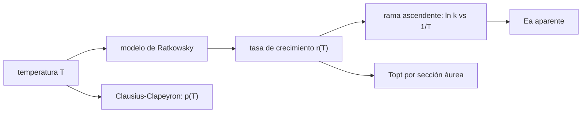

# B64-C02 — Termófilos e hipertermófilos

<!-- nav:top -->
[🏠 Programa](../../../../README.md) · [📚 Bloque B64](../../../tronco-comun/B64-extremofilos-y-limites-de-la-vida.md) · [← Anterior: B64-C01 — Radiotolerancia biológica y reparación del ADN](../B64-C01-radiotolerancia-biologica-y-reparacion-del-adn/CLASE.md) · [Siguiente: B64-C03 — Psicrófilos y vida en frío →](../B64-C03-psicrofilos-y-vida-en-frio/CLASE.md)
<!-- /nav -->

## 1. Ubicación, nivel y alcance

Clase 2 del bloque B64 (área A05). Nivel N3. Describes cómo crece un microorganismo en función de la temperatura, cómo se estima una **energía de activación aparente** de la rama ascendente y qué **presión** hace falta para mantener agua líquida por encima de 100 °C. Usas la ecuación de Arrhenius y un método numérico sencillo. Todos los datos del laboratorio son sintéticos.

## 2. Por qué esta clase existe

Un hipertermófilo crece donde casi todo lo demás muere, pero el agua hierve a 100 °C a presión ambiente. La pregunta motivadora: **¿qué fija el límite superior de temperatura de la vida y cómo se mide ese límite?** La decisión central: ajustar una curva con tres temperaturas cardinales (mínima, óptima, máxima) y distinguir lo que describe el crecimiento de lo que exige el medio (presión).

## 3. Lo que podrás hacer al terminar

1. Definir las temperaturas cardinales y los intervalos térmicos de termófilos e hipertermófilos.
2. Generar y leer una curva de crecimiento con el modelo cardinal de Ratkowsky.
3. Estimar una energía de activación aparente con un ajuste lineal de ln k frente a 1/T.
4. Hallar la temperatura óptima por sección áurea y contrastarla con un barrido.
5. Calcular la presión de saturación del agua entre 100 y 121 °C con Clausius–Clapeyron y verificarla por integración numérica.
6. Nombrar los límites del modelo (extrapolación, calor de vaporización constante).

La evidencia es la **ficha de la curva térmica** del ejercicio 12 (sección 20).

## 4. Con qué llegas y cómo comprobarlo

1. ¿Qué es una energía de activación?
2. ¿Cómo se convierte °C en K?
3. ¿Qué es un ajuste por mínimos cuadrados?
4. ¿Qué es una ecuación diferencial ordinaria?
5. ¿Qué es un dato sintético?

<details>
<summary>Ver respuestas</summary>

1. La barrera energética de una reacción en la ecuación de Arrhenius. 2. Sumando 273,15. 3. Elegir los parámetros que minimizan la suma de los cuadrados de los residuos. 4. Una relación entre una función y su derivada. 5. Un valor propuesto para el ejemplo, no medido.
</details>

Con cuatro o cinco aciertos, sigue; si no, repasa los prerrequisitos.

## 5. Un caso de contexto y casos de referencia

Bloechl y colaboradores [S1] describen *Pyrolobus fumarii*, una arquea aislada de una chimenea hidrotermal profunda, que crece entre 90 y 113 °C con un óptimo cerca de 106 °C. De Kashefi y Lovley [S2] solo se verificó el registro bibliográfico («Extending the upper temperature limit for life», *Science*, 2003); su resumen no se obtuvo, por lo que sus cifras no se usan. Para calcular, usas un organismo **hipotético y sintético** con `T_min = 60 °C`, `T_max = 112 °C` y parámetros de forma `b = 0,045` y `c = 0,30 K⁻¹`. Es el **ejemplo conductor**; no es *Pyrolobus*.

## 6. Vocabulario

Las **temperaturas cardinales** son la mínima, la óptima y la máxima de crecimiento. Un **termófilo** tiene óptimo moderadamente alto y un **hipertermófilo** muy alto (los intervalos exactos varían por autor; aquí no se fijan). La **energía de activación aparente** `Eₐ` se obtiene de la pendiente de `ln k` frente a `1/T`. La **presión de saturación** `p` es la presión a la que el agua líquida y su vapor coexisten a una temperatura dada.

## 7. Modelo mental

La tasa de crecimiento sube con la temperatura como una reacción química, hasta que las proteínas y las membranas fallan y cae a cero de golpe.



*Descripción textual:* la temperatura entra en un modelo cardinal que da la tasa; de la rama ascendente sale la energía de activación aparente, del máximo la temperatura óptima, y por separado la temperatura fija la presión de saturación que exige el medio.

Analogía: un motor que acelera con la temperatura hasta recalentarse y detenerse. Límite: el motor no se repara; la célula sí se adapta en la evolución.

## 8. La explicación, paso a paso

### 8.1 La curva

El modelo es `√r = b (T − T_min)(1 − e^{c (T − T_max)})` para `T_min < T < T_max` y `r = 0` fuera, con `T` en °C, `r` en h⁻¹ y `b`, `c` ilustrativos. Con los valores sintéticos, la tasa máxima es `3,2590 h⁻¹` a `T_opt = 103,2 °C`, es decir, un tiempo de duplicación de `0,21 h`; a 100 °C la tasa es `3,065 h⁻¹` y la duplicación `0,23 h`.

### 8.2 Energía de activación aparente

En la rama ascendente (62–94,5 °C, 14 puntos con ruido gaussiano del 1 %), el ajuste de `ln k` frente a `1/T` da una pendiente `−Eₐ/R`. Dos vías independientes (mínimos cuadrados cerrados y descenso de gradiente) dan `151,7 kJ/mol`; el modelo sin ruido da `152,1 kJ/mol`. Es una energía **aparente** porque combina varios pasos y la curva ya se curva por la proximidad del máximo.

### 8.3 Presión para agua líquida

Con `d ln p/dT = ΔH_vap/(R T²)` y `ΔH_vap = 40,66 kJ/mol` constante (aproximación), `p = p₀ exp[−ΔH/R (1/T − 1/T₀)]` con `p₀ = 101 325 Pa` a `373,15 K`. El laboratorio integra la ecuación diferencial con RK4 y reproduce la forma cerrada a menos de `10⁻⁶`:

| T [°C] | p [kPa] |
|---|---|
| 100 | 101,33 |
| 105 | 120,50 |
| 113 | 157,52 |
| 121 | 203,69 |

### 8.4 Lectura

Cultivar a 121 °C exige unos 204 kPa (2,0 atm) en esta aproximación. Una tabla de vapor real daría valores algo distintos porque `ΔH_vap` baja con la temperatura; la cifra es una estimación de orden de magnitud.

## 9. Magnitudes, símbolos y unidades

| Símbolo | Qué es | Unidad | Valor / nota |
|---|---|---|---|
| `T` | temperatura | °C (K en Arrhenius) | 60–121 |
| `r` | tasa de crecimiento | h⁻¹ | 0–3,26 (sintético) |
| `Eₐ` | energía de activación aparente | kJ/mol | ≈152 (sintético) |
| `R` | constante molar de los gases | J mol⁻¹ K⁻¹ | 8,314462618 (CODATA 2022) |
| `ΔH_vap` | entalpía de vaporización | kJ/mol | 40,66 (ilustrativo, constante) |
| `p` | presión de saturación | kPa | 101–204 |

## 10. Convenciones y referencias

Temperaturas en °C para la curva y en K en Arrhenius; `T[K] = T[°C] + 273,15`; logaritmos naturales; tiempo de duplicación `ln 2 / r`. Sistema de referencia: cultivo en fase exponencial balanceada.

## 11. De dónde sale lo que afirmamos

Fecha de consulta de todas las filas: 2026-11-09.

| ID | Fuente | Localizador | Respalda | Estado |
|---|---|---|---|---|
| S1 | Bloechl, Rachel, Burggraf, Hafenbradl, Jannasch, Stetter, «Pyrolobus fumarii…», *Extremophiles* 1(1):14–21, 1997 | DOI 10.1007/s007920050010; PMID 9680332 (Europe PMC) | Crecimiento de 90 a 113 °C con óptimo cerca de 106 °C | Solo resumen |
| S2 | Kashefi y Lovley, «Extending the upper temperature limit for life», *Science* 301(5635):934, 2003 | DOI 10.1126/science.1086823; PMID 12920290 (Europe PMC) | Solo la existencia del trabajo | Solo registro; resumen no obtenido; sus cifras no se usan |
| S3 | NIST, CODATA 2022 | physics.nist.gov/cuu/Constants/Table/allascii.txt | R = 8,314462618 J mol⁻¹ K⁻¹ (exacto) | Consultada |

Límites: ΔH_vap = 40,66 kJ/mol no se consultó (valor ilustrativo); ninguna cifra de la curva es de un organismo real; no se consultó la presión de vapor tabulada.

## 12. Cómo ver el resultado

| Magnitud | Valor sintético |
|---|---|
| `T_opt` | 103,2 °C |
| Tasa máxima | 3,259 h⁻¹ |
| Duplicación en `T_opt` | 0,21 h |
| `Eₐ` aparente | 151,7 kJ/mol |
| p a 121 °C | 203,7 kPa |

Descripción larga: la tasa sube de forma casi exponencial entre 62 y 95 °C, alcanza el máximo cerca de 103 °C y cae a cero antes de 112 °C.

## 13. Ejemplo trabajado: la presión a 113 °C

**Paso 1 · Temperatura.** `T = 113 + 273,15 = 386,15 K`.

**Paso 2 · Exponente.** `ΔH/R = 40 660/8,314463 = 4890,4 K`; `1/T − 1/T₀ = 1/386,15 − 1/373,15 = −9,022·10⁻⁵ K⁻¹`.

**Paso 3 · Cociente.** `p/p₀ = exp(4890,4·9,022·10⁻⁵) = exp(0,4412) = 1,555`.

**Paso 4 · Resultado.** `p = 1,555·101,325 = 157,5 kPa`, igual a la tabla del laboratorio.

## 14. Distintas formas de describir el mismo fenómeno

**Por modelo cardinal:** forma completa con máximo. **Por Arrhenius:** solo la rama ascendente. **Por Clausius–Clapeyron:** el medio, no el organismo. **Por simulación:** RK4 de la ecuación diferencial frente a la forma cerrada.

## 15. Práctica guiada

**Ejercicio 1 · guiado.** Convierte 94,5 °C a kelvin y calcula `1/T`. *Pasos:* suma 273,15 y divide (sección 8.2).

<details><summary>Solución comentada</summary>

`T = 367,65 K`; `1/T = 2,720·10⁻³ K⁻¹`.
</details>

**Ejercicio 2 · guiado.** Con una tasa de 3,259 h⁻¹, ¿cuál es el tiempo de duplicación? *Pista:* `ln 2 / r`.

<details><summary>Solución comentada</summary>

`0,6931/3,259 = 0,213 h`, unos 13 minutos.
</details>

**Ejercicio 3 · guiado.** La pendiente de `ln k` frente a `1/T` vale `−Eₐ/R`. Calcula la pendiente para `Eₐ = 151,7 kJ/mol`. *Casi autónomo.*

<details><summary>Solución comentada</summary>

`−151 700/8,3145 = −18 246 K`.
</details>

## 16. Práctica autónoma, transferencia e integrador

**Ejercicio 4 · autónomo.** Calcula el ancho de la ventana de crecimiento `T_max − T_min`.

<details><summary>Solución comentada</summary>

`112 − 60 = 52 K`.
</details>

**Ejercicio 5 · autónomo.** ¿En qué fracción de la ventana, medida desde `T_min`, está el óptimo?

<details><summary>Solución comentada</summary>

`(103,2 − 60)/52 = 0,83`: el óptimo está muy cerca del máximo, rasgo típico de estas curvas.
</details>

**Ejercicio 6 · autónomo.** Calcula el cociente de presiones entre 121 °C y 100 °C.

<details><summary>Solución comentada</summary>

`203,69/101,33 = 2,01`.
</details>

**Ejercicio 7 · autónomo.** Compara la tasa a 100 °C con la tasa máxima.

<details><summary>Solución comentada</summary>

`3,065/3,259 = 0,94`; a 100 °C el organismo crece al 94 % de su máximo.
</details>

**Ejercicio 8 · autónomo.** Explica por qué la sección 8.3 es solo un orden de magnitud.

<details><summary>Solución comentada</summary>

Porque `ΔH_vap` se tomó constante y se sabe que disminuye con la temperatura; no se consultó una tabla de vapor.
</details>

**Ejercicio 9 · transferencia.** **Transferencia.** Un colega extrapola el modelo a 125 °C. ¿Qué responde el modelo y qué opinas?

<details><summary>Solución comentada</summary>

El modelo da `r = 0` por construcción sobre `T_max`; no es una predicción sino un límite impuesto. Ningún dato de este laboratorio es medición.
</details>

**Ejercicio 10 · transferencia.** **Transferencia.** La energía aparente (≈152 kJ/mol) difiere de la de 110 kJ de la clase C03. ¿Es una contradicción?

<details><summary>Solución comentada</summary>

No: son magnitudes distintas (rama ascendente de un hipertermófilo sintético frente a un parámetro de escalado de metabolismo en frío). Comparar requiere el mismo proceso y los mismos datos.
</details>

**Ejercicio 11 · transferencia.** **Transferencia.** En un sistema hidrotermal bajo 2000 m de agua, ¿se necesita presión extra para el agua a 121 °C? Usa `ρ = 1000 kg/m³` y `g = 9,81 m/s²` (ilustrativos).

<details><summary>Solución comentada</summary>

`p = ρ g h = 19,6 MPa`, mucho mayor que 0,2 MPa: el agua permanece líquida. Es un cálculo sintético, sin salinidad ni temperatura real.
</details>

**Ejercicio 12 · integrador.** **Integrador.** Elabora tu *ficha de la curva térmica*: parámetros cardinales sintéticos, `Eₐ` de la rama ascendente por dos vías, `T_opt` por dos vías, la presión a 121 °C y tres límites.

<details><summary>Solución comentada</summary>

Debe incluir tablas con unidades, las pruebas (`Eₐ` a 3 %, `T_opt` a 0,05 K, RK4 a 10⁻⁶) y la declaración de que los datos son sintéticos.
</details>

## 17. Laboratorio: curva térmica, energía de activación aparente y presión de vapor

El script [termofilos.py](termofilos.py) genera datos sintéticos con ruido, ajusta `Eₐ` por dos vías, halla `T_opt` por sección áurea y barrido, e integra Clausius–Clapeyron con RK4 (**comprueba** 3 %, 0,05 K y 1e-6).

**Datos:** `R` de CODATA 2022 (consultada el 2026-11-09); curva y ruido **sintéticos**; `ΔH_vap` ilustrativo. Semilla `20261109` donde hay aleatoriedad. **Predice antes de ejecutar:** ¿Será la presión a 121 °C cercana a 2 atm? (sí, 203,7 kPa.) **Ejecución del 2026-11-09:**

```text
Python 3.12.9 (biblioteca estandar)
Datos SINTETICOS: Tmin=60.0 C, Tmax=112.0 C, b=0.045, c=0.3
Ea aparente (rama 62-94.5 C): minimos cuadrados cerrados 151.7 kJ/mol ; descenso de gradiente 151.7 kJ/mol
Ea aparente del modelo sin ruido: 152.1 kJ/mol (el ruido del 1 % la perturba poco)
Topt: seccion aurea 103.212 C ; barrido fino 103.21 C ; tasa maxima 3.2590 1/h
Tiempo de duplicacion en Topt: 0.21 h ; a 100 C: 0.23 h
  T [C]  p cerrada [kPa]  p RK4 [kPa]
  100.0           101.33       101.33
  105.0           120.50       120.50
  113.0           157.52       157.52
  121.0           203.69       203.69
Pruebas superadas.
```

```bash
python programa/clases/B64/B64-C02-termofilos-e-hipertermofilos/termofilos.py
```

**Límites:** Arrhenius solo en la rama ascendente; `ΔH_vap` constante; sin lisis ni adaptación.

## 18. Errores frecuentes y cómo corregirlos

**Leer la energía aparente como la de una enzima.** Es una cantidad global (sección 8.2).

**Extrapolar fuera de `T_min`–`T_max`.** Se corrige con el ejercicio 9.

**Olvidar la presión.** Sobre 100 °C el medio líquido exige presión (sección 8.3).

**Presentar el organismo sintético como *Pyrolobus*.** Se corrige con la sección 5.

## 19. Cómo sabrás que vas bien

Tras la sección 8.1, ¿qué tasa esperabas a 100 °C y cuál obtuviste? Si dudas, repasa el ejemplo 13. Tras el laboratorio: ¿qué comprueba el script? (ver la sección 17).

## 20. Qué entregas y cómo se evalúa

El producto es tu **ficha de la curva térmica** (ejercicio 12).

| Criterio | Inicial | En desarrollo | Logrado | Destacado |
|---|---|---|---|---|
| Conceptos | Los confunde | Parciales | Define y usa los conceptos de la clase | Explica sus límites |
| Cálculo | Sin unidades | Con errores | Tablas completas con unidades | Calcula casos nuevos |
| Numérico | Sin comprobar | Un caso | Contraste con la vía independiente | Interpreta las diferencias |
| Fuentes | Sin fuente | Sin fecha | Fuentes con fecha y estado | Declara lo sintético y lo no consultado |
| Límites | No los nombra | Uno | Tres | Discute qué falta del modelo |

**Condiciones críticas (no se compensan con promedio):** rotular como sintéticos los datos del laboratorio; no presentar lo simulado como observado; no atribuir la curva sintética a ningún organismo real; citar solo lo consultado.

## 21. Ética, seguridad y límites

Clase educativa. Los cultivos a más de 100 °C se hacen en recipientes a presión; no se dan instrucciones de operación y requieren formación y equipo certificado. Los valores son sintéticos. Accesibilidad: tablas equivalentes a las gráficas, fórmulas en texto, ejercicios sin conexión.

## 22. Para cerrar y seguir

Una curva cardinal resume el crecimiento; Arrhenius explica la subida, y la presión del medio fija lo que el agua líquida permite. El hipertermófilo sintético llega a 103 °C y exige unos 2 atm a 121 °C. Queda una pregunta: ¿qué pasa en el otro extremo, donde el frío frena la química?

**Glosario español–inglés.** termófilo · *thermophile*; hipertermófilo · *hyperthermophile*; temperatura cardinal · *cardinal temperature*; energía de activación · *activation energy*; presión de saturación · *saturation pressure*.

**Continuidad.** [B64-C03](../B64-C03-psicrofilos-y-vida-en-frio/CLASE.md) estudia los psicrófilos.

**Referencias:** ver sección 11.

<!-- nav:bottom -->
---

[← Anterior: B64-C01 — Radiotolerancia biológica y reparación del ADN](../B64-C01-radiotolerancia-biologica-y-reparacion-del-adn/CLASE.md) · [📚 Bloque B64](../../../tronco-comun/B64-extremofilos-y-limites-de-la-vida.md) · [Siguiente: B64-C03 — Psicrófilos y vida en frío →](../B64-C03-psicrofilos-y-vida-en-frio/CLASE.md)
<!-- /nav -->
