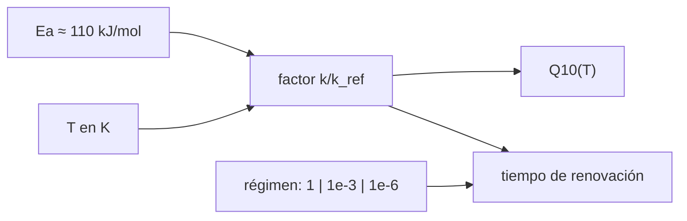

# B64-C03 — Psicrófilos y vida en frío

<!-- nav:top -->
[🏠 Programa](../../../../README.md) · [📚 Bloque B64](../../../tronco-comun/B64-extremofilos-y-limites-de-la-vida.md) · [← Anterior: B64-C02 — Termófilos e hipertermófilos](../B64-C02-termofilos-e-hipertermofilos/CLASE.md) · [Siguiente: B64-C04 — Halófilos y vida en salmueras →](../B64-C04-halofilos-y-vida-en-salmueras/CLASE.md)
<!-- /nav -->

## 1. Ubicación, nivel y alcance

Clase 3 del bloque B64 (área A05). Nivel N3. Aprendes a **escalar una tasa metabólica con la temperatura** hasta valores bajo cero y a leer el resultado como un orden de magnitud. Usas la ecuación de Arrhenius vista en B64-C02. Todos los datos del laboratorio son sintéticos; el parámetro central proviene del resumen de un artículo consultado.

## 2. Por qué esta clase existe

El frío no detiene la vida de golpe: la ralentiza. La pregunta motivadora: **¿cuánto más lento es el metabolismo a −40 °C que a 25 °C, y qué significa «vivir» a esa velocidad?** La decisión central: tratar el escalado con una sola energía de activación como hipótesis de trabajo, no como ley.

## 3. Lo que podrás hacer al terminar

1. Calcular el factor de Arrhenius entre dos temperaturas con la energía de activación.
2. Obtener Q10 y explicar por qué crece al bajar la temperatura.
3. Recuperar `Eₐ` de datos sintéticos con ruido.
4. Convertir un factor de lentitud en un tiempo de renovación.
5. Distinguir crecimiento, mantenimiento y supervivencia con la razón 10⁶ : 10³ : 1 del resumen consultado.
6. Nombrar los límites del escalado (membranas, agua líquida, daño acumulado).

La evidencia es la **ficha del escalado en frío** del ejercicio 12 (sección 20).

## 4. Con qué llegas y cómo comprobarlo

1. ¿Qué es la ecuación de Arrhenius?
2. ¿Qué es Q10?
3. ¿Qué es un logaritmo natural?
4. ¿Qué es una razón de 10⁶ : 10³ : 1?
5. ¿Qué es un dato sintético?

<details>
<summary>Ver respuestas</summary>

1. Una relación exponencial entre la tasa y 1/T con una energía de activación. 2. El factor por el que cambia una tasa al subir 10 K. 3. La función inversa de la exponencial de base e. 4. Tres cantidades que se escalan por factores de mil. 5. Un valor propuesto para el ejemplo, no medido.
</details>

Con cuatro o cinco aciertos, sigue; si no, repasa los prerrequisitos.

## 5. Un caso de contexto y casos de referencia

Price y Sowers [S1] compararon tasas metabólicas de microbios en muchos ambientes fríos y no hallaron una temperatura mínima de metabolismo; según su resumen, crecimiento, mantenimiento y supervivencia siguen una misma energía de activación de unos 110 kJ y se escalan aproximadamente como 10⁶ : 10³ : 1. Esa cifra de 110 kJ es el **parámetro** del ejemplo conductor; las tasas absolutas son sintéticas. Rodrigues y Tiedje [S2] se verificaron solo como registro bibliográfico («Coping with our cold planet», 2008); su resumen no se obtuvo.

## 6. Vocabulario

Un **psicrófilo** crece mejor a temperaturas bajas; la clasificación exacta por intervalo varía y aquí no se fija. La **energía de activación** `Eₐ` es la barrera de la ecuación de Arrhenius. **Q10** es `k(T+10)/k(T)`. Un **tiempo de renovación** es lo que tarda en renovarse una unidad de carbono celular. **Crecimiento, mantenimiento y supervivencia** son tres regímenes de actividad.

## 7. Modelo mental

La tasa depende de la temperatura de forma exponencial en `1/T`: cada grado de frío cuesta más que el anterior en términos relativos.



*Descripción textual:* la energía de activación y la temperatura dan el factor de Arrhenius; de él salen el Q10 y, combinado con el régimen de actividad, el tiempo de renovación.

Analogía: un deshielo lento: mientras más frío, más tarda cada paso. Límite: el agua líquida de las salmueras y la estructura de las membranas pueden cambiar el comportamiento.

## 8. La explicación, paso a paso

### 8.1 El factor

`k(T)/k_ref = exp[−(Eₐ/R)(1/T − 1/T_ref)]`, con `T` en K, `T_ref = 298,15 K`, `Eₐ = 110 kJ/mol` y `R = 8,314462618 J mol⁻¹ K⁻¹` [S3]. La razón `Eₐ/R` vale `13 230 K`.

### 8.2 Resultados del laboratorio

| T [°C] | k/k(25 °C) | Q10 | factor de lentitud |
|---|---|---|---|
| 25 | 1 | 4,22 | 1 |
| 4 | 3,466·10⁻² | 5,27 | 28,9 |
| 0 | 1,723·10⁻² | 5,53 | 58,1 |
| −10 | 2,734·10⁻³ | 6,30 | 366 |
| −20 | 3,753·10⁻⁴ | 7,29 | 2665 |
| −40 | 4,240·10⁻⁶ | 10,32 | 2,36·10⁵ |

### 8.3 Recuperar la energía

Con 10 temperaturas entre −40 y 25 °C y ruido gaussiano de `σ(ln k) = 0,05`, el ajuste lineal de `ln k` frente a `1/T` recupera `110,0 kJ/mol` (tolerancia 2 %).

### 8.4 Tiempos de renovación

Si a 25 °C una unidad de carbono se renovara en 1 h (supuesto sintético), el régimen de crecimiento a −40 °C tardaría 26,9 años, el de mantenimiento 2,69·10⁴ años y el de supervivencia 2,69·10⁷ años. El producto de factores por tramos de 5 K reproduce el factor directo (`4,240·10⁻⁶`), una prueba de coherencia.

### 8.5 Lectura

Q10 no es constante: sube de 4,2 a 10,3 al bajar. El resumen de [S1] también cita unas 10 unidades de carbono celular renovadas por mil millones de años a −40 °C; nuestro valor sintético da del orden de decenas por mil millones de años para la supervivencia, pero la coincidencia es casual porque la tasa de referencia es arbitraria: **no es una validación**.

## 9. Magnitudes, símbolos y unidades

| Símbolo | Qué es | Unidad | Valor / nota |
|---|---|---|---|
| `k` | tasa | relativa | 1 a 25 °C |
| `Eₐ` | energía de activación | kJ/mol | 110 (del resumen de S1) |
| `R` | constante molar de los gases | J mol⁻¹ K⁻¹ | 8,314462618 |
| `T` | temperatura | K | 233–298 |
| `Q10` | factor por 10 K | adimensional | 4,2–10,3 |
| `t_ren` | tiempo de renovación | años | 10⁻⁴–10⁷ |

## 10. Convenciones y referencias

Temperaturas internas en K; `T_ref = 298,15 K`; tasas relativas; régimen de crecimiento = 1, mantenimiento = 10⁻³, supervivencia = 10⁻⁶ (razón del resumen consultado). Sistema de referencia: células en agua líquida.

## 11. De dónde sale lo que afirmamos

Fecha de consulta de todas las filas: 2026-11-09.

| ID | Fuente | Localizador | Respalda | Estado |
|---|---|---|---|---|
| S1 | Price y Sowers, «Temperature dependence of metabolic rates for microbial growth, maintenance, and survival», *PNAS* 101(13):4631–4636, 2004 | DOI 10.1073/pnas.0400522101; PMID 15070769 (Europe PMC) | Energía común de ~110 kJ; razón 10⁶ : 10³ : 1; sin mínimo de metabolismo; unas 10 unidades de carbono por 10⁹ años a −40 °C | Solo resumen |
| S2 | Rodrigues y Tiedje, «Coping with our cold planet», *Appl. Environ. Microbiol.* 74(6):1677–1686, 2008 | DOI 10.1128/aem.02000-07; PMID 18203855 (Europe PMC) | Solo la existencia del trabajo | Solo registro; resumen no obtenido; sus cifras no se usan |
| S3 | NIST, CODATA 2022 | physics.nist.gov/cuu/Constants/Table/allascii.txt | R exacta | Consultada |

Límites: de S1 solo el resumen; el tiempo de referencia de 1 h a 25 °C es un supuesto sintético; el escalado de una sola energía es una hipótesis.

## 12. Cómo ver el resultado

| Magnitud | Valor |
|---|---|
| `Eₐ/R` | 13 230 K |
| Factor de lentitud 25 → 0 °C | 58,1 |
| Factor de lentitud 25 → −40 °C | 2,36·10⁵ |
| Q10 a −40 °C | 10,3 |

Descripción larga: el logaritmo de la tasa cae casi en línea recta al graficarlo contra `1/T`, de modo que la tasa a −40 °C es unas 240 000 veces menor que a 25 °C.

## 13. Ejemplo trabajado: el factor a 4 °C

**Paso 1 · Temperaturas.** `T = 277,15 K`; `T_ref = 298,15 K`.

**Paso 2 · Diferencia.** `1/277,15 − 1/298,15 = 2,543·10⁻⁴ K⁻¹`.

**Paso 3 · Exponente.** `−13 230·2,543·10⁻⁴ = −3,364`.

**Paso 4 · Resultado.** `k/k_ref = e^(−3,364) = 0,0346`, igual al laboratorio: a 4 °C la tasa es el 3,5 % de la de 25 °C.

## 14. Distintas formas de describir el mismo fenómeno

**Por factor:** `k/k_ref`. **Por Q10:** cambio por 10 K, que depende de `T`. **Por regresión:** pendiente de `ln k` contra `1/T`. **Por tramos:** producto de factores de 5 K.

## 15. Práctica guiada

**Ejercicio 1 · guiado.** Calcula `Eₐ/R` con `Eₐ = 110 kJ/mol`. *Pasos:* divide por `R` en J mol⁻¹ K⁻¹.

<details><summary>Solución comentada</summary>

`110 000/8,3145 = 13 230 K`.
</details>

**Ejercicio 2 · guiado.** Calcula el factor `k/k_ref` a 4 °C (sección 8.1). *Pista:* usa `1/277,15 − 1/298,15`.

<details><summary>Solución comentada</summary>

`exp(−13 230·2,543·10⁻⁴) = 0,0346`.
</details>

**Ejercicio 3 · guiado.** ¿Cuántas veces más lenta es la tasa a 4 °C que a 25 °C? *Casi autónomo.*

<details><summary>Solución comentada</summary>

`1/0,0346 = 28,9` veces.
</details>

## 16. Práctica autónoma, transferencia e integrador

**Ejercicio 4 · autónomo.** Calcula el factor de lentitud entre 25 °C y 0 °C.

<details><summary>Solución comentada</summary>

`1/1,723·10⁻² = 58,0` (tabla: 58,1).
</details>

**Ejercicio 5 · autónomo.** ¿Qué razón hay entre los tiempos de renovación de supervivencia y de crecimiento a la misma temperatura?

<details><summary>Solución comentada</summary>

`10⁶`, por el factor 10⁻⁶ del régimen.
</details>

**Ejercicio 6 · autónomo.** Comprueba el cociente entre el tiempo de renovación de crecimiento a −40 °C y a 25 °C.

<details><summary>Solución comentada</summary>

`26,9/1,141·10⁻⁴ = 2,36·10⁵`, igual al factor de lentitud.
</details>

**Ejercicio 7 · autónomo.** Explica por qué Q10 crece al bajar la temperatura.

<details><summary>Solución comentada</summary>

Porque `ln Q10 = (Eₐ/R)(1/T − 1/(T+10))` y esa diferencia aumenta al bajar `T`.
</details>

**Ejercicio 8 · autónomo.** Calcula `k/k(25 °C)` a −40 °C si `Eₐ` fuera 60 kJ/mol.

<details><summary>Solución comentada</summary>

`Eₐ/R = 7217 K`; `1/233,15 − 1/298,15 = 9,351·10⁻⁴`; `exp(−6,75) = 1,2·10⁻³`, mucho mayor que `4,2·10⁻⁶`: la energía importa.
</details>

**Ejercicio 9 · transferencia.** **Transferencia.** Un artículo de divulgación dice «los psicrófilos viven a −40 °C como si nada». Responde con el modelo.

<details><summary>Solución comentada</summary>

El modelo da una tasa 240 000 veces menor y renovaciones de décadas (crecimiento) a millones de años (supervivencia), si se acepta Arrhenius. «Vivir» a esa velocidad no es crecer.
</details>

**Ejercicio 10 · transferencia.** **Transferencia.** El resumen de [S1] cita unas 10 unidades de carbono por 10⁹ años a −40 °C y el laboratorio da del orden de 37. ¿Valida el modelo?

<details><summary>Solución comentada</summary>

No: la tasa de referencia de 1 h a 25 °C es arbitraria. La coincidencia de orden de magnitud no valida nada.
</details>

**Ejercicio 11 · transferencia.** **Transferencia.** ¿Qué debe cumplirse para aplicar el escalado a una veta de salmuera en hielo?

<details><summary>Solución comentada</summary>

Agua líquida disponible, ausencia de daño por congelación y validez de Arrhenius en ese intervalo; ninguna se comprueba aquí.
</details>

**Ejercicio 12 · integrador.** **Integrador.** Elabora tu *ficha del escalado en frío*: tabla de factores y Q10 entre −40 y 25 °C, recuperación de `Eₐ`, tiempos de renovación por régimen y tres límites.

<details><summary>Solución comentada</summary>

Debe rotular lo sintético, incluir las pruebas del laboratorio (Q10 a 1e-12, tramos a 1e-9) y nombrar los límites del escalado.
</details>

## 17. Laboratorio: escalado de Arrhenius hacia temperaturas bajo cero

El script [psicrofilos.py](psicrofilos.py) calcula factores y Q10, recupera `Eₐ` de datos con ruido y compara el factor directo con el producto por tramos (**comprueba** 2 %, 1e-12 y 1e-9).

**Datos:** `R` de CODATA 2022; `Eₐ` y la razón de regímenes tomadas del resumen de S1; tasas **sintéticas**. Semilla `20261109` donde hay aleatoriedad. **Predice antes de ejecutar:** ¿Será el factor de lentitud a −40 °C del orden de 10⁵? (sí, 2,36·10⁵.) **Ejecución del 2026-11-09:**

```text
Python 3.12.9 (biblioteca estandar)
Ea (parametro) = 110 kJ/mol ; T_ref = 298.15 K
  T [C]     k/k(25C)     Q10   factor de lentitud
     25    1.000e+00    4.22            1.000e+00
      4    3.466e-02    5.27            2.885e+01
      0    1.723e-02    5.53            5.805e+01
    -10    2.734e-03    6.30            3.657e+02
    -20    3.753e-04    7.29            2.665e+03
    -40    4.240e-06   10.32            2.358e+05
Ea recuperada de datos sinteticos con ruido (sigma ln k = 0.05): 110.0 kJ/mol
Categorias (razon 1e6 : 1e3 : 1 segun el resumen consultado): crecimiento / mantenimiento / supervivencia
    25 C    crecimiento: renovacion =  1.141e-04 anios
    25 C  mantenimiento: renovacion =  1.141e-01 anios
    25 C  supervivencia: renovacion =  1.141e+02 anios
     0 C    crecimiento: renovacion =  6.622e-03 anios
     0 C  mantenimiento: renovacion =  6.622e+00 anios
     0 C  supervivencia: renovacion =  6.622e+03 anios
   -20 C    crecimiento: renovacion =  3.040e-01 anios
   -20 C  mantenimiento: renovacion =  3.040e+02 anios
   -20 C  supervivencia: renovacion =  3.040e+05 anios
   -40 C    crecimiento: renovacion =  2.690e+01 anios
   -40 C  mantenimiento: renovacion =  2.690e+04 anios
   -40 C  supervivencia: renovacion =  2.690e+07 anios
Producto de factores por tramos de 5 K = 4.240e-06 ; directo = 4.240e-06
Pruebas superadas.
```

```bash
python programa/clases/B64/B64-C03-psicrofilos-y-vida-en-frio/psicrofilos.py
```

**Límites:** Arrhenius en todo el intervalo; agua líquida; sin daño por frío.

## 18. Errores frecuentes y cómo corregirlos

**Usar °C en el exponente.** Siempre kelvin (sección 8.1).

**Creer que Q10 vale 2.** Aquí varía de 4 a 10 (sección 8.2).

**Tomar el tiempo de renovación como medida.** Es sintético (sección 8.4).

**Citar el resultado como validación de S1.** Se corrige con la sección 8.5.

## 19. Cómo sabrás que vas bien

Tras la sección 8.2, ¿qué factor esperabas a −20 °C y cuál obtuviste? Si dudas, repasa el ejemplo 13. Tras el laboratorio: ¿qué comprueba el script? (ver la sección 17).

## 20. Qué entregas y cómo se evalúa

El producto es tu **ficha del escalado en frío** (ejercicio 12).

| Criterio | Inicial | En desarrollo | Logrado | Destacado |
|---|---|---|---|---|
| Conceptos | Los confunde | Parciales | Define y usa los conceptos de la clase | Explica sus límites |
| Cálculo | Sin unidades | Con errores | Tablas completas con unidades | Calcula casos nuevos |
| Numérico | Sin comprobar | Un caso | Contraste con la vía independiente | Interpreta las diferencias |
| Fuentes | Sin fuente | Sin fecha | Fuentes con fecha y estado | Declara lo sintético y lo no consultado |
| Límites | No los nombra | Uno | Tres | Discute qué falta del modelo |

**Condiciones críticas (no se compensan con promedio):** rotular como sintéticos los datos del laboratorio; no presentar lo simulado como observado; no presentar el escalado sintético como medida de un psicrófilo; citar solo lo consultado.

## 21. Ética, seguridad y límites

Clase educativa. No se manipulan muestras de hielo ni permafrost. Los valores son sintéticos y no sirven para estimar la habitabilidad de ningún lugar. Accesibilidad: tablas equivalentes a las gráficas, fórmulas en texto, ejercicios sin conexión.

## 22. Para cerrar y seguir

Con una sola energía de activación, la tasa a −40 °C es unas 240 000 veces menor que a 25 °C y Q10 sube a 10. Eso hace plausible, no probada, una vida muy lenta. Queda una pregunta: ¿qué ocurre cuando el agua líquida contiene mucha sal?

**Glosario español–inglés.** psicrófilo · *psychrophile*; energía de activación · *activation energy*; Q10 · *Q10 temperature coefficient*; tiempo de renovación · *turnover time*; mantenimiento · *maintenance*.

**Continuidad.** [B64-C04](../B64-C04-halofilos-y-vida-en-salmueras/CLASE.md) estudia los halófilos.

**Referencias:** ver sección 11.

<!-- nav:bottom -->
---

[← Anterior: B64-C02 — Termófilos e hipertermófilos](../B64-C02-termofilos-e-hipertermofilos/CLASE.md) · [📚 Bloque B64](../../../tronco-comun/B64-extremofilos-y-limites-de-la-vida.md) · [Siguiente: B64-C04 — Halófilos y vida en salmueras →](../B64-C04-halofilos-y-vida-en-salmueras/CLASE.md)
<!-- /nav -->
