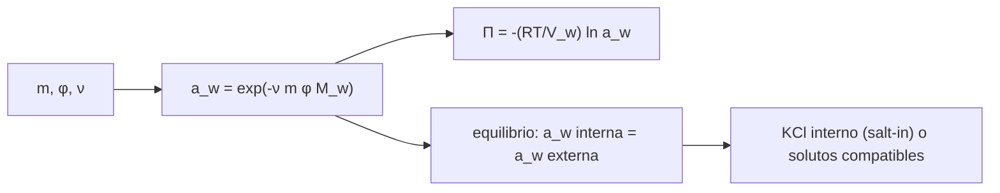

# B64-C04 — Halófilos y vida en salmueras

<!-- nav:top -->
[🏠 Programa](../../../../README.md) · [📚 Bloque B64](../../../tronco-comun/B64-extremofilos-y-limites-de-la-vida.md) · [← Anterior: B64-C03 — Psicrófilos y vida en frío](../B64-C03-psicrofilos-y-vida-en-frio/CLASE.md) · [Siguiente: B64-C05 — Acidófilos y alcalófilos →](../B64-C05-acidofilos-y-alcalofilos/CLASE.md)
<!-- /nav -->

## 1. Ubicación, nivel y alcance

Clase 4 del bloque B64 (área A05). Nivel N3. Relacionas la **concentración de sal** de una salmuera con su **actividad del agua** y con la **presión osmótica** que debe soportar o equilibrar una célula. Usas logaritmos y exponenciales y la constante R de CODATA. Todos los datos del laboratorio son sintéticos.

## 2. Por qué esta clase existe

En una salmuera concentrada el agua existe pero «no está disponible» del mismo modo. La pregunta motivadora: **¿cuánta sal puede haber en el exterior antes de que el agua deje de bastar para la célula?** La decisión central: medir la disponibilidad del agua con la actividad `a_w` y decidir cómo equilibra la célula la presión osmótica.

## 3. Lo que podrás hacer al terminar

1. Definir la actividad del agua y calcularla a partir de la molalidad y el coeficiente osmótico.
2. Comparar el modelo con coeficiente osmótico y la solución ideal de Raoult.
3. Calcular la presión osmótica `Π = −(RT/V_w) ln a_w`.
4. Calcular la concentración interna de KCl que equilibra una salmuera (estrategia «salt-in»).
5. Estimar el cambio de volumen de una célula sin pared ante un choque hipoosmótico.
6. Nombrar los límites del modelo (soluciones concentradas, mezcla de sales, temperatura).

La evidencia es la **ficha de la salmuera** del ejercicio 12 (sección 20).

## 4. Con qué llegas y cómo comprobarlo

1. ¿Qué es la molalidad?
2. ¿Qué es un logaritmo natural?
3. ¿Qué es la presión osmótica?
4. ¿Qué es un coeficiente de actividad?
5. ¿Qué es un dato sintético?

<details>
<summary>Ver respuestas</summary>

1. Moles de soluto por kilogramo de disolvente. 2. El inverso de la exponencial de base e. 3. La presión que equilibra el paso neto de agua a través de una membrana semipermeable. 4. Un factor que corrige el comportamiento ideal de una disolución. 5. Un valor propuesto para el ejemplo, no medido.
</details>

Con cuatro o cinco aciertos, sigue; si no, repasa los prerrequisitos.

## 5. Un caso de contexto y casos de referencia

Oren [S1] revisa los halófilos de los tres dominios y describe dos estrategias para equilibrar la presión osmótica: acumular concentraciones altas de KCl, lo que exige proteínas adaptadas a la sal, o excluir la sal y acumular solutos orgánicos compatibles. Para calcular, usas una salmuera de NaCl **sintética** con molalidades de 0,01 a 6 mol/kg y un coeficiente osmótico `φ` propuesto por fila. Es el **ejemplo conductor**; los `φ` no se consultaron en tablas.

## 6. Vocabulario

La **actividad del agua** `a_w` es 1 para agua pura y menor con solutos. La **molalidad** `m` se expresa en mol/kg. El **coeficiente osmótico** `φ` mide la desviación de la idealidad. La **presión osmótica** `Π` es la presión que debe soportar la membrana. La estrategia **«salt-in»** equilibra con KCl interno; los **solutos compatibles** son moléculas orgánicas que no perturban las proteínas.

## 7. Modelo mental

El agua va hacia donde su actividad es menor, y la célula solo conserva su agua si iguala la actividad de afuera.



*Descripción textual:* la sal y su coeficiente osmótico fijan la actividad del agua; de ella salen la presión osmótica y la condición de equilibrio que la célula cumple con KCl o con solutos compatibles.

Analogía: una esponja entre dos recipientes: el agua fluye al más concentrado. Límite: la membrana también tiene transportadores y válvulas.

## 8. La explicación, paso a paso

### 8.1 La actividad del agua

`a_w = exp(−ν m φ M_w)`, con `ν = 2` para NaCl, `m` en mol/kg, `M_w = 0,018015 kg/mol` y `φ` adimensional. La solución ideal por fracción molar da `a_w = 1/(1 + ν m M_w)`. En el límite diluido ambas coinciden con `1 − ν m M_w`: a `m = 0,01`, las tres expresiones dan `0,999640`.

### 8.2 Resultados del laboratorio

| m [mol/kg] | φ (sintético) | a_w (con φ) | a_w (Raoult) | Π [MPa] |
|---|---|---|---|---|
| 0,01 | 0,93 | 0,9997 | 0,9996 | 0,05 |
| 0,50 | 0,92 | 0,9836 | 0,9823 | 2,28 |
| 2,00 | 1,00 | 0,9305 | 0,9328 | 9,92 |
| 4,00 | 1,10 | 0,8534 | 0,8740 | 21,83 |
| 6,00 | 1,25 | 0,7632 | 0,8222 | 37,22 |

A concentraciones altas la idealidad falla: a 6 mol/kg, `φ` baja `a_w` de 0,822 (ideal) a 0,763.

### 8.3 Presión osmótica y equilibrio

`Π = −(R T/V_w) ln a_w`, con `R = 8,314462618 J mol⁻¹ K⁻¹` [S2], `T = 298,15 K` y `V_w = 1,8·10⁻⁵ m³/mol`. Para `a_w = 0,8534`, `Π = 21,83 MPa`. La integración numérica de `ln a_w = −ν M_w ∫ φ dm` con `φ` constante coincide con la forma cerrada a `10⁻¹²`.

Una célula con estrategia «salt-in» iguala `a_w` interna y externa con KCl a `m_in = −ln a_w/(ν M_w φ) = 4,000 mol/kg`, igual a la sal externa si se usa el mismo `φ`.

### 8.4 Choque hipoosmótico

Si la célula equilibrada a 21,83 MPa se pasa a un medio de `a_w = 0,95`, `Π₁ = 7,06 MPa`; con un volumen no osmótico `b = 0,25` (sintético), la cota teórica de `V/V₀ = b + (1 − b) Π₀/Π₁` es 2,57. Esa hinchazón es teórica: una célula real la limita con la pared o la libera con válvulas mecanosensibles.

### 8.5 Lectura

Cuanto menor `a_w`, más cara es mantener el agua. Los resultados son de un modelo con `φ` propuesto, no de salmueras medidas.

## 9. Magnitudes, símbolos y unidades

| Símbolo | Qué es | Unidad | Valor / nota |
|---|---|---|---|
| `m` | molalidad | mol/kg | 0,01–6 |
| `φ` | coeficiente osmótico | adimensional | 0,92–1,25 (sintético) |
| `ν` | iones por fórmula | adimensional | 2 (NaCl) |
| `M_w` | masa molar del agua | kg/mol | 0,018015 |
| `a_w` | actividad del agua | adimensional | 0,76–1 |
| `Π` | presión osmótica | MPa | 0,05–37 |

## 10. Convenciones y referencias

Temperatura 298,15 K; `a_w` adimensional; presión osmótica en MPa; `φ` constante por fila; sistema de referencia: disolución acuosa de NaCl.

## 11. De dónde sale lo que afirmamos

Fecha de consulta de todas las filas: 2026-11-09.

| ID | Fuente | Localizador | Respalda | Estado |
|---|---|---|---|---|
| S1 | Oren, «Microbial life at high salt concentrations: phylogenetic and metabolic diversity», *Saline Systems* 4:2, 2008 | DOI 10.1186/1746-1448-4-2; PMID 18412960 (Europe PMC) | Estrategias osmóticas: KCl interno o solutos compatibles | Solo resumen |
| S2 | NIST, CODATA 2022 | physics.nist.gov/cuu/Constants/Table/allascii.txt | R exacta | Consultada |
| S3 | Oren, «Thermodynamic limits to microbial life at high salt concentrations», *Environ. Microbiol.* 13(8):1908–1923, 2011 | DOI 10.1111/j.1462-2920.2010.02365.x; PMID 21054738 (Europe PMC) | Solo la existencia de límites bioenergéticos a alta salinidad | Solo resumen; sus conclusiones no se usan en los cálculos |

Límites: ningún `φ`, ninguna molalidad de saturación ni ninguna `a_w` mínima de crecimiento se consultaron; `V_w` y `b` son aproximados o sintéticos.

## 12. Cómo ver el resultado

| Magnitud | Valor sintético |
|---|---|
| `a_w` a 4 mol/kg (φ = 1,10) | 0,8534 |
| Π a 4 mol/kg | 21,83 MPa |
| KCl interno de equilibrio | 4,000 mol/kg |
| `V/V₀` (cota) a `a_w` = 0,95 | 2,57 |

Descripción larga: al subir la molalidad, `a_w` cae de 1 a 0,76 y la presión osmótica crece de 0,05 a 37 MPa.

## 13. Ejemplo trabajado: la actividad del agua a 2 mol/kg

**Paso 1 · Exponente.** `ν m φ M_w = 2·2·1,00·0,018015 = 0,07206`.

**Paso 2 · Actividad.** `a_w = e^(−0,07206) = 0,9305`.

**Paso 3 · Raoult.** `1/(1 + 0,07206) = 0,9328`.

**Paso 4 · Presión.** `Π = −(8,3145·298,15/1,8·10⁻⁵)·ln 0,9305 = 9,92 MPa`.

## 14. Distintas formas de describir el mismo fenómeno

**Por modelo ideal:** Raoult. **Por coeficiente osmótico:** corrige la idealidad. **Por integración:** de `φ` constante, que reproduce la forma cerrada. **Por equilibrio celular:** `a_w` interna igual a `a_w` externa.

## 15. Práctica guiada

**Ejercicio 1 · guiado.** Calcula `ν m M_w` para `m = 2` mol/kg y NaCl. *Pasos:* multiplica 2·2·0,018015.

<details><summary>Solución comentada</summary>

`0,07206`.
</details>

**Ejercicio 2 · guiado.** Con `φ = 1`, calcula `a_w`. *Pista:* `exp(−0,07206)`.

<details><summary>Solución comentada</summary>

`0,9305`.
</details>

**Ejercicio 3 · guiado.** Calcula la actividad por Raoult y compara. *Casi autónomo.*

<details><summary>Solución comentada</summary>

`1/1,07206 = 0,9328`; difiere en 0,002.
</details>

## 16. Práctica autónoma, transferencia e integrador

**Ejercicio 4 · autónomo.** ¿Cuál es la presión osmótica a 6 mol/kg?

<details><summary>Solución comentada</summary>

`37,22 MPa` (tabla 8.2).
</details>

**Ejercicio 5 · autónomo.** Calcula la diferencia entre `a_w` con φ y por Raoult a 6 mol/kg.

<details><summary>Solución comentada</summary>

`0,8222 − 0,7632 = 0,059`.
</details>

**Ejercicio 6 · autónomo.** ¿Cuál es el KCl interno de equilibrio para una salmuera externa de 4 mol/kg y φ = 1,10?

<details><summary>Solución comentada</summary>

`4,000 mol/kg`.
</details>

**Ejercicio 7 · autónomo.** Calcula el cociente de presiones osmóticas entre 4 y 0,5 mol/kg.

<details><summary>Solución comentada</summary>

`21,83/2,28 = 9,6`.
</details>

**Ejercicio 8 · autónomo.** ¿Cuál es la cota de `V/V₀` para un choque a `a_w = 0,95`?

<details><summary>Solución comentada</summary>

`2,57`; es una cota teórica de una célula sin pared.
</details>

**Ejercicio 9 · transferencia.** **Transferencia.** Explica por qué la estrategia «salt-in» obliga a adaptar las proteínas (resumen de [S1]).

<details><summary>Solución comentada</summary>

Con KCl interno alto, las proteínas funcionan en la misma fuerza iónica que el exterior y deben tolerarla; por eso se adaptan.
</details>

**Ejercicio 10 · transferencia.** **Transferencia.** Una célula usa solutos compatibles en vez de KCl. ¿Qué cambia en el balance de `a_w`?

<details><summary>Solución comentada</summary>

Iguala `a_w` con moléculas orgánicas, sin elevar la sal interna; el modelo cambia el soluto y su coeficiente, no la condición de igualdad.
</details>

**Ejercicio 11 · transferencia.** **Transferencia.** Un estudiante afirma que 0,76 es el límite de vida en salmueras. ¿Qué falta?

<details><summary>Solución comentada</summary>

Un dato medido de `a_w` mínima de crecimiento con fuente; este laboratorio no lo consulta ni lo afirma.
</details>

**Ejercicio 12 · integrador.** **Integrador.** Elabora tu *ficha de la salmuera*: tabla de `a_w` y Π, verificación del límite diluido, equilibrio de KCl, choque hipoosmótico y tres límites.

<details><summary>Solución comentada</summary>

Debe incluir las tres pruebas del laboratorio, rotular `φ` como sintético y declarar lo no consultado.
</details>

## 17. Laboratorio: actividad del agua y presión osmótica de una salmuera

El script [halofilos.py](halofilos.py) calcula `a_w` y Π, comprueba el límite diluido, integra numéricamente y resuelve el equilibrio de KCl (**comprueba** 1e-3 y 1e-12).

**Datos:** `R` de CODATA 2022; `φ`, `b` y `V_w` **sintéticos o aproximados**. Semilla `20261109` donde hay aleatoriedad. **Predice antes de ejecutar:** ¿Será `a_w` por Raoult mayor o menor que con φ > 1 a 6 mol/kg? (mayor: 0,822 frente a 0,763.) **Ejecución del 2026-11-09:**

```text
Python 3.12.9 (biblioteca estandar)
Datos SINTETICOS: phi constante por fila; NaCl (nu=2); T = 298.15 K
 m [mol/kg]   phi  a_w (phi)  a_w (Raoult)  Pi [MPa]
       0.01  0.93     0.9997        0.9996      0.05
       0.50  0.92     0.9836        0.9823      2.28
       2.00  1.00     0.9305        0.9328      9.92
       4.00  1.10     0.8534        0.8740     21.83
       6.00  1.25     0.7632        0.8222     37.22
Prueba limite diluido (m=0.01): exp 0.999640 ; Raoult 0.999640 ; lineal 0.999640
Prueba integral: a_w numerica 0.85339565 ; cerrada 0.85339565
KCl interno de equilibrio con phi=1.1: 4.000 mol/kg (igual a la sal externa, estrategia 'salt-in')
Choque: celula equilibrada a Pi0 = 21.83 MPa que pasa a agua dulce (a_w=0.9999):
  a_w externa 0.95: Pi1 = 7.064 MPa ; V/V0 = 2.57 (celula sin pared: cota teorica)
  a_w externa 0.99: Pi1 = 1.384 MPa ; V/V0 = 12.08 (celula sin pared: cota teorica)
  a_w externa 0.9999: Pi1 = 0.014 MPa ; V/V0 = 1189.18 (celula sin pared: cota teorica)
Nota: V/V0 > 1 indica que una celula sin pared ni valvulas de salida estallaria; es la razon de las valvulas mecanosensibles.
Pruebas superadas.
```

```bash
python programa/clases/B64/B64-C04-halofilos-y-vida-en-salmueras/halofilos.py
```

**Límites:** NaCl solo, 298,15 K, `φ` constante por fila; sin transportadores.

## 18. Errores frecuentes y cómo corregirlos

**Confundir molaridad y molalidad.** Se corrige con la sección 8.1.

**Usar solo Raoult en soluciones concentradas.** Ver la tabla 8.2.

**Tomar la cota de volumen como predicción.** Se corrige con la sección 8.4.

**Presentar `φ` como medido.** Se corrige con la sección 5.

## 19. Cómo sabrás que vas bien

Tras la sección 8.2, ¿qué `a_w` esperabas a 2 mol/kg y cuál obtuviste? Si dudas, repasa el ejemplo 13. Tras el laboratorio: ¿qué comprueba el script? (ver la sección 17).

## 20. Qué entregas y cómo se evalúa

El producto es tu **ficha de la salmuera** (ejercicio 12).

| Criterio | Inicial | En desarrollo | Logrado | Destacado |
|---|---|---|---|---|
| Conceptos | Los confunde | Parciales | Define y usa los conceptos de la clase | Explica sus límites |
| Cálculo | Sin unidades | Con errores | Tablas completas con unidades | Calcula casos nuevos |
| Numérico | Sin comprobar | Un caso | Contraste con la vía independiente | Interpreta las diferencias |
| Fuentes | Sin fuente | Sin fecha | Fuentes con fecha y estado | Declara lo sintético y lo no consultado |
| Límites | No los nombra | Uno | Tres | Discute qué falta del modelo |

**Condiciones críticas (no se compensan con promedio):** rotular como sintéticos los datos del laboratorio; no presentar lo simulado como observado; no atribuir a_w ni φ sintéticos a una salmuera real; citar solo lo consultado.

## 21. Ética, seguridad y límites

Clase educativa. No se manipulan salmueras reales ni muestras ambientales. Los valores son sintéticos. Accesibilidad: tablas equivalentes a las gráficas, fórmulas en texto, ejercicios sin conexión.

## 22. Para cerrar y seguir

La actividad del agua resume cuánta sal hay; la célula debe igualarla con KCl o con solutos compatibles. A 4 mol/kg el modelo da `a_w = 0,853` y 21,8 MPa. Queda una pregunta: ¿qué ocurre cuando lo extremo no es la sal sino el pH?

**Glosario español–inglés.** halófilo · *halophile*; actividad del agua · *water activity*; presión osmótica · *osmotic pressure*; coeficiente osmótico · *osmotic coefficient*; soluto compatible · *compatible solute*.

**Continuidad.** [B64-C05](../B64-C05-acidofilos-y-alcalofilos/CLASE.md) estudia acidófilos y alcalófilos.

**Referencias:** ver sección 11.

<!-- nav:bottom -->
---

[← Anterior: B64-C03 — Psicrófilos y vida en frío](../B64-C03-psicrofilos-y-vida-en-frio/CLASE.md) · [📚 Bloque B64](../../../tronco-comun/B64-extremofilos-y-limites-de-la-vida.md) · [Siguiente: B64-C05 — Acidófilos y alcalófilos →](../B64-C05-acidofilos-y-alcalofilos/CLASE.md)
<!-- /nav -->
