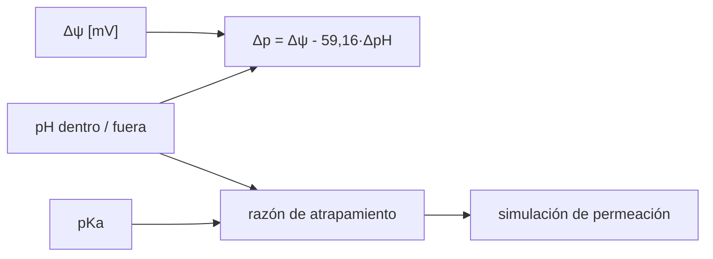

# B64-C05 — Acidófilos y alcalófilos

<!-- nav:top -->
[🏠 Programa](../../../../README.md) · [📚 Bloque B64](../../../tronco-comun/B64-extremofilos-y-limites-de-la-vida.md) · [← Anterior: B64-C04 — Halófilos y vida en salmueras](../B64-C04-halofilos-y-vida-en-salmueras/CLASE.md) · [Siguiente: B64-C06 — Biofilms en ambientes extremos →](../../../tronco-comun/B64-extremofilos-y-limites-de-la-vida.md#b64-c06)
<!-- /nav -->

## 1. Ubicación, nivel y alcance

Clase 5 del bloque B64 (área A05). Nivel N3. Cuantificas el **gradiente de pH** a través de la membrana, la **fuerza protonmotriz** y el **atrapamiento de un ácido débil** en células que viven a pH muy bajo o muy alto. Usas logaritmos y las constantes R y F de CODATA. Los valores del laboratorio son sintéticos.

## 2. Por qué esta clase existe

Un acidófilo vive en un medio miles de veces más ácido que su citoplasma. La pregunta motivadora: **¿cómo mantiene una célula un interior casi neutro y qué le cuesta?** La decisión central: calcular la fuerza protonmotriz con su componente eléctrica y su componente de pH, y ver qué le pasa a un ácido débil en cada caso.

## 3. Lo que podrás hacer al terminar

1. Calcular la pendiente de Nernst `2,303 RT/F` a una temperatura dada.
2. Calcular la fuerza protonmotriz `Δp = Δψ − (2,303 RT/F) ΔpH`.
3. Interpretar un potencial de membrana invertido (positivo dentro).
4. Calcular la razón de atrapamiento de un ácido débil.
5. Verificar la razón con una simulación de permeación de la forma neutra.
6. Nombrar los límites del modelo (pKa, volúmenes, pH amortiguado).

La evidencia es la **ficha del gradiente de pH** del ejercicio 12 (sección 20).

## 4. Con qué llegas y cómo comprobarlo

1. ¿Qué es el pH?
2. ¿Qué es un ácido débil?
3. ¿Qué es un potencial de membrana?
4. ¿Qué es la constante de Faraday?
5. ¿Qué es un dato sintético?

<details>
<summary>Ver respuestas</summary>

1. El logaritmo decimal negativo de la actividad de H⁺. 2. Un ácido que se disocia parcialmente, con una constante pKa. 3. La diferencia de potencial eléctrico entre el interior y el exterior de la célula. 4. La carga de un mol de cargas elementales. 5. Un valor propuesto para el ejemplo, no medido.
</details>

Con cuatro o cinco aciertos, sigue; si no, repasa los prerrequisitos.

## 5. Un caso de contexto y casos de referencia

Baker-Austin y Dopson [S1] resumen que los acidófilos, con óptimo bajo pH 3, mantienen un gradiente de pH de varias unidades mientras producen ATP con la entrada de protones, y que se asocian a un potencial de membrana invertido (positivo dentro), membranas poco permeables y muchos transportadores secundarios. Para calcular, usas cuatro casos **sintéticos** (neutrófilo, acidófilo con potencial invertido, acidófilo moderado y alcalófilo) con pH y potenciales propuestos. Es el **ejemplo conductor**.

## 6. Vocabulario

La **fuerza protonmotriz** `Δp` es la energía por carga almacenada en el gradiente de protones. `Δψ` es el potencial de membrana (dentro menos fuera) y `ΔpH` es pH interno menos pH externo. Un **acidófilo** crece a pH bajo y un **alcalófilo** a pH alto. El **atrapamiento** de un ácido débil es la acumulación de su forma disociada donde el pH es mayor.

## 7. Modelo mental

Los protones empujan por dos razones: la diferencia de carga y la diferencia de concentración. En un acidófilo ambas pueden oponerse.



*Descripción textual:* el potencial de membrana y los pH dan la fuerza protonmotriz; los pH y el pKa fijan cuánto de un ácido débil se acumula dentro, lo que se verifica simulando la permeación de la forma neutra.

Analogía: una presa con dos compuertas: una por la altura del agua (ΔpH) y otra por una carga eléctrica (Δψ). Límite: el protón no es un fluido ideal y las membranas no son compuertas simples.

## 8. La explicación, paso a paso

### 8.1 La pendiente de Nernst

`2,303 R T/F = 59,159 mV` por unidad de pH a `T = 298,15 K`, con `R = 8,314462618 J mol⁻¹ K⁻¹` y `F = 96 485,33212 C/mol` [S2]. El laboratorio comprueba que coincide con 59,16 mV a `10⁻³` relativo.

### 8.2 Fuerza protonmotriz

| caso | pH ext. | pH int. | Δψ [mV] | Δp [mV] |
|---|---|---|---|---|
| neutrófilo | 7,0 | 7,5 | −140 | −169,6 |
| acidófilo (ψ invertido) | 1,5 | 6,0 | +20 | −246,2 |
| acidófilo moderado | 3,0 | 6,5 | −20 | −227,1 |
| alcalófilo | 10,0 | 8,5 | −60 | +28,7 |

En los acidófilos el componente de pH es grande (más de 260 mV) y el potencial invertido lo reduce. En el alcalófilo el pH interno es menor que el externo y el término de pH se suma con signo opuesto: la fuerza protonmotriz del ejemplo es pequeña y de signo positivo; cómo producen ATP estos organismos es una cuestión que no se trata aquí (no consultado).

### 8.3 Atrapamiento de un ácido débil

Solo la forma neutra HA cruza la membrana. En el equilibrio `[HA]` es igual dentro y fuera, de modo que `total_in/total_out = (1 + 10^(pH_in − pKa))/(1 + 10^(pH_out − pKa))`, con `pKa = 4,76` (ilustrativo):

| caso | razón analítica | simulada |
|---|---|---|
| neutrófilo | 3,150 | 3,150 |
| acidófilo (ψ invertido) | 18,37 | 18,37 |
| acidófilo moderado | 55,00 | 55,00 |
| alcalófilo | 0,0316 | 0,0316 |

### 8.4 Lectura

En un acidófilo, un ácido débil orgánico entra como neutro y se acumula disociado dentro: una razón de 18 a 55 anticipa toxicidad. En el alcalófilo ocurre lo contrario. El modelo no incluye efectos del potencial sobre la forma disociada, que casi no cruza.

## 9. Magnitudes, símbolos y unidades

| Símbolo | Qué es | Unidad | Valor / nota |
|---|---|---|---|
| `Δψ` | potencial de membrana (dentro − fuera) | mV | −140 a +20 (sintético) |
| `ΔpH` | pH interno − pH externo | adimensional | −1,5 a +4,5 |
| `R` | constante molar de los gases | J mol⁻¹ K⁻¹ | 8,314462618 |
| `F` | constante de Faraday | C/mol | 96 485,33212 |
| `Δp` | fuerza protonmotriz | mV | −246 a +29 |
| `pKa` | constante de acidez | adimensional | 4,76 (ilustrativo) |

## 10. Convenciones y referencias

298,15 K; potencial en mV; convención `Δψ = ψ_in − ψ_out`; volúmenes iguales para el balance de masa; pH constante en ambos lados. Sistema de referencia: la membrana citoplasmática.

## 11. De dónde sale lo que afirmamos

Fecha de consulta de todas las filas: 2026-11-09.

| ID | Fuente | Localizador | Respalda | Estado |
|---|---|---|---|---|
| S1 | Baker-Austin y Dopson, «Life in acid: pH homeostasis in acidophiles», *Trends Microbiol.* 15(4):165–171, 2007 | DOI 10.1016/j.tim.2007.02.005; PMID 17331729 (Europe PMC) | Gradiente de pH de varias unidades, potencial invertido, membranas poco permeables | Solo resumen |
| S2 | NIST, CODATA 2022 | physics.nist.gov/cuu/Constants/Table/allascii.txt | R y F exactas | Consultada |

Límites: pH, potenciales y pKa son sintéticos o ilustrativos; no se consultó ninguna medida real de pH interno; el mecanismo de ATP en alcalófilos no se consultó.

## 12. Cómo ver el resultado

| Magnitud | Valor |
|---|---|
| Pendiente de Nernst | 59,159 mV/unidad |
| Δp acidófilo (ψ invertido) | −246,2 mV |
| Razón de atrapamiento acidófilo | 18,37 |
| Razón de atrapamiento alcalófilo | 0,0316 |

Descripción larga: en los dos acidófilos la fuerza protonmotriz supera en magnitud la del neutrófilo; el alcalófilo del ejemplo la tiene casi nula.

## 13. Ejemplo trabajado: la fuerza protonmotriz del acidófilo con ψ invertido

**Paso 1 · ΔpH.** `6,0 − 1,5 = 4,5`.

**Paso 2 · Término de pH.** `59,159·4,5 = 266,2 mV`.

**Paso 3 · Suma.** `Δp = +20 − 266,2 = −246,2 mV`.

**Paso 4 · Lectura.** Sin el potencial invertido (`Δψ = −20`) sería `−286,2 mV`: el potencial positivo resta 40 mV al efecto del pH.

## 14. Distintas formas de describir el mismo fenómeno

**Por fórmula:** Nernst. **Por tabla:** la 8.2. **Por simulación:** la razón de atrapamiento sale de la permeación. **Por contraste:** neutrófilo frente a acidófilo y alcalófilo.

## 15. Práctica guiada

**Ejercicio 1 · guiado.** Calcula la fuerza protonmotriz del neutrófilo: `Δψ = −140 mV`, `ΔpH = 0,5`. *Pasos:* aplica la fórmula de 8.2.

<details><summary>Solución comentada</summary>

`−140 − 59,16·0,5 = −169,6 mV`.
</details>

**Ejercicio 2 · guiado.** Haz lo mismo para el acidófilo moderado (`Δψ = −20`, pH 3,0 fuera y 6,5 dentro).

<details><summary>Solución comentada</summary>

`ΔpH = 3,5`; `−20 − 59,16·3,5 = −227,1 mV`.
</details>

**Ejercicio 3 · guiado.** Calcula la razón de atrapamiento del neutrófilo. *Pista:* `10^(7,5−4,76) = 549,5` y `10^(7,0−4,76) = 173,8`.

<details><summary>Solución comentada</summary>

`(1 + 549,5)/(1 + 173,8) = 3,15`.
</details>

## 16. Práctica autónoma, transferencia e integrador

**Ejercicio 4 · autónomo.** Calcula la diferencia de `Δp` entre el acidófilo (ψ invertido) y el neutrófilo.

<details><summary>Solución comentada</summary>

`−246,2 − (−169,6) = −76,6 mV`.
</details>

**Ejercicio 5 · autónomo.** ¿Cuánto vale `Δp` del acidófilo si `Δψ` fuera −20 en vez de +20?

<details><summary>Solución comentada</summary>

`−286,2 mV`.
</details>

**Ejercicio 6 · autónomo.** Calcula la razón de atrapamiento del acidófilo moderado.

<details><summary>Solución comentada</summary>

`(1 + 10^(6,5−4,76))/(1 + 10^(3,0−4,76)) = 55,0`.
</details>

**Ejercicio 7 · autónomo.** Calcula la pendiente de Nernst a 338,15 K.

<details><summary>Solución comentada</summary>

`59,159·338,15/298,15 = 67,1 mV`.
</details>

**Ejercicio 8 · autónomo.** ¿Qué signo tiene la razón de atrapamiento menor que 1 para un alcalófilo y qué significa?

<details><summary>Solución comentada</summary>

Significa que el total del ácido es menor dentro que fuera: el interior es más ácido que el exterior.
</details>

**Ejercicio 9 · transferencia.** **Transferencia.** Un ácido orgánico débil se usa como conservante en alimentos. ¿Por qué podría ser más tóxico para un acidófilo?

<details><summary>Solución comentada</summary>

Porque la razón de atrapamiento sale mayor que 1 (18 a 55): el ácido entra neutro y se acumula disociado.
</details>

**Ejercicio 10 · transferencia.** **Transferencia.** Si la membrana fuera muy permeable a H⁺, ¿qué ocurre con el gradiente?

<details><summary>Solución comentada</summary>

Se disipa: la fuerza protonmotriz cae. Por eso los acidófilos tienen membranas poco permeables [S1].
</details>

**Ejercicio 11 · transferencia.** **Transferencia.** ¿Qué hipótesis del laboratorio puede fallar en una célula real?

<details><summary>Solución comentada</summary>

Volúmenes iguales, pH constante, un solo pKa, ausencia de transporte activo del ácido.
</details>

**Ejercicio 12 · integrador.** **Integrador.** Elabora tu *ficha del gradiente de pH*: tabla de `Δp` para los cuatro casos, razones de atrapamiento por dos vías y tres límites.

<details><summary>Solución comentada</summary>

Debe incluir las pruebas de Nernst y atrapamiento, rotular lo sintético y declarar lo no consultado.
</details>

## 17. Laboratorio: fuerza protonmotriz y atrapamiento de un ácido débil

El script [acidofilos.py](acidofilos.py) calcula la pendiente de Nernst, `Δp` de cuatro casos y la razón de atrapamiento analítica y por simulación de permeación (**comprueba** 1e-3).

**Datos:** `R` y `F` de CODATA 2022; pH, potenciales y pKa **sintéticos/ilustrativos**. Semilla `20261109` donde hay aleatoriedad. **Predice antes de ejecutar:** ¿Qué caso tendrá la mayor razón de atrapamiento? (el acidófilo moderado, 55.) **Ejecución del 2026-11-09:**

```text
Python 3.12.9 (biblioteca estandar)
2.303 R T / F = 59.159 mV por unidad de pH (298.15 K)
Datos SINTETICOS: 
caso                         pH out  pH in  dpsi [mV]   dp [mV]
neutrofilo                      7.0    7.5     -140.0    -169.6
acidofilo (psi invertido)       1.5    6.0       20.0    -246.2
acidofilo moderado              3.0    6.5      -20.0    -227.1
alcalofilo                     10.0    8.5      -60.0      28.7

Atrapamiento de un acido debil (pKa ilustrativo 4.76):
caso                           total in/out analitico   simulado
neutrofilo                                     3.1499     3.1499
acidofilo (psi invertido)                     18.3679    18.3679
acidofilo moderado                            54.9983    54.9983
alcalofilo                                     0.0316     0.0316
Nota: una razon > 1 significa que el acido debil se acumula dentro (atrapamiento); es grande en los acidofilos, con interior mucho menos acido que el exterior, y menor que 1 en el alcalofilo, con interior mas acido que el exterior.
Pruebas superadas.
```

```bash
python programa/clases/B64/B64-C05-acidofilos-y-alcalofilos/acidofilos.py
```

**Límites:** Solo HA cruza; volúmenes iguales; pH constante; sin transporte activo.

## 18. Errores frecuentes y cómo corregirlos

**Cambiar el signo de ΔpH.** Es interior menos exterior (sección 8.2).

**Creer que un potencial positivo aumenta Δp.** En el acidófilo lo reduce (ejemplo 13).

**Olvidar la forma neutra.** Solo HA cruza (sección 8.3).

**Presentar pH y potenciales como medidos.** Se corrige con la sección 5.

## 19. Cómo sabrás que vas bien

Tras la sección 8.2, ¿qué `Δp` esperabas para el alcalófilo y cuál obtuviste? Si dudas, repasa el ejemplo 13. Tras el laboratorio: ¿qué comprueba el script? (ver la sección 17).

## 20. Qué entregas y cómo se evalúa

El producto es tu **ficha del gradiente de pH** (ejercicio 12).

| Criterio | Inicial | En desarrollo | Logrado | Destacado |
|---|---|---|---|---|
| Conceptos | Los confunde | Parciales | Define y usa los conceptos de la clase | Explica sus límites |
| Cálculo | Sin unidades | Con errores | Tablas completas con unidades | Calcula casos nuevos |
| Numérico | Sin comprobar | Un caso | Contraste con la vía independiente | Interpreta las diferencias |
| Fuentes | Sin fuente | Sin fecha | Fuentes con fecha y estado | Declara lo sintético y lo no consultado |
| Límites | No los nombra | Uno | Tres | Discute qué falta del modelo |

**Condiciones críticas (no se compensan con promedio):** rotular como sintéticos los datos del laboratorio; no presentar lo simulado como observado; no tratar los potenciales sintéticos como medidas de una cepa; citar solo lo consultado.

## 21. Ética, seguridad y límites

Clase educativa. No se trabaja con ácidos fuertes ni con muestras de drenaje ácido de minas. Los valores son sintéticos. Accesibilidad: tablas equivalentes a las gráficas, fórmulas en texto, ejercicios sin conexión.

## 22. Para cerrar y seguir

La fuerza protonmotriz suma un término eléctrico y uno de pH; en los acidófilos el pH domina y el potencial invertido lo reduce. Un ácido débil se acumula 18 a 55 veces dentro. Queda una pregunta: ¿cómo se protegen las células cuando viven juntas en una película?

**Glosario español–inglés.** acidófilo · *acidophile*; alcalófilo · *alkaliphile*; fuerza protonmotriz · *proton motive force*; potencial de membrana · *membrane potential*; atrapamiento de ácido débil · *weak-acid trapping*.

**Continuidad.** [B64-C06](../B64-C06-biofilms-en-ambientes-extremos/CLASE.md) estudia los biofilms.

**Referencias:** ver sección 11.

<!-- nav:bottom -->
---

[← Anterior: B64-C04 — Halófilos y vida en salmueras](../B64-C04-halofilos-y-vida-en-salmueras/CLASE.md) · [📚 Bloque B64](../../../tronco-comun/B64-extremofilos-y-limites-de-la-vida.md) · [Siguiente: B64-C06 — Biofilms en ambientes extremos →](../../../tronco-comun/B64-extremofilos-y-limites-de-la-vida.md#b64-c06)
<!-- /nav -->
