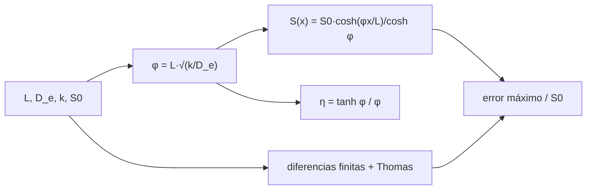

# B64-C06 — Biofilms en ambientes extremos

<!-- nav:top -->
[🏠 Programa](../../../../README.md) · [📚 Bloque B64](../../../tronco-comun/B64-extremofilos-y-limites-de-la-vida.md) · [← Anterior: B64-C05 — Acidófilos y alcalófilos](../B64-C05-acidofilos-y-alcalofilos/CLASE.md) · [Siguiente: B64-C07 — Cultivo de extremófilos no patógenos en condiciones análogas →](../B64-C07-cultivo-de-extremofilos-no-patogenos-en-condiciones-analogas/CLASE.md)
<!-- /nav -->

## 1. Ubicación, nivel y alcance

Clase 6 del bloque B64 (área A05). Nivel N3. Estudias por qué las células de un ambiente extremo suelen vivir **pegadas a una superficie dentro de una matriz** y cuánto sustrato llega al interior de esa película. Resuelves una ecuación diferencial de segundo orden con solución analítica y la verificas con diferencias finitas. Todos los datos del laboratorio son sintéticos.

## 2. Por qué esta clase existe

Una película de células y matriz crea su propio microambiente. La pregunta motivadora: **¿hasta qué profundidad llega un nutriente en un biofilm y qué sucede con las células que quedan más adentro?** La decisión central: comparar el espesor de la película con la longitud de penetración del sustrato mediante el módulo de Thiele.

## 3. Lo que podrás hacer al terminar

1. Describir la matriz de sustancias poliméricas extracelulares (EPS) y sus funciones.
2. Plantear la ecuación de difusión con consumo de primer orden en una losa.
3. Calcular el módulo de Thiele, el perfil de concentración y el factor de efectividad.
4. Verificar la solución analítica con diferencias finitas y el algoritmo de Thomas.
5. Interpretar la profundidad de penetración y la carencia en el interior.
6. Nombrar los límites del modelo (cinética de primer orden, 1D, difusividad uniforme).

La evidencia es la **ficha del biofilm** del ejercicio 12 (sección 20).

## 4. Con qué llegas y cómo comprobarlo

1. ¿Qué es la difusión?
2. ¿Qué es una ecuación diferencial de segundo orden?
3. ¿Qué es cosh?
4. ¿Qué es una condición de frontera?
5. ¿Qué es un dato sintético?

<details>
<summary>Ver respuestas</summary>

1. El transporte de una sustancia desde zonas concentradas hacia zonas diluidas por movimiento aleatorio. 2. Una relación que involucra la segunda derivada de la función. 3. El coseno hiperbólico, (e^x + e^(−x))/2. 4. El valor o la derivada de la función en el borde del dominio. 5. Un valor propuesto para el ejemplo, no medido.
</details>

Con cuatro o cinco aciertos, sigue; si no, repasa los prerrequisitos.

## 5. Un caso de contexto y casos de referencia

Flemming y Wingender [S1] describen la matriz del biofilm como un conjunto de polisacáridos, proteínas, ácidos nucleicos y lípidos que da estabilidad mecánica, fija las células a superficies, forma una red tridimensional y retiene enzimas cerca de las células. Para calcular, usas una película **sintética**: difusividad efectiva `D_e = 10⁻⁹ m²/s`, concentración superficial `S₀ = 0,25 mol/m³` y espesores de 20 a 500 µm. Es el **ejemplo conductor**; no representa a ningún biofilm medido. Un trabajo posterior de revisión [S2] se verificó en su resumen.

## 6. Vocabulario

Una **matriz de EPS** es el material que envuelve las células. La **difusividad efectiva** `D_e` mide qué tan fácil se mueve el soluto en la película. La **constante de consumo** `k` es la tasa de consumo de primer orden. El **módulo de Thiele** `φ = L √(k/D_e)` compara consumo con difusión. El **factor de efectividad** `η` es la fracción del consumo ideal que se logra de hecho.

## 7. Modelo mental

Los nutrientes entran por la superficie y las células de arriba los consumen primero; a mayor espesor o consumo, menos llega al fondo.



*Descripción textual:* los parámetros definen el módulo de Thiele; de él sale el perfil analítico y el factor de efectividad, y el perfil se contrasta con la solución numérica de diferencias finitas.

Analogía: una ciudad con una sola carretera: los primeros barrios se llevan casi todo el tráfico. Límite: el consumo real no siempre es de primer orden y los canales dentro del biofilm cambian la difusión.

## 8. La explicación, paso a paso

### 8.1 Ecuación y solución

Losa de espesor `L` con superficie en `x = L` a `S = S₀` y sustrato impermeable en `x = 0` (`dS/dx = 0`). En estado estacionario con consumo de primer orden: `D_e S'' = k S`. La solución es `S(x) = S₀ cosh(φ x/L)/cosh(φ)`, con `φ = L √(k/D_e)`. El factor de efectividad es `η = tanh(φ)/φ` y la longitud de penetración, `1/√(k/D_e)`.

### 8.2 Resultados del laboratorio

| L [µm] | k [s⁻¹] | φ | η | S(0)/S₀ | penetración [µm] | error máx. |
|---|---|---|---|---|---|---|
| 20 | 0,01 | 0,06 | 0,999 | 0,9980 | 316,2 | 2,3·10⁻¹² |
| 100 | 0,01 | 0,32 | 0,968 | 0,9520 | 316,2 | 2,4·10⁻⁹ |
| 100 | 0,10 | 1,00 | 0,762 | 0,6481 | 100,0 | 1,3·10⁻⁷ |
| 500 | 0,10 | 5,00 | 0,200 | 0,0135 | 100,0 | 2,4·10⁻⁶ |

### 8.3 Verificación numérica

Con 400 nodos de diferencias finitas y el algoritmo de Thomas para el sistema tridiagonal, el error máximo normalizado por `S₀` es inferior a `10⁻⁵` en los cuatro casos. El factor de efectividad calculado con el flujo en la superficie coincide con `tanh(φ)/φ` a 1 %.

### 8.4 Lectura

Cuando `φ ≪ 1` el perfil es plano y toda la película consume. Cuando `φ ≫ 1`, como en el último caso, el fondo recibe solo el 1,35 % de la concentración superficial y la película usa el 20 % de su capacidad: las células más profundas están en carencia, lo que en la práctica favorece subpoblaciones lentas. Eso es una consecuencia del modelo, no una observación.

## 9. Magnitudes, símbolos y unidades

| Símbolo | Qué es | Unidad | Valor / nota |
|---|---|---|---|
| `L` | espesor de la película | µm | 20–500 (sintético) |
| `D_e` | difusividad efectiva | m²/s | 10⁻⁹ (sintético) |
| `k` | constante de consumo | s⁻¹ | 0,01–0,1 (sintético) |
| `S₀` | concentración en la superficie | mol/m³ | 0,25 (sintético) |
| `φ` | módulo de Thiele | adimensional | 0,06–5 |
| `η` | factor de efectividad | adimensional | 0,2–0,999 |

## 10. Convenciones y referencias

Unidades SI; `x = 0` en el sustrato y `x = L` en la superficie; consumo de primer orden; estado estacionario; solución 1D. Sistema de referencia: coordenada normal a la superficie de adhesión.

## 11. De dónde sale lo que afirmamos

Fecha de consulta de todas las filas: 2026-11-09.

| ID | Fuente | Localizador | Respalda | Estado |
|---|---|---|---|---|
| S1 | Flemming y Wingender, «The biofilm matrix», *Nat. Rev. Microbiol.* 8(9):623–633, 2010 | DOI 10.1038/nrmicro2415; PMID 20676145 (Europe PMC) | Componentes y funciones de la matriz de EPS | Solo resumen |
| S2 | Flemming et al., «The biofilm matrix: multitasking in a shared space», *Nat. Rev. Microbiol.* 21(2):70–86, 2023 | DOI 10.1038/s41579-022-00791-0; PMID 36127518 (Europe PMC) | Matriz como espacio compartido; señales | Solo resumen |

Límites: ninguna cifra de difusividad, espesor o consumo proviene de una fuente; no se consultó ningún biofilm de ambiente extremo en particular.

## 12. Cómo ver el resultado

| Magnitud | Valor |
|---|---|
| `φ` con L = 500 µm, k = 0,1 s⁻¹ | 5,00 |
| `η` | 0,200 |
| `S(0)/S₀` | 0,0135 |
| Penetración | 100 µm |

Descripción larga: al aumentar el espesor de 20 a 500 µm con consumo alto, la concentración en el fondo cae de casi 1 a 0,0135 de la de la superficie.

## 13. Ejemplo trabajado: el caso de 100 µm con k = 0,1 s⁻¹

**Paso 1 · Longitud.** `√(k/D_e) = √(0,1/10⁻⁹) = 10⁴ m⁻¹`; penetración `= 10⁻⁴ m = 100 µm`.

**Paso 2 · Módulo.** `φ = 100·10⁻⁶·10⁴ = 1,00`.

**Paso 3 · Efectividad.** `η = tanh(1)/1 = 0,7616`.

**Paso 4 · Fondo.** `S(0)/S₀ = 1/cosh(1) = 1/1,5431 = 0,6481`.

## 14. Distintas formas de describir el mismo fenómeno

**Por solución analítica:** coseno hiperbólico. **Por diferencias finitas:** sistema tridiagonal. **Por magnitud resumen:** `φ` y `η`. **Por longitud característica:** la penetración frente al espesor.

## 15. Práctica guiada

**Ejercicio 1 · guiado.** Calcula la longitud de penetración para `k = 0,01 s⁻¹` y `D_e = 10⁻⁹ m²/s`. *Pasos:* `1/√(k/D_e)`.

<details><summary>Solución comentada</summary>

`√(10⁷) = 3162 m⁻¹`; penetración `316 µm`.
</details>

**Ejercicio 2 · guiado.** Con `L = 100 µm`, calcula `φ` (sección 8.1).

<details><summary>Solución comentada</summary>

`100·10⁻⁶·3162 = 0,316`.
</details>

**Ejercicio 3 · guiado.** Calcula `η = tanh φ/φ` para `φ = 0,316`. *Pista:* `tanh 0,316 = 0,306`.

<details><summary>Solución comentada</summary>

`0,306/0,316 = 0,968`.
</details>

## 16. Práctica autónoma, transferencia e integrador

**Ejercicio 4 · autónomo.** Calcula `φ` para `L = 100 µm` y `k = 0,1 s⁻¹`.

<details><summary>Solución comentada</summary>

`1,00`.
</details>

**Ejercicio 5 · autónomo.** Calcula `S(0)/S₀` para ese caso.

<details><summary>Solución comentada</summary>

`1/cosh 1 = 0,648`.
</details>

**Ejercicio 6 · autónomo.** Calcula `S(0)/S₀` para `φ = 5` sabiendo que `cosh 5 = 74,2`.

<details><summary>Solución comentada</summary>

`1/74,2 = 0,0135`.
</details>

**Ejercicio 7 · autónomo.** ¿Qué fracción del espesor de 500 µm queda dentro de la penetración de 100 µm?

<details><summary>Solución comentada</summary>

`100/500 = 20 %` desde la superficie.
</details>

**Ejercicio 8 · autónomo.** Calcula `η` para `φ = 5` con `tanh 5 = 0,9999`.

<details><summary>Solución comentada</summary>

`0,9999/5 = 0,200`.
</details>

**Ejercicio 9 · transferencia.** **Transferencia.** La matriz retiene enzimas cerca de las células [S1]. ¿Cómo podría cambiar `D_e` o `k` en el modelo?

<details><summary>Solución comentada</summary>

Puede reducir `D_e` efectiva (más difícil difundir) y aumentar la reacción local; ambos suben `φ`. Es una hipótesis del modelo, no un resultado de [S1].
</details>

**Ejercicio 10 · transferencia.** **Transferencia.** Si el consumo fuera de orden cero, ¿cambia la forma de la solución?

<details><summary>Solución comentada</summary>

Sí: la ecuación pasa a `D_e S'' = k₀` y el perfil es parabólico, con posible agotamiento total a cierta profundidad. El laboratorio no lo cubre.
</details>

**Ejercicio 11 · transferencia.** **Transferencia.** Un artículo dice que el biofilm «protege» a las células en un ambiente ácido. ¿Qué dato falta para sostenerlo con este modelo?

<details><summary>Solución comentada</summary>

El perfil de pH y las difusividades del H⁺ y de los tampones dentro de la película, con fuente. El laboratorio solo trata un nutriente neutro.
</details>

**Ejercicio 12 · integrador.** **Integrador.** Elabora tu *ficha del biofilm*: tabla de `φ`, `η` y `S(0)/S₀` para dos espesores nuevos, verificación contra diferencias finitas y tres límites.

<details><summary>Solución comentada</summary>

Debe incluir la prueba numérica (error < 10⁻⁴), el límite `φ ≪ 1`, y rotular lo sintético.
</details>

## 17. Laboratorio: difusión y reacción en una película

El script [biofilm.py](biofilm.py) calcula el perfil analítico y el numérico (diferencias finitas, Thomas), el factor de efectividad y el límite `φ ≪ 1` (**comprueba** 1e-4 y 1 %).

**Datos:** sin constantes físicas; `L`, `D_e`, `k` y `S₀` **sintéticos**. Semilla `20261109` donde hay aleatoriedad. **Predice antes de ejecutar:** ¿En qué caso quedará el fondo casi sin sustrato? (L = 500 µm y k = 0,1 s⁻¹.) **Ejecución del 2026-11-09:**

```text
Python 3.12.9 (biblioteca estandar)
Datos SINTETICOS: D_e = 1.0e-09 m2/s ; S0 = 0.25 mol/m3
 L [um]   k [1/s]     phi     eta   S(0)/S0  penetracion [um]  error max
     20      0.01    0.06   0.999    0.9980             316.2   2.25e-12
    100      0.01    0.32   0.968    0.9520             316.2   2.41e-09
    100      0.10    1.00   0.762    0.6481             100.0   1.29e-07
    500      0.10    5.00   0.200    0.0135             100.0   2.40e-06
Limite phi<<1: S(0)/S0 = 0.99999
Lectura: cuando phi >> 1 solo una capa de ~1/sqrt(k/D_e) cerca de la superficie recibe sustrato; el resto vive en carencia.
Pruebas superadas.
```

```bash
python programa/clases/B64/B64-C06-biofilms-en-ambientes-extremos/biofilm.py
```

**Límites:** Primer orden, 1D, `D_e` uniforme, estado estacionario.

## 18. Errores frecuentes y cómo corregirlos

**Confundir `L` con la penetración.** Se corrige con la sección 8.1.

**Pensar que `η` cercano a 1 implica película gruesa.** Es lo contrario (sección 8.2).

**Usar el modelo para un biofilm real.** Se corrige con la sección 5.

**Olvidar la frontera impermeable.** Se corrige con la sección 8.1.

## 19. Cómo sabrás que vas bien

Tras la sección 8.2, ¿qué `φ` esperabas para L = 100 µm y k = 0,1 s⁻¹ y cuál obtuviste? Si dudas, repasa el ejemplo 13. Tras el laboratorio: ¿qué comprueba el script? (ver la sección 17).

## 20. Qué entregas y cómo se evalúa

El producto es tu **ficha del biofilm** (ejercicio 12).

| Criterio | Inicial | En desarrollo | Logrado | Destacado |
|---|---|---|---|---|
| Conceptos | Los confunde | Parciales | Define y usa los conceptos de la clase | Explica sus límites |
| Cálculo | Sin unidades | Con errores | Tablas completas con unidades | Calcula casos nuevos |
| Numérico | Sin comprobar | Un caso | Contraste con la vía independiente | Interpreta las diferencias |
| Fuentes | Sin fuente | Sin fecha | Fuentes con fecha y estado | Declara lo sintético y lo no consultado |
| Límites | No los nombra | Uno | Tres | Discute qué falta del modelo |

**Condiciones críticas (no se compensan con promedio):** rotular como sintéticos los datos del laboratorio; no presentar lo simulado como observado; no atribuir D_e ni k sintéticos a un biofilm real; citar solo lo consultado.

## 21. Ética, seguridad y límites

Clase educativa. No se cultivan biofilms; en la práctica, los biofilms pueden contener organismos de riesgo y requieren las normas de bioseguridad del laboratorio. Los valores son sintéticos. Accesibilidad: tablas equivalentes a las gráficas, fórmulas en texto, ejercicios sin conexión.

## 22. Para cerrar y seguir

Una película con `φ = 1` conserva el 65 % de la concentración en el fondo; con `φ = 5`, solo el 1,35 %. El módulo de Thiele resume si la película vive repartida o en capas. Queda una pregunta: ¿cómo se cultiva con seguridad un organismo así en un laboratorio?

**Glosario español–inglés.** biofilm · *biofilm*; sustancias poliméricas extracelulares · *extracellular polymeric substances*; módulo de Thiele · *Thiele modulus*; factor de efectividad · *effectiveness factor*; difusividad efectiva · *effective diffusivity*.

**Continuidad.** [B64-C07](../B64-C07-cultivo-de-extremofilos-no-patogenos-en-condiciones-analogas/CLASE.md) trata el cultivo de no patógenos en condiciones análogas.

**Referencias:** ver sección 11.

<!-- nav:bottom -->
---

[← Anterior: B64-C05 — Acidófilos y alcalófilos](../B64-C05-acidofilos-y-alcalofilos/CLASE.md) · [📚 Bloque B64](../../../tronco-comun/B64-extremofilos-y-limites-de-la-vida.md) · [Siguiente: B64-C07 — Cultivo de extremófilos no patógenos en condiciones análogas →](../B64-C07-cultivo-de-extremofilos-no-patogenos-en-condiciones-analogas/CLASE.md)
<!-- /nav -->
