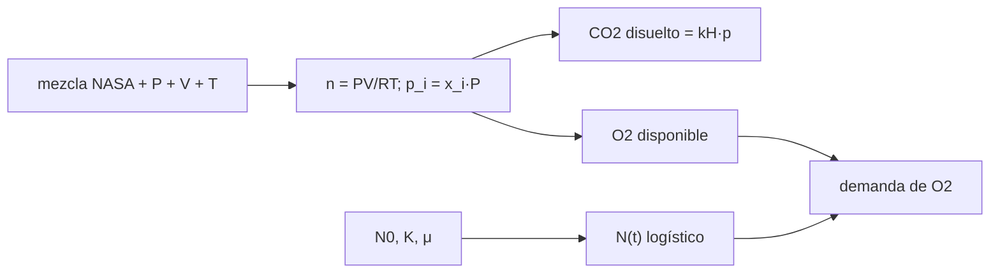

# B64-C07 — Cultivo de extremófilos no patógenos en condiciones análogas

<!-- nav:top -->
[🏠 Programa](../../../../README.md) · [📚 Bloque B64](../../../tronco-comun/B64-extremofilos-y-limites-de-la-vida.md) · [← Anterior: B64-C06 — Biofilms en ambientes extremos](../B64-C06-biofilms-en-ambientes-extremos/CLASE.md) · [Siguiente: B65-C01 — Convección del manto y evolución térmica de interiores planetarios →](../../B65/B65-C01-conveccion-del-manto-y-evolucion-termica-de-interiores-planetarios/CLASE.md)
<!-- /nav -->

## 1. Ubicación, nivel y alcance

Clase 7 del bloque B64 (área A05). Nivel N3. Cierra el bloque: planificas **cómo se cultivaría con seguridad un organismo no patógeno** en una cámara que imita **una parte** de las condiciones de otro mundo, calculas el balance de gases y la curva de crecimiento, y declaras qué no reproduce el análogo. Usas la ley del gas ideal, la ley de Henry y una ecuación logística. Todos los datos de crecimiento son sintéticos.

## 2. Por qué esta clase existe

Un análogo no es el otro mundo: reproduce algunas variables y deja otras. La pregunta motivadora: **¿qué parte del ambiente real estás imitando, qué parte no y qué puedes concluir de un cultivo en la cámara?** La decisión central: elegir qué variables se controlan, calcular su balance y declarar los límites del análogo antes de interpretar el resultado.

## 3. Lo que podrás hacer al terminar

1. Calcular moles y presiones parciales de una mezcla de gases con la ley del gas ideal.
2. Usar la composición de la atmósfera marciana de la ficha NASA como mezcla de partida.
3. Calcular el CO₂ disuelto con la ley de Henry.
4. Simular un crecimiento logístico con RK4 y contrastarlo con la solución cerrada.
5. Comparar la demanda de oxígeno de un cultivo con el oxígeno de la cámara.
6. Declarar las condiciones de bioseguridad y los límites del análogo.

La evidencia es la **ficha del cultivo en cámara análoga** del ejercicio 12 (sección 20).

## 4. Con qué llegas y cómo comprobarlo

1. ¿Qué es la ley del gas ideal?
2. ¿Qué es una presión parcial?
3. ¿Qué es un crecimiento logístico?
4. ¿Qué es un nivel de bioseguridad 1?
5. ¿Qué es un dato sintético?

<details>
<summary>Ver respuestas</summary>

1. `PV = nRT`. 2. La presión que ejercería un gas de la mezcla si ocupara solo el volumen. 3. Un crecimiento exponencial que se satura en una capacidad de carga. 4. El nivel para agentes bien caracterizados que no causan enfermedad en adultos sanos. 5. Un valor propuesto para el ejemplo, no medido.
</details>

Con cuatro o cinco aciertos, sigue; si no, repasa los prerrequisitos.

## 5. Un caso de contexto y casos de referencia

La ficha de datos de Marte de la NASA [S1] (actualizada el 19 de mayo de 2025) da una presión superficial media de 6,36 mbar (4,0 a 8,7 con la estación) y una atmósfera de 95,1 % CO₂, 2,59 % N₂, 1,94 % Ar y 0,16 % O₂ en volumen. Como las fracciones suman 99,79 %, el laboratorio las renormaliza. Con esa mezcla, una cámara **hipotética** de 10 L se evalúa a la presión marciana (636 Pa) y a 100 kPa con la misma composición. El crecimiento de un cultivo no patógeno es **sintético**. Es el **ejemplo conductor**.

## 6. Vocabulario

Una **cámara análoga** reproduce algunas condiciones (gases, presión, temperatura) de un ambiente. La **presión parcial** `pᵢ = xᵢ P`. La **ley de Henry** relaciona el gas disuelto con su presión parcial: `[CO₂] = k_H p`. La **capacidad de carga** `K` es la densidad máxima del cultivo. El **nivel de bioseguridad 1** corresponde a organismos no patógenos manejados con buenas prácticas de laboratorio.

## 7. Modelo mental

Se fija la mezcla y la presión; el gas fija lo disuelto; el cultivo crece hasta chocar con un límite.



*Descripción textual:* la mezcla, la presión, el volumen y la temperatura dan los moles y las presiones parciales; de ellos salen el CO₂ disuelto y el oxígeno disponible; el crecimiento logístico da la demanda, que se compara con el oxígeno.

Analogía: una maqueta de un paisaje: reproduce relieve y color pero no el clima. Límite: una cámara puede reproducir una o dos variables, rara vez todas a la vez.

## 8. La explicación, paso a paso

### 8.1 Balance de gases

La mezcla renormalizada tiene `x(CO₂) = 0,953`. A `T = 298,15 K` y `V = 10 L`, con `R = 8,314462618 J mol⁻¹ K⁻¹` [S2]:

| condición | n total [mol] | n(O₂) [mol] | p(CO₂) [atm] | CO₂ disuelto [mmol/L] |
|---|---|---|---|---|
| 636 Pa (marciana) | 2,566·10⁻³ | 4,114·10⁻⁶ | 0,005982 | 0,2034 |
| 100 kPa (misma mezcla) | 0,4034 | 6,468·10⁻⁴ | 0,9405 | 31,98 |

La ley de Henry usa `k_H = 0,034 mol/(L atm)` (valor ilustrativo, no consultado).

### 8.2 Lo que la presión marciana no permite

A 636 Pa el agua líquida a 25 °C no es estable: su presión de vapor es mayor que la presión total (valor de memoria, no consultado). Por eso un análogo de composición suele usar medios sellados o cámaras presurizadas; es un análogo de la mezcla, no de la presión.

### 8.3 Crecimiento logístico

`N(t) = K/(1 + (K/N₀ − 1) e^(−μ t))`. Con `N₀ = 10⁴`, `K = 10⁹` UFC/mL y `μ = 0,35 h⁻¹` (sintéticos), el cultivo pasa por `6,66·10⁵` a las 12 h, `4,26·10⁷` a las 24 h y `7,48·10⁸` a las 36 h. Llega a `K/2` a las 32,89 h. La integración RK4 coincide con la forma cerrada a `10⁻⁶`.

### 8.4 Oxígeno

A 100 kPa la cámara tiene `6,468·10⁻⁴` mol de O₂. Un cultivo aerobio hipotético de 50 mL que llegara a `K` demandaría `5,0·10⁻²` mol (con 10⁻¹² mol por UFC, sintético), 77 veces más. En la cámara cerrada el cultivo se limitaría por oxígeno mucho antes de llegar a `K`.

### 8.5 Bioseguridad

Solo se cultivan organismos no patógenos de nivel de bioseguridad 1, obtenidos de una colección reconocida; no se manipulan muestras ambientales sin análisis de riesgo institucional, y toda cámara se opera con las normas de su laboratorio.

## 9. Magnitudes, símbolos y unidades

| Símbolo | Qué es | Unidad | Valor / nota |
|---|---|---|---|
| `P` | presión total | Pa | 636 y 100 000 |
| `V` | volumen de la cámara | m³ | 0,010 (ilustrativo) |
| `xᵢ` | fracción en volumen | adimensional | NASA, renormalizada |
| `k_H` | constante de Henry del CO₂ | mol L⁻¹ atm⁻¹ | 0,034 (ilustrativo) |
| `μ` | tasa de crecimiento | h⁻¹ | 0,35 (sintético) |
| `K` | capacidad de carga | UFC/mL | 10⁹ (sintético) |

## 10. Convenciones y referencias

298,15 K; mezcla ideal; fracciones renormalizadas; UFC/mL para la densidad de cultivo; 1 atm = 101 325 Pa. Sistema de referencia: el interior de la cámara.

## 11. De dónde sale lo que afirmamos

Fecha de consulta de todas las filas: 2026-11-09.

| ID | Fuente | Localizador | Respalda | Estado |
|---|---|---|---|---|
| S1 | NASA NSSDC, «Mars Fact Sheet» (actualizada 19 may 2025) | nssdc.gsfc.nasa.gov/planetary/factsheet/marsfact.html | Presión 6,36 mbar (4,0–8,7); CO₂ 95,1 %, N₂ 2,59 %, Ar 1,94 %, O₂ 0,16 % | Consultada |
| S2 | NIST, CODATA 2022 | physics.nist.gov/cuu/Constants/Table/allascii.txt | R exacta | Consultada |

Límites: la constante de Henry y la presión de vapor del agua no se consultaron; el volumen, `μ`, `K` y el consumo de O₂ son sintéticos; no se consultó ningún protocolo de bioseguridad (se enuncia solo el principio general).

## 12. Cómo ver el resultado

| Magnitud | Valor |
|---|---|
| n total a 636 Pa (10 L) | 2,566·10⁻³ mol |
| n total a 100 kPa (10 L) | 0,4034 mol |
| Tiempo a K/2 | 32,89 h |
| Demanda/oferta de O₂ | 77 |

Descripción larga: el cultivo sintético crece 4000 veces en 24 h; el oxígeno de una cámara cerrada de 10 L a 100 kPa no basta para llevarlo a la capacidad de carga.

## 13. Ejemplo trabajado: los moles totales a 636 Pa en 10 L

**Paso 1 · Datos.** `P = 636 Pa`, `V = 0,010 m³`, `T = 298,15 K`.

**Paso 2 · Producto.** `P V = 6,36 J`; `R T = 2478,96 J/mol`.

**Paso 3 · Cociente.** `n = 6,36/2478,96 = 2,566·10⁻³ mol`.

**Paso 4 · CO₂.** `p(CO₂) = 0,953·636 = 606,1 Pa = 0,005982 atm`; disuelto: `0,034·0,005982 = 2,034·10⁻⁴ mol/L`.

## 14. Distintas formas de describir el mismo fenómeno

**Por ley del gas ideal:** moles. **Por presiones parciales:** composición. **Por Henry:** gas disuelto. **Por RK4:** crecimiento, que reproduce la forma cerrada.

## 15. Práctica guiada

**Ejercicio 1 · guiado.** Calcula `n = PV/RT` para 636 Pa en 10 L a 298,15 K. *Pasos:* sección 8.1.

<details><summary>Solución comentada</summary>

`2,566·10⁻³ mol`.
</details>

**Ejercicio 2 · guiado.** Calcula `p(CO₂)` con la fracción renormalizada 0,953. *Pista:* `0,953·636`.

<details><summary>Solución comentada</summary>

`606,1 Pa = 0,005982 atm`.
</details>

**Ejercicio 3 · guiado.** Calcula el CO₂ disuelto con `k_H = 0,034`. *Casi autónomo.*

<details><summary>Solución comentada</summary>

`0,034·0,005982 = 2,034·10⁻⁴ mol/L = 0,2034 mmol/L`.
</details>

## 16. Práctica autónoma, transferencia e integrador

**Ejercicio 4 · autónomo.** ¿Cuántas veces más moles hay a 100 kPa que a 636 Pa?

<details><summary>Solución comentada</summary>

`100 000/636 = 157,2`.
</details>

**Ejercicio 5 · autónomo.** ¿Cuántas veces crece el cultivo entre `t = 0` y 24 h?

<details><summary>Solución comentada</summary>

`4,2578·10⁷/10⁴ = 4258`.
</details>

**Ejercicio 6 · autónomo.** Calcula el tiempo en que `N = K/2`.

<details><summary>Solución comentada</summary>

`ln(K/N₀ − 1)/μ = ln(99 999)/0,35 = 32,89 h`.
</details>

**Ejercicio 7 · autónomo.** Calcula el tiempo de duplicación de la fase inicial.

<details><summary>Solución comentada</summary>

`ln 2/0,35 = 1,98 h`.
</details>

**Ejercicio 8 · autónomo.** Calcula la razón entre la demanda hipotética de O₂ y el O₂ de la cámara a 100 kPa.

<details><summary>Solución comentada</summary>

`5,0·10⁻²/6,468·10⁻⁴ = 77`.
</details>

**Ejercicio 9 · transferencia.** **Transferencia.** Un informe dice «el microorganismo creció en condiciones marcianas». ¿Qué le exiges decir?

<details><summary>Solución comentada</summary>

Qué variables se imitaron (mezcla de gases, ¿presión?, ¿temperatura?), cuáles no (radiación, perclorato, suelo, presión) y que la cámara es un análogo parcial; sin eso, la frase es engañosa.
</details>

**Ejercicio 10 · transferencia.** **Transferencia.** Propones usar una muestra de un lago salino natural en la cámara. ¿Qué debes hacer antes?

<details><summary>Solución comentada</summary>

No procede sin análisis de riesgo institucional, autorización y trabajo en el nivel de bioseguridad que corresponda; en esta clase solo se tratan organismos no patógenos de colección.
</details>

**Ejercicio 11 · transferencia.** **Transferencia.** Si cambias a una presión de 600 Pa, ¿qué cambia en el balance?

<details><summary>Solución comentada</summary>

Los moles escalan con `P` (−5,7 %); las fracciones y la composición quedan igual. Sigue sin ser estable el agua líquida.
</details>

**Ejercicio 12 · integrador.** **Integrador.** Elabora tu *ficha del cultivo en cámara análoga*: balance de gases a dos presiones, CO₂ disuelto, curva logística con RK4, demanda de O₂, nivel de bioseguridad y tres límites del análogo.

<details><summary>Solución comentada</summary>

Debe incluir las pruebas del laboratorio, rotular lo sintético y lo no consultado, y declarar qué variables del ambiente real no se imitan.
</details>

## 17. Laboratorio: balance de gases de una cámara y crecimiento logístico

El script [camara.py](camara.py) calcula moles y presiones parciales con la mezcla de la NASA, el CO₂ disuelto y el crecimiento logístico por RK4 y por la forma cerrada (**comprueba** 1e-12 y 1e-6).

**Datos:** presión y composición de la ficha NASA (consultada el 2026-11-09), `R` de CODATA 2022; volumen, `k_H`, `μ`, `K` y consumo de O₂ **ilustrativos o sintéticos**. Semilla `20261109` donde hay aleatoriedad. **Predice antes de ejecutar:** ¿Bastará el oxígeno de la cámara para llevar el cultivo a K? (no; faltan unas 77 veces.) **Ejecución del 2026-11-09:**

```text
Python 3.12.9 (biblioteca estandar)
Las fracciones de la ficha NASA suman 0.9979; se renormalizan a 1 (el resto, trazas, se ignora)
Datos: V = 10 L (ilustrativo), T = 298.15 K
presion marciana (636 Pa): n_total = 2.5656e-03 mol ; n_O2 = 4.114e-06 mol ; p_CO2 = 0.005982 atm ; CO2 disuelto = 0.2034 mmol/L
presion de trabajo (100 kPa, misma mezcla): n_total = 4.0340e-01 mol ; n_O2 = 6.468e-04 mol ; p_CO2 = 0.9405 atm ; CO2 disuelto = 31.98 mmol/L
Nota: a 636 Pa la presion del vapor de agua a 25 C (alrededor de 3 kPa; valor de memoria, no consultado) supera la total: el medio liquido hierve; por eso los analogos de composicion usan camaras presurizadas o medios sellados.

Crecimiento SINTETICO: N0 = 1e+04, K = 1e+09 UFC/mL, mu = 0.35 1/h
 t [h]      cerrada          RK4
     0   1.0000e+04   1.0000e+04
    12   6.6643e+05   6.6643e+05
    24   4.2578e+07   4.2578e+07
    36   7.4783e+08   7.4783e+08
    48   9.9497e+08   9.9497e+08
    72   1.0000e+09   1.0000e+09
Tiempo en que N = K/2: 32.89 h
O2 de la camara a 100 kPa: 6.468e-04 mol ; consumo hipotetico de un cultivo aerobio de 50 mL que llegara a K: 5.000e-02 mol
Pruebas superadas.
```

```bash
python programa/clases/B64/B64-C07-cultivo-de-extremofilos-no-patogenos-en-condiciones-analogas/camara.py
```

**Límites:** Gas ideal, isotermia, sin consumo de gas por el cultivo en el balance, `k_H` no consultada.

## 18. Errores frecuentes y cómo corregirlos

**Llamar «condiciones marcianas» a una cámara parcial.** Se corrige con la sección 8.2 y el ejercicio 9.

**Olvidar renormalizar las fracciones.** Se corrige con la sección 5.

**Ignorar el oxígeno disponible.** Se corrige con la sección 8.4.

**Pasar por alto la bioseguridad.** Se corrige con la sección 8.5.

## 19. Cómo sabrás que vas bien

Tras la sección 8.1, ¿qué `n` esperabas a 100 kPa y cuál obtuviste? Si dudas, repasa el ejemplo 13. Tras el laboratorio: ¿qué comprueba el script? (ver la sección 17).

## 20. Qué entregas y cómo se evalúa

El producto es tu **ficha del cultivo en cámara análoga** (ejercicio 12).

| Criterio | Inicial | En desarrollo | Logrado | Destacado |
|---|---|---|---|---|
| Conceptos | Los confunde | Parciales | Define y usa los conceptos de la clase | Explica sus límites |
| Cálculo | Sin unidades | Con errores | Tablas completas con unidades | Calcula casos nuevos |
| Numérico | Sin comprobar | Un caso | Contraste con la vía independiente | Interpreta las diferencias |
| Fuentes | Sin fuente | Sin fecha | Fuentes con fecha y estado | Declara lo sintético y lo no consultado |
| Límites | No los nombra | Uno | Tres | Discute qué falta del modelo |

**Condiciones críticas (no se compensan con promedio):** rotular como sintéticos los datos del laboratorio; no presentar lo simulado como observado; no presentar un cultivo en cámara parcial como si ocurriera en otro mundo, y usar solo organismos no patógenos; citar solo lo consultado.

## 21. Ética, seguridad y límites

Clase educativa. No se dan protocolos de cultivo ni se trabaja con muestras ambientales. Solo se admiten organismos no patógenos de nivel de bioseguridad 1 de colección, bajo supervisión institucional. Ningún resultado de la clase implica la existencia de vida fuera de la Tierra. Accesibilidad: tablas equivalentes a las gráficas, fórmulas en texto, ejercicios sin conexión.

## 22. Para cerrar y seguir

Una cámara análoga controla algunas variables: la mezcla de gases de la ficha NASA a 636 Pa da 2,57 mmol en 10 L, y el oxígeno de una cámara cerrada limita el crecimiento antes que la capacidad de carga. Cierra el bloque: los límites de la vida son magnitudes medibles, y todo análogo es parcial.

**Glosario español–inglés.** cámara análoga · *analog chamber*; presión parcial · *partial pressure*; ley de Henry · *Henry's law*; capacidad de carga · *carrying capacity*; nivel de bioseguridad · *biosafety level*.

**Continuidad.** El bloque siguiente, [B65 — Geofísica de interiores planetarios](../../../tronco-comun/B65-geofisica-de-interiores-planetarios.md), pasa de la vida a la estructura interna de los planetas.

**Referencias:** ver sección 11.

<!-- nav:bottom -->
---

[← Anterior: B64-C06 — Biofilms en ambientes extremos](../B64-C06-biofilms-en-ambientes-extremos/CLASE.md) · [📚 Bloque B64](../../../tronco-comun/B64-extremofilos-y-limites-de-la-vida.md) · [Siguiente: B65-C01 — Convección del manto y evolución térmica de interiores planetarios →](../../B65/B65-C01-conveccion-del-manto-y-evolucion-termica-de-interiores-planetarios/CLASE.md)
<!-- /nav -->
