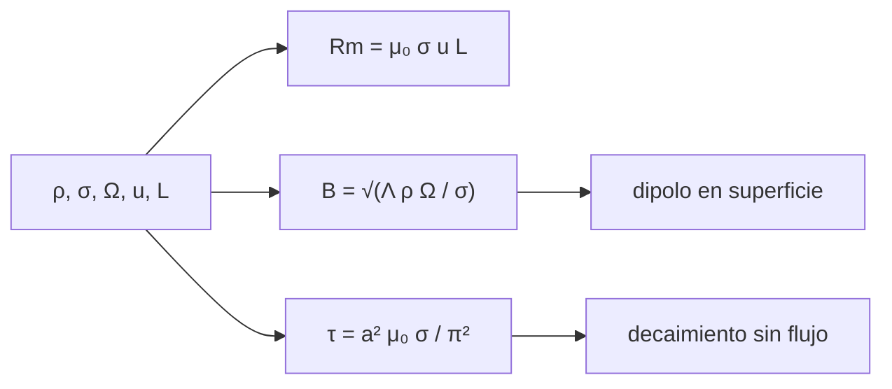

# B65-C02 — Dinamos planetarias y campos magnéticos de origen interno

<!-- nav:top -->
[🏠 Programa](../../../../README.md) · [📚 Bloque B65](../../../tronco-comun/B65-geofisica-de-interiores-planetarios.md) · [← Anterior: B65-C01 — Convección del manto y evolución térmica de interiores planetarios](../B65-C01-conveccion-del-manto-y-evolucion-termica-de-interiores-planetarios/CLASE.md) · [Siguiente: B65-C03 — Magnetismo cortical remanente y anomalías magnéticas →](../B65-C03-magnetismo-cortical-remanente-y-anomalias-magneticas/CLASE.md)
<!-- /nav -->

## 1. Ubicación, nivel y alcance

Clase 2 del bloque B65. Nivel N3. Un campo magnético global que dura miles de millones de años no puede ser un imán permanente: se disiparía en decenas de miles de años. Aquí calculas la **escala de Elsasser** del campo de una dinamo, el **número de Reynolds magnético** que mide si el movimiento del fluido gana a la difusión, y el **tiempo de decaimiento óhmico** de un dipolo, que contrastas con un cálculo numérico. B30 trata los campos solares y la magnetosfera terrestre; esta clase explica el mecanismo interior. Todos los parámetros del núcleo son **ilustrativos**.

## 2. Por qué esta clase existe

La presencia o ausencia de un campo global dice si un cuerpo tiene un fluido conductor en movimiento. La decisión central: **¿qué intensidad de campo permite un núcleo y cuánto duraría ese campo si el movimiento se detuviera?**

## 3. Lo que podrás hacer al terminar

1. Calcular el campo de una dinamo con la escala de Elsasser `Λ = σB²/(ρΩ)`.
2. Calcular el número de Reynolds magnético `Rm = μ₀σuL`.
3. Escalar un campo del núcleo a la superficie suponiendo un dipolo.
4. Resolver numéricamente el decaimiento libre del modo dipolar de una esfera conductora.
5. Contrastar la tasa numérica con `π²η_m/a²`.
6. Explicar por qué un campo de larga duración exige un mecanismo de regeneración.

La evidencia es la **ficha de la dinamo planetaria** del ejercicio 12 (sección 20).

## 4. Con qué llegas y cómo comprobarlo

1. ¿Qué es la conductividad eléctrica?
2. ¿Qué es la difusión?
3. ¿Qué es un campo dipolar?
4. ¿Qué es un valor ilustrativo?
5. ¿Qué es una verificación numérica?

<details>
<summary>Ver respuestas</summary>

1. La capacidad de un material de conducir corriente eléctrica. 2. El esparcimiento de una propiedad por movimiento aleatorio o gradientes, que la suaviza. 3. Un campo con un polo norte y un polo sur, como el de una barra imantada. 4. Un valor propuesto para el ejemplo, no medido. 5. Comparar un cálculo con un resultado analítico o independiente.
</details>

Con cuatro o cinco aciertos, sigue; si no, repasa los prerrequisitos.

## 5. Un caso de contexto y casos de referencia

Un núcleo externo líquido ilustrativo de densidad `1,1×10⁴ kg/m³`, conductividad `5×10⁵ S/m`, que rota con `Ω = 7,292×10⁻⁵ rad/s`, con una velocidad de flujo `5×10⁻⁴ m/s` en un espesor de `2 260 km`, tiene `Rm = 710` y un campo de Elsasser (`Λ = 1`) de `1,267 mT`. Es el **ejemplo conductor**. Los valores son **ilustrativos**: no son medidas del núcleo terrestre.

## 6. Vocabulario

La **dinamo** es la conversión de energía cinética de un fluido conductor en energía magnética. El **número de Reynolds magnético** `Rm = μ₀σuL` compara la inducción por el flujo con la difusión óhmica. El **número de Elsasser** `Λ = σB²/(ρΩ)` compara la fuerza de Lorentz con la de Coriolis. El **tiempo de decaimiento óhmico** es la escala en que un campo desaparece si no se regenera. La **difusividad magnética** es `η_m = 1/(μ₀σ)`.

## 7. Modelo mental: una rueda que se frena sola

Un dínamo de bicicleta convierte movimiento en electricidad; una dinamo planetaria es un dínamo cuyo campo lo produce el propio fluido en movimiento. Sin movimiento, el campo se apaga como una rueda que se frena.



*Descripción textual:* con los parámetros del núcleo se obtienen tres cantidades: `Rm` (si el flujo vence a la difusión), el campo de Elsasser y el tiempo de decaimiento.

Analogía: una rueda que se frena. Límite: son escalas, no una simulación de dinamo.

## 8. La explicación, paso a paso

### 8.1 Escala de Elsasser

Si la fuerza de Lorentz iguala a la de Coriolis (`Λ = 1`), `B = √(Λ ρ Ω / σ)`:

| `Λ` | `B` en el núcleo (mT) |
|---|---|
| 0,1 | 0,401 |
| 1 | 1,267 |
| 10 | 4,005 |

El campo crece con la raíz de `Λ`. Con `Rm = 710` el flujo ilustrativo vence a la difusión en un factor grande.

### 8.2 Del núcleo a la superficie

Un campo dipolar decae con `r⁻³`. Con el radio del núcleo `3,48×10⁶ m` y el de la superficie `6,371×10⁶ m`, `(r_c/R)³ = 0,163`. El campo ecuatorial en la superficie es la mitad del polar, de modo que `B_sup ≈ B_núcleo (r_c/R)³ / 2 = 103,2 µT` (una escala, no una predicción).

### 8.3 Decaimiento sin movimiento

Sin flujo, el modo dipolar poloidal de una esfera conductora en vacío decae como `exp(−t/τ)`, con `τ = a²μ₀σ/π²`. Se resolvió la ecuación radial `S_t = η(S_xx − 2S/x²)` con condición `S'(1) + S(1) = 0` (campo exterior potencial) por diferencias finitas implícitas con 400 celdas:

| Magnitud | Numérico | Analítico |
|---|---|---|
| Tasa (unidades `η/a²`) | 9,85984 | `π² = 9,86960` |
| Error relativo | `9,9×10⁻⁴` | — |

Con `a = 3 480 km`, `τ = 24 431 años` (parámetros ilustrativos).

### 8.4 Lectura

El campo del núcleo ilustrativo se apagaría en decenas de miles de años sin flujo, mucho menos que la edad de un planeta: por eso un campo duradero exige regeneración continua. La clase no explica cómo se regenera (eso exige resolver las ecuaciones de inducción y de movimiento), solo da la escala.

## 9. Magnitudes, símbolos y unidades

| Símbolo | Qué es | Unidad | Valor / nota |
|---|---|---|---|
| `μ₀` | permeabilidad del vacío | N A⁻² | `1,25663706127×10⁻⁶` (NIST) |
| `σ` | conductividad eléctrica | S/m | `5×10⁵` (ilustrativo) |
| `ρ` | densidad del fluido | kg/m³ | `1,1×10⁴` (ilustrativo) |
| `Ω` | velocidad angular | rad/s | `7,292×10⁻⁵` (ilustrativo) |
| `Rm` | Reynolds magnético | — | 710 |
| `B` | campo del núcleo | mT | 1,267 |
| `τ` | decaimiento óhmico | años | 24 431 |

## 10. Convenciones y referencias

Unidades SI; el campo en tesla (1 mT = 10⁻³ T). La esfera es conductora uniforme, con exterior en vacío; los modos se numeran por su grado esférico `l`, aquí `l = 1` (dipolo). Un año es `3,15576×10⁷ s`.

## 11. De dónde sale lo que afirmamos

| ID | Fuente | Localizador | Respalda | Estado |
|---|---|---|---|---|
| S1 | NIST, *Fundamental Physical Constants* (CODATA 2022) | https://physics.nist.gov/cuu/Constants/Table/allascii.txt | `μ₀` | Consultada el 2026-11-09 |
| S2 | Yadav et al., arXiv:1304.6163 | https://arxiv.org/abs/1304.6163 | La intensidad del campo y la velocidad siguen una ley de potencia con la potencia de flotabilidad en simulaciones de dinamo | Solo resumen, consultado el 2026-11-09 |
| S3 | Cálculo de la clase | `dinamo.py` | Escala de Elsasser, `Rm` y decaimiento óhmico | Verificado numéricamente; las fórmulas clásicas **no se consultaron** en un texto |

Límites: no se consultó ninguna fuente sobre el núcleo terrestre ni sobre otro cuerpo; los parámetros del núcleo son ilustrativos y `Λ = 1` es una hipótesis de escala.

## 12. Cómo ver la dinamo planetaria

| Magnitud | Valor |
|---|---|
| `B` (Elsasser, `Λ = 1`) | 1,267 mT |
| `Rm` | 710 |
| `B` ecuatorial en superficie (escala) | 103,2 µT |
| `τ` sin flujo | 24 431 años |

Descripción larga: el campo del núcleo depende de la raíz de la densidad, de la rotación y de la inversa de la conductividad, y sin flujo se apaga en una escala mucho menor que la edad de un planeta.

## 13. Ejemplo trabajado: el campo de Elsasser

**Paso 1 · Cociente.** `ρΩ/σ = 1,1×10⁴ × 7,292×10⁻⁵ / 5×10⁵ = 1,604×10⁻⁶ T²`.

**Paso 2 · Raíz.** `B = √(1,604×10⁻⁶) = 1,267×10⁻³ T`.

**Paso 3 · Unidades.** `1,267 mT`.

## 14. Distintas formas de describir la dinamo

**Por escala:** Elsasser. **Por umbral:** `Rm`. **Por tiempo:** `τ`. **Por geometría:** modo `l = 1` con exterior potencial.

## 15. Práctica guiada

**Ejercicio 1 · con los pasos indicados.** Calcula `B` para `Λ = 1`. *Pasos:* `ρΩ/σ` y raíz.

<details><summary>Solución comentada</summary>

`1,267 mT` (ejemplo 13).
</details>

**Ejercicio 2 · con una pista.** ¿Cuánto vale `B` para `Λ = 10`? *Pista:* factor `√10`.

<details><summary>Solución comentada</summary>

`1,267 × 3,162 = 4,005 mT`.
</details>

**Ejercicio 3 · casi autónomo.** Calcula `Rm` con los valores de la sección 5.

<details><summary>Solución comentada</summary>

`1,2566×10⁻⁶ × 5×10⁵ = 0,6283`; `× 5×10⁻⁴ = 3,1416×10⁻⁴`; `× 2,26×10⁶ = 710`.
</details>

## 16. Práctica autónoma, transferencia e integrador

**Ejercicio 4.** Calcula `(r_c/R)³` con `3 480` y `6 371 km`.

<details><summary>Solución comentada</summary>

`0,5462³ = 0,163`.
</details>

**Ejercicio 5.** Campo ecuatorial en superficie.

<details><summary>Solución comentada</summary>

`1,267 mT × 0,163 / 2 = 103 µT`.
</details>

**Ejercicio 6.** ¿Qué pasa con `τ` si `σ` se reduce a la mitad?

<details><summary>Solución comentada</summary>

`τ ∝ σ`: baja a `12 216 años`. El campo de Elsasser sube por `√2` (`1,79 mT`).
</details>

**Ejercicio 7.** ¿Qué error relativo da el cálculo numérico de la tasa de decaimiento?

<details><summary>Solución comentada</summary>

`9,9×10⁻⁴`, dentro de la tolerancia de `2×10⁻³`.
</details>

**Ejercicio 8.** Si el flujo se anula, ¿cuánto vale `Rm`?

<details><summary>Solución comentada</summary>

Cero: no hay inducción y el campo decae en `τ`.
</details>

**Ejercicio 9 · transferencia.** **Transferencia.** Un colega afirma que «el campo del núcleo terrestre es de 1,27 mT, calculado». Responde.

<details><summary>Solución comentada</summary>

Es una escala con parámetros ilustrativos y la hipótesis `Λ = 1`; no es una medida ni una predicción del núcleo terrestre.
</details>

**Ejercicio 10 · transferencia.** **Transferencia.** Si un cuerpo gira con la mitad de `Ω`, ¿cómo cambia el campo de Elsasser?

<details><summary>Solución comentada</summary>

Baja por `√2`: `0,896 mT`.
</details>

**Ejercicio 11 · transferencia.** **Transferencia.** Un cuerpo no tiene campo global. ¿Qué dos explicaciones caben y qué clase de dato las distinguiría?

<details><summary>Solución comentada</summary>

Falta de fluido conductor líquido o de movimiento que lo regenere; distinguirlas exige datos de estructura interior (gravedad, sísmica), como en B65-C05. Esta clase no decide entre ellas.
</details>

**Ejercicio 12.** **Integrador.** Elabora tu *ficha de la dinamo planetaria*: `Rm`, campo de Elsasser, campo en superficie y tiempo de decaimiento, con unidades y lo ilustrativo rotulado.

<details><summary>Solución modelo</summary>

Secciones 8.1–8.4 y los ejercicios 1, 3, 5 y 6.
</details>

## 17. Laboratorio: dinamo y decaimiento óhmico

El script [dinamo.py](dinamo.py) calcula el campo de Elsasser, `Rm` y el campo en superficie, y resuelve por diferencias finitas el decaimiento del dipolo para contrastarlo con `π²` (**comprueba** el error relativo < 2e-3).

**Datos:** `μ₀` consultada; el resto **ilustrativo**. **Predice antes de ejecutar:** ¿la tasa numérica será mayor o menor que `π²`? (algo menor: 9,860.) **Ejecución del 2026-11-09 (Python 3.12.9):**

```text
Python 3.12.9 (biblioteca estandar)
Elsasser (Lambda = 1): B_nucleo = 1.267 mT ; Rm = mu0 sigma u L = 710.0 ; dipolo en superficie (B_nucleo (rc/R)^3 / 2) = 103.2 uT
  Lambda =   0.1 -> B_nucleo = 0.401 mT
  Lambda =   1.0 -> B_nucleo = 1.267 mT
  Lambda =  10.0 -> B_nucleo = 4.005 mT
Tasa de decaimiento (unidades eta/a^2): diferencias finitas = 9.85984 ; analitica pi^2 = 9.86960 ; error relativo = 9.90e-04
Tiempo de decaimiento tau = a^2 mu0 sigma / pi^2 con a = radio del nucleo (3.48e6 m): 24431 anos
Pruebas superadas.
```

```bash
python programa/clases/B65/B65-C02-dinamos-planetarias-y-campos-magneticos-de-origen-interno/dinamo.py
```

**Límites:** conductividad uniforme, sin flujo, escalas y no una dinamo resuelta.

## 18. Errores frecuentes y cómo corregirlos

**Pensar que el campo es un imán congelado.** Se corrige con 8.3 y 8.4.

**Tomar `Λ = 1` como una ley.** Se corrige con la sección 11.

**Olvidar que el dipolo cae con `r⁻³`.** Se corrige con 8.2.

**Confundir `Rm` grande con la existencia de dinamo.** Se corrige con la sección 6: `Rm` es una condición necesaria, no suficiente.

## 19. Cómo sabrás que vas bien

Tras la sección 8: ¿qué resultado esperabas y cuál obtuviste? Si dudas, repasa el ejemplo 13. Tras el laboratorio: ¿qué comprueba? (ver la sección 17).

## 20. Qué entregas y cómo se evalúa

El producto es tu **ficha de la dinamo planetaria** (ejercicio 12).

| Criterio | Inicial | En desarrollo | Logrado | Destacado |
|---|---|---|---|---|
| Conceptos | Los confunde | Parciales | Conceptos de la clase | Explica los límites |
| Cálculo | Sin unidades | Con errores | Tablas completas | Calcula casos nuevos |
| Numérico | Sin comprobar | Un caso | Contraste con el análisis | Interpreta las diferencias |
| Fuentes | Sin fuente | Sin fecha | Fuentes con fecha | Declara lo ilustrativo |
| Límites | No los nombra | Uno | Tres | Discute qué falta del modelo |

**Condiciones críticas (no se compensan con promedio):** rotular los parámetros del núcleo como ilustrativos; no presentar la escala como una predicción; citar solo lo consultado.

## 21. Ética, seguridad y límites

Clase educativa: los modelos son simplificados. Accesibilidad: tablas equivalentes a las gráficas, fórmulas en texto, ejercicios sin conexión.

## 22. Para cerrar y seguir

Un núcleo ilustrativo con `Rm = 710` tiene un campo de Elsasser de `1,27 mT`, y sin movimiento ese campo se apagaría en unos `2,4×10⁴` años. Queda una pregunta: ¿qué queda del campo cuando la dinamo se apaga? La respuesta está en las rocas magnetizadas.

**Glosario español–inglés.** dinamo · *dynamo*; número de Elsasser · *Elsasser number*; número de Reynolds magnético · *magnetic Reynolds number*; decaimiento óhmico · *Ohmic decay*; difusividad magnética · *magnetic diffusivity*.

**Continuidad.** [B65-C03](../B65-C03-magnetismo-cortical-remanente-y-anomalias-magneticas/CLASE.md) estudia el magnetismo cortical remanente.

**Referencias:** ver sección 11.

<!-- nav:bottom -->
---

[← Anterior: B65-C01 — Convección del manto y evolución térmica de interiores planetarios](../B65-C01-conveccion-del-manto-y-evolucion-termica-de-interiores-planetarios/CLASE.md) · [📚 Bloque B65](../../../tronco-comun/B65-geofisica-de-interiores-planetarios.md) · [Siguiente: B65-C03 — Magnetismo cortical remanente y anomalías magnéticas →](../B65-C03-magnetismo-cortical-remanente-y-anomalias-magneticas/CLASE.md)
<!-- /nav -->
