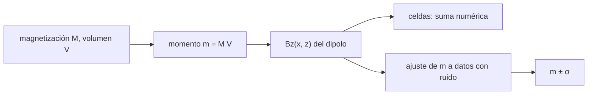

# B65-C03 — Magnetismo cortical remanente y anomalías magnéticas

<!-- nav:top -->
[🏠 Programa](../../../../README.md) · [📚 Bloque B65](../../../tronco-comun/B65-geofisica-de-interiores-planetarios.md) · [← Anterior: B65-C02 — Dinamos planetarias y campos magnéticos de origen interno](../B65-C02-dinamos-planetarias-y-campos-magneticos-de-origen-interno/CLASE.md) · [Siguiente: B65-C04 — Flujo térmico planetario y balance térmico del interior →](../B65-C04-flujo-termico-planetario-y-balance-termico-del-interior/CLASE.md)
<!-- /nav -->

## 1. Ubicación, nivel y alcance

Clase 3 del bloque B65. Nivel N3. Cuando una dinamo se apaga, la corteza que se enfrió bajo ella puede conservar una **magnetización remanente**: un registro del campo antiguo. Aquí calculas la anomalía magnética de un bloque de corteza sintético, lo contrastas con una integración numérica, recuperas su momento a partir de datos con ruido y estimas hasta qué profundidad puede estar magnetizada la corteza. Usas [B10](../../../tronco-comun/B10-algebra-lineal-y-matematicas-geometricas.md) para los vectores. Los datos son **sintéticos**: no se modela ninguna región de Marte ni de la Luna.

## 2. Por qué esta clase existe

La corteza magnetizada permite reconstruir campos de cuerpos que hoy no tienen dinamo. La decisión central: **¿qué parte de un mapa de anomalías es información sobre la magnetización y qué parte es ambigüedad geométrica?**

## 3. Lo que podrás hacer al terminar

1. Calcular el campo de una esfera uniformemente magnetizada como el de un dipolo.
2. Contrastar la solución cerrada con una integración numérica por celdas.
3. Ajustar el momento magnético a datos con ruido y dar su error estándar.
4. Predecir cómo cae la anomalía con la altura de observación.
5. Estimar una profundidad de Curie.
6. Explicar por qué la anomalía determina el momento y no el volumen y la magnetización por separado.

La evidencia es la **ficha de la anomalía magnética** del ejercicio 12 (sección 20).

## 4. Con qué llegas y cómo comprobarlo

1. ¿Qué es un dipolo magnético?
2. ¿Qué es la magnetización?
3. ¿Qué es un ajuste por mínimos cuadrados?
4. ¿Qué es un dato sintético?
5. ¿Qué es una relación señal/ruido?

<details>
<summary>Ver respuestas</summary>

1. Un par de polos magnéticos cuyo campo cae con el cubo de la distancia. 2. El momento magnético por unidad de volumen. 3. Elegir el parámetro que minimiza la suma de los cuadrados de los residuos. 4. Un dato generado por el autor, no medido. 5. El cociente entre la amplitud de la señal y la del ruido.
</details>

Con cuatro o cinco aciertos, sigue; si no, repasa los prerrequisitos.

## 5. Un caso de contexto y casos de referencia

Una esfera de 50 km de radio con magnetización uniforme vertical de `5 A/m` tiene un momento `m = 2,618×10¹⁵ A·m²`; observada 150 km sobre su cima (200 km sobre su centro) produce una anomalía vertical de `65,45 nT` en su vertical. Es el **ejemplo conductor**. Todo es **sintético**.

## 6. Vocabulario

La **magnetización remanente** es la que una roca conserva sin campo externo. Una **anomalía magnética** es la diferencia entre el campo observado y el campo de referencia. La **temperatura de Curie** es aquella por encima de la cual un mineral pierde su magnetización. El **momento magnético** `m = M V` es la magnetización por el volumen. La **profundidad de Curie** es la profundidad donde la temperatura alcanza la de Curie.

## 7. Modelo mental: un imán enterrado y un compás que sobrevuela

Un imán enterrado desvía un compás que pasa por encima; cuanto más alto pasa el compás, más suave es la desviación.



*Descripción textual:* la magnetización y el volumen se combinan en un momento; el momento fija la anomalía; la anomalía se calcula de dos formas y se invierte con mínimos cuadrados.

Analogía: un imán enterrado y un compás. Límite: magnetización uniforme y vertical, sin campo inductor, sin curvatura planetaria.

## 8. La explicación, paso a paso

### 8.1 La esfera es un dipolo

El campo exterior de una esfera uniformemente magnetizada es el de un dipolo `m = (4/3)πa³M`. Se verificó sumando los dipolos de 24 celdas cúbicas por lado (con el volumen de las celdas corregido), en `z = 200 km`:

| `x` (km) | `Bz` dipolo (nT) | `Bz` celdas (nT) | diferencia (nT) |
|---|---|---|---|
| 0 | 65,4498 | 65,4551 | −0,00527 |
| 100 | 32,7825 | 32,7818 | 0,00064 |
| 200 | 5,7850 | 5,7850 | −0,00002 |
| 400 | −1,1708 | −1,1708 | −0,00001 |

La mayor diferencia es el `8,1×10⁻⁵` del pico.

### 8.2 Ajuste con ruido

Con 41 puntos entre `x = −400` y `+400 km`, ruido gaussiano de 2 nT y semilla 20261109, el ajuste lineal da `m = 2,6051×10¹⁵ A·m²`, con error estándar `2,91×10¹³`, frente al valor verdadero `2,6180×10¹⁵`: la diferencia es `−0,44 σ`. La relación señal/ruido del pico es `32,7`.

### 8.3 Altura y profundidad

El pico a 150 km sobre la cima es `11,391` veces el de 400 km, que coincide con `((A+400)/(A+150))³ = 11,391` (`A = 50 km`). La profundidad de Curie ilustrativa, con `T_C = 853 K`, `T_s = 210 K` y un gradiente de `15 K/km`, es `(853 − 210)/15 = 42,9 km`.

### 8.4 Lectura

La anomalía depende de `m = MV`: una esfera de la mitad del radio y ocho veces más magnetizada da la misma anomalía. El mapa no distingue magnetización y volumen sin otra información. Los valores de `T_C` y del gradiente son ilustrativos.

## 9. Magnitudes, símbolos y unidades

| Símbolo | Qué es | Unidad | Valor / nota |
|---|---|---|---|
| `m` | momento magnético | A·m² | `2,618×10¹⁵` |
| `M` | magnetización | A/m | 5 (sintético) |
| `a` | radio de la esfera | km | 50 (sintético) |
| `Bz` | anomalía vertical | nT | 65,45 (pico) |
| `σ` | ruido | nT | 2 (sintético) |
| `T_C` | temperatura de Curie | K | 853 (ilustrativo) |

## 10. Convenciones y referencias

Sistema de coordenadas con `x` horizontal y `z` hacia arriba, origen en el centro de la esfera; `Bz` en nT (1 nT `= 10⁻⁹ T`). `μ₀ = 1,25663706127×10⁻⁶ N A⁻²`. El dipolo vertical produce `Bz = (μ₀/4π) m (3 z²/r² − 1)/r³`.

## 11. De dónde sale lo que afirmamos

| ID | Fuente | Localizador | Respalda | Estado |
|---|---|---|---|---|
| S1 | NIST, *Fundamental Physical Constants* (CODATA 2022) | https://physics.nist.gov/cuu/Constants/Table/allascii.txt | `μ₀` | Consultada el 2026-11-09 |
| S2 | Acuña et al., *Global Distribution of Crustal Magnetization Discovered by the Mars Global Surveyor MAG/ER Experiment*, Science 284, 790–793 (1999), doi:10.1126/science.284.5415.790 | https://doi.org/10.1126/science.284.5415.790 | Los datos se tomaron a unos 100–200 km de altitud; hay fuentes magnetizadas alineadas con las tierras altas, sin magnetización cortical cerca de las grandes cuencas Hellas y Argyre, lo que sugiere que la dinamo se apagó hace unos 4 Ga | Solo resumen (vía Crossref), consultado el 2026-11-09 |
| S3 | Cálculo de la clase | `anomalia.py` | Dipolo, integración, ajuste | Verificado numéricamente; la fórmula del dipolo **no se consultó** en un texto |

Límites: el artículo de Acuña solo se leyó en resumen; la esfera, la magnetización y el ruido son sintéticos y no reproducen ninguna anomalía observada.

## 12. Cómo ver la anomalía magnética

| Magnitud | Valor |
|---|---|
| `m` verdadero | `2,618×10¹⁵ A·m²` |
| `m` ajustado | `(2,605 ± 0,029)×10¹⁵ A·m²` |
| Pico | 65,45 nT |
| Profundidad de Curie (ilustrativa) | 42,9 km |

Descripción larga: la anomalía cae como el cubo de la distancia, cambia de signo en `x = √2 z` y su amplitud solo fija el producto magnetización por volumen.

## 13. Ejemplo trabajado: el pico de la anomalía

**Paso 1 · Momento.** `m = (4/3)π(5×10⁴)³ × 5 = 2,618×10¹⁵ A·m²`.

**Paso 2 · Campo en la vertical.** Con `x = 0`, `Bz = (μ₀/4π) · 2m/z³`.

**Paso 3 · Números.** `10⁻⁷ × 2 × 2,618×10¹⁵ / (2×10⁵)³ = 6,545×10⁻⁸ T`.

**Paso 4 · Unidades.** `65,45 nT`.

## 14. Distintas formas de describir la anomalía

**Por fórmula:** dipolo. **Por suma:** celdas. **Por ajuste:** `m ± σ`. **Por altura:** ley de `z⁻³`.

## 15. Práctica guiada

**Ejercicio 1 · con los pasos indicados.** Calcula `m` para `a = 50 km` y `M = 5 A/m`. *Pasos:* `(4/3)πa³M`.

<details><summary>Solución comentada</summary>

`2,618×10¹⁵ A·m²`.
</details>

**Ejercicio 2 · con una pista.** Calcula el pico `Bz`. *Pista:* ejemplo 13.

<details><summary>Solución comentada</summary>

`65,45 nT`.
</details>

**Ejercicio 3 · casi autónomo.** ¿Cuánto cae el pico al pasar de 150 a 400 km sobre la cima?

<details><summary>Solución comentada</summary>

`(450/200)³ = 11,39` veces.
</details>

## 16. Práctica autónoma, transferencia e integrador

**Ejercicio 4.** Calcula `Bz` en `x = 200 km`, `z = 200 km`.

<details><summary>Solución comentada</summary>

`r = 282,8 km`, `3z²/r² − 1 = 0,5`; `Bz = 10⁻⁷ × 2,618×10¹⁵ × 0,5 / (2,828×10⁵)³ = 5,79 nT`.
</details>

**Ejercicio 5.** ¿Por qué `Bz(400 km)` es negativo?

<details><summary>Solución comentada</summary>

Porque `3z²/r² − 1 = −0,4 < 0`: pasado `x = √2 z`, el campo vertical del dipolo se invierte.
</details>

**Ejercicio 6.** Error relativo del momento ajustado.

<details><summary>Solución comentada</summary>

`2,91×10¹³ / 2,6051×10¹⁵ = 1,1 %`.
</details>

**Ejercicio 7.** ¿Dónde se anula `Bz`?

<details><summary>Solución comentada</summary>

En `x = √2 z = 282,8 km`.
</details>

**Ejercicio 8.** Profundidad de Curie con un gradiente de `30 K/km`.

<details><summary>Solución comentada</summary>

`643/30 = 21,4 km`: un gradiente mayor reduce la capa magnetizada.
</details>

**Ejercicio 9 · transferencia.** **Transferencia.** Un colega dice que, a partir de la anomalía, determinó que la roca tiene 5 A/m. Responde.

<details><summary>Solución comentada</summary>

La anomalía fija `m = MV`: una fuente de la mitad del radio y 40 A/m (8 veces más) da la misma señal. Hace falta otra información (el volumen) para separar.
</details>

**Ejercicio 10 · transferencia.** **Transferencia.** El resumen de Acuña et al. dice que no hay magnetización cortical cerca de Hellas y Argyre. ¿Qué lectura sugieren los autores y qué límite tiene esta clase para sostenerla?

<details><summary>Solución comentada</summary>

Sugieren que la dinamo se apagó hace unos 4 Ga. La clase solo leyó el resumen y no reproduce los datos; no puede evaluar la inferencia.
</details>

**Ejercicio 11 · transferencia.** **Transferencia.** ¿Qué cambia si el observador vuela a 400 km en vez de 150?

<details><summary>Solución comentada</summary>

La señal cae 11,4 veces (pico de 5,7 nT) y la relación señal/ruido con 2 nT baja a 2,9: la fuente puede quedar casi enterrada en el ruido.
</details>

**Ejercicio 12.** **Integrador.** Elabora tu *ficha de la anomalía magnética*: `m`, pico, ajuste con error, caída con la altura y profundidad de Curie.

<details><summary>Solución modelo</summary>

Secciones 8.1–8.4 y los ejercicios 1, 2, 3 y 6.
</details>

## 17. Laboratorio: anomalía de una esfera magnetizada

El script [anomalia.py](anomalia.py) compara el dipolo con la suma de celdas, ajusta `m` a datos sintéticos con ruido y calcula la caída con la altura (**comprueba** la diferencia < 1e-3 del pico y el error del ajuste < 3σ).

**Datos:** `μ₀` consultada; esfera, magnetización, ruido y `T_C` **sintéticos o ilustrativos**. **Predice antes de ejecutar:** ¿qué cociente de picos habrá entre 150 y 400 km? (`(450/200)³ ≈ 11,4`.) **Ejecución del 2026-11-09 (Python 3.12.9):**

```text
Python 3.12.9 (biblioteca estandar)
Esfera sintetica: a = 50 km, M = 5.0 A/m, momento m = 2.6180e+15 A m^2, altura de observacion sobre el centro = 200 km
 x [km]   Bz dipolo [nT]   Bz celdas [nT]   dif [nT]
     0          65.4498          65.4551   -0.00527
   100          32.7825          32.7818    0.00064
   200           5.7850           5.7850   -0.00002
   400          -1.1708          -1.1708   -0.00001
Maxima diferencia / pico = 8.06e-05
Ajuste lineal (41 puntos, ruido 2.0 nT, semilla 20261109): m_ajustado = 2.6051e+15 A m^2 ; error estandar = 2.91e+13 ; verdadero = 2.6180e+15
Diferencia = -0.44 sigma ; Bz pico = 65.450 nT (relacion senal/ruido = 32.7)
Pico a 150 km / pico a 400 km sobre la cima = 11.391 ; (z2/z1)^3 = 11.391
Profundidad de Curie ilustrativa: (853 - 210) K / 15 K/km = 42.9 km
Pruebas superadas.
```

```bash
python programa/clases/B65/B65-C03-magnetismo-cortical-remanente-y-anomalias-magneticas/anomalia.py
```

**Límites:** esfera uniforme y vertical, sin campo inductor.

## 18. Errores frecuentes y cómo corregirlos

**Creer que la anomalía determina la magnetización.** Se corrige con 8.4.

**Olvidar el cambio de signo fuera de la vertical.** Se corrige con el ejercicio 5.

**Confundir nT y T.** Se corrige con la sección 10.

**Presentar la esfera como una región de Marte.** Se corrige con la sección 11.

## 19. Cómo sabrás que vas bien

Tras la sección 8: ¿qué resultado esperabas y cuál obtuviste? Si dudas, repasa el ejemplo 13. Tras el laboratorio: ¿qué comprueba? (ver la sección 17).

## 20. Qué entregas y cómo se evalúa

El producto es tu **ficha de la anomalía magnética** (ejercicio 12).

| Criterio | Inicial | En desarrollo | Logrado | Destacado |
|---|---|---|---|---|
| Conceptos | Los confunde | Parciales | Conceptos de la clase | Explica los límites |
| Cálculo | Sin unidades | Con errores | Tablas completas | Calcula casos nuevos |
| Numérico | Sin comprobar | Un caso | Contraste con el análisis | Interpreta las diferencias |
| Fuentes | Sin fuente | Sin fecha | Fuentes con fecha | Declara lo sintético |
| Límites | No los nombra | Uno | Tres | Discute qué falta del modelo |

**Condiciones críticas (no se compensan con promedio):** rotular la esfera como sintética; no presentarla como una anomalía observada; citar solo lo consultado.

## 21. Ética, seguridad y límites

Clase educativa: los modelos son simplificados. Accesibilidad: tablas equivalentes a las gráficas, fórmulas en texto, ejercicios sin conexión.

## 22. Para cerrar y seguir

Una esfera sintética de `m = 2,6×10¹⁵ A·m²` da 65 nT a 200 km y su momento se recupera con un 1 % de error, pero no su volumen ni su magnetización por separado. Queda una pregunta: ¿de dónde viene el calor que mantiene el núcleo líquido y la convección?

**Glosario español–inglés.** magnetización remanente · *remanent magnetization*; anomalía magnética · *magnetic anomaly*; temperatura de Curie · *Curie temperature*; momento magnético · *magnetic moment*; relación señal/ruido · *signal-to-noise ratio*.

**Continuidad.** [B65-C04](../B65-C04-flujo-termico-planetario-y-balance-termico-del-interior/CLASE.md) estudia el flujo térmico planetario.

**Referencias:** ver sección 11.

<!-- nav:bottom -->
---

[← Anterior: B65-C02 — Dinamos planetarias y campos magnéticos de origen interno](../B65-C02-dinamos-planetarias-y-campos-magneticos-de-origen-interno/CLASE.md) · [📚 Bloque B65](../../../tronco-comun/B65-geofisica-de-interiores-planetarios.md) · [Siguiente: B65-C04 — Flujo térmico planetario y balance térmico del interior →](../B65-C04-flujo-termico-planetario-y-balance-termico-del-interior/CLASE.md)
<!-- /nav -->
