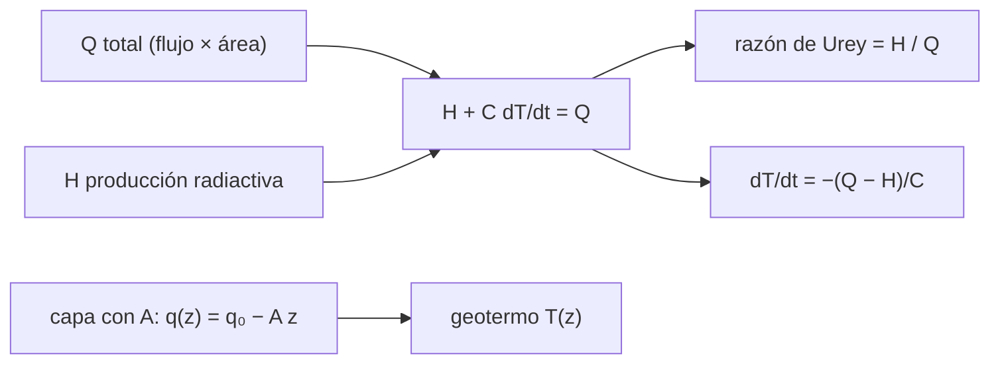

# B65-C04 — Flujo térmico planetario y balance térmico del interior

<!-- nav:top -->
[🏠 Programa](../../../../README.md) · [📚 Bloque B65](../../../tronco-comun/B65-geofisica-de-interiores-planetarios.md) · [← Anterior: B65-C03 — Magnetismo cortical remanente y anomalías magnéticas](../B65-C03-magnetismo-cortical-remanente-y-anomalias-magneticas/CLASE.md) · [Siguiente: B65-C05 — Inversión geofísica conjunta: validación de modelos interiores →](../B65-C05-inversion-geofisica-conjunta-validacion-de-modelos-interiores/CLASE.md)
<!-- /nav -->

## 1. Ubicación, nivel y alcance

Clase 4 del bloque B65. Nivel N3. El flujo de calor que atraviesa la superficie es la única medida directa del balance térmico de un interior. Aquí conviertes un flujo total en un flujo medio, resuelves un **geotermo** con producción radiactiva, calculas el flujo de una litosfera que se enfría como un semiespacio y planteas el balance entre calor radiactivo y enfriamiento secular. B52-C17 trata la evolución térmica por colisiones; esta clase trata el balance térmico estacionario y secular. Usas [B10](../../../tronco-comun/B10-algebra-lineal-y-matematicas-geometricas.md) para el cálculo. Salvo el flujo total de la Tierra, los valores son **ilustrativos**.

## 2. Por qué esta clase existe

Un planeta se enfría en parte porque pierde calor guardado y en parte vive del que producen sus isótopos radiactivos. La decisión central: **¿qué fracción del calor que sale es producción actual y qué fracción es enfriamiento?**

## 3. Lo que podrás hacer al terminar

1. Convertir un flujo total en un flujo medio con unidades.
2. Resolver un geotermo con producción radiactiva y contrastarlo con diferencias finitas.
3. Calcular el flujo de una litosfera oceánica que se enfría y contrastarlo con una simulación.
4. Calcular una razón de Urey y una tasa de enfriamiento secular.
5. Reconocer que el flujo en la base de una capa radiactiva es menor que en superficie.
6. Declarar qué valores son medidos y cuáles ilustrativos.

La evidencia es la **ficha del balance térmico** del ejercicio 12 (sección 20).

## 4. Con qué llegas y cómo comprobarlo

1. ¿Qué es un flujo de calor?
2. ¿Qué es la conductividad térmica?
3. ¿Qué es un gradiente?
4. ¿Qué es un valor ilustrativo?
5. ¿Qué es una verificación numérica?

<details>
<summary>Ver respuestas</summary>

1. La energía por unidad de tiempo y de área que atraviesa una superficie. 2. La propiedad que relaciona el flujo de calor con el gradiente de temperatura. 3. El cambio de una magnitud por unidad de longitud. 4. Un valor propuesto para el ejemplo, no medido. 5. Comparar un cálculo con un resultado analítico o independiente.
</details>

Con cuatro o cinco aciertos, sigue; si no, repasa los prerrequisitos.

## 5. Un caso de contexto y casos de referencia

El flujo total de calor de la Tierra se estima en `47 ± 2 TW` (Davies y Davies, 2010), que repartido sobre `5,1006×10¹⁴ m²` da `92,15 mW/m²`. Una capa de corteza de 30 km con producción radiactiva `1 µW/m³` aporta `30 mW/m²` de un flujo superficial ilustrativo de `65 mW/m²`. Es el **ejemplo conductor**; solo el flujo total de la Tierra y su radio proceden de fuentes, el resto es **ilustrativo**.

## 6. Vocabulario

El **flujo térmico superficial** `q` es la potencia que atraviesa una superficie por unidad de área (W/m²). El **geotermo** es el perfil de temperatura con la profundidad. La **producción radiactiva** `A` es el calor por unidad de volumen que liberan los isótopos. El **enfriamiento secular** es la pérdida del calor almacenado. La **razón de Urey** es el cociente entre la producción radiactiva y el calor total que sale.

## 7. Modelo mental: una casa con calefacción y con una estufa que se apaga

Una casa pierde calor por las paredes; una parte la repone la calefacción (la producción radiactiva) y el resto la pierde el aire acumulado que se enfría (el enfriamiento secular).



*Descripción textual:* el flujo total que sale se reparte entre producción radiactiva y calor almacenado; el perfil de temperatura de una capa radiactiva sale de su flujo superficial y de su producción.

Analogía: calefacción y aire acumulado. Límite: conducción 1D, propiedades constantes, una sola temperatura media.

## 8. La explicación, paso a paso

### 8.1 Flujo medio

`q̄ = Q/(4πR²) = 47 TW / 5,1006×10¹⁴ m² = 92,15 mW/m²`. La incertidumbre de `±2 TW` equivale a `±3,92 mW/m²`. Es un promedio global: el flujo local varía mucho.

### 8.2 Geotermo con producción radiactiva

Con `k = 3 W m⁻¹K⁻¹`, `A = 1 µW/m³` y `q₀ = 65 mW/m²`, el geotermo estacionario es `T(z) = T_s + q₀z/k − Az²/(2k)`. A 30 km: `T = 273 + 650 − 150 = 773 K`. Se verificó resolviendo `kT'' = −A` por diferencias finitas con 300 intervalos y temperaturas fijas en ambos extremos: el flujo superficial recuperado es `65,0000 mW/m²` (error `4×10⁻¹⁴`). En la base de la capa el flujo es `q₀ − AL = 35 mW/m²`: la capa aporta `30 mW/m²`.

### 8.3 Litosfera que se enfría

Para un semiespacio que se enfría desde `ΔT = 1 300 K` con `κ = 10⁻⁶ m²/s` y `k = 3`, `q = kΔT/√(πκt)`:

| Edad (Ma) | `q` analítico (mW/m²) | `q` diferencias finitas (mW/m²) | error |
|---|---|---|---|
| 10 | 123,86 | 123,89 | `2,0×10⁻⁴` |
| 50 | 55,39 | 55,39 | `4,0×10⁻⁵` |
| 100 | 39,17 | 39,17 | `2,0×10⁻⁵` |

El flujo cae como `t^{-1/2}`.

### 8.4 Balance y lectura

Con una producción radiactiva ilustrativa de 20 TW, la razón de Urey es `20/47 = 0,426` y el enfriamiento secular saca `27 TW`, lo que equivale a `dT/dt = −122 K/Ga` con `C = 7×10²⁷ J/K`. Esas cifras dependen de `H` y `C`, que son ilustrativos: la clase enseña el cálculo, no el valor terrestre.

## 9. Magnitudes, símbolos y unidades

| Símbolo | Qué es | Unidad | Valor / nota |
|---|---|---|---|
| `Q` | flujo total | TW | 47 ± 2 (Tierra, Davies y Davies 2010) |
| `q̄` | flujo medio | mW/m² | 92,15 |
| `k` | conductividad | W m⁻¹K⁻¹ | 3 (ilustrativo) |
| `A` | producción radiactiva | W/m³ | `10⁻⁶` (ilustrativo) |
| `κ` | difusividad térmica | m²/s | `10⁻⁶` (ilustrativo) |
| `H` | calor radiactivo | TW | 20 (ilustrativo) |

## 10. Convenciones y referencias

Unidades SI; `z` hacia abajo desde la superficie; el flujo positivo sale del planeta. Radio de la Tierra `6 371 km` (volumétrico, NASA). Un año es `3,15576×10⁷ s`; 1 Ga `= 10⁹` años. La temperatura superficial es `273 K` (ilustrativa).

## 11. De dónde sale lo que afirmamos

| ID | Fuente | Localizador | Respalda | Estado |
|---|---|---|---|---|
| S1 | Davies y Davies, *Earth's surface heat flux*, Solid Earth 1, 5–24 (2010), doi:10.5194/se-1-5-2010 | https://se.copernicus.org/articles/1/5/2010/ | Estimación del flujo total `47 ± 2 TW` con 38 347 mediciones | Solo resumen, consultado el 2026-11-09 |
| S2 | NASA/GSFC NSSDC, *Earth Fact Sheet* | https://nssdc.gsfc.nasa.gov/planetary/factsheet/earthfact.html | Radio volumétrico medio `6 371,000 km` | Consultada el 2026-11-09 (actualizada el 2024-11-15) |
| S3 | Cálculo de la clase | `balance.py` | Geotermo, semiespacio, balance | Verificado numéricamente; las fórmulas clásicas **no se consultaron** en un texto |

Límites: el artículo de Davies y Davies solo se leyó en resumen; no se consultó el reparto continental–oceánico ni la producción radiactiva terrestre, y `H`, `A`, `k`, `κ`, `C` son ilustrativos.

## 12. Cómo ver el balance térmico

| Magnitud | Valor |
|---|---|
| Flujo medio de la Tierra | 92,15 mW/m² |
| `T` a 30 km (ilustrativo) | 773 K |
| Flujo a 50 Ma (ilustrativo) | 55,39 mW/m² |
| Razón de Urey (ilustrativa) | 0,426 |

Descripción larga: el flujo superficial suma lo que produce la capa radiactiva y lo que llega de abajo; el flujo oceánico cae con la raíz de la edad; el resto es enfriamiento.

## 13. Ejemplo trabajado: el flujo medio

**Paso 1 · Área.** `4π(6,371×10⁶)² = 5,1006×10¹⁴ m²`.

**Paso 2 · División.** `47×10¹² / 5,1006×10¹⁴ = 0,09215 W/m²`.

**Paso 3 · Unidades.** `92,15 mW/m²`.

**Paso 4 · Incertidumbre.** `2×10¹² / 5,1006×10¹⁴ = 3,92 mW/m²`.

## 14. Distintas formas de describir el balance

**Por flujo:** mW/m². **Por potencia:** TW. **Por razón:** Urey. **Por tasa:** K/Ga.

## 15. Práctica guiada

**Ejercicio 1 · con los pasos indicados.** Calcula el flujo medio de la Tierra. *Pasos:* divide `47 TW` entre el área.

<details><summary>Solución comentada</summary>

`92,15 mW/m²`.
</details>

**Ejercicio 2 · con una pista.** Convierte `±2 TW` en `mW/m²`. *Pista:* misma área.

<details><summary>Solución comentada</summary>

`±3,92 mW/m²`.
</details>

**Ejercicio 3 · casi autónomo.** Calcula `T` a 30 km con `q₀ = 65 mW/m²`.

<details><summary>Solución comentada</summary>

`273 + 650 − 150 = 773 K`.
</details>

## 16. Práctica autónoma, transferencia e integrador

**Ejercicio 4.** Flujo en la base de la capa de 30 km.

<details><summary>Solución comentada</summary>

`65 − 30 = 35 mW/m²`.
</details>

**Ejercicio 5.** Flujo del semiespacio a 50 Ma.

<details><summary>Solución comentada</summary>

`πκt = 4,957×10⁹ m²`, raíz `7,04×10⁴ m`; `3 × 1 300 / 7,04×10⁴ = 55,4 mW/m²`.
</details>

**Ejercicio 6.** Razón entre el flujo a 10 Ma y a 100 Ma.

<details><summary>Solución comentada</summary>

`√10 = 3,16`; `123,86/39,17 = 3,16`.
</details>

**Ejercicio 7.** Razón de Urey con `H = 20 TW`.

<details><summary>Solución comentada</summary>

`20/47 = 0,426`.
</details>

**Ejercicio 8.** Tasa de enfriamiento secular con `C = 7×10²⁷ J/K`.

<details><summary>Solución comentada</summary>

`27×10¹² / 7×10²⁷ = 3,86×10⁻¹⁵ K/s`, y `× 3,156×10¹⁶ s/Ga = 122 K/Ga`.
</details>

**Ejercicio 9 · transferencia.** **Transferencia.** Un colega dice que la Tierra pierde `92 mW/m²` en cada punto. Responde.

<details><summary>Solución comentada</summary>

Es un promedio global; el flujo local varía (por ejemplo, con la edad del fondo oceánico: 124 mW/m² a 10 Ma y 39 mW/m² a 100 Ma en el modelo).
</details>

**Ejercicio 10 · transferencia.** **Transferencia.** Un colega afirma que la razón de Urey de la Tierra es 0,43. Responde.

<details><summary>Solución comentada</summary>

Ese valor sale de `H = 20 TW` ilustrativo; no se consultó el calor radiactivo terrestre. La clase no determina la razón de Urey de la Tierra.
</details>

**Ejercicio 11 · transferencia.** **Transferencia.** Si `A` se duplica con `q₀` fijo, ¿qué flujo llega a la base de la capa?

<details><summary>Solución comentada</summary>

`65 − 60 = 5 mW/m²`: casi todo el flujo superficial lo produce la propia capa.
</details>

**Ejercicio 12.** **Integrador.** Elabora tu *ficha del balance térmico*: flujo medio con incertidumbre, geotermo, flujo del semiespacio y razón de Urey, con lo ilustrativo rotulado.

<details><summary>Solución modelo</summary>

Secciones 8.1–8.4 y los ejercicios 1, 3, 5 y 7.
</details>

## 17. Laboratorio: flujo, geotermo y enfriamiento

El script [balance.py](balance.py) calcula el flujo medio, resuelve el geotermo por diferencias finitas, compara el semiespacio con una simulación y evalúa el balance (**comprueba** el error del geotermo < 1e-6 y del semiespacio < 1 %).

**Datos:** `47 TW` y `6 371 km` consultados; el resto **ilustrativo**. **Predice antes de ejecutar:** ¿cómo cae el flujo de 10 a 100 Ma? (por `√10`.) **Ejecución del 2026-11-09 (Python 3.12.9):**

```text
Python 3.12.9 (biblioteca estandar)
Flujo medio de la Tierra = 47 TW / (4 pi R^2) = 92.15 mW/m^2 (area = 5.1006e+14 m^2) ; +/- 2 TW -> +/- 3.92 mW/m^2
Geotermo: q0 = 65.0 mW/m^2, A = 1.0 uW/m^3 -> T(30 km) = 773.00 K ; flujo FD = 65.0000 mW/m^2 ; error relativo = 4.38e-14
  Flujo en la base de la capa = q0 - A L = 35.0 mW/m^2 (la capa aporta 30.0 mW/m^2)
Litosfera oceanica que se enfria (semiespacio, ilustrativa):
  t =  10 Ma: q analitico =  123.86 mW/m^2 ; q FD =  123.89 mW/m^2 ; error = 2.00e-04
  t =  50 Ma: q analitico =   55.39 mW/m^2 ; q FD =   55.39 mW/m^2 ; error = 4.01e-05
  t = 100 Ma: q analitico =   39.17 mW/m^2 ; q FD =   39.17 mW/m^2 ; error = 2.00e-05
Balance: H = 20 TW (ilustrativo) -> razon de Urey = 0.426 ; enfriamiento secular = 27 TW -> dT/dt = -122 K/Ga
Pruebas superadas.
```

```bash
python programa/clases/B65/B65-C04-flujo-termico-planetario-y-balance-termico-del-interior/balance.py
```

**Límites:** conducción 1D con propiedades constantes; sin convección hidrotermal ni variación lateral.

## 18. Errores frecuentes y cómo corregirlos

**Tomar el flujo medio como valor local.** Se corrige con 8.1.

**Olvidar que el flujo en profundidad es menor que en superficie.** Se corrige con 8.2.

**Confundir Urey con una constante terrestre.** Se corrige con la sección 11.

**Mezclar TW con mW/m².** Se corrige con la sección 10.

## 19. Cómo sabrás que vas bien

Tras la sección 8: ¿qué resultado esperabas y cuál obtuviste? Si dudas, repasa el ejemplo 13. Tras el laboratorio: ¿qué comprueba? (ver la sección 17).

## 20. Qué entregas y cómo se evalúa

El producto es tu **ficha del balance térmico** (ejercicio 12).

| Criterio | Inicial | En desarrollo | Logrado | Destacado |
|---|---|---|---|---|
| Conceptos | Los confunde | Parciales | Conceptos de la clase | Explica los límites |
| Cálculo | Sin unidades | Con errores | Tablas completas | Calcula casos nuevos |
| Numérico | Sin comprobar | Un caso | Contraste con el análisis | Interpreta las diferencias |
| Fuentes | Sin fuente | Sin fecha | Fuentes con fecha | Declara lo ilustrativo |
| Límites | No los nombra | Uno | Tres | Discute qué falta del modelo |

**Condiciones críticas (no se compensan con promedio):** rotular `H`, `A`, `k`, `C` como ilustrativos; no presentar la razón de Urey como la terrestre; citar solo lo consultado.

## 21. Ética, seguridad y límites

Clase educativa: los modelos son simplificados. Accesibilidad: tablas equivalentes a las gráficas, fórmulas en texto, ejercicios sin conexión.

## 22. Para cerrar y seguir

El flujo medio de la Tierra es de `92 mW/m²` y, con una producción radiactiva ilustrativa, la razón de Urey sale `0,43`; el semiespacio reproduce la caída `t^{-1/2}` del flujo oceánico. Queda una pregunta: ¿cómo se contrasta un modelo interior con los datos de gravedad cuando varios modelos los explican?

**Glosario español–inglés.** flujo térmico · *heat flow*; geotermo · *geotherm*; producción radiactiva · *radiogenic heat production*; razón de Urey · *Urey ratio*; enfriamiento secular · *secular cooling*.

**Continuidad.** [B65-C05](../B65-C05-inversion-geofisica-conjunta-validacion-de-modelos-interiores/CLASE.md) estudia la inversión geofísica conjunta.

**Referencias:** ver sección 11.

<!-- nav:bottom -->
---

[← Anterior: B65-C03 — Magnetismo cortical remanente y anomalías magnéticas](../B65-C03-magnetismo-cortical-remanente-y-anomalias-magneticas/CLASE.md) · [📚 Bloque B65](../../../tronco-comun/B65-geofisica-de-interiores-planetarios.md) · [Siguiente: B65-C05 — Inversión geofísica conjunta: validación de modelos interiores →](../B65-C05-inversion-geofisica-conjunta-validacion-de-modelos-interiores/CLASE.md)
<!-- /nav -->
