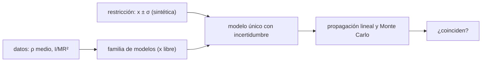

# B65-C05 — Inversión geofísica conjunta: validación de modelos interiores

<!-- nav:top -->
[🏠 Programa](../../../../README.md) · [📚 Bloque B65](../../../tronco-comun/B65-geofisica-de-interiores-planetarios.md) · [← Anterior: B65-C04 — Flujo térmico planetario y balance térmico del interior](../B65-C04-flujo-termico-planetario-y-balance-termico-del-interior/CLASE.md) · [Siguiente: B65-C06 — Calentamiento por marea y equilibrio térmico en satélites →](../B65-C06-calentamiento-por-marea-y-equilibrio-termico-en-satelites/CLASE.md)
<!-- /nav -->

## 1. Ubicación, nivel y alcance

Clase 5 del bloque B65. Nivel N3. Un interior planetario no se observa: se **infiere** de datos globales como la masa, el momento de inercia, la sísmica o el campo magnético. Aquí inviertes un modelo de dos capas (manto y núcleo homogéneos) a partir de la densidad media y del momento de inercia, ves que los dos datos admiten una **familia** de modelos, añades una restricción adicional y propagas las incertidumbres de dos formas independientes. Usas [B10](../../../tronco-comun/B10-algebra-lineal-y-matematicas-geometricas.md) para el álgebra. Las densidades de las capas son resultados del modelo, no mediciones.

## 2. Por qué esta clase existe

Un modelo interior que reproduce los datos no es por eso el correcto. La decisión central: **¿qué datos faltan para elegir un modelo entre los que cumplen los datos que ya tienes?**

## 3. Lo que podrás hacer al terminar

1. Plantear el problema directo de dos capas (densidad media y `I/MR²`).
2. Resolver el problema inverso para un radio de núcleo dado.
3. Construir la familia de modelos compatibles con los datos.
4. Añadir una restricción adicional y propagar las incertidumbres de forma lineal y por Monte Carlo.
5. Identificar qué dato domina la incertidumbre del resultado.
6. Declarar los límites de un modelo de capas homogéneas.

La evidencia es la **ficha de la inversión conjunta** del ejercicio 12 (sección 20).

## 4. Con qué llegas y cómo comprobarlo

1. ¿Qué es un momento de inercia?
2. ¿Qué es un problema inverso?
3. ¿Qué es la no unicidad?
4. ¿Qué es un dato sintético?
5. ¿Qué es una simulación Monte Carlo?

<details>
<summary>Ver respuestas</summary>

1. La medida de cuánto cuesta cambiar la rotación de un cuerpo; depende de dónde está la masa. 2. Deducir las causas (el modelo) a partir de los efectos (los datos). 3. Que varios modelos distintos explican los mismos datos. 4. Un dato inventado para el ejercicio, no medido. 5. Repetir un cálculo con números aleatorios de semilla fija.
</details>

Con cuatro o cinco aciertos, sigue; si no, repasa los prerrequisitos.

## 5. Un caso de contexto y casos de referencia

La Tierra tiene densidad media `5 513 kg/m³` y `I/MR² = 0,3308`; Marte, `3 934 kg/m³` y `0,366`; la Luna, `3 344 kg/m³` y `0,394` (hojas de datos de la NASA). Una esfera homogénea tiene `0,4`: cuanto menor es el valor, más concentrada está la masa hacia el centro. Con un radio de núcleo relativo `x = 0,546` **sintético**, el modelo de la Tierra sale `ρ_manto = 4 154 kg/m³` y `ρ_núcleo = 12 502 kg/m³`. Es el **ejemplo conductor**.

## 6. Vocabulario

El **problema directo** calcula los datos a partir del modelo. El **problema inverso** hace lo contrario. La **no unicidad** es que varios modelos reproduzcan los mismos datos. El **factor de momento de inercia** es `I/(MR²)`. Una **restricción adicional** es un dato independiente que acota la familia. La **propagación de incertidumbre** traslada la de los datos a la del modelo.

## 7. Modelo mental: adivinar el contenido de una caja por su peso y su balanceo

Pesar una caja y ver cómo gira dice cuánta masa hay y cuánto está hacia el centro, pero no cuántos objetos hay ni dónde está cada uno: se necesitan más datos.



*Descripción textual:* dos datos y tres incógnitas dejan una familia; una restricción sobre el radio del núcleo fija el modelo; la incertidumbre se propaga de dos formas que deben coincidir.

Analogía: pesar y hacer girar una caja. Límite: capas homogéneas, sin rotación ni marea.

## 8. La explicación, paso a paso

### 8.1 El problema directo

Para capas homogéneas con densidad `ρ_m` (manto) y `ρ_c` (núcleo) y radio relativo del núcleo `x`:

`ρ̄ = ρ_m + (ρ_c − ρ_m) x³`, `I/(MR²) = (2/5) [ρ_m + (ρ_c − ρ_m) x⁵] / ρ̄`.

### 8.2 El problema inverso para `x` dado

Con `Δ = ρ_c − ρ_m`, restar las dos ecuaciones da `Δ = ρ̄ (1 − 5C/2) / [x³ (1 − x²)]` y `ρ_m = ρ̄ − Δ x³`. Para la Tierra:

| `x` | `ρ_manto` (kg/m³) | `ρ_núcleo` (kg/m³) |
|---|---|---|
| 0,3 | 4 464,9 | 43 282,5 |
| 0,4 | 4 377,6 | 22 118,5 |
| 0,5 | 4 241,3 | 14 414,7 |
| 0,546 | 4 154,2 | 12 502,3 |
| 0,6 | 4 022,8 | 10 922,0 |
| 0,7 | 3 642,9 | 9 095,1 |

Todos reproducen los dos datos con una discrepancia de `1,7×10⁻¹⁶`. Con solo masa e inercia hay una **familia** de modelos. Para Marte con `x = 0,5` sale `3 488,1` y `7 055,0 kg/m³`; para la Luna con `x = 0,3`, `3 288,9` y `5 330,4 kg/m³`, un contraste mucho menor porque `C = 0,394` se acerca a `0,4`.

### 8.3 La restricción adicional

Con un radio del núcleo **sintético** `x = 0,546 ± 0,010` y una incertidumbre **ilustrativa** de `0,001` en `I/MR²`:

| Magnitud | Resultado | σ lineal | σ Monte Carlo (N = 20 000) |
|---|---|---|---|
| `ρ_manto` | 4 154,2 kg/m³ | 28,9 | 29,2 |
| `ρ_núcleo` | 12 502,3 kg/m³ | 364,2 | 367,1 |

Para `ρ_núcleo`, la incertidumbre de `x` aporta 349,9 kg/m³ y la de `I/MR²`, 101,0 kg/m³.

### 8.4 Lectura

Las dos vías de propagación coinciden en menos de un 1 %. El dato que domina es el radio del núcleo: mejorar `I/MR²` apenas ayudaría. Esto es lo que significa «validar» un modelo: ver qué datos lo limitan. Las hojas de datos no dan incertidumbre para `I/MR²`; el `0,001` es ilustrativo.

## 9. Magnitudes, símbolos y unidades

| Símbolo | Qué es | Unidad | Valor / nota |
|---|---|---|---|
| `ρ̄` | densidad media | kg/m³ | 5 513 (Tierra, NASA) |
| `C = I/(MR²)` | factor de momento de inercia | — | 0,3308 (Tierra, NASA) |
| `x` | radio relativo del núcleo | — | 0,546 ± 0,010 (sintético) |
| `ρ_m`, `ρ_c` | densidades de manto y núcleo | kg/m³ | resultados del modelo |
| `σ_C` | incertidumbre de `C` | — | 0,001 (ilustrativa) |

## 10. Convenciones y referencias

Unidades SI. `R` es el radio del cuerpo y `r_c` el del núcleo, con `x = r_c/R`. Las capas son homogéneas y esféricas. Se exige `ρ_m > 0` y `ρ_c > ρ_m`. La semilla del Monte Carlo es 20261109.

## 11. De dónde sale lo que afirmamos

| ID | Fuente | Localizador | Respalda | Estado |
|---|---|---|---|---|
| S1 | NASA/GSFC NSSDC, *Earth Fact Sheet* | https://nssdc.gsfc.nasa.gov/planetary/factsheet/earthfact.html | Densidad media 5 513 kg/m³; `I/MR² = 0,3308` | Consultada el 2026-11-09 (actualizada el 2024-11-15) |
| S2 | NASA/GSFC NSSDC, *Mars Fact Sheet* | https://nssdc.gsfc.nasa.gov/planetary/factsheet/marsfact.html | Densidad media 3 934 kg/m³; `I/MR² = 0,366` | Consultada el 2026-11-09 (actualizada el 2025-05-19) |
| S3 | NASA/GSFC NSSDC, *Moon Fact Sheet* | https://nssdc.gsfc.nasa.gov/planetary/factsheet/moonfact.html | Densidad media 3 344 kg/m³; `I/MR² = 0,394` | Consultada el 2026-11-09 (actualizada el 2024-01-11) |
| S4 | Bagheri et al., arXiv:2505.14743 | https://arxiv.org/abs/2505.14743 | Un marco estadístico combina libración, forma, flujo de calor, gravedad y masa para acotar el interior de Encélado; medir solo `k₂` da la disipación total pero no dónde ocurre | Solo resumen, consultado el 2026-11-09 |
| S5 | Cálculo de la clase | `inversion.py` | Problema directo e inverso; propagación | Verificado numéricamente |

Límites: no se consultó ningún modelo interior publicado ni sus incertidumbres; el radio del núcleo es sintético y los resultados no son modelos de la Tierra, Marte ni la Luna.

## 12. Cómo ver la inversión conjunta

| Magnitud | Valor |
|---|---|
| Familia (Tierra) | `ρ_c` de 43 283 a 9 095 kg/m³ para `x` de 0,3 a 0,7 |
| Modelo con `x = 0,546` | 4 154 y 12 502 kg/m³ |
| σ lineal / Monte Carlo (`ρ_c`) | 364,2 / 367,1 kg/m³ |

Descripción larga: a mayor núcleo, menor densidad necesaria; la restricción sobre `x` convierte la familia en un modelo con incertidumbre y la propagación indica qué dato manda.

## 13. Ejemplo trabajado: el contraste de densidad de la Tierra con `x = 0,546`

**Paso 1 · Numerador.** `1 − 2,5 × 0,3308 = 0,173`; `× 5 513 = 953,8`.

**Paso 2 · Denominador.** `x³ = 0,16276`; `1 − x² = 0,70188`; producto `0,11424`.

**Paso 3 · Contraste.** `Δ = 953,8/0,11424 = 8 349 kg/m³`.

**Paso 4 · Densidades.** `ρ_m = 5 513 − 8 349 × 0,16276 = 4 154`; `ρ_c = 4 154 + 8 349 = 12 503 kg/m³` (el laboratorio da 12 502,3 por el redondeo).

## 14. Distintas formas de describir la inversión

**Por familia:** tabla de `x`. **Por contraste:** `Δ`. **Por incertidumbre:** `σ`. **Por dominio:** qué dato aporta más.

## 15. Práctica guiada

**Ejercicio 1 · con los pasos indicados.** Calcula `Δ` para la Tierra con `x = 0,546`. *Pasos:* ejemplo 13.

<details><summary>Solución comentada</summary>

`8 349 kg/m³`.
</details>

**Ejercicio 2 · con una pista.** ¿Cuánto vale `Δ` si `C = 0,4`? *Pista:* `1 − 2,5 C`.

<details><summary>Solución comentada</summary>

Cero: una esfera homogénea no tiene contraste.
</details>

**Ejercicio 3 · casi autónomo.** ¿Por qué dos datos no fijan tres incógnitas?

<details><summary>Solución comentada</summary>

Porque cada `x` da una solución distinta que cumple ambos datos: la tabla 8.2 es una familia.
</details>

## 16. Práctica autónoma, transferencia e integrador

**Ejercicio 4.** Contraste de densidad de la Luna con `x = 0,3`.

<details><summary>Solución comentada</summary>

`5 330,4 − 3 288,9 = 2 041,5 kg/m³`.
</details>

**Ejercicio 5.** Cociente `ρ_c/ρ_m` de Marte con `x = 0,5`.

<details><summary>Solución comentada</summary>

`7 055,0 / 3 488,1 = 2,02`.
</details>

**Ejercicio 6.** Cambio relativo de `ρ_m` de la Tierra de `x = 0,4` a `0,6`.

<details><summary>Solución comentada</summary>

`(4 022,8 − 4 377,6)/4 377,6 = −8,1 %`.
</details>

**Ejercicio 7.** Combina las contribuciones de `x` y de `C` a `σ(ρ_c)`.

<details><summary>Solución comentada</summary>

`√(349,9² + 101,0²) = 364,2 kg/m³`.
</details>

**Ejercicio 8.** ¿Qué tan cerca están el cálculo lineal y el Monte Carlo para `ρ_c`?

<details><summary>Solución comentada</summary>

`367,1/364,2 − 1 = 0,8 %`.
</details>

**Ejercicio 9 · transferencia.** **Transferencia.** Un colega dice que «la densidad del núcleo terrestre es 12 502 kg/m³, calculada». Responde.

<details><summary>Solución comentada</summary>

Depende de `x = 0,546`, que es sintético, y de un modelo de dos capas homogéneas. Es un ejemplo de método, no una determinación.
</details>

**Ejercicio 10 · transferencia.** **Transferencia.** Si se midiera `I/MR²` diez veces mejor (`σ_C = 0,0001`), ¿cuánto bajaría `σ(ρ_c)`?

<details><summary>Solución comentada</summary>

La contribución de `C` pasa de 101,0 a 10,1; el total, `√(349,9² + 10,1²) = 350,0` frente a 364,2: baja un 4 %. El radio del núcleo domina.
</details>

**Ejercicio 11 · transferencia.** **Transferencia.** Para la Luna, ¿qué dato añadirías para elegir un modelo de la familia?

<details><summary>Solución comentada</summary>

Uno independiente del par masa–inercia que fije el radio del núcleo o su densidad (sísmica o magnético, por ejemplo). Esta clase no tiene esos datos.
</details>

**Ejercicio 12.** **Integrador.** Elabora tu *ficha de la inversión conjunta*: familia de modelos, restricción adicional, `σ` lineal y Monte Carlo, y qué dato domina.

<details><summary>Solución modelo</summary>

Secciones 8.1–8.4 y los ejercicios 1, 4, 7 y 8.
</details>

## 17. Laboratorio: inversión de dos capas

El script [inversion.py](inversion.py) resuelve el modelo para varios `x` y tres cuerpos, reconstruye los datos y propaga la incertidumbre de forma lineal y por Monte Carlo (**comprueba** la reconstrucción < 1e-12 y que ambas propagaciones difieren menos de un 10 %).

**Datos:** densidades medias y `I/MR²` de las hojas de la NASA; `x` **sintético**; `σ_C` **ilustrativa**. **Predice antes de ejecutar:** ¿qué dato dominará la incertidumbre de `ρ_c`? (el radio del núcleo.) **Ejecución del 2026-11-09 (Python 3.12.9):**

```text
Python 3.12.9 (biblioteca estandar)

Tierra: densidad media = 5513 kg/m^3 ; I/(MR^2) = 0.3308
  x = rc/R   rho_manto [kg/m^3]   rho_nucleo [kg/m^3]   fisico?
    0.200             4519.5             128705.6   si
    0.300             4464.9              43282.5   si
    0.400             4377.6              22118.5   si
    0.500             4241.3              14414.7   si
    0.546             4154.2              12502.3   si
    0.600             4022.8              10922.0   si
    0.700             3642.9               9095.1   si

Marte: densidad media = 3934 kg/m^3 ; I/(MR^2) = 0.366
  x = rc/R   rho_manto [kg/m^3]   rho_nucleo [kg/m^3]   fisico?
    0.200             3585.7              47126.0   si
    0.300             3566.5              17176.2   si
    0.400             3535.9               9756.0   si
    0.500             3488.1               7055.0   si
    0.546             3457.6               6384.5   si
    0.600             3411.5               5830.4   si
    0.700             3278.3               5189.9   si

Luna: densidad media = 3344 kg/m^3 ; I/(MR^2) = 0.394
  x = rc/R   rho_manto [kg/m^3]   rho_nucleo [kg/m^3]   fisico?
    0.200             3291.8               9823.0   si
    0.300             3288.9               5330.4   si
    0.400             3284.3               4217.3   si
    0.500             3277.1               3812.2   si
    0.546             3272.5               3711.6   si
    0.600             3265.6               3628.5   si
    0.700             3245.6               3532.4   si

Tierra con x = 0.546 +/- 0.01 (sintetico) y sigma(I/MR^2) = 0.001 (ilustrativo):
  rho_manto = 4154.2 kg/m^3 ; sigma lineal = 28.9 ; sigma Monte Carlo (N = 20000) = 29.2
  rho_nucleo = 12502.3 kg/m^3 ; sigma lineal = 364.2 ; sigma Monte Carlo (N = 20000) = 367.1
  Contribucion de cada dato a sigma(rho_nucleo): por x = 349.9 ; por I/MR^2 = 101.0 kg/m^3
Maxima discrepancia al reconstruir los datos = 1.68e-16
Pruebas superadas.
```

```bash
python programa/clases/B65/B65-C05-inversion-geofisica-conjunta-validacion-de-modelos-interiores/inversion.py
```

**Límites:** capas homogéneas; sin rotación, marea ni compresión.

## 18. Errores frecuentes y cómo corregirlos

**Creer que ajustar los datos valida el modelo.** Se corrige con 8.2.

**Olvidar comprobar que `ρ_c > ρ_m`.** Se corrige con la sección 10.

**Sumar incertidumbres sin considerar cuál domina.** Se corrige con 8.3.

**Presentar el modelo sintético como el de un cuerpo real.** Se corrige con la sección 11.

## 19. Cómo sabrás que vas bien

Tras la sección 8: ¿qué resultado esperabas y cuál obtuviste? Si dudas, repasa el ejemplo 13. Tras el laboratorio: ¿qué comprueba? (ver la sección 17).

## 20. Qué entregas y cómo se evalúa

El producto es tu **ficha de la inversión conjunta** (ejercicio 12).

| Criterio | Inicial | En desarrollo | Logrado | Destacado |
|---|---|---|---|---|
| Conceptos | Los confunde | Parciales | Conceptos de la clase | Explica los límites |
| Cálculo | Sin unidades | Con errores | Tablas completas | Calcula casos nuevos |
| Numérico | Sin comprobar | Un caso | Contraste con el análisis | Interpreta las diferencias |
| Fuentes | Sin fuente | Sin fecha | Fuentes con fecha | Declara lo sintético |
| Límites | No los nombra | Uno | Tres | Discute qué falta del modelo |

**Condiciones críticas (no se compensan con promedio):** rotular `x` como sintético; no presentar el resultado como el interior de un cuerpo real; citar solo lo consultado.

## 21. Ética, seguridad y límites

Clase educativa: los modelos son simplificados. Accesibilidad: tablas equivalentes a las gráficas, fórmulas en texto, ejercicios sin conexión.

## 22. Para cerrar y seguir

Masa e inercia dejan una familia de modelos; una restricción sobre el radio del núcleo fija uno, y el radio domina la incertidumbre. Queda una pregunta: ¿de dónde sale el calor interno de un satélite pequeño que no tiene radiactividad suficiente?

**Glosario español–inglés.** problema inverso · *inverse problem*; no unicidad · *non-uniqueness*; factor de momento de inercia · *moment of inertia factor*; restricción · *constraint*; propagación de incertidumbre · *uncertainty propagation*.

**Continuidad.** [B65-C06](../B65-C06-calentamiento-por-marea-y-equilibrio-termico-en-satelites/CLASE.md) estudia el calentamiento por marea.

**Referencias:** ver sección 11.

<!-- nav:bottom -->
---

[← Anterior: B65-C04 — Flujo térmico planetario y balance térmico del interior](../B65-C04-flujo-termico-planetario-y-balance-termico-del-interior/CLASE.md) · [📚 Bloque B65](../../../tronco-comun/B65-geofisica-de-interiores-planetarios.md) · [Siguiente: B65-C06 — Calentamiento por marea y equilibrio térmico en satélites →](../B65-C06-calentamiento-por-marea-y-equilibrio-termico-en-satelites/CLASE.md)
<!-- /nav -->
