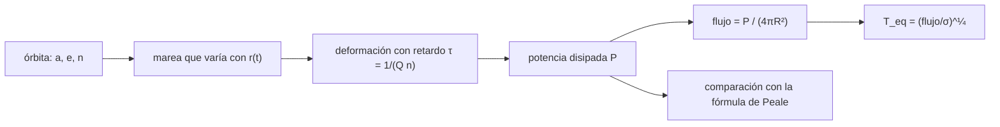

# B65-C06 — Calentamiento por marea y equilibrio térmico en satélites

<!-- nav:top -->
[🏠 Programa](../../../../README.md) · [📚 Bloque B65](../../../tronco-comun/B65-geofisica-de-interiores-planetarios.md) · [← Anterior: B65-C05 — Inversión geofísica conjunta: validación de modelos interiores](../B65-C05-inversion-geofisica-conjunta-validacion-de-modelos-interiores/CLASE.md) · [Siguiente: B66-C01 — Valles y canales: morfología y origen en superficies planetarias →](../../../tronco-comun/B66-geomorfologia-y-procesos-superficiales-planetarios.md#b66-c01)
<!-- /nav -->

## 1. Ubicación, nivel y alcance

Clase 6 del bloque B65. Nivel N3. Un satélite en una órbita excéntrica se deforma y se relaja una y otra vez al recorrerla; la fricción interna de esa deformación se convierte en **calor de marea**. B72-C16 modela las mareas orbitales; aquí tratas la **disipación** y su efecto térmico. Calculas la potencia con la fórmula de Peale para los cuatro satélites galileanos con datos de las hojas de la NASA, y **verificas la fórmula** integrando numéricamente la deformación de un satélite en una órbita kepleriana. Usas [B10](../../../tronco-comun/B10-algebra-lineal-y-matematicas-geometricas.md) y la mecánica de B72. El parámetro de respuesta `k₂/Q` es **ilustrativo** y no se ajusta a ningún satélite.

## 2. Por qué esta clase existe

Un satélite pequeño se enfría rápido; si aun así tiene un interior caliente, algo lo calienta. La decisión central: **¿cuánto calor produce una marea y a qué temperatura de equilibrio llevaría la superficie?**

## 3. Lo que podrás hacer al terminar

1. Calcular la potencia de marea `Ė = (21/2)(k₂/Q) G M_p² R⁵ n e² / a⁶` con unidades.
2. Verificar la fórmula con una integración numérica de la deformación en una órbita excéntrica.
3. Comprobar dos expresiones independientes de la potencia disipada.
4. Calcular el flujo superficial y la temperatura de equilibrio radiativo.
5. Explicar por qué la potencia depende de `e²` y de `a⁻⁶`.
6. Distinguir lo calculado con un `k₂/Q` ilustrativo de lo observado en un satélite.

La evidencia es la **ficha del calentamiento por marea** del ejercicio 12 (sección 20).

## 4. Con qué llegas y cómo comprobarlo

1. ¿Qué es la excentricidad?
2. ¿Qué es la rotación sincrónica?
3. ¿Qué es la disipación?
4. ¿Qué es un valor ilustrativo?
5. ¿Qué es una verificación numérica?

<details>
<summary>Ver respuestas</summary>

1. Una medida de cuánto se aparta la órbita de un círculo (0 es circular). 2. Que el cuerpo da una vuelta sobre su eje por cada vuelta orbital, mostrando siempre la misma cara. 3. La conversión de energía mecánica en calor por fricción. 4. Un valor propuesto para el ejemplo, no medido. 5. Comparar un cálculo con un resultado analítico o independiente.
</details>

Con cuatro o cinco aciertos, sigue; si no, repasa los prerrequisitos.

## 5. Un caso de contexto y casos de referencia

Peale, Cassen y Reynolds (1979) mostraron que el calentamiento por marea en Io probablemente fundió gran parte de su interior. Con los datos orbitales de la hoja de la NASA (semieje `421 800 km`, excentricidad `0,004`, radio `1 821,5 km`) y un `k₂/Q = 0,015` **ilustrativo**, la fórmula da `88,65 TW`, un flujo de `2,126 W/m²` y, si todo el calor se radiara, una temperatura de `78,3 K`. Es el **ejemplo conductor**; la potencia depende del `k₂/Q` elegido y no se compara con ninguna medida.

## 6. Vocabulario

La **marea** es la deformación de un cuerpo por el campo gravitatorio de otro. El **número de Love** `k₂` mide la respuesta del cuerpo (cuánto se deforma). El **factor de calidad** `Q` mide la disipación (cuanto menor, más disipa). La **excentricidad** `e` hace que la distancia, y con ella la marea, varíe en cada órbita. El **equilibrio térmico** ocurre cuando el calor generado iguala al que sale.

## 7. Modelo mental: doblar un clip una y otra vez

Un clip que se dobla y se estira se calienta; un satélite cuya marea sube y baja en cada órbita se calienta igual, y solo si la órbita es excéntrica la marea cambia.



*Descripción textual:* la órbita excéntrica hace variar la marea; la deformación responde con retardo; el retardo disipa potencia, que se compara con la fórmula y se convierte en flujo y en una temperatura de equilibrio.

Analogía: doblar un clip. Límite: rotación sincrónica exacta, un solo parámetro de respuesta y órbita fija.

## 8. La explicación, paso a paso

### 8.1 La fórmula con datos de las hojas

Con `G = 6,67430×10⁻¹¹ m³ kg⁻¹ s⁻²`, `M_p = 1 898,13×10²⁴ kg` (Júpiter), y `k₂/Q = 0,015` ilustrativo para los cuatro satélites, `n = √(G(M_p + M_s)/a³)`:

| Satélite | `R` (km) | `e` (hoja) | `Ė` (TW) | Flujo (mW/m²) | `T_eq` (K) |
|---|---|---|---|---|---|
| Io | 1 821,5 | 0,004 | 88,650 | 2 126,24 | 78,3 |
| Europa | 1 560,8 | 0,009 | 6,368 | 208,03 | 43,8 |
| Ganímedes | 2 631,2 | 0,001 | 0,032 | 0,37 | 9,0 |
| Calisto | 2 410,3 | 0,007 | 0,015 | 0,20 | 7,7 |

El periodo calculado con la tercera ley de Kepler (`1,7699 d` para Io) coincide con el de la hoja (`1,7691 d`) en `0,05 %`: las masas y semiejes son coherentes. Las excentricidades de la hoja están redondeadas a 0,001, por lo que la de Ganímedes tiene una incertidumbre relativa enorme y la potencia, con ella.

### 8.2 Verificación numérica de la fórmula

La fórmula no se consultó en un texto, de modo que se verifica. El satélite tiene un tensor de cuadrupolo `Q_ij` en su sistema fijo que relaja hacia el equilibrio de marea `Q_eq = (k₂R⁵/3G)(GM_p/r³)(3r̂r̂ − I)` con un retardo `τ = 1/(Qn)`: `dQ/dt = (Q_eq − Q)/τ`. La rigidez `K = 3G/(2k₂R⁵)` define la energía elástica y la potencia disipada es `P = Kτ⟨|dQ/dt|²⟩`. Se integró con Runge–Kutta de cuarto orden sobre dos periodos orbitales de una órbita kepleriana, tras cuatro de transitorio. Para Io:

| `e` | Fórmula (TW) | Integración (TW) | Cociente |
|---|---|---|---|
| 0,002 | 22,1626 | 22,1620 | 0,99997 |
| 0,004 | 88,6504 | 88,6671 | 1,00019 |
| 0,008 | 354,6017 | 354,9747 | 1,00105 |

La segunda forma de la potencia, `⟨F:dQ/dt⟩` (trabajo de la marea sobre la deformación), coincide con la primera a `10⁻⁸`.

### 8.3 Lectura

La fórmula de Peale resulta correcta en este modelo hasta `0,1 %` para `e ≤ 0,008`. La potencia crece como `e²`: duplicar `e` la multiplica por 4. El resultado vale para este modelo de un parámetro; un satélite real tiene capas, un océano o un manto parcialmente fundido, que cambian `k₂/Q` y dónde se disipa. Bagheri et al. (2025) señalan que medir solo `k₂` da la disipación total pero no dónde ocurre.

## 9. Magnitudes, símbolos y unidades

| Símbolo | Qué es | Unidad | Valor / nota |
|---|---|---|---|
| `G` | constante gravitatoria | m³ kg⁻¹ s⁻² | `6,67430×10⁻¹¹` (NIST) |
| `M_p` | masa de Júpiter | kg | `1,89813×10²⁷` (NASA) |
| `a`, `e`, `n` | semieje, excentricidad, movimiento medio | m, —, rad/s | hojas de la NASA |
| `k₂/Q` | respuesta de marea y disipación | — | 0,015 (ilustrativo) |
| `Ė` | potencia de marea | W | 88,65 TW (Io) |
| `σ` | constante de Stefan–Boltzmann | W m⁻² K⁻⁴ | `5,670374419×10⁻⁸` (NIST) |

## 10. Convenciones y referencias

Unidades SI. Sistema de referencia del satélite, con un eje hacia el pericentro y rotación sincrónica de velocidad `n`. Se supone el sistema de dos cuerpos con `n = √(G(M_p+M_s)/a³)`. `T_eq` supone que todo el calor sale por radiación de cuerpo negro desde toda la superficie, lo que es solo una cota de escala.

## 11. De dónde sale lo que afirmamos

| ID | Fuente | Localizador | Respalda | Estado |
|---|---|---|---|---|
| S1 | NIST, *Fundamental Physical Constants* (CODATA 2022) | https://physics.nist.gov/cuu/Constants/Table/allascii.txt | `G`, `σ` | Consultada el 2026-11-09 |
| S2 | NASA/GSFC NSSDC, *Jovian Satellite Fact Sheet* | https://nssdc.gsfc.nasa.gov/planetary/factsheet/joviansatfact.html | Masa, diámetro, semieje, periodo y excentricidad de los cuatro satélites | Consultada el 2026-11-09 (actualizada el 2023-12-06) |
| S3 | NASA/GSFC NSSDC, *Jupiter Fact Sheet* | https://nssdc.gsfc.nasa.gov/planetary/factsheet/jupiterfact.html | Masa de Júpiter | Consultada el 2026-11-09 (actualizada el 2024-10-02) |
| S4 | Peale, Cassen y Reynolds, *Melting of Io by Tidal Dissipation*, Science 203, 892–894 (1979), doi:10.1126/science.203.4383.892 | https://doi.org/10.1126/science.203.4383.892 | El calentamiento de marea en Io probablemente fundió gran parte de su interior | Solo resumen (vía Crossref), consultado el 2026-11-09 |
| S5 | Bagheri et al., arXiv:2505.14743 | https://arxiv.org/abs/2505.14743 | Medir `k₂` da la disipación total pero no su ubicación | Solo resumen, consultado el 2026-11-09 |
| S6 | Cálculo de la clase | `marea.py` | Fórmula de Peale | Verificada numéricamente en el modelo de la clase; la expresión **no se consultó** en un texto |

Límites: el artículo de Peale et al. solo se leyó en resumen y no se usó su valor de `Q`; no se comparó ninguna potencia con una medida; `k₂/Q = 0,015` es ilustrativo y no se consultó ningún valor observado ni ningún dato de Europa o Encélado.

## 12. Cómo ver el calentamiento por marea

| Magnitud | Valor |
|---|---|
| `Ė` de Io (fórmula) | 88,650 TW |
| `Ė` de Io (numérico) | 88,667 TW |
| Flujo de Io | 2 126 mW/m² |
| `T_eq` de Io | 78,3 K |

Descripción larga: la potencia sube con `e²` y baja con la sexta potencia del semieje, por eso el satélite más interno con excentricidad no nula domina en el modelo.

## 13. Ejemplo trabajado: el flujo y la temperatura de Io

**Paso 1 · Área.** `4π(1,8215×10⁶)² = 4,169×10¹³ m²`.

**Paso 2 · Flujo.** `88,65×10¹² / 4,169×10¹³ = 2,126 W/m²`.

**Paso 3 · Temperatura.** `(2,126 / 5,670×10⁻⁸)^{1/4} = (3,75×10⁷)^{1/4} = 78,2 K`.

**Paso 4 · Lectura.** Es una temperatura de escala de un cuerpo que radia todo su calor interno; no es la temperatura de la superficie.

## 14. Distintas formas de describir el calentamiento

**Por fórmula:** Peale. **Por integración:** tensor que relaja. **Por balance:** flujo y `T_eq`. **Por escala:** `e²` y `a⁻⁶`.

## 15. Práctica guiada

**Ejercicio 1 · con los pasos indicados.** Calcula `n` de Io a partir de su periodo `1,769138 d`. *Pasos:* `2π/(1,769138 × 86 400)`.

<details><summary>Solución comentada</summary>

`4,1107×10⁻⁵ rad/s`; el cálculo con Kepler da `4,1088×10⁻⁵`.
</details>

**Ejercicio 2 · con una pista.** Si `e` pasa de 0,004 a 0,008, ¿cuánto cambia `Ė`? *Pista:* `e²`.

<details><summary>Solución comentada</summary>

Se multiplica por 4: de `88,65` a `354,6 TW`.
</details>

**Ejercicio 3 · casi autónomo.** Calcula el flujo superficial de Io.

<details><summary>Solución comentada</summary>

`2,126 W/m²` (ejemplo 13).
</details>

## 16. Práctica autónoma, transferencia e integrador

**Ejercicio 4.** Calcula `T_eq` de Io.

<details><summary>Solución comentada</summary>

`78,2 K` (78,3 en el laboratorio por el redondeo).
</details>

**Ejercicio 5.** Cociente de potencias Europa/Io.

<details><summary>Solución comentada</summary>

`6,368/88,65 = 0,072`.
</details>

**Ejercicio 6.** ¿Cuánto difiere la integración de la fórmula para `e = 0,004`?

<details><summary>Solución comentada</summary>

`1,00019`: `0,019 %`.
</details>

**Ejercicio 7.** ¿Qué indica que `P` y `⟨F:dQ/dt⟩` coincidan a `10⁻⁸`?

<details><summary>Solución comentada</summary>

Que la energía elástica es periódica y el trabajo medio de la marea es calor disipado: la integración es consistente.
</details>

**Ejercicio 8.** ¿Cuánto difiere el periodo de Kepler del de la hoja para Io?

<details><summary>Solución comentada</summary>

`(1,7699 − 1,7691)/1,7691 = 0,05 %`.
</details>

**Ejercicio 9 · transferencia.** **Transferencia.** Un colega dice que «Io produce 88,65 TW, igual que la medida». Responde.

<details><summary>Solución comentada</summary>

La cifra depende de `k₂/Q = 0,015`, ilustrativo; no se consultó ninguna medida de la potencia de Io, así que no hay comparación.
</details>

**Ejercicio 10 · transferencia.** **Transferencia.** La excentricidad de Ganímedes en la hoja es 0,001. ¿Qué incertidumbre tiene su potencia?

<details><summary>Solución comentada</summary>

La hoja redondea a 0,001: si el valor está entre 0,0005 y 0,0015, la potencia (∝ `e²`) cambia por un factor de 0,25 a 2,25. No se puede afirmar una cifra.
</details>

**Ejercicio 11 · transferencia.** **Transferencia.** El modelo mantiene la órbita fija. ¿Qué se pierde?

<details><summary>Solución comentada</summary>

La disipación quita energía orbital y, sin un mecanismo que mantenga `e`, esta cambiaría con el tiempo. La clase no trata ese acoplamiento.
</details>

**Ejercicio 12.** **Integrador.** Elabora tu *ficha del calentamiento por marea*: potencia, flujo y `T_eq` de un satélite, y la verificación numérica de la fórmula.

<details><summary>Solución modelo</summary>

Secciones 8.1–8.3 y los ejercicios 2, 3, 4 y 6.
</details>

## 17. Laboratorio: marea en una órbita excéntrica

El script [marea.py](marea.py) calcula la potencia de Peale para los cuatro satélites, integra la deformación del satélite en una órbita kepleriana y compara (**comprueba** el cociente dentro del 1 % y las dos potencias dentro del 1 %). Tarda unos 40 s.

**Datos:** `G`, `σ`, masa de Júpiter y datos orbitales consultados; `k₂/Q` **ilustrativo**. **Predice antes de ejecutar:** ¿qué cociente tendrá la integración con la fórmula? (muy cerca de 1.) **Ejecución del 2026-11-09 (Python 3.12.9):**

```text
Python 3.12.9 (biblioteca estandar)
Formula de Peale con k2/Q = 0.015 ilustrativo:
 cuerpo     R [km]   n [rad/s]   periodo calc. [d] (hoja)       e      E [TW]   flujo [mW/m^2]   T_eq [K]
 Io         1821.5  4.1088e-05   1.7699 (1.7691)    0.004    88.650        2126.24      78.3
 Europa     1560.8  2.0473e-05   3.5520 (3.5512)    0.009     6.368         208.03      43.8
 Ganymede   2631.2  1.0164e-05   7.1549 (7.1546)    0.001     0.032           0.37       9.0
 Callisto   2410.3  4.3572e-06  16.6901 (16.6890)    0.007     0.015           0.20       7.7

Io (e = 0.004): formula = 88.6504 TW ; integracion numerica P = 88.6671 TW ; <F:dQ/dt> = 88.6671 TW
  cociente numerico/formula = 1.00019 ; diferencia entre las dos formas de la potencia = 1.02e-08
  e = 0.002: formula = 22.1626 TW ; numerico = 22.1620 TW ; cociente = 0.99997
  e = 0.008: formula = 354.6017 TW ; numerico = 354.9747 TW ; cociente = 1.00105
Pruebas superadas.
```

```bash
python programa/clases/B65/B65-C06-calentamiento-por-marea-y-equilibrio-termico-en-satelites/marea.py
```

**Límites:** rotación sincrónica exacta, un solo parámetro de respuesta, órbita fija y sin estructura interna.

## 18. Errores frecuentes y cómo corregirlos

**Pensar que una órbita circular da calor de marea.** Se corrige con la dependencia en `e²`.

**Confundir `k₂` con `Q`.** Se corrige con la sección 6.

**Tomar `T_eq` como temperatura de la superficie.** Se corrige con la sección 10.

**Presentar `88,65 TW` como el de Io.** Se corrige con la sección 11.

## 19. Cómo sabrás que vas bien

Tras la sección 8: ¿qué resultado esperabas y cuál obtuviste? Si dudas, repasa el ejemplo 13. Tras el laboratorio: ¿qué comprueba? (ver la sección 17).

## 20. Qué entregas y cómo se evalúa

El producto es tu **ficha del calentamiento por marea** (ejercicio 12).

| Criterio | Inicial | En desarrollo | Logrado | Destacado |
|---|---|---|---|---|
| Conceptos | Los confunde | Parciales | Conceptos de la clase | Explica los límites |
| Cálculo | Sin unidades | Con errores | Tablas completas | Calcula casos nuevos |
| Numérico | Sin comprobar | Un caso | Contraste con el análisis | Interpreta las diferencias |
| Fuentes | Sin fuente | Sin fecha | Fuentes con fecha | Declara lo ilustrativo |
| Límites | No los nombra | Uno | Tres | Discute qué falta del modelo |

**Condiciones críticas (no se compensan con promedio):** rotular `k₂/Q` como ilustrativo; no presentar la potencia como medida; citar solo lo consultado.

## 21. Ética, seguridad y límites

Clase educativa: los modelos son simplificados. Accesibilidad: tablas equivalentes a las gráficas, fórmulas en texto, ejercicios sin conexión.

## 22. Para cerrar y seguir

Con un `k₂/Q` ilustrativo, la marea de Io disipa unos 89 TW y la fórmula de Peale coincide con la integración numérica dentro de `0,1 %`. Con esto el bloque queda cerrado: del calor que mueve el manto al calor que la marea produce en un satélite, el balance de energía es el hilo común.

**Glosario español–inglés.** calentamiento por marea · *tidal heating*; número de Love · *Love number*; factor de calidad · *quality factor*; excentricidad · *eccentricity*; equilibrio térmico · *thermal equilibrium*.

**Continuidad.** Fin del bloque; vuelve al [bloque B65](../../../tronco-comun/B65-geofisica-de-interiores-planetarios.md).

**Referencias:** ver sección 11.

<!-- nav:bottom -->
---

[← Anterior: B65-C05 — Inversión geofísica conjunta: validación de modelos interiores](../B65-C05-inversion-geofisica-conjunta-validacion-de-modelos-interiores/CLASE.md) · [📚 Bloque B65](../../../tronco-comun/B65-geofisica-de-interiores-planetarios.md) · [Siguiente: B66-C01 — Valles y canales: morfología y origen en superficies planetarias →](../../../tronco-comun/B66-geomorfologia-y-procesos-superficiales-planetarios.md#b66-c01)
<!-- /nav -->
