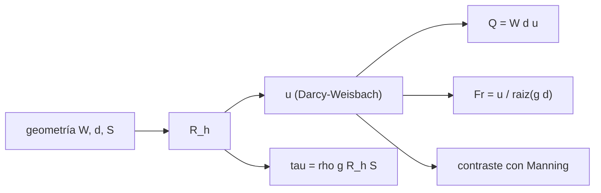

# B66-C01 — Valles y canales: morfología y origen en superficies planetarias

<!-- nav:top -->
[🏠 Programa](../../../../README.md) · [📚 Bloque B66](../../../tronco-comun/B66-geomorfologia-y-procesos-superficiales-planetarios.md) · [← Anterior: B65-C06 — Calentamiento por marea y equilibrio térmico en satélites](../../B65/B65-C06-calentamiento-por-marea-y-equilibrio-termico-en-satelites/CLASE.md) · [Siguiente: B66-C02 — Procesos de ladera y transporte de masa →](../B66-C02-procesos-de-ladera-y-transporte-de-masa/CLASE.md)
<!-- /nav -->

## 1. Ubicación, nivel y alcance

Clase 1 del bloque B66. Nivel N3. Un valle o un canal es una forma; el caudal que lo excavó es una inferencia. Aquí conviertes la geometría de un canal en velocidad, caudal y número de Froude con la ecuación de Darcy–Weisbach, la contrastas con la de Manning y ves cómo cambian con la gravedad al pasar de la Tierra a Marte y a Titán. Usas [B65](../../../tronco-comun/B65-geofisica-de-interiores-planetarios.md) solo para la gravedad superficial. El canal es sintético y no corresponde a ningún valle real.

## 2. Por qué esta clase existe

Un valle visto desde órbita no dice por sí solo cuánta agua (o metano) pasó por él. La decisión central: **¿cuánto caudal transporta un canal de la misma geometría en otro cuerpo, y qué cambia además del caudal?**

## 3. Lo que podrás hacer al terminar

1. Calcular el radio hidráulico de un canal ancho rectangular.
2. Calcular la velocidad con Darcy–Weisbach y contrastarla con Manning.
3. Calcular el caudal y el número de Froude de un canal.
4. Escalar la velocidad y el caudal con `√g` entre cuerpos.
5. Estimar la tensión de fondo `τ = ρ g R_h S` y ver su dependencia de `g` y `ρ`.
6. Separar lo consultado (gravedades) de lo ilustrativo (geometría, fricción, fluido).

La evidencia es la **ficha hidráulica de un canal en tres cuerpos** del ejercicio 12 (sección 20).

## 4. Con qué llegas y cómo comprobarlo

1. ¿Qué es la gravedad superficial y en qué unidades se mide?
2. ¿Qué es una pendiente adimensional?
3. ¿Qué es un caudal y en qué unidades se mide?
4. ¿Qué es un dato sintético?
5. ¿Qué es una verificación por segunda vía?

<details>
<summary>Ver respuestas</summary>

1. La aceleración que siente un cuerpo en la superficie, en m/s². 2. El cociente entre desnivel y distancia horizontal. 3. El volumen de fluido por unidad de tiempo, en m³/s. 4. Un dato generado para el ejemplo, no medido. 5. Calcular lo mismo con otro método y comparar.
</details>

Con cuatro o cinco aciertos, sigue; si no, repasa los prerrequisitos.

## 5. Un caso de contexto y casos de referencia

Un canal ancho de `W = 20 m` y profundidad `d = 1,0 m` con pendiente `S = 0,01` y factor de fricción `f = 0,05` conduce `75,587 m³/s` en la Tierra, `46,585 m³/s` en Marte y `28,070 m³/s` en Titán, con el mismo número de Froude `1,206`. Es el **ejemplo conductor**. Todo es **ilustrativo**: ninguna cifra describe un valle real.

## 6. Vocabulario

El **radio hidráulico** `R_h = W d/(W + 2d)` es el área mojada dividida por el perímetro mojado. La **ecuación de Darcy–Weisbach** da la velocidad media `u = √(8 g R_h S / f)`. La **ecuación de Manning** la expresa con un coeficiente `n`. El **número de Froude** `Fr = u/√(g d)` compara la velocidad con la de una onda superficial. La **tensión de fondo** es `τ = ρ g R_h S`.

## 7. Modelo mental: una rampa de patinaje con distinta gravedad



*Descripción textual:* de la geometría salen el radio hidráulico, la velocidad, el caudal, el número de Froude y la tensión de fondo; la velocidad se contrasta con Manning.

Analogía: una pelota baja la misma rampa más despacio con menos gravedad, pero la forma de la rampa decide cuánto cambia el movimiento. Límite: el factor de fricción `f` se toma constante; en un flujo real depende de la rugosidad y del número de Reynolds.

## 8. La explicación, paso a paso

### 8.1 Radio hidráulico y velocidad

Con `W = 20 m` y `d = 1,0 m`, `R_h = 20 × 1/(20 + 2) = 0,9091 m`. Con `g = 9,820 m/s²`, `S = 0,01` y `f = 0,05`: `u = √(8 × 9,820 × 0,9091 × 0,01/0,05) = 3,7794 m/s`.

### 8.2 Tres cuerpos

| Cuerpo | `g` (m/s²) | `u` (m/s) | `Q` (m³/s) | `Fr` | `τ` (Pa) |
|---|---|---|---|---|---|
| Tierra | 9,8200 | 3,7794 | 75,587 | 1,206 | 89,273 |
| Marte | 3,7300 | 2,3293 | 46,585 | 1,206 | 33,909 |
| Titán | 1,3543 | 1,4035 | 28,070 | 1,206 | 5,540 |

La gravedad de Titán se calcula como `g = GM/R²`. La densidad del fluido de Titán (metano líquido, 450 kg/m³) es una ilustración no consultada y solo afecta a `τ`.

### 8.3 Dos vías para la velocidad

Con Manning y `n = R_h^(1/6) √(f/(8g))`, la diferencia relativa máxima con Darcy–Weisbach es `1,58 × 10⁻¹⁶`: son la misma ecuación escrita de otra forma, de modo que la comprobación valida el código, no la física.

### 8.4 Qué cambia y qué no

`u` y `Q` escalan con `√g`: `Q(Marte)/Q(Tierra) = 0,616309 = √(3,73/9,820)`. El número de Froude `Fr = √(8 S/f)·√(R_h/d)` **no depende de `g`**, por eso vale lo mismo en los tres cuerpos. La tensión de fondo escala con `ρ g`. Para transportar `100 m³/s` en un canal de 20 m hace falta una profundidad de `1,2129 m` en la Tierra, `1,6986 m` en Marte y `2,4295 m` en Titán.

## 9. Magnitudes, símbolos y unidades

| Símbolo | Qué es | Unidad | Valor / nota |
|---|---|---|---|
| `R_h` | radio hidráulico | m | 0,9091 |
| `u` | velocidad media | m/s | 3,78 (Tierra) |
| `Q` | caudal | m³/s | 75,6 (Tierra) |
| `Fr` | número de Froude | — | 1,206 |
| `τ` | tensión de fondo | Pa | 89,3 (Tierra) |
| `f` | factor de fricción de Darcy | — | 0,05 (ilustrativo) |
| `g` | gravedad superficial | m/s² | 9,820; 3,73; 1,354 |

## 10. Convenciones y referencias

Gravedades medias de las fichas de la NASA/NSSDC; en Titán, `g = GM/R²` con `GM = 8978,13710 km³/s²` y `R = 2574,76 km`. Flujo uniforme, canal ancho rectangular de fondo rígido, fluido newtoniano, sin sedimento. Geometría, pendiente, `f` y densidades son ilustrativas.

## 11. De dónde sale lo que afirmamos

| ID | Fuente | Localizador | Respalda | Estado |
|---|---|---|---|---|
| S1 | NASA/NSSDC, Earth Fact Sheet — https://nssdc.gsfc.nasa.gov/planetary/factsheet/earthfact.html (consultada 2026-11-09) | ficha completa leída | g media 9,820 m/s², presión 1014 mb, T media 288 K | Consultada |
| S2 | NASA/NSSDC, Mars Fact Sheet — https://nssdc.gsfc.nasa.gov/planetary/factsheet/marsfact.html (consultada 2026-11-09) | ficha completa leída | g media 3,73 m/s², presión 4,0–8,7 mb, densidad de superficie ~0,016 ± 0,006 kg/m³ | Consultada |
| S3 | NASA JPL SSD, Planetary Satellite Physical Parameters — https://ssd.jpl.nasa.gov/sats/phys_par/ (consultada 2026-11-09) | fila de Titán | GM = 8978,13710 km³/s²; radio medio 2574,76 km (IAU WG 2015); g = GM/R² se calcula en el laboratorio | Consultada |
| — | Relaciones estándar (Darcy–Weisbach, Manning, número de Froude) | — | las verifica el laboratorio con una segunda vía | No consultada en una fuente concreta |

Límites: la geometría del canal, la fricción y el fluido de Titán no se consultaron; no se infiere ningún caudal de un valle real.

## 12. Cómo ver la hidráulica de un canal

| Magnitud | Valor |
|---|---|
| `R_h` | 0,9091 m |
| `u` en Marte | 2,3293 m/s |
| `Q`(Marte)/`Q`(Tierra) | 0,616309 |
| `Fr` (los tres cuerpos) | 1,206 |
| diferencia con Manning | 1,6 × 10⁻¹⁶ |

Descripción larga: el caudal cae con la raíz de la gravedad, el Froude no cambia y la tensión de fondo cae en proporción a `g`.

## 13. Ejemplo trabajado: la velocidad en Marte

**Paso 1 · Radio hidráulico.** `R_h = 0,9091 m`.

**Paso 2 · Velocidad.** `u = √(8 × 3,73 × 0,9091 × 0,01/0,05) = √5,4260 = 2,3293 m/s`.

**Paso 3 · Caudal.** `Q = 20 × 1,0 × 2,3293 = 46,585 m³/s`.

**Paso 4 · Froude.** `Fr = 2,3293/√(3,73 × 1,0) = 1,206`.

## 14. Distintas formas de describir un canal

**Por geometría:** `W`, `d`, `S`. **Por velocidad:** `u`. **Por caudal:** `Q`. **Por régimen:** `Fr` mayor que 1 es supercrítico. **Por esfuerzo:** `τ`.

## 15. Práctica guiada

**Ejercicio 1 · con los pasos indicados.** Calcula `R_h` para `W = 20 m` y `d = 1 m`. *Pasos:* multiplica y divide por el perímetro mojado `W + 2d`.

<details><summary>Solución comentada</summary>

`20/22 = 0,9091 m`.
</details>

**Ejercicio 2 · con una pista.** Predice `Q` de Marte con el factor `√g`. *Pista:* `Q(Tierra) = 75,587`.

<details><summary>Solución comentada</summary>

`75,587 × 0,6163 = 46,585 m³/s`; coincide con el laboratorio.
</details>

**Ejercicio 3 · casi autónomo.** ¿Por qué el Froude no cambia entre cuerpos?

<details><summary>Solución comentada</summary>

mira qué variables entran en `u` y en `√(g d)`.
</details>

## 16. Práctica autónoma, transferencia e integrador

**Ejercicio 4 · autónomo.** `τ` en Marte con `ρ = 1000 kg/m³`.

<details><summary>Solución comentada</summary>

`1000 × 3,73 × 0,9091 × 0,01 = 33,9 Pa`.
</details>

**Ejercicio 5 · autónomo.** Profundidad en Titán para `Q = 100 m³/s` si el canal tiene 20 m.

<details><summary>Solución comentada</summary>

`2,4295 m` (laboratorio).
</details>

**Ejercicio 6 · autónomo.** Cociente `u(Titán)/u(Tierra)`.

<details><summary>Solución comentada</summary>

`1,4035/3,7794 = 0,371 = √(1,3543/9,820)`.
</details>

**Ejercicio 7 · autónomo.** Si `f` se duplica, ¿cómo cambia `Q`?

<details><summary>Solución comentada</summary>

Se divide por `√2`: `Q ∝ f^(-1/2)`.
</details>

**Ejercicio 8 · autónomo.** ¿Qué `S` da `Fr = 1` con `f = 0,05` y `R_h = d`?

<details><summary>Solución comentada</summary>

`S = f/8 = 0,00625`.
</details>

**Ejercicio 9 · transferencia.** **Transferencia.** Un valle marciano tiene 20 m de ancho en las imágenes. ¿Basta eso para el caudal?

<details><summary>Solución comentada</summary>

No: faltan profundidad, pendiente y fricción, y la geometría actual puede no ser la del flujo.
</details>

**Ejercicio 10 · transferencia.** **Transferencia.** Un colega usa `g` terrestre para un canal de Marte. ¿Qué error comete en `Q`?

<details><summary>Solución comentada</summary>

Sobreestima `Q` en un factor `1/0,6163 = 1,62` a igual geometría.
</details>

**Ejercicio 11 · transferencia.** **Transferencia.** ¿Qué cambia en un canal de Titán si el fluido es metano y no agua?

<details><summary>Solución comentada</summary>

La densidad cambia `τ` y el transporte de sedimento; `u` y `Q` de Darcy–Weisbach no dependen de `ρ`.
</details>

**Ejercicio 12 · integrador.** **Integrador.** Elabora tu *ficha hidráulica de un canal en tres cuerpos*: tabla de `R_h`, `u`, `Q`, `Fr` y `τ` para los tres cuerpos, contraste con Manning y lista de qué es consultado e ilustrativo.

<details><summary>Solución comentada</summary>

Secciones 8.1–8.4 y la salida del laboratorio.
</details>

## 17. Laboratorio: canal en la Tierra, Marte y Titán

El script [canal.py](canal.py) calcula `R_h`, `u`, `Q`, `Fr` y `τ` para tres cuerpos, contrasta con Manning y resuelve la profundidad para un caudal dado (**comprueba** diferencia < 1e-9 y `Q ∝ √g`).

**Datos:** gravedades de la NASA/JPL (consultadas); geometría, pendiente, fricción y densidades **ilustrativas**. **Predice antes de ejecutar:** ¿qué `Fr` tendrá Titán? (el mismo que la Tierra: 1,206.) **Ejecución del 2026-11-09 (Python 3.12.9):**

```text
Python 3.12.9 (biblioteca estandar)
Canal ILUSTRATIVO: W = 20.0 m, d = 1.0 m, S = 0.01, f = 0.05; Rh = 0.9091 m
 cuerpo   g [m/s2]   u [m/s]   Q [m3/s]   Fr     tau [Pa]
Tierra     9.8200    3.7794     75.587  1.206    89.273
Marte      3.7300    2.3293     46.585  1.206    33.909
Titan      1.3543    1.4035     28.070  1.206     5.540
Diferencia relativa maxima Darcy-Weisbach frente a Manning = 1.58e-16
Q(Marte)/Q(Tierra) = 0.616309 ; sqrt(gM/gT) = 0.616309
Profundidad necesaria para Q = 100 m3/s con W = 20 m:
  Tierra  d = 1.2129 m
  Marte   d = 1.6986 m
  Titan   d = 2.4295 m
Pruebas superadas.
```

```bash
python programa/clases/B66/B66-C01-valles-y-canales-morfologia-y-origen-en-superficies-planetarias/canal.py
```

**Límites:** flujo uniforme, fricción constante y sin sedimento; Manning es la misma ecuación reescrita, no una validación independiente de la física.

## 18. Errores frecuentes y cómo corregirlos

**Usar `g` terrestre en otro cuerpo.** Se corrige con 8.4.

**Esperar un Froude distinto por la gravedad.** Se corrige con 8.4.

**Tomar la validación con Manning como prueba física.** Se corrige con 8.3.

**Presentar el canal sintético como un valle real.** Se corrige con la sección 10.

## 19. Cómo sabrás que vas bien

Tras la sección 8: ¿qué `Q` esperabas en Marte y cuál obtuviste? Si dudas, repasa el ejemplo 13. Tras el laboratorio: ¿qué comprueba? (ver la sección 17).

## 20. Qué entregas y cómo se evalúa

El producto es tu **ficha hidráulica de un canal en tres cuerpos** (ejercicio 12).

| Criterio | Inicial | En desarrollo | Logrado | Destacado |
|---|---|---|---|---|
| Conceptos | Los confunde | Parciales | Calcula `u`, `Q` y `Fr` | Explica los límites |
| Cálculo | Sin unidades | Con errores | Tablas completas con unidades | Calcula casos nuevos |
| Numérico | Sin comprobar | Un caso | Contraste con una segunda vía | Interpreta las diferencias |
| Fuentes | Sin fuente | Sin fecha | Fuentes con fecha y estado | Declara lo ilustrativo y lo no consultado |
| Límites | No los nombra | Uno | Tres | Discute qué falta del modelo |

**Condiciones críticas (no se compensan con promedio):** rotular el canal y la fricción como ilustrativos; no inferir el caudal de un valle real; citar solo lo consultado.

## 21. Ética, seguridad y límites

Clase educativa: los modelos son simplificados y sus datos son sintéticos o ilustrativos; ningún resultado describe una superficie real ni sustituye a la interpretación de datos de misión. Accesibilidad: tablas equivalentes a las gráficas, fórmulas en texto, ejercicios sin conexión.

## 22. Para cerrar y seguir

Un canal de 20 m × 1 m transporta `75,6 m³/s` en la Tierra y `46,6 m³/s` en Marte con la misma pendiente, y el Froude no cambia. Queda una pregunta: ¿cómo se mueve el material en las laderas del valle?

**Glosario español–inglés.** radio hidráulico · *hydraulic radius*; número de Froude · *Froude number*; tensión de fondo · *bed shear stress*; caudal · *discharge*; factor de fricción · *friction factor*.

**Continuidad.** [B66-C02](../B66-C02-procesos-de-ladera-y-transporte-de-masa/CLASE.md) estudia las laderas y el transporte de masa.

**Referencias:** ver sección 11.

<!-- nav:bottom -->
---

[← Anterior: B65-C06 — Calentamiento por marea y equilibrio térmico en satélites](../../B65/B65-C06-calentamiento-por-marea-y-equilibrio-termico-en-satelites/CLASE.md) · [📚 Bloque B66](../../../tronco-comun/B66-geomorfologia-y-procesos-superficiales-planetarios.md) · [Siguiente: B66-C02 — Procesos de ladera y transporte de masa →](../B66-C02-procesos-de-ladera-y-transporte-de-masa/CLASE.md)
<!-- /nav -->
