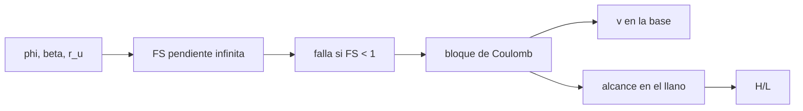

# B66-C02 — Procesos de ladera y transporte de masa

<!-- nav:top -->
[🏠 Programa](../../../../README.md) · [📚 Bloque B66](../../../tronco-comun/B66-geomorfologia-y-procesos-superficiales-planetarios.md) · [← Anterior: B66-C01 — Valles y canales: morfología y origen en superficies planetarias](../B66-C01-valles-y-canales-morfologia-y-origen-en-superficies-planetarias/CLASE.md) · [Siguiente: B66-C03 — Procesos eólicos: dunas, ripples y erosión planetaria →](../B66-C03-procesos-eolicos-dunas-ripples-y-erosion-planetaria/CLASE.md)
<!-- /nav -->

## 1. Ubicación, nivel y alcance

Clase 2 del bloque B66. Nivel N3. Una ladera falla cuando la fricción interna ya no compensa la pendiente, y el material deslizado recorre una distancia que delata su fricción efectiva. Aquí calculas el factor de seguridad de una pendiente infinita sin cohesión, el efecto de la presión de poros y el alcance de un bloque de Coulomb en la Tierra, Marte y Titán, con una segunda vía numérica. Sigue a [B66-C01](../B66-C01-valles-y-canales-morfologia-y-origen-en-superficies-planetarias/CLASE.md). La ladera es sintética.

## 2. Por qué esta clase existe

Un deslizamiento marciano o titaniano parece igual a uno terrestre, pero su velocidad y duración no lo son. La decisión central: **¿qué propiedades de un deslizamiento dependen de la gravedad y cuáles no?**

## 3. Lo que podrás hacer al terminar

1. Calcular el factor de seguridad de una pendiente infinita sin cohesión.
2. Obtener el ángulo crítico con y sin presión de poros.
3. Calcular la velocidad en la base y el tiempo de caída de un bloque de Coulomb.
4. Calcular el alcance en el llano y la razón `H/L`.
5. Contrastar el resultado analítico con una integración numérica.
6. Explicar qué escala con `g` y qué no.

La evidencia es la **ficha de estabilidad y alcance de una ladera** del ejercicio 12 (sección 20).

## 4. Con qué llegas y cómo comprobarlo

1. ¿Qué es el ángulo de fricción interna?
2. ¿Qué es una presión de poros?
3. ¿Qué es la fricción de Coulomb?
4. ¿Qué es una integración numérica?
5. ¿Qué es un dato ilustrativo?

<details>
<summary>Ver respuestas</summary>

1. El ángulo cuya tangente es el coeficiente de fricción de un material granular. 2. La presión del fluido en los huecos, que reduce el esfuerzo efectivo entre granos. 3. Una fuerza de rozamiento proporcional a la fuerza normal. 4. Avanzar una ecuación de movimiento en pasos de tiempo pequeños. 5. Un valor propuesto para el ejemplo, no medido.
</details>

Con cuatro o cinco aciertos, sigue; si no, repasa los prerrequisitos.

## 5. Un caso de contexto y casos de referencia

Una ladera de `30°` con material de ángulo de fricción `35°` tiene factor de seguridad `1,2128` en seco y `0,6064` con una razón de presión de poros `0,5`. Un bloque que cae `500 m` por esa pendiente con `μ = 0,4` llega a la base a `54,92 m/s` en la Tierra, `33,85 m/s` en Marte y `20,40 m/s` en Titán, y recorre `383,975 m` en el llano en los tres. Es el **ejemplo conductor**. Todo es **ilustrativo**.

## 6. Vocabulario

El **factor de seguridad** `FS` compara resistencia y carga; `FS < 1` indica falla. En una **pendiente infinita** sin cohesión, `FS = (1 − r_u) tan φ / tan β`, con `r_u` la razón de presión de poros. El **bloque de Coulomb** desliza con aceleración `g(sen β − μ cos β)`. La **razón `H/L`** (altura de caída sobre alcance horizontal total) mide la movilidad.

## 7. Modelo mental: una caja que baja una rampa y frena en el suelo



*Descripción textual:* los ángulos y la presión de poros dan el factor de seguridad; si hay falla, el bloque acelera, llega a la base con una velocidad y se detiene tras un alcance.

Analogía: una caja baja una rampa y se detiene en el suelo: la rampa fija cuánto se acelera y el roce fija cuánto se desliza. Límite: un deslizamiento real se fragmenta, se fluidiza o es lubricado; aquí es un solo bloque rígido con `μ` constante.

## 8. La explicación, paso a paso

### 8.1 Pendiente infinita

Para un suelo sin cohesión, `FS = (1 − r_u) tan φ / tan β`. La gravedad no aparece: el peso y la fuerza de fricción son proporcionales a `g` y se cancelan. Con `φ = 35°` y `β = 30°`, `FS = tan 35°/tan 30° = 1,2128`; con `r_u = 0,5`, `FS = 0,6064`. El ángulo crítico es `35,00°` en seco y `19,30°` con `r_u = 0,5`.

### 8.2 Bloque de Coulomb

Con `H = 500 m` y `β = 30°`, el recorrido en la pendiente es `L = H/sen β = 1000 m`. La aceleración es `a = g(sen β − μ cos β)`, la velocidad en la base `v = √(2 a L)` y el tiempo `t = √(2L/a)`. En el llano frena con `μ g`, de modo que el alcance es `x = v²/(2 μ g) = H (1/μ − 1/tan β)`.

| Cuerpo | `g` (m/s²) | `v` base (m/s) | `t` ladera (s) | alcance (m) | `t` llano (s) | `H/L` |
|---|---|---|---|---|---|---|
| Tierra | 9,8200 | 54,923 | 36,415 | 383,975 | 13,982 | 0,4000 |
| Marte | 3,7300 | 33,849 | 59,085 | 383,975 | 22,687 | 0,4000 |
| Titán | 1,3543 | 20,396 | 98,057 | 383,975 | 37,651 | 0,4000 |

### 8.3 Segunda vía

Una integración numérica con paso de `10⁻³ s` reproduce velocidad y alcance con una diferencia relativa máxima de `6,09 × 10⁻⁵`, dentro de la tolerancia de 0,1 %.

### 8.4 Qué escala con g

La velocidad escala con `√g` (`33,849/54,923 = 0,616309 = √(3,73/9,820)`) y los tiempos con `1/√g`. En cambio el factor de seguridad, el ángulo crítico, el alcance y `H/L` **no dependen de `g`**. Además `H/L = μ` exactamente en este modelo: la razón de movilidad lee la fricción efectiva.

## 9. Magnitudes, símbolos y unidades

| Símbolo | Qué es | Unidad | Valor / nota |
|---|---|---|---|
| `FS` | factor de seguridad | — | 1,2128 (seco) |
| `φ` | ángulo de fricción interna | grados | 35 (ilustrativo) |
| `β` | ángulo de la pendiente | grados | 30 |
| `r_u` | razón de presión de poros | — | 0 y 0,5 |
| `μ` | fricción dinámica | — | 0,4 (ilustrativo) |
| `v` | velocidad en la base | m/s | 54,9 (Tierra) |
| `x` | alcance en el llano | m | 383,975 |

## 10. Convenciones y referencias

Gravedades medias de las fichas NASA/NSSDC (Tierra, Marte) y `g = GM/R²` (Titán, JPL). Ladera plana infinita, sin cohesión; bloque rígido con fricción constante, sin atmósfera. `φ`, `μ`, `H` y `r_u` son ilustrativos.

## 11. De dónde sale lo que afirmamos

| ID | Fuente | Localizador | Respalda | Estado |
|---|---|---|---|---|
| S1 | NASA/NSSDC, Earth Fact Sheet — https://nssdc.gsfc.nasa.gov/planetary/factsheet/earthfact.html (consultada 2026-11-09) | ficha completa leída | g media 9,820 m/s², presión 1014 mb, T media 288 K | Consultada |
| S2 | NASA/NSSDC, Mars Fact Sheet — https://nssdc.gsfc.nasa.gov/planetary/factsheet/marsfact.html (consultada 2026-11-09) | ficha completa leída | g media 3,73 m/s², presión 4,0–8,7 mb, densidad de superficie ~0,016 ± 0,006 kg/m³ | Consultada |
| S3 | NASA JPL SSD, Planetary Satellite Physical Parameters — https://ssd.jpl.nasa.gov/sats/phys_par/ (consultada 2026-11-09) | fila de Titán | GM = 8978,13710 km³/s²; radio medio 2574,76 km (IAU WG 2015); g = GM/R² se calcula en el laboratorio | Consultada |
| — | Relaciones estándar (pendiente infinita, fricción de Coulomb) | — | las verifica el laboratorio con una segunda vía | No consultada en una fuente concreta |

Límites: `φ`, `μ`, `H` y `r_u` no se consultaron; no se modelan fluidización, fragmentación ni cohesión.

## 12. Cómo ver una ladera estable o inestable

| Magnitud | Valor |
|---|---|
| `FS` seco | 1,2128 |
| `FS` con `r_u` = 0,5 | 0,6064 |
| `v` en Marte | 33,849 m/s |
| alcance (los tres cuerpos) | 383,975 m |
| diferencia numérico/analítico | 6,09 × 10⁻⁵ |

Descripción larga: la ladera falla al subir la presión de poros; el bloque llega más despacio en Marte y Titán pero se detiene a la misma distancia.

## 13. Ejemplo trabajado: el alcance en Marte

**Paso 1 · Aceleración.** `a = 3,73 × (0,5 − 0,4 × 0,8660) = 0,5729 m/s²`.

**Paso 2 · Velocidad.** `v = √(2 × 0,5729 × 1000) = 33,85 m/s`.

**Paso 3 · Alcance.** `x = 33,85²/(2 × 0,4 × 3,73) = 383,9 m`.

**Paso 4 · Comparación.** Es el mismo que en la Tierra (383,975 m).

## 14. Distintas formas de describir una ladera

**Por equilibrio de fuerzas:** `FS`. **Por ángulo:** `β_c`. **Por energía:** `½ v² = g H (1 − μ/tan β)`. **Por movilidad:** `H/L`.

## 15. Práctica guiada

**Ejercicio 1 · con los pasos indicados.** Calcula `FS` con `φ = 35°`, `β = 30°` y `r_u = 0`. *Pasos:* divide las tangentes: `0,7002/0,5774`.

<details><summary>Solución comentada</summary>

`1,2128`.
</details>

**Ejercicio 2 · con una pista.** Predice el ángulo crítico con `r_u = 0,5`. *Pista:* `β_c = atan(0,5 tan 35°)`.

<details><summary>Solución comentada</summary>

`atan(0,3501) = 19,30°`.
</details>

**Ejercicio 3 · casi autónomo.** ¿Por qué `g` no aparece en `FS`?

<details><summary>Solución comentada</summary>

compara peso y fricción.
</details>

## 16. Práctica autónoma, transferencia e integrador

**Ejercicio 4 · autónomo.** `FS` con `r_u = 0,3`.

<details><summary>Solución comentada</summary>

`0,7 × 1,2128 = 0,849`: falla.
</details>

**Ejercicio 5 · autónomo.** Velocidad en la base en Titán.

<details><summary>Solución comentada</summary>

`20,396 m/s`.
</details>

**Ejercicio 6 · autónomo.** Cociente de tiempos `t(Marte)/t(Tierra)`.

<details><summary>Solución comentada</summary>

`59,085/36,415 = 1,622 = √(9,820/3,73)`.
</details>

**Ejercicio 7 · autónomo.** `H/L` si `μ = 0,25`.

<details><summary>Solución comentada</summary>

`0,25`.
</details>

**Ejercicio 8 · autónomo.** Alcance con `μ = 0,25` y `β = 30°`, `H = 500 m`.

<details><summary>Solución comentada</summary>

`500 (4 − 1,7321) = 1134 m`.
</details>

**Ejercicio 9 · transferencia.** **Transferencia.** Un deslizamiento en Marte llegó mucho más lejos que el modelo con `μ = 0,4`. ¿Qué interpretas?

<details><summary>Solución comentada</summary>

Que la fricción efectiva fue menor (`H/L` bajo): fluidización, hielo o lubricación; no basta el bloque rígido.
</details>

**Ejercicio 10 · transferencia.** **Transferencia.** Un colega espera que la ladera de Titán sea más estable por tener menos gravedad. Respóndele.

<details><summary>Solución comentada</summary>

El `FS` no depende de `g`; solo cambian la velocidad y la duración.
</details>

**Ejercicio 11 · transferencia.** **Transferencia.** ¿Qué mide `H/L` y por qué se usa?

<details><summary>Solución comentada</summary>

La movilidad: con Coulomb vale `μ`; valores menores indican menos fricción efectiva.
</details>

**Ejercicio 12 · integrador.** **Integrador.** Elabora tu *ficha de estabilidad y alcance de una ladera*: tabla de `FS`, velocidad, tiempo, alcance y `H/L` para los tres cuerpos, contraste numérico y lista de lo que escala con `g` y lo que no.

<details><summary>Solución comentada</summary>

Secciones 8.1–8.4 y la salida del laboratorio.
</details>

## 17. Laboratorio: ladera y deslizamiento en tres cuerpos

El script [ladera.py](ladera.py) calcula `FS`, ángulos críticos, velocidad, tiempos, alcance y `H/L`, y contrasta con una integración numérica (**comprueba** alcance igual en los tres cuerpos y diferencia < 0,1 %).

**Datos:** gravedades de la NASA/JPL (consultadas); ángulos, `μ`, `r_u` y `H` **ilustrativos**. **Predice antes de ejecutar:** ¿qué alcance tendrá Titán? (el mismo: 383,975 m.) **Ejecución del 2026-11-09 (Python 3.12.9):**

```text
Python 3.12.9 (biblioteca estandar)
Angulo critico sin cohesion: beta_c = atan((1-ru) tan phi): ru = 0 -> 35.00 grados ; ru = 0.5 -> 19.30 grados
FS(beta = 30 grados, phi = 35 grados, ru = 0.0) = 1.2128  (identico en los tres cuerpos: g se cancela)
FS(beta = 30 grados, phi = 35 grados, ru = 0.5) = 0.6064  (identico en los tres cuerpos: g se cancela)
Bloque de Coulomb ILUSTRATIVO: H = 500 m, beta = 30 grados, mu = 0.4
 cuerpo   g [m/s2]  v_base [m/s]  t_ladera [s]  alcance llano [m]  t_llano [s]  H/L
Tierra     9.8200        54.923        36.415            383.975       13.982 0.4000
Marte      3.7300        33.849        59.085            383.975       22.687 0.4000
Titan      1.3543        20.396        98.057            383.975       37.651 0.4000
Diferencia relativa maxima numerico frente a analitico = 6.09e-05
v(Marte)/v(Tierra) = 0.616309 ; sqrt(gM/gT) = 0.616309
Pruebas superadas.
```

```bash
python programa/clases/B66/B66-C02-procesos-de-ladera-y-transporte-de-masa/ladera.py
```

**Límites:** un solo bloque rígido, fricción constante, sin atmósfera ni fluidización.

## 18. Errores frecuentes y cómo corregirlos

**Creer que la gravedad baja hace más estable la ladera.** Se corrige con 8.4.

**Confundir velocidad con alcance.** Se corrige con la tabla 8.2.

**Ignorar la presión de poros.** Se corrige con 8.1.

**Presentar la ladera como real.** Se corrige con la sección 10.

## 19. Cómo sabrás que vas bien

Tras la sección 8: ¿qué alcance esperabas en Titán y cuál obtuviste? Si dudas, repasa el ejemplo 13. Tras el laboratorio: ¿qué comprueba? (ver la sección 17).

## 20. Qué entregas y cómo se evalúa

El producto es tu **ficha de estabilidad y alcance de una ladera** (ejercicio 12).

| Criterio | Inicial | En desarrollo | Logrado | Destacado |
|---|---|---|---|---|
| Conceptos | Los confunde | Parciales | Calcula `FS`, velocidad y alcance | Explica los límites |
| Cálculo | Sin unidades | Con errores | Tablas completas con unidades | Calcula casos nuevos |
| Numérico | Sin comprobar | Un caso | Contraste con una segunda vía | Interpreta las diferencias |
| Fuentes | Sin fuente | Sin fecha | Fuentes con fecha y estado | Declara lo ilustrativo y lo no consultado |
| Límites | No los nombra | Uno | Tres | Discute qué falta del modelo |

**Condiciones críticas (no se compensan con promedio):** rotular la ladera y la fricción como ilustrativas; no inferir la causa de un deslizamiento real; citar solo lo consultado.

## 21. Ética, seguridad y límites

Clase educativa: los modelos son simplificados y sus datos son sintéticos o ilustrativos; ningún resultado describe una superficie real ni sustituye a la interpretación de datos de misión. Accesibilidad: tablas equivalentes a las gráficas, fórmulas en texto, ejercicios sin conexión.

## 22. Para cerrar y seguir

La misma ladera falla o no según su presión de poros y no según su gravedad, y el bloque llega a `20,4 m/s` en Titán frente a `54,9 m/s` en la Tierra pero se detiene a `383,975 m` en ambos. Queda una pregunta: ¿cómo mueve el viento los granos sueltos?

**Glosario español–inglés.** factor de seguridad · *factor of safety*; pendiente infinita · *infinite slope*; presión de poros · *pore pressure*; transporte de masa · *mass wasting*; alcance · *runout*.

**Continuidad.** [B66-C03](../B66-C03-procesos-eolicos-dunas-ripples-y-erosion-planetaria/CLASE.md) estudia los procesos eólicos.

**Referencias:** ver sección 11.

<!-- nav:bottom -->
---

[← Anterior: B66-C01 — Valles y canales: morfología y origen en superficies planetarias](../B66-C01-valles-y-canales-morfologia-y-origen-en-superficies-planetarias/CLASE.md) · [📚 Bloque B66](../../../tronco-comun/B66-geomorfologia-y-procesos-superficiales-planetarios.md) · [Siguiente: B66-C03 — Procesos eólicos: dunas, ripples y erosión planetaria →](../B66-C03-procesos-eolicos-dunas-ripples-y-erosion-planetaria/CLASE.md)
<!-- /nav -->
