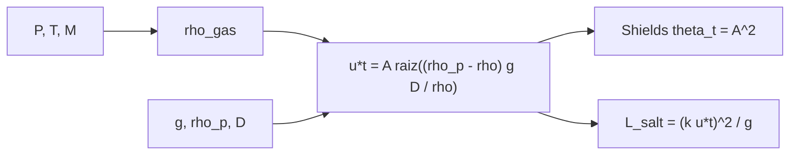

# B66-C03 — Procesos eólicos: dunas, ripples y erosión planetaria

<!-- nav:top -->
[🏠 Programa](../../../../README.md) · [📚 Bloque B66](../../../tronco-comun/B66-geomorfologia-y-procesos-superficiales-planetarios.md) · [← Anterior: B66-C02 — Procesos de ladera y transporte de masa](../B66-C02-procesos-de-ladera-y-transporte-de-masa/CLASE.md) · [Siguiente: B66-C04 — Redes fluviales fósiles y paleohidrología marciana →](../B66-C04-redes-fluviales-fosiles-y-paleohidrologia-marciana/CLASE.md)
<!-- /nav -->

## 1. Ubicación, nivel y alcance

Clase 3 del bloque B66. Nivel N3. El viento mueve granos solo cuando su fricción con el suelo supera un umbral que depende de la gravedad, de la densidad del gas y de la del grano. Aquí calculas la densidad atmosférica con la ley de los gases, la velocidad umbral de fricción tipo Bagnold y una longitud de saltación en la Tierra, Marte, Venus y Titán. Sigue a [B66-C02](../B66-C02-procesos-de-ladera-y-transporte-de-masa/CLASE.md) y se apoya en las atmósferas de [B54](../../../tronco-comun/B54-atmosferas-y-climatologia-planetaria.md). Los granos son sintéticos.

## 2. Por qué esta clase existe

Marte tiene dunas y una atmósfera cien veces menos densa que la terrestre; Venus, una atmósfera enorme y casi sin viento. La decisión central: **¿qué viento mueve un grano de 200 micras en cada mundo, y por qué difieren tanto?**

## 3. Lo que podrás hacer al terminar

1. Calcular la densidad de un gas con la ley de los gases ideales.
2. Calcular la velocidad umbral de fricción `u*t`.
3. Comprobar que el parámetro de Shields umbral es el mismo en todos los cuerpos en este modelo.
4. Estimar una longitud de saltación ilustrativa.
5. Comparar los cuatro entornos con cocientes.
6. Distinguir lo consultado de lo ilustrativo y de lo no consultado.

La evidencia es la **tabla de umbrales eólicos** del ejercicio 12 (sección 20).

## 4. Con qué llegas y cómo comprobarlo

1. ¿Qué es la ley de los gases ideales?
2. ¿Qué es una velocidad de fricción?
3. ¿Qué es la saltación?
4. ¿Qué es un cociente?
5. ¿Qué es un valor no consultado?

<details>
<summary>Ver respuestas</summary>

1. `P = ρ R T/M`: relaciona presión, densidad y temperatura. 2. `u* = √(τ/ρ)`: una escala de velocidad del esfuerzo del viento sobre el suelo. 3. El movimiento de granos en saltos balísticos cerca del suelo. 4. Una división que compara dos valores del mismo tipo. 5. Uno que se usa como ilustración sin haberlo leído en una fuente.
</details>

Con cuatro o cinco aciertos, sigue; si no, repasa los prerrequisitos.

## 5. Un caso de contexto y casos de referencia

Un grano de `200 µm` necesita `u*t = 0,206 m/s` en la Tierra y `1,183 m/s` en Marte: unas `5,7` veces más. En Venus bastan `0,028 m/s` y en Titán `0,023 m/s`. Es el **ejemplo conductor**. La física de Venus y Titán es la más incierta: sus granos y la atmósfera de Titán no se consultaron.

## 6. Vocabulario

La **velocidad umbral de fricción** `u*t = A √((ρ_p − ρ) g D/ρ)` es la mínima que inicia el movimiento (con `A = 0,1` ilustrativo). El **parámetro de Shields** `θ = ρ u*² /((ρ_p − ρ) g D)` es su forma adimensional. La **saltación** es el transporte en saltos y la **longitud de saltación** su alcance típico. Las **ripples** y **dunas** son formas que el transporte genera en el lecho.

## 7. Modelo mental: empujar una canica en una piscina de aire



*Descripción textual:* presión, temperatura y masa molar dan la densidad del gas; con ella, la gravedad y el grano sale el umbral, y de él el Shields y la longitud de saltación.

Analogía: un gas denso empuja mejor un grano porque transmite más cantidad de movimiento: en Marte hace falta un viento mucho más rápido. Límite: el modelo con `A` constante omite el régimen viscoso y la cohesión, que dominan en granos pequeños.

## 8. La explicación, paso a paso

### 8.1 Densidad del gas

Con `ρ = P M/(R T)` y `R = 8,314 462 618 J mol⁻¹ K⁻¹` (NIST): Tierra, `P = 1014 mb`, `T = 288 K`, `M = 28,97 g/mol` (no consultada) dan `1,2268 kg/m³`. Marte se toma de la ficha: `0,016 kg/m³`. Venus, `P = 92 bar`, `T = 737 K` y `M = 44,01 g/mol` (CO₂, no consultada) dan `66,08 kg/m³`. Titán, con `1,47 × 10⁵ Pa`, `94 K` y `28,01 g/mol` (N₂), todos **no consultados**, da `5,27 kg/m³`.

### 8.2 Umbral

| Entorno | `g` (m/s²) | `ρ` aire (kg/m³) | `ρ_p` (kg/m³) | `u*t` (m/s) | `θ_t` | `L` salt (m) |
|---|---|---|---|---|---|---|
| Tierra | 9,8200 | 1,2268 | 2650 | 0,2059 | 0,01000 | 0,0173 |
| Marte | 3,7300 | 0,0160 | 3000 | 1,1827 | 0,01000 | 1,5000 |
| Venus | 8,8700 | 66,0751 | 3000 | 0,0281 | 0,01000 | 0,0004 |
| Titán | 1,3543 | 5,2683 | 1000 | 0,0226 | 0,01000 | 0,0015 |

### 8.3 Cocientes

`u*t(Marte)/u*t(Tierra) = 5,743`, `u*t(Venus)/u*t(Tierra) = 0,136`, `u*t(Titán)/u*t(Tierra) = 0,110`. El parámetro de Shields vale `A² = 0,01` en los cuatro: lo que cambia el umbral es la combinación `(ρ_p − ρ) g D/ρ`.

### 8.4 Lectura

En Marte la baja densidad del gas exige velocidades de fricción altas, pero un grano lanzado salta lejos (`1,5 m`, ilustrativo). En Venus y Titán el gas denso lo mueve con muy poco viento, aunque el modelo con `A` constante probablemente falla ahí porque la cohesión y la viscosidad importan. El artículo de revisión de Kok et al. (2012) trata el transporte eólico en los cuatro cuerpos; de él solo se consultó el resumen.

## 9. Magnitudes, símbolos y unidades

| Símbolo | Qué es | Unidad | Valor / nota |
|---|---|---|---|
| `ρ` | densidad del gas | kg/m³ | 1,2268; 0,016; 66,08; 5,27 |
| `ρ_p` | densidad del grano | kg/m³ | 2650; 3000; 3000; 1000 (ilustrativas) |
| `D` | diámetro del grano | m | 2,0 × 10⁻⁴ (ilustrativo) |
| `u*t` | velocidad umbral de fricción | m/s | 0,206 (Tierra) |
| `θ_t` | Shields umbral | — | 0,0100 |
| `L` | longitud de saltación | m | ilustrativa |

## 10. Convenciones y referencias

Gravedades de las fichas NASA/NSSDC y `g = GM/R²` (Titán, JPL). `R` de NIST (CODATA 2022). Gas ideal; grano esférico; viento estacionario; `A = 0,1` y `k = 2` ilustrativos. Masas molares, presión y temperatura de Titán y densidades de grano no consultadas.

## 11. De dónde sale lo que afirmamos

| ID | Fuente | Localizador | Respalda | Estado |
|---|---|---|---|---|
| S1 | NASA/NSSDC, Earth Fact Sheet — https://nssdc.gsfc.nasa.gov/planetary/factsheet/earthfact.html (consultada 2026-11-09) | ficha completa leída | g media 9,820 m/s², presión 1014 mb, T media 288 K | Consultada |
| S2 | NASA/NSSDC, Mars Fact Sheet — https://nssdc.gsfc.nasa.gov/planetary/factsheet/marsfact.html (consultada 2026-11-09) | ficha completa leída | g media 3,73 m/s², presión 4,0–8,7 mb, densidad de superficie ~0,016 ± 0,006 kg/m³ | Consultada |
| S3 | NASA/NSSDC, Venus Fact Sheet — https://nssdc.gsfc.nasa.gov/planetary/factsheet/venusfact.html (consultada 2026-11-09) | ficha completa leída | g media 8,87 m/s², presión 92 bar, T media 737 K | Consultada |
| S4 | NASA JPL SSD, Planetary Satellite Physical Parameters — https://ssd.jpl.nasa.gov/sats/phys_par/ (consultada 2026-11-09) | fila de Titán | GM = 8978,13710 km³/s²; radio medio 2574,76 km (IAU WG 2015); g = GM/R² se calcula en el laboratorio | Consultada |
| S5 | NIST CODATA 2022 — https://physics.nist.gov/cgi-bin/cuu/Value?r y ...?gn (consultadas 2026-11-09) | valores de R y gₙ | R = 8,314 462 618… J mol⁻¹ K⁻¹; gₙ = 9,806 65 m s⁻² | Consultada |
| S6 | Kok, Parteli, Michaels y Bou Karam (2012), «The physics of wind-blown sand and dust», Rep. Prog. Phys. 75, 106901 — https://arxiv.org/abs/1201.4353 (consultada 2026-11-09) | resumen de la página de arXiv | la revisión trata saltación, dunas y ripples en la Tierra y Marte, y arena eólica y dunas en Venus y Titán | Solo se consultó el resumen |
| — | Relaciones estándar (ley de los gases ideales, umbral tipo Bagnold) | — | las verifica el laboratorio con una segunda vía | No consultada en una fuente concreta |

Límites: de Kok et al. solo se consultó el resumen; la atmósfera de Titán, las masas molares, las densidades de grano y la constante `A` no se consultaron.

## 12. Cómo ver el umbral eólico

| Magnitud | Valor |
|---|---|
| `ρ` Tierra | 1,2268 kg/m³ |
| `u*t` Marte | 1,1827 m/s |
| `u*t`(Marte)/`u*t`(Tierra) | 5,743 |
| `θ_t` (todos) | 0,01000 |

Descripción larga: Marte exige una velocidad de fricción más de cinco veces mayor que la Tierra, mientras que Venus y Titán exigen menos de una sexta parte.

## 13. Ejemplo trabajado: el umbral en Marte

**Paso 1 · Cociente de densidades.** `(3000 − 0,016) × 3,73 × 2×10⁻⁴/0,016 = 139,9 m²/s²`.

**Paso 2 · Raíz.** `√139,9 = 11,83 m/s`.

**Paso 3 · Umbral.** `u*t = 0,1 × 11,83 = 1,183 m/s`.

## 14. Distintas formas de describir el umbral

**Por velocidad:** `u*t`. **Por Shields:** `θ_t = A²`. **Por cociente:** respecto a la Tierra. **Por alcance:** longitud de saltación.

## 15. Práctica guiada

**Ejercicio 1 · con los pasos indicados.** Calcula la densidad de Marte con la ficha y compárala con la de la Tierra. *Pasos:* divide `0,016` entre `1,2268`.

<details><summary>Solución comentada</summary>

`0,013`: unas 77 veces menor.
</details>

**Ejercicio 2 · con una pista.** Predice `u*t` de la Tierra con `√((2650 − 1,2)·9,82·2×10⁻⁴/1,2268)`. *Pista:* calcula bajo la raíz y multiplica por 0,1.

<details><summary>Solución comentada</summary>

`0,206 m/s`.
</details>

**Ejercicio 3 · casi autónomo.** ¿Por qué Venus necesita menos viento si su gravedad es casi la terrestre?

<details><summary>Solución comentada</summary>

mira la densidad del gas.
</details>

## 16. Práctica autónoma, transferencia e integrador

**Ejercicio 4 · autónomo.** `θ_t` de Titán.

<details><summary>Solución comentada</summary>

`A² = 0,01`.
</details>

**Ejercicio 5 · autónomo.** `u*t(Marte)` si `D = 100 µm`.

<details><summary>Solución comentada</summary>

`1,183/√2 = 0,836 m/s`.
</details>

**Ejercicio 6 · autónomo.** `L` en Marte con `k = 3`.

<details><summary>Solución comentada</summary>

`(3 × 1,1827)²/3,73 = 3,375 m`.
</details>

**Ejercicio 7 · autónomo.** Cociente `u*t(Venus)/u*t(Tierra)`.

<details><summary>Solución comentada</summary>

`0,136`.
</details>

**Ejercicio 8 · autónomo.** ¿Qué `u*t` daría Marte si `A = 0,2`?

<details><summary>Solución comentada</summary>

`2,365 m/s`: proporcional a `A`.
</details>

**Ejercicio 9 · transferencia.** **Transferencia.** Un rover mide un viento de 0,5 m/s de fricción en Marte. ¿Mueve granos de 200 µm?

<details><summary>Solución comentada</summary>

No con este modelo (`u*t` = 1,18 m/s); pero el umbral real depende de `A`, de la cohesión y del grano.
</details>

**Ejercicio 10 · transferencia.** **Transferencia.** Una duna observada en Titán, ¿prueba que el viento actual supera el umbral?

<details><summary>Solución comentada</summary>

No: las dunas pueden ser antiguas o formadas por vientos raros; esta clase no usa observaciones.
</details>

**Ejercicio 11 · transferencia.** **Transferencia.** ¿Por qué el modelo con `A` constante es poco fiable para Venus?

<details><summary>Solución comentada</summary>

Porque la viscosidad y la cohesión cambian `A` y la atmósfera es de 92 bar.
</details>

**Ejercicio 12 · integrador.** **Integrador.** Elabora tu *tabla de umbrales eólicos*: tabla de `ρ`, `u*t`, `θ_t` y longitud de saltación para los cuatro entornos, con los cocientes y la lista de lo consultado, lo ilustrativo y lo no consultado.

<details><summary>Solución comentada</summary>

Secciones 8.1–8.4 y la salida del laboratorio.
</details>

## 17. Laboratorio: umbral eólico en cuatro mundos

El script [eolico.py](eolico.py) calcula la densidad del gas, `u*t`, el Shields umbral y la longitud de saltación para cuatro entornos (**comprueba** `θ_t = A²` con 1e-12).

**Datos:** gravedades, presiones y `R` consultados; masas molares, atmósfera de Titán, granos y `A` **ilustrativos o no consultados**. **Predice antes de ejecutar:** ¿qué `θ_t` tendrá cada cuerpo? (el mismo, 0,01.) **Ejecución del 2026-11-09 (Python 3.12.9):**

```text
Python 3.12.9 (biblioteca estandar)
Grano ILUSTRATIVO D = 200 micras ; A = 0.1 ; k = 2.0
 entorno  g [m/s2]  rho_aire [kg/m3]  rho_grano  u*t [m/s]  theta_t   L_salt [m]
Tierra     9.8200          1.2268       2650     0.2059   0.01000      0.0173
Marte      3.7300          0.0160       3000     1.1827   0.01000      1.5000
Venus      8.8700         66.0751       3000     0.0281   0.01000      0.0004
Titan      1.3543          5.2683       1000     0.0226   0.01000      0.0015
u*t(Marte)/u*t(Tierra) = 5.743
u*t(Venus)/u*t(Tierra) = 0.136
u*t(Titan)/u*t(Tierra) = 0.110
Pruebas superadas.
```

```bash
python programa/clases/B66/B66-C03-procesos-eolicos-dunas-ripples-y-erosion-planetaria/eolico.py
```

**Límites:** `A` constante, grano esférico y liso, sin cohesión ni régimen viscoso; las cifras de Venus y Titán son las menos fiables.

## 18. Errores frecuentes y cómo corregirlos

**Comparar velocidades de viento en lugar de velocidades de fricción.** Se corrige con la sección 6.

**Creer que la gravedad baja facilita el movimiento en Marte.** Se corrige con 8.4: manda la densidad del gas.

**Presentar las cifras de Titán como medidas.** Se corrige con la sección 11.

**Olvidar que `A` es ilustrativo.** Se corrige con la sección 10.

## 19. Cómo sabrás que vas bien

Tras la sección 8: ¿qué umbral esperabas en Marte y cuál obtuviste? Si dudas, repasa el ejemplo 13. Tras el laboratorio: ¿qué comprueba? (ver la sección 17).

## 20. Qué entregas y cómo se evalúa

El producto es tu **tabla de umbrales eólicos** (ejercicio 12).

| Criterio | Inicial | En desarrollo | Logrado | Destacado |
|---|---|---|---|---|
| Conceptos | Los confunde | Parciales | Calcula `ρ`, `u*t` y `θ_t` | Explica los límites |
| Cálculo | Sin unidades | Con errores | Tablas completas con unidades | Calcula casos nuevos |
| Numérico | Sin comprobar | Un caso | Contraste con una segunda vía | Interpreta las diferencias |
| Fuentes | Sin fuente | Sin fecha | Fuentes con fecha y estado | Declara lo ilustrativo y lo no consultado |
| Límites | No los nombra | Uno | Tres | Discute qué falta del modelo |

**Condiciones críticas (no se compensan con promedio):** rotular granos y `A` como ilustrativos; rotular los datos de Titán como no consultados; no presentar un umbral como observado; citar solo lo consultado.

## 21. Ética, seguridad y límites

Clase educativa: los modelos son simplificados y sus datos son sintéticos o ilustrativos; ningún resultado describe una superficie real ni sustituye a la interpretación de datos de misión. Accesibilidad: tablas equivalentes a las gráficas, fórmulas en texto, ejercicios sin conexión.

## 22. Para cerrar y seguir

Un grano de 200 µm necesita `1,18 m/s` de fricción en Marte y solo `0,023 m/s` en Titán según un modelo con datos parcialmente ilustrativos. Queda una pregunta: ¿qué redes de drenaje dejó el agua en Marte?

**Glosario español–inglés.** velocidad de fricción · *friction velocity*; saltación · *saltation*; duna · *dune*; ripple · *ripple*; parámetro de Shields · *Shields parameter*.

**Continuidad.** [B66-C04](../B66-C04-redes-fluviales-fosiles-y-paleohidrologia-marciana/CLASE.md) estudia las redes fluviales fósiles.

**Referencias:** ver sección 11.

<!-- nav:bottom -->
---

[← Anterior: B66-C02 — Procesos de ladera y transporte de masa](../B66-C02-procesos-de-ladera-y-transporte-de-masa/CLASE.md) · [📚 Bloque B66](../../../tronco-comun/B66-geomorfologia-y-procesos-superficiales-planetarios.md) · [Siguiente: B66-C04 — Redes fluviales fósiles y paleohidrología marciana →](../B66-C04-redes-fluviales-fosiles-y-paleohidrologia-marciana/CLASE.md)
<!-- /nav -->
