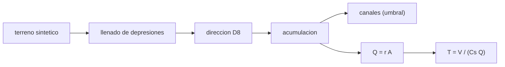

# B66-C04 — Redes fluviales fósiles y paleohidrología marciana

<!-- nav:top -->
[🏠 Programa](../../../../README.md) · [📚 Bloque B66](../../../tronco-comun/B66-geomorfologia-y-procesos-superficiales-planetarios.md) · [← Anterior: B66-C03 — Procesos eólicos: dunas, ripples y erosión planetaria](../B66-C03-procesos-eolicos-dunas-ripples-y-erosion-planetaria/CLASE.md) · [Siguiente: B66-C05 — Depósitos sedimentarios y sedimentología planetaria →](../B66-C05-depositos-sedimentarios-y-sedimentologia-planetaria/CLASE.md)
<!-- /nav -->

## 1. Ubicación, nivel y alcance

Clase 4 del bloque B66. Nivel N3. Una red de valles fósiles registra por dónde corrió el agua; el caudal y la duración hay que inferirlos con supuestos explícitos. Aquí extraes una red de drenaje con el método D8 de un terreno **sintético**, mides su densidad y estimas el caudal y la duración mínima del agua que excavó un volumen dado. Sigue a [B66-C03](../B66-C03-procesos-eolicos-dunas-ripples-y-erosion-planetaria/CLASE.md) y usa la hidráulica de [B66-C01](../B66-C01-valles-y-canales-morfologia-y-origen-en-superficies-planetarias/CLASE.md). Ninguna cifra describe una cuenca marciana real.

## 2. Por qué esta clase existe

Un mapa de valles marcianos invita a decir «hubo un océano» o «hubo lluvia». La decisión central: **¿qué se puede inferir del caudal y de la duración con una red, un volumen y supuestos explícitos, y qué incertidumbre arrastra?**

## 3. Lo que podrás hacer al terminar

1. Llenar depresiones de un modelo de terreno con inundación con prioridad.
2. Calcular direcciones D8 y acumulación de área.
3. Verificar el método con un plano inclinado de solución exacta.
4. Definir canales con un umbral y calcular la densidad de drenaje.
5. Estimar `Q = r A` y la duración mínima `T = V/(C_s Q)`.
6. Explicar por qué el resultado es una cota que depende de supuestos.

La evidencia es la **ficha paleohidrológica de una cuenca sintética** del ejercicio 12 (sección 20).

## 4. Con qué llegas y cómo comprobarlo

1. ¿Qué es un modelo digital de terreno?
2. ¿Qué es un área de drenaje?
3. ¿Qué es una densidad de drenaje?
4. ¿Qué es una semilla fija?
5. ¿Qué es una cota mínima?

<details>
<summary>Ver respuestas</summary>

1. Una malla de elevaciones. 2. La superficie cuya escorrentía llega a un punto. 3. La longitud de canal por unidad de área, en km/km². 4. Un valor inicial que hace repetible un generador aleatorio. 5. Un valor por debajo del cual el resultado no puede estar, dados los supuestos.
</details>

Con cuatro o cinco aciertos, sigue; si no, repasa los prerrequisitos.

## 5. Un caso de contexto y casos de referencia

Un terreno **sintético** de `40 × 40` celdas de `100 m` (`16,00 km²`) con un valle central da `315` celdas de canal, `32,48 km` de canal y una densidad de drenaje de `2,030 km/km²`. Con una escorrentía ilustrativa de `5 × 10⁻⁸ m/s` el caudal en la salida es `0,41 m³/s` y excavar `2 × 10⁸ m³` con una concentración de sedimento de `10⁻³` exige al menos `15 439` años. Es el **ejemplo conductor**; todo es **sintético e ilustrativo**.

## 6. Vocabulario

El **método D8** envía el flujo de cada celda a su vecina de descenso más pronunciado entre las 8 vecinas. La **acumulación** cuenta cuántas celdas drenan a cada una. El **llenado de depresiones** elimina sumideros para que todo flujo salga. La **densidad de drenaje** es longitud de canal entre área. La **duración mínima** `T = V/(C_s Q)` supone caudal de banca llena continuo.

## 7. Modelo mental: gotas que bajan por un mantel arrugado



*Descripción textual:* el terreno se rellena, se calculan direcciones y acumulación, se definen canales con un umbral y del área mayor sale el caudal y la duración mínima.

Analogía: las gotas sobre un mantel arrugado bajan por los pliegues y se juntan en los valles; el pliegue más ancho recoge más. Límite: el modelo asume escorrentía uniforme y constante, sin infiltración ni evaporación.

## 8. La explicación, paso a paso

### 8.1 Verificación con un plano inclinado

En un plano inclinado sin ruido que desciende hacia `+j`, la acumulación exacta en la columna `j` es `j + 1` para cualquier fila. El laboratorio la comprueba en todas las celdas (`11` en la celda `(20, 10)`).

### 8.2 Red sintética

El terreno suma un plano inclinado (`50 m` de desnivel), un valle gaussiano y ruido uniforme de hasta `0,6 m` con semilla `20261109`. Tras el llenado, todas las celdas drenan: las salidas acumulan `1600` de `1600` celdas.

| Magnitud | Valor |
|---|---|
| celdas de canal (umbral 30) | 315 |
| longitud de canal | 32,48 km |
| densidad de drenaje | 2,030 km/km² |
| mayor área drenada | 821 celdas = 8,21 km² |

### 8.3 Caudal y duración

`Q = r A = 5 × 10⁻⁸ × 8,21 × 10⁶ = 0,41 m³/s`. La duración mínima de excavar `V = 2 × 10⁸ m³` con `C_s = 10⁻³` es `T = V/(C_s Q) = 4,872 × 10¹¹ s = 15 439 años`.

| Escorrentía | `T` mínimo (años) |
|---|---|
| × 0,5 | 30 878 |
| × 1,0 | 15 439 |
| × 2,0 | 7719 |

### 8.4 Lectura

`T` es inversamente proporcional a la escorrentía y a la concentración: no es un dato, es una cota condicionada. Duplicar la escorrentía supuesta reduce a la mitad la duración. La densidad de drenaje y el caudal dependen además de la resolución de la malla y del umbral de canal. Nada de esto se refiere a una cuenca real de Marte.

## 9. Magnitudes, símbolos y unidades

| Símbolo | Qué es | Unidad | Valor / nota |
|---|---|---|---|
| `z` | elevación | m | sintética |
| `Δx` | tamaño de celda | m | 100 |
| `A` | área drenada | m² | 8,21 × 10⁶ |
| `r` | escorrentía | m/s | 5 × 10⁻⁸ (ilustrativa) |
| `Q` | caudal | m³/s | 0,41 |
| `C_s` | concentración volumétrica | — | 10⁻³ (ilustrativa) |
| `V` | volumen excavado | m³ | 2 × 10⁸ (ilustrativo) |
| `T` | duración mínima | años | 15 439 |

## 10. Convenciones y referencias

Malla de `40 × 40` celdas de `100 m` en coordenadas locales, filas `i` y columnas `j`, elevaciones en metros; el flujo desciende hacia `+j`. Terreno sintético con semilla `20261109`. Escorrentía uniforme, sin infiltración ni evaporación.

## 11. De dónde sale lo que afirmamos

| ID | Fuente | Localizador | Respalda | Estado |
|---|---|---|---|---|
| S1 | NASA/NSSDC, Mars Fact Sheet — https://nssdc.gsfc.nasa.gov/planetary/factsheet/marsfact.html (consultada 2026-11-09) | ficha completa leída | g media 3,73 m/s², presión 4,0–8,7 mb, densidad de superficie ~0,016 ± 0,006 kg/m³ | Consultada |
| — | Relaciones estándar (método D8, llenado de depresiones por inundación con prioridad, balance de masa de sedimento) | — | las verifica el laboratorio con una segunda vía | No consultada en una fuente concreta |

Límites: el terreno, la escorrentía, `C_s` y `V` son sintéticos o ilustrativos; la ficha de Marte solo aporta contexto; no se consultó literatura de paleohidrología marciana.

## 12. Cómo ver una red de drenaje

| Magnitud | Valor |
|---|---|
| celdas de canal | 315 |
| densidad de drenaje | 2,030 km/km² |
| `Q` en la salida | 0,41 m³/s |
| `T` mínimo | 15 439 años |

Descripción larga: la duración cae a la mitad si se duplica la escorrentía supuesta; el resultado es una cota con supuestos, no una medición.

## 13. Ejemplo trabajado: la duración con escorrentía doble

**Paso 1 · Caudal.** `Q = 2 × 0,41 = 0,82 m³/s`.

**Paso 2 · Flujo de sedimento.** `C_s Q = 10⁻³ × 0,82 = 8,2 × 10⁻⁴ m³/s`.

**Paso 3 · Duración.** `T = 2 × 10⁸/8,2 × 10⁻⁴ = 2,44 × 10¹¹ s = 7719 años`.

## 14. Distintas formas de describir una red de drenaje

**Por direcciones:** D8. **Por área:** acumulación. **Por longitud:** densidad de drenaje. **Por balance:** `T = V/(C_s Q)`.

## 15. Práctica guiada

**Ejercicio 1 · con los pasos indicados.** ¿Cuánto vale la acumulación en la columna `j = 10` de un plano inclinado? *Pasos:* aplica `j + 1`.

<details><summary>Solución comentada</summary>

`11`.
</details>

**Ejercicio 2 · con una pista.** Calcula el área en km² de 821 celdas de 100 m. *Pista:* multiplica por `10⁴ m²`.

<details><summary>Solución comentada</summary>

`8,21 km²`.
</details>

**Ejercicio 3 · casi autónomo.** ¿Por qué hay que llenar las depresiones?

<details><summary>Solución comentada</summary>

piensa en un sumidero.
</details>

## 16. Práctica autónoma, transferencia e integrador

**Ejercicio 4 · autónomo.** Longitud de canal si hubiera 200 celdas rectas de 100 m.

<details><summary>Solución comentada</summary>

`20 km`.
</details>

**Ejercicio 5 · autónomo.** `Q` con `r = 10⁻⁷ m/s` y 8,21 km².

<details><summary>Solución comentada</summary>

`0,821 m³/s`.
</details>

**Ejercicio 6 · autónomo.** `T` si `C_s = 5 × 10⁻³`.

<details><summary>Solución comentada</summary>

`15 439/5 = 3088 años`.
</details>

**Ejercicio 7 · autónomo.** `T` si `V = 10⁹ m³`.

<details><summary>Solución comentada</summary>

`77 194 años`.
</details>

**Ejercicio 8 · autónomo.** Densidad de drenaje con 50 km de canal en 16 km².

<details><summary>Solución comentada</summary>

`3,125 km/km²`.
</details>

**Ejercicio 9 · transferencia.** **Transferencia.** Un artículo da una duración de 10⁴ años. ¿Qué preguntas haces antes de aceptarla?

<details><summary>Solución comentada</summary>

Qué `V`, `C_s`, escorrentía y supuesto de continuidad usó, y si es cota mínima o estimación.
</details>

**Ejercicio 10 · transferencia.** **Transferencia.** ¿Por qué la densidad de drenaje cambia con la resolución?

<details><summary>Solución comentada</summary>

Porque una malla más fina resuelve canales pequeños que una gruesa no ve.
</details>

**Ejercicio 11 · transferencia.** **Transferencia.** Un colega dice que el caudal prueba un océano. ¿Qué respondes?

<details><summary>Solución comentada</summary>

Un caudal en un valle no prueba un océano; hay que unir morfología, estratigrafía y clima, y declarar la incertidumbre.
</details>

**Ejercicio 12 · integrador.** **Integrador.** Elabora tu *ficha paleohidrológica de una cuenca sintética*: resumen de la red (celdas, longitud, densidad), el caudal, la duración mínima con sensibilidad ×0,5, ×1 y ×2 y la lista de supuestos.

<details><summary>Solución comentada</summary>

Secciones 8.1–8.4 y la salida del laboratorio.
</details>

## 17. Laboratorio: red D8 y duración mínima del agua

El script [drenaje.py](drenaje.py) rellena un terreno sintético, calcula D8 y acumulación, define canales y estima `Q` y `T` (**comprueba** la acumulación exacta en el plano y que las salidas suman todas las celdas).

**Datos:** terreno **sintético** de semilla fija; escorrentía, `C_s` y `V` **ilustrativos**. **Predice antes de ejecutar:** ¿cuánto cambia `T` si se duplica la escorrentía? (a la mitad.) **Ejecución del 2026-11-09 (Python 3.12.9):**

```text
Python 3.12.9 (biblioteca estandar)
Plano inclinado sin ruido: acumulacion en (20, 10) = 11 ; esperado j+1 = 11
Terreno SINTETICO 40x40, celda 100 m (1600 celdas); area total = 16.00 km2
Celdas sin destino (salidas) acumulan 1600 celdas de 1600
Celdas de canal (umbral 30): 315 ; longitud de canal = 32.48 km ; densidad de drenaje = 2.030 km/km2
Mayor area drenada = 821 celdas = 8.21 km2 ; Q = r A = 0.41 m3/s (ILUSTRATIVO)
  escorrentia x0.5: T minimo = 9.744e+11 s = 30877.6 anos
  escorrentia x1.0: T minimo = 4.872e+11 s = 15438.8 anos
  escorrentia x2.0: T minimo = 2.436e+11 s = 7719.4 anos
Pruebas superadas.
```

```bash
python programa/clases/B66/B66-C04-redes-fluviales-fosiles-y-paleohidrologia-marciana/drenaje.py
```

**Límites:** escorrentía uniforme y constante, sin infiltración ni evaporación; el umbral de canal y la malla fijan la densidad.

## 18. Errores frecuentes y cómo corregirlos

**Presentar la duración como un dato.** Se corrige con 8.4.

**No llenar las depresiones.** Se corrige con 8.1.

**Olvidar la resolución de la malla.** Se corrige con 8.4.

**Confundir el terreno sintético con una cuenca de Marte.** Se corrige con la sección 10.

## 19. Cómo sabrás que vas bien

Tras la sección 8: ¿qué `T` esperabas con escorrentía doble y cuál obtuviste? Si dudas, repasa el ejemplo 13. Tras el laboratorio: ¿qué comprueba? (ver la sección 17).

## 20. Qué entregas y cómo se evalúa

El producto es tu **ficha paleohidrológica de una cuenca sintética** (ejercicio 12).

| Criterio | Inicial | En desarrollo | Logrado | Destacado |
|---|---|---|---|---|
| Conceptos | Los confunde | Parciales | Calcula D8, `Q` y `T` | Explica los límites |
| Cálculo | Sin unidades | Con errores | Tablas completas con unidades | Calcula casos nuevos |
| Numérico | Sin comprobar | Un caso | Contraste con una segunda vía | Interpreta las diferencias |
| Fuentes | Sin fuente | Sin fecha | Fuentes con fecha y estado | Declara lo ilustrativo y lo no consultado |
| Límites | No los nombra | Uno | Tres | Discute qué falta del modelo |

**Condiciones críticas (no se compensan con promedio):** rotular el terreno como sintético y los parámetros como ilustrativos; presentar `T` como cota condicionada; no atribuir la red a una cuenca real; citar solo lo consultado.

## 21. Ética, seguridad y límites

Clase educativa: los modelos son simplificados y sus datos son sintéticos o ilustrativos; ningún resultado describe una superficie real ni sustituye a la interpretación de datos de misión. Accesibilidad: tablas equivalentes a las gráficas, fórmulas en texto, ejercicios sin conexión.

## 22. Para cerrar y seguir

Un terreno sintético de 16 km² produce una red de `32,48 km` y, con supuestos ilustrativos, una duración mínima de `15 439` años que cambia en proporción inversa a la escorrentía. Queda una pregunta: ¿qué ambientes registran los depósitos que dejó el agua?

**Glosario español–inglés.** método D8 · *D8 method*; acumulación de flujo · *flow accumulation*; densidad de drenaje · *drainage density*; paleohidrología · *paleohydrology*; escorrentía · *runoff*.

**Continuidad.** [B66-C05](../B66-C05-depositos-sedimentarios-y-sedimentologia-planetaria/CLASE.md) estudia los depósitos sedimentarios.

**Referencias:** ver sección 11.

<!-- nav:bottom -->
---

[← Anterior: B66-C03 — Procesos eólicos: dunas, ripples y erosión planetaria](../B66-C03-procesos-eolicos-dunas-ripples-y-erosion-planetaria/CLASE.md) · [📚 Bloque B66](../../../tronco-comun/B66-geomorfologia-y-procesos-superficiales-planetarios.md) · [Siguiente: B66-C05 — Depósitos sedimentarios y sedimentología planetaria →](../B66-C05-depositos-sedimentarios-y-sedimentologia-planetaria/CLASE.md)
<!-- /nav -->
