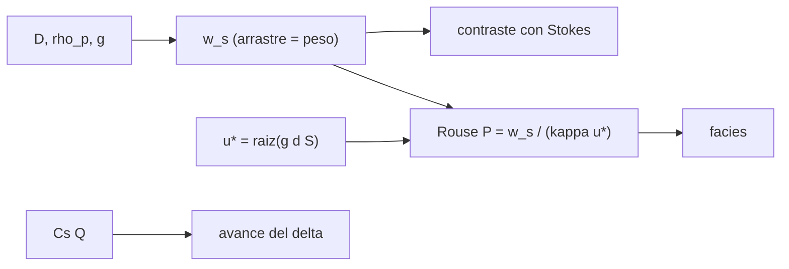

# B66-C05 — Depósitos sedimentarios y sedimentología planetaria

<!-- nav:top -->
[🏠 Programa](../../../../README.md) · [📚 Bloque B66](../../../tronco-comun/B66-geomorfologia-y-procesos-superficiales-planetarios.md) · [← Anterior: B66-C04 — Redes fluviales fósiles y paleohidrología marciana](../B66-C04-redes-fluviales-fosiles-y-paleohidrologia-marciana/CLASE.md) · [Siguiente: B67-C01 — Selección de sitios de extracción con criterios múltiples →](../../B67/B67-C01-seleccion-de-sitios-de-extraccion-con-criterios-multiples/CLASE.md)
<!-- /nav -->

## 1. Ubicación, nivel y alcance

Clase 5 del bloque B66. Nivel N3. Un delta o una pila de estratos conserva el tamaño de grano y el modo de transporte de las crecidas que los formaron. Aquí calculas la velocidad de caída de granos de agua en la Tierra y en Marte, la contrastas con la ley de Stokes, clasificas el transporte con el número de Rouse, estimas cuánto avanza el frente de un delta y generas una columna **sintética** de 12 crecidas. Sigue a [B66-C04](../B66-C04-redes-fluviales-fosiles-y-paleohidrologia-marciana/CLASE.md); la estratigrafía de [B53](../../../tronco-comun/B53-astrogeologia-y-geodesia-planetaria.md) es el marco. Ninguna cifra describe depósitos reales.

## 2. Por qué esta clase existe

Los deltas marcianos se interpretan como archivo de ambientes pasados, pero un grano cae más despacio con menos gravedad y el mismo flujo puede dejar otra facies. La decisión central: **¿cómo cambia la facies que deja un flujo cuando cambia la gravedad?**

## 3. Lo que podrás hacer al terminar

1. Calcular la velocidad de caída de una esfera por balance de arrastre y peso.
2. Contrastarla con la ley de Stokes para granos finos.
3. Calcular el número de Rouse y clasificar el modo de transporte.
4. Estimar el avance de un delta por conservación de volumen.
5. Construir una columna estratigráfica sintética con semilla fija.
6. Separar lo consultado de lo ilustrativo y de lo sintético.

La evidencia es la **columna estratigráfica sintética con facies** del ejercicio 12 (sección 20).

## 4. Con qué llegas y cómo comprobarlo

1. ¿Qué es la velocidad de caída?
2. ¿Qué es el número de Reynolds?
3. ¿Qué es una facies sedimentaria?
4. ¿Qué es la porosidad?
5. ¿Qué es un dato sintético?

<details>
<summary>Ver respuestas</summary>

1. La velocidad terminal de un grano en un fluido en reposo. 2. La razón entre fuerzas de inercia y viscosas. 3. El conjunto de rasgos de un depósito que refleja su ambiente de formación. 4. La fracción de volumen vacío en un depósito. 5. Uno generado para el ejemplo, no medido.
</details>

Con cuatro o cinco aciertos, sigue; si no, repasa los prerrequisitos.

## 5. Un caso de contexto y casos de referencia

Una arena de `0,5 mm` cae a `0,0785 m/s` en agua terrestre y a `0,0395 m/s` en Marte: `0,503` veces. Con un delta de `2000 m` de ancho y `10 m` de altura, un caudal de `100 m³/s` y una concentración de `10⁻³`, el frente avanza `0,720 m/día`. Una columna **sintética** de 12 crecidas en Marte da 11 capas de suspensión mixta y 1 de carga de fondo para una grava de 2 mm. Es el **ejemplo conductor**; todo es **ilustrativo o sintético**.

## 6. Vocabulario

La **velocidad de caída** `w_s` resulta del balance `(ρ_p − ρ) g (π/6) D³ = ½ ρ C_d (π/4) D² w_s²`. La **ley de Stokes** `w_s = (ρ_p − ρ) g D²/(18 μ)` vale para Reynolds bajo. El **número de Rouse** `P = w_s/(κ u*)` separa carga de fondo (`P > 2,5`), suspensión mixta (`0,8 < P ≤ 2,5`) y suspensión (`P ≤ 0,8`), con umbrales ilustrativos. La **progradación** es el avance de un delta hacia la cuenca.

## 7. Modelo mental: granos que caen en un vaso de agua en movimiento



*Descripción textual:* el tamaño de grano y la gravedad dan la velocidad de caída; con la velocidad de fricción sale el número de Rouse y la facies; el caudal de sedimento fija el avance del delta.

Analogía: los granos pesados caen al fondo y los finos se quedan flotando; con menos gravedad caen más despacio, y el flujo también es más lento. Límite: la esfera lisa en agua pura y fría no es un grano natural, y el mundo real tiene floculación y rugosidad.

## 8. La explicación, paso a paso

### 8.1 Velocidad de caída

Se resuelve el balance de arrastre y peso por bisección con `C_d = 24/Re (1 + 0,15 Re^0,687)` (Schiller–Naumann, estándar, no consultada), agua de `1000 kg/m³` y `10⁻³ Pa·s` (ilustrativas) y `ρ_p = 2650 kg/m³`.

| `D` (mm) | Tierra (m/s) | Marte (m/s) | Marte/Tierra |
|---|---|---|---|
| 0,02 | 0,00036 | 0,00014 | 0,3808 |
| 0,10 | 0,00798 | 0,00320 | 0,4011 |
| 0,50 | 0,07850 | 0,03949 | 0,5031 |
| 2,00 | 0,28365 | 0,15614 | 0,5504 |

Para `D = 20 µm` en la Tierra, la diferencia relativa con Stokes es `5,0 × 10⁻³`. Con granos finos `w_s ∝ g` (cociente `0,38` cercano a `3,73/9,820 = 0,380`) y con granos gruesos se acerca a `√g` (`0,616`; a 2 mm vale `0,550`).

### 8.2 Rouse en el canal

Para `Q = 100 m³/s` en un canal de 20 m con `S = 0,01` y `f = 0,05` (ilustrativos), la profundidad es `1,213 m` en la Tierra y `1,699 m` en Marte; `u* = √(g d S)` vale `0,3451` y `0,2517 m/s`. Para arena de 0,5 mm, `P = 0,555` (Tierra) y `0,383` (Marte): ambas en suspensión.

### 8.3 Columna sintética

Se generan 12 caudales lognormales con semilla `20261109 + k` y se clasifica la fracción de 2 mm en Marte: 11 crecidas dan suspensión mixta (`P` de 1,03 a 1,99) y la más pequeña (`17,7 m³/s`, `P = 2,74`) carga de fondo. El espesor acumulado del modelo (1 día por crecida sobre `2000 × 2000 m`) es `55,61 mm`.

### 8.4 Delta y lectura

`avance = C_s Q/(ancho · altura · (1 − porosidad)) = 0,1/(2000 × 10 × 0,6) = 8,33 × 10⁻⁶ m/s = 0,720 m/día`. El mismo flujo en Marte es más profundo y más lento, y un grano de una misma talla se transporta más en suspensión: leer la facies sin corregir por gravedad puede subestimar el tamaño de grano. Todo es modelo sintético.

## 9. Magnitudes, símbolos y unidades

| Símbolo | Qué es | Unidad | Valor / nota |
|---|---|---|---|
| `w_s` | velocidad de caída | m/s | 0,0785 (0,5 mm, Tierra) |
| `P` | número de Rouse | — | 0,555 (Tierra) |
| `u*` | velocidad de fricción | m/s | 0,3451 (Tierra) |
| `κ` | constante de von Kármán | — | 0,41 (ilustrativa) |
| `φ` | porosidad | — | 0,4 (ilustrativa) |
| `C_s` | concentración | — | 10⁻³ (ilustrativa) |

## 10. Convenciones y referencias

Gravedades de las fichas NASA/NSSDC (9,820 y 3,73 m/s²). Esferas lisas en agua pura; flujo uniforme en el canal de B66-C01; semilla `20261109`. Fluido, grano, `κ`, porosidad, concentración y umbrales de Rouse ilustrativos.

## 11. De dónde sale lo que afirmamos

| ID | Fuente | Localizador | Respalda | Estado |
|---|---|---|---|---|
| S1 | NASA/NSSDC, Earth Fact Sheet — https://nssdc.gsfc.nasa.gov/planetary/factsheet/earthfact.html (consultada 2026-11-09) | ficha completa leída | g media 9,820 m/s², presión 1014 mb, T media 288 K | Consultada |
| S2 | NASA/NSSDC, Mars Fact Sheet — https://nssdc.gsfc.nasa.gov/planetary/factsheet/marsfact.html (consultada 2026-11-09) | ficha completa leída | g media 3,73 m/s², presión 4,0–8,7 mb, densidad de superficie ~0,016 ± 0,006 kg/m³ | Consultada |
| — | Relaciones estándar (ley de Stokes, correlación de arrastre de Schiller–Naumann, número de Rouse, conservación de volumen) | — | las verifica el laboratorio con una segunda vía | No consultada en una fuente concreta |

Límites: el agua, el grano, los umbrales de Rouse, la porosidad y la concentración no se consultaron; no se modela Titán ni fluidos no acuosos; la columna es sintética.

## 12. Cómo ver la facies que deja un flujo

| Magnitud | Valor |
|---|---|
| `w_s` 0,5 mm en Marte | 0,03949 m/s |
| diferencia con Stokes (20 µm) | 5,0 × 10⁻³ |
| `P` arena 0,5 mm (Marte) | 0,383 |
| avance del delta | 0,720 m/día |
| facies de 2 mm (12 crecidas) | 11 mixta, 1 carga de fondo |

Descripción larga: con menos gravedad los granos caen más despacio y el número de Rouse baja; el delta avanza en proporción al caudal de sedimento.

## 13. Ejemplo trabajado: Stokes para 20 µm

**Paso 1 · Datos.** `ρ_p − ρ = 1650 kg/m³`, `g = 9,820 m/s²`, `D = 2×10⁻⁵ m`, `μ = 10⁻³ Pa·s`.

**Paso 2 · Fórmula.** `w_s = 1650 × 9,820 × (2×10⁻⁵)²/(18 × 10⁻³)`.

**Paso 3 · Resultado.** `w_s = 3,6 × 10⁻⁴ m/s`, que coincide con la tabla 8.1 (`0,00036`).

## 14. Distintas formas de describir la facies

**Por velocidad de caída:** `w_s`. **Por número de Rouse:** `P`. **Por columna:** conteo de facies. **Por balance:** avance del delta.

## 15. Práctica guiada

**Ejercicio 1 · con los pasos indicados.** Calcula `ρ_p − ρ` con `2650` y `1000`. *Pasos:* resta.

<details><summary>Solución comentada</summary>

`1650 kg/m³`.
</details>

**Ejercicio 2 · con una pista.** Predice el cociente Marte/Tierra de Stokes. *Pista:* `g` entra una vez.

<details><summary>Solución comentada</summary>

`3,73/9,820 = 0,380`; el laboratorio da 0,3808.
</details>

**Ejercicio 3 · casi autónomo.** ¿Qué facies da `P = 0,555`?

<details><summary>Solución comentada</summary>

compara con 0,8.
</details>

## 16. Práctica autónoma, transferencia e integrador

**Ejercicio 4 · autónomo.** Avance del delta con el doble de caudal.

<details><summary>Solución comentada</summary>

`1,44 m/día`.
</details>

**Ejercicio 5 · autónomo.** `P` si `u*` baja a la mitad.

<details><summary>Solución comentada</summary>

se duplica.
</details>

**Ejercicio 6 · autónomo.** Espesor depositado por día con `Q = 100 m³/s` sobre `2000 × 2000 m`.

<details><summary>Solución comentada</summary>

`0,1 × 86 400/(4×10⁶ × 0,6) = 3,6 mm/día`.
</details>

**Ejercicio 7 · autónomo.** Clasifica `P = 3`.

<details><summary>Solución comentada</summary>

Carga de fondo.
</details>

**Ejercicio 8 · autónomo.** Clasifica `P = 1,5`.

<details><summary>Solución comentada</summary>

Suspensión mixta.
</details>

**Ejercicio 9 · transferencia.** **Transferencia.** Un delta marciano tiene gravas de 5 cm. ¿Qué dice la gravedad sobre el flujo?

<details><summary>Solución comentada</summary>

Con menos gravedad un grano cae más despacio, así que un flujo comparable mueve gravas con menor velocidad de fricción; hay que recalcular el umbral, no usar valores terrestres.
</details>

**Ejercicio 10 · transferencia.** **Transferencia.** ¿Por qué no se puede decir que una capa sintética representa Marte?

<details><summary>Solución comentada</summary>

Porque los caudales, el grano y la geometría son sintéticos; la capa solo ilustra el método.
</details>

**Ejercicio 11 · transferencia.** **Transferencia.** Un colega usa Stokes para granos de 2 mm. ¿Qué error comete?

<details><summary>Solución comentada</summary>

Stokes vale a Reynolds bajo; a 2 mm la velocidad real es mucho menor (`0,284 m/s` frente a `3,6 m/s` de Stokes).
</details>

**Ejercicio 12 · integrador.** **Integrador.** Elabora tu *columna estratigráfica sintética con facies*: tabla de `w_s` en dos cuerpos, contraste con Stokes, número de Rouse en el canal, avance del delta y la columna sintética con sus facies.

<details><summary>Solución comentada</summary>

Secciones 8.1–8.4 y la salida del laboratorio.
</details>

## 17. Laboratorio: sedimento, Rouse y delta sintético

El script [sedimentos.py](sedimentos.py) calcula `w_s`, la contrasta con Stokes, clasifica con Rouse, estima el avance de un delta y genera una columna de 12 crecidas (**comprueba** Stokes < 1 % y que se clasifican las 12 crecidas).

**Datos:** gravedades de la NASA (consultadas); fluido, grano, `κ`, umbrales, porosidad, concentración y caudales **ilustrativos o sintéticos**. **Predice antes de ejecutar:** ¿cuánto menos cae una arena de 0,5 mm en Marte? (aprox. la mitad: 0,503.) **Ejecución del 2026-11-09 (Python 3.12.9):**

```text
Python 3.12.9 (biblioteca estandar)
Velocidad de caida ws [m/s] (agua ILUSTRATIVA, esfera):
 D [mm]   Tierra      Marte    Marte/Tierra
  0.02    0.00036    0.00014   0.3808
  0.10    0.00798    0.00320   0.4011
  0.50    0.07850    0.03949   0.5031
  2.00    0.28365    0.15614   0.5504
Contraste con Stokes (D = 20 micras, Tierra): diferencia relativa = 5.02e-03
Numero de Rouse para arena de 0.5 mm en el canal ILUSTRATIVO con Q = 100 m3/s:
  Tierra d = 1.213 m ; u* = 0.3451 m/s ; P = 0.555 -> suspension
  Marte  d = 1.699 m ; u* = 0.2517 m/s ; P = 0.383 -> suspension
Estratigrafia SINTETICA de 12 crecidas en Marte (grava fina de 2 mm; Rouse de la fraccion de 2 mm):
  crecida  1: Q =   138.9 m3/s ; P =  1.35 ; suspension mixta ; espesor/dia = 5.001 mm
  crecida  2: Q =    87.7 m3/s ; P =  1.58 ; suspension mixta ; espesor/dia = 3.156 mm
  crecida  3: Q =    17.7 m3/s ; P =  2.74 ; carga de fondo   ; espesor/dia = 0.638 mm
  crecida  4: Q =   122.5 m3/s ; P =  1.41 ; suspension mixta ; espesor/dia = 4.410 mm
  crecida  5: Q =   177.7 m3/s ; P =  1.23 ; suspension mixta ; espesor/dia = 6.398 mm
  crecida  6: Q =   226.6 m3/s ; P =  1.13 ; suspension mixta ; espesor/dia = 8.157 mm
  crecida  7: Q =    77.9 m3/s ; P =  1.65 ; suspension mixta ; espesor/dia = 2.804 mm
  crecida  8: Q =   112.7 m3/s ; P =  1.45 ; suspension mixta ; espesor/dia = 4.058 mm
  crecida  9: Q =   110.4 m3/s ; P =  1.46 ; suspension mixta ; espesor/dia = 3.973 mm
  crecida 10: Q =   292.5 m3/s ; P =  1.03 ; suspension mixta ; espesor/dia = 10.531 mm
  crecida 11: Q =   134.9 m3/s ; P =  1.36 ; suspension mixta ; espesor/dia = 4.856 mm
  crecida 12: Q =    45.2 m3/s ; P =  1.99 ; suspension mixta ; espesor/dia = 1.627 mm
Conteo de facies: {'suspension mixta': 11, 'carga de fondo': 1} ; espesor acumulado (1 dia por crecida) = 55.61 mm
Avance del frente del delta con Q = 100 m3/s: 8.333e-06 m/s = 0.720 m/dia
Pruebas superadas.
```

```bash
python programa/clases/B66/B66-C05-depositos-sedimentarios-y-sedimentologia-planetaria/sedimentos.py
```

**Límites:** esferas lisas en agua pura, flujo uniforme, sin Titán ni fluidos no acuosos; la columna es sintética.

## 18. Errores frecuentes y cómo corregirlos

**Usar Stokes fuera de su rango.** Se corrige con 8.1.

**Usar los umbrales de Rouse como valores medidos.** Se corrige con la sección 6.

**Leer la columna sintética como un registro de Marte.** Se corrige con 8.4.

**Olvidar corregir por gravedad.** Se corrige con la tabla 8.1.

## 19. Cómo sabrás que vas bien

Tras la sección 8: ¿qué cociente Marte/Tierra esperabas y cuál obtuviste? Si dudas, repasa el ejemplo 13. Tras el laboratorio: ¿qué comprueba? (ver la sección 17).

## 20. Qué entregas y cómo se evalúa

El producto es tu **columna estratigráfica sintética con facies** (ejercicio 12).

| Criterio | Inicial | En desarrollo | Logrado | Destacado |
|---|---|---|---|---|
| Conceptos | Los confunde | Parciales | Calcula `w_s`, `P` y el avance | Explica los límites |
| Cálculo | Sin unidades | Con errores | Tablas completas con unidades | Calcula casos nuevos |
| Numérico | Sin comprobar | Un caso | Contraste con una segunda vía | Interpreta las diferencias |
| Fuentes | Sin fuente | Sin fecha | Fuentes con fecha y estado | Declara lo ilustrativo y lo no consultado |
| Límites | No los nombra | Uno | Tres | Discute qué falta del modelo |

**Condiciones críticas (no se compensan con promedio):** rotular fluido, grano y umbrales como ilustrativos y la columna como sintética; no presentar el modelo como observación de un depósito; citar solo lo consultado.

## 21. Ética, seguridad y límites

Clase educativa: los modelos son simplificados y sus datos son sintéticos o ilustrativos; ningún resultado describe una superficie real ni sustituye a la interpretación de datos de misión. Accesibilidad: tablas equivalentes a las gráficas, fórmulas en texto, ejercicios sin conexión.

## 22. Para cerrar y seguir

Una arena de 0,5 mm cae al `50 %` de su velocidad terrestre en Marte, un delta sintético avanza `0,720 m/día` y una columna de 12 crecidas deja 11 facies mixtas y 1 de carga de fondo. Con esto el bloque cierra el recorrido de la forma al proceso, y la forma de leer cada resultado es: modelo con supuestos, no observación.

**Glosario español–inglés.** velocidad de caída · *settling velocity*; número de Rouse · *Rouse number*; facies · *facies*; progradación · *progradation*; delta · *delta*.

**Continuidad.** Esta es la última clase del bloque B66. El bloque siguiente es [B67](../../../tronco-comun/B67-prospeccion-y-evaluacion-de-reservas-de-recursos-extraterrestres.md).

**Referencias:** ver sección 11.

<!-- nav:bottom -->
---

[← Anterior: B66-C04 — Redes fluviales fósiles y paleohidrología marciana](../B66-C04-redes-fluviales-fosiles-y-paleohidrologia-marciana/CLASE.md) · [📚 Bloque B66](../../../tronco-comun/B66-geomorfologia-y-procesos-superficiales-planetarios.md) · [Siguiente: B67-C01 — Selección de sitios de extracción con criterios múltiples →](../../B67/B67-C01-seleccion-de-sitios-de-extraccion-con-criterios-multiples/CLASE.md)
<!-- /nav -->
