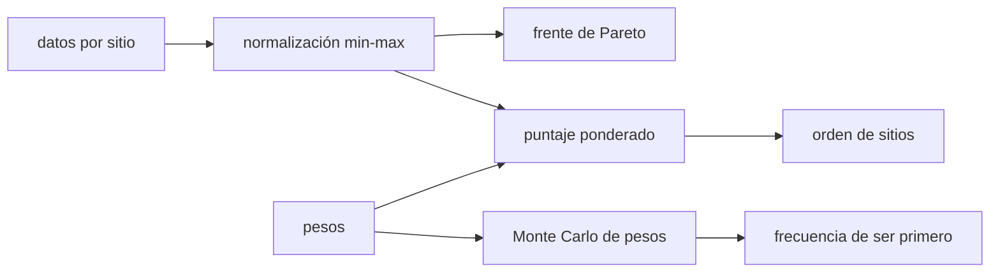

# B67-C01 — Selección de sitios de extracción con criterios múltiples

<!-- nav:top -->
[🏠 Programa](../../../../README.md) · [📚 Bloque B67](../../../tronco-comun/B67-prospeccion-y-evaluacion-de-reservas-de-recursos-extraterrestres.md) · [← Anterior: B66-C05 — Depósitos sedimentarios y sedimentología planetaria](../../B66/B66-C05-depositos-sedimentarios-y-sedimentologia-planetaria/CLASE.md) · [Siguiente: B67-C02 — Diseño de un programa de prospección por fases →](../B67-C02-diseno-de-un-programa-de-prospeccion-por-fases/CLASE.md)
<!-- /nav -->

## 1. Ubicación, nivel y alcance

Clase 1 del bloque B67 (área A05). Nivel N3. Antes de prospectar hay que decidir **dónde**: un sitio con mucha reserva puede ser inaccesible, estar a oscuras o ser demasiado riesgoso. Aquí comparas sitios con cuatro criterios (reserva, pendiente, iluminación como proxy de energía y riesgo), normalizas, ponderas, buscas el frente de Pareto y mides cuánto depende el orden de los pesos elegidos. Usas la estadística de [B12](../../../tronco-comun/B12-probabilidad-estadistica-e-incertidumbre.md) para el Monte Carlo. Los siete sitios son **sintéticos**: no corresponden a ningún lugar real.

## 2. Por qué esta clase existe

Elegir con una sola cifra (la reserva) lleva a sitios que no se pueden explotar; elegir con una suma de unidades distintas es un error. La decisión central: **¿cuál sitio conviene, y cuánto de esa respuesta depende de los pesos que fija quien decide?**

## 3. Lo que podrás hacer al terminar

1. Normalizar criterios con unidades distintas a una escala común sin que el orden dependa de las unidades.
2. Calcular un puntaje ponderado y ordenar los sitios.
3. Identificar los sitios dominados (frente de Pareto) y descartarlos sin discutir pesos.
4. Estimar con Monte Carlo la frecuencia con que cada sitio queda primero al variar los pesos.
5. Encontrar el peso de un criterio a partir del cual cambia el ganador.
6. Presentar la selección separando el dato, el peso y la decisión.

La evidencia es la **ficha de selección multicriterio** del ejercicio 12 (sección 20).

## 4. Con qué llegas y cómo comprobarlo

1. ¿Qué es una unidad de medida y por qué no se suman kilotones con grados?
2. ¿Qué es un valor mínimo y uno máximo de un conjunto?
3. ¿Qué es una distribución uniforme?
4. ¿Qué es una simulación Monte Carlo?
5. ¿Qué es un dato sintético?

<details>
<summary>Ver respuestas</summary>

1. Es un patrón de comparación; magnitudes distintas no se suman sin convertirlas a una escala común. 2. El menor y el mayor valor observados. 3. Una en la que todos los valores de un rango son igual de probables. 4. Repetir un cálculo con números aleatorios de semilla fija para ver la variación. 5. Uno inventado para la clase, no medido.
</details>

Con cuatro o cinco aciertos, sigue; si no, repasa los prerrequisitos.

## 5. Un caso de contexto y casos de referencia

Siete sitios candidatos con una reserva de entre 60 y 200 kt de agua equivalente, pendiente de 4° a 18°, iluminación de 10 % a 60 % del año y un índice de riesgo de 3 a 8. Con pesos de 0,4 para la reserva y 0,2 para cada uno de los otros tres criterios, el sitio S2 (80 kt, pero llano, iluminado y poco riesgoso) obtiene `0,6371` y supera a S3 (200 kt, pero empinado y oscuro), que obtiene `0,4000`. Es el **ejemplo conductor**; todo es **sintético**.

## 6. Vocabulario

Un **criterio** es una propiedad que se compara (reserva, pendiente, iluminación, riesgo). La **normalización min-max** lleva cada criterio a `[0, 1]` con 1 = mejor. El **puntaje ponderado** es la suma de los criterios normalizados por sus pesos, que suman 1. Un sitio **domina** a otro si es al menos igual en todo y mejor en algo. El **frente de Pareto** es el conjunto de sitios no dominados. La **robustez** es la fracción de pesos aleatorios con que un sitio sigue siendo el primero.

## 7. Modelo mental: elegir una casa con cuatro cosas que importan

Piensa en elegir una casa por precio, tamaño, cercanía y luz: nadie suma metros con euros. Primero se pone todo en la misma escala, luego se decide cuánto importa cada cosa, y por último se revisa si la elección sobrevive a cambiar esas importancias.



*Descripción textual:* los datos de cada sitio se normalizan; los dominados se descartan con el frente de Pareto; los pesos convierten los datos normalizados en un puntaje y un orden; repetir con pesos aleatorios mide qué tan estable es el primero.

Analogía: elegir una casa con cuatro cosas que importan. Límite: los criterios se suponen independientes y los puntajes lineales; un sitio con un valor inaceptable en un criterio (por ejemplo, riesgo extremo) puede requerir una regla de exclusión y no un promedio.

## 8. La explicación, paso a paso

### 8.1 Normalizar

Para un criterio donde más es mejor, `z = (x − mín)/(máx − mín)`; donde menos es mejor, `z = 1 − (x − mín)/(máx − mín)`. Esa transformación es afín, de modo que cambiar las unidades (de kt a t, de grados a radianes, o sumar una constante) **no** altera `z`. El laboratorio lo comprueba: con otras unidades el orden es idéntico.

### 8.2 Puntaje y orden (pesos 0,4 / 0,2 / 0,2 / 0,2)

| Sitio | Puntaje | Rango |
|---|---|---|
| S1 | 0,3771 | 7 |
| S2 | 0,6371 | 1 |
| S3 | 0,4000 | 6 |
| S4 | 0,5514 | 2 |
| S5 | 0,5057 | 3 |
| S6 | 0,4914 | 4 |
| S7 | 0,4629 | 5 |

### 8.3 Frente de Pareto

S7 (90 kt, 7°, 35 %, riesgo 5) está dominado por S4 (95 kt, 6°, 40 %, riesgo 4): S4 es mejor en los cuatro criterios. Los otros seis sitios no están dominados. Un sitio dominado **no puede** ser el primero con ningún conjunto de pesos no negativos: el Monte Carlo lo confirma con frecuencia 0 para S7.

### 8.4 Robustez frente a los pesos

Con 20 000 vectores de pesos aleatorios (distribución de Dirichlet uniforme sobre el simplex, semilla 67), el sitio es el primero con frecuencia: S2 `0,837`; S3 `0,097`; S5 `0,049`; S6 `0,017`; S1, S4 y S7, `0`. S4 queda segundo con los pesos base pero **nunca primero**: aun no estando dominado, ningún peso lo hace ganar.

### 8.5 Cuándo cambia el ganador

Si el peso de la reserva sube y el resto se reparte en partes iguales, el ganador cambia de S2 a S3 cuando el peso de la reserva llega a `0,54`. Esa cifra, y no el puntaje, es lo que conviene discutir con quien decide.

## 9. Magnitudes, símbolos y unidades

| Símbolo | Qué es | Unidad | Valor / nota |
|---|---|---|---|
| `x` | valor del criterio | kt; °; %; adimensional | sintético |
| `z` | criterio normalizado | adimensional | 0–1, 1 = mejor |
| `w_k` | peso del criterio `k` | adimensional | suman 1 |
| `P_i` | puntaje del sitio `i` | adimensional | 0–1 |

## 10. Convenciones y referencias

Reserva en kt de agua equivalente; pendiente en grados; iluminación como porcentaje del año con Sol (proxy de la energía disponible); riesgo como índice adimensional de 0 a 10. Pesos no negativos que suman 1. Semilla `67` en el Monte Carlo. Versiones: Python 3.12.9, numpy 2.4.4. Tolerancia: comparación exacta de órdenes y `1e-12` en la suma de frecuencias.

## 11. De dónde sale lo que afirmamos

| ID | Fuente | Localizador | Respalda | Estado |
|---|---|---|---|---|
| — | Sin fuente externa | — | el método (min-max, suma ponderada, dominancia) es estándar y lo verifica el laboratorio | No se consultó una fuente para esta clase |

Límites: no se consultó ninguna fuente para esta clase; los sitios, criterios y pesos son inventados; no se evalúa ningún sitio lunar real.

## 12. Cómo ver la selección

| Magnitud | Valor |
|---|---|
| mejor sitio con pesos base | S2 (0,6371) |
| sitios dominados | S7 |
| frecuencia de S2 como primero | 0,837 |
| peso de reserva en que cambia el ganador | 0,54 |

Descripción larga: el primer lugar no es estable; sube y baja con el peso que se da a la reserva, y un sitio dominado nunca puede ganar.

## 13. Ejemplo trabajado: el puntaje de S2

**Paso 1 · Reserva.** `(80 − 60)/(200 − 60) = 0,1429`.

**Paso 2 · Pendiente (menos es mejor).** `1 − (4 − 4)/(18 − 4) = 1`.

**Paso 3 · Iluminación.** `(55 − 10)/(60 − 10) = 0,9`. **Riesgo (menos es mejor):** `1 − (3 − 3)/(8 − 3) = 1`.

**Paso 4 · Puntaje.** `0,4·0,1429 + 0,2·1 + 0,2·0,9 + 0,2·1 = 0,6371`.

## 14. Distintas formas de describir la selección de un sitio

**Por tabla:** puntajes y rangos. **Por conjunto:** frente de Pareto. **Por probabilidad:** frecuencia de ganar con pesos aleatorios. **Por umbral:** peso en que cambia el ganador.

## 15. Práctica guiada

**Ejercicio 1 · con los pasos indicados.** Normaliza la reserva de S4 (95 kt) con mín 60 y máx 200. *Pasos:* resta el mínimo y divide por el rango.

<details><summary>Solución comentada</summary>

`(95 − 60)/140 = 0,25`.
</details>

**Ejercicio 2 · con una pista.** Normaliza el riesgo de S6 (7) con mín 3 y máx 8, sabiendo que menos es mejor. *Pista:* `1 − (x − mín)/(máx − mín)`.

<details><summary>Solución comentada</summary>

`1 − (7 − 3)/5 = 0,2`.
</details>

**Ejercicio 3 · casi autónomo.** ¿Por qué la pendiente se normaliza con `1 − …` y la reserva no?

<details><summary>Solución comentada</summary>

Porque con la pendiente menos es mejor; la normalización debe dejar 1 = mejor en todos los criterios.
</details>

## 16. Práctica autónoma, transferencia e integrador

**Ejercicio 4 · autónomo.** Calcula el puntaje de S5 con los pesos base.

<details><summary>Solución comentada</summary>

Reserva `0`; pendiente `1 − 1/14 = 0,9286`; iluminación `1`; riesgo `1 − 2/5 = 0,6`. Puntaje `0,2(0,9286 + 1 + 0,6) = 0,5057`.
</details>

**Ejercicio 5 · autónomo.** Demuestra que S7 está dominado por S4.

<details><summary>Solución comentada</summary>

S4 tiene más reserva (95 > 90), menos pendiente (6 < 7), más iluminación (40 > 35) y menos riesgo (4 < 5): es mejor en los cuatro criterios.
</details>

**Ejercicio 6 · autónomo.** Calcula el puntaje de S3 (200 kt, 18°, 10 %, riesgo 8).

<details><summary>Solución comentada</summary>

Reserva `1`, los otros tres `0`; puntaje `0,4·1 = 0,4000`.
</details>

**Ejercicio 7 · autónomo.** Con pesos iguales de 0,25, calcula el puntaje de S2 y el de S3.

<details><summary>Solución comentada</summary>

S2: `(0,1429 + 1 + 0,9 + 1)/4 = 0,7607`; S3: `1/4 = 0,25`. La distancia entre ambos crece.
</details>

**Ejercicio 8 · autónomo.** S4 nunca es el primero en el Monte Carlo. ¿Significa que está dominado?

<details><summary>Solución comentada</summary>

No: no está dominado (el laboratorio lo cuenta en el frente), pero otro sitio lo supera para todo vector de pesos probado; ser no dominado es condición necesaria, no suficiente, para ganar.
</details>

**Ejercicio 9 · transferencia.** Quien decide quiere pesos 0,7 para reserva y 0,1 para cada otro criterio. ¿Qué haces antes de aceptar el resultado?

<details><summary>Solución comentada</summary>

Calcular el puntaje con esos pesos y compararlo con el umbral de `0,54`: ya estás del lado de S3. Mostrar a quien decide que la elección depende de ese peso.
</details>

**Ejercicio 10 · transferencia.** Se añade un quinto criterio, «distancia a la planta». ¿Qué cambia en el método?

<details><summary>Solución comentada</summary>

Se añade una columna, se normaliza con su sentido y se reparten los pesos de nuevo; el frente de Pareto puede crecer, porque un sitio antes dominado puede ganar en el criterio nuevo.
</details>

**Ejercicio 11 · transferencia.** Un colega propone sumar directamente kt y grados «porque todo son números». Responde.

<details><summary>Solución comentada</summary>

Sumar magnitudes sin normalizar hace que el criterio de mayor escala (la reserva en kt) decida casi todo, y que el resultado cambie con las unidades.
</details>

**Ejercicio 12 · integrador.** Elabora tu *ficha de selección multicriterio*: tabla de datos, normalización, puntaje, frente de Pareto, robustez y umbral de cambio.

<details><summary>Solución comentada</summary>

Secciones 8.1–8.5, con los datos rotulados como sintéticos.
</details>

## 17. Laboratorio: comparación multicriterio de siete sitios sintéticos

El script [seleccion.py](seleccion.py) normaliza, pondera, busca el frente de Pareto y repite con pesos aleatorios (**comprueba** la invariancia a unidades, la suma de frecuencias y que un dominado nunca gana).

**Datos:** siete sitios sintéticos; semilla 67. **Predice antes de ejecutar:** ¿cuál será la frecuencia de S2 como primero? (alrededor de 0,84.) **Ejecución del 2026-11-09 (Python 3.12.9, numpy 2.4.4):**

```text
Python 3.12.9 ; numpy 2.4.4
DATOS SINTETICOS (inventados para la clase; no son sitios reales)
Pesos base: {'reserva': 0.4, 'pendiente': 0.2, 'iluminacion': 0.2, 'riesgo': 0.2}
sitio  puntaje  rango
  S1    0.3771    7
  S2    0.6371    1
  S3    0.4000    6
  S4    0.5514    2
  S5    0.5057    3
  S6    0.4914    4
  S7    0.4629    5
Frente de Pareto: ['S1', 'S2', 'S3', 'S4', 'S5', 'S6']
Invariancia a cambios de unidades: orden identico (comprobado)
Monte Carlo de pesos (N=20000, semilla 67): frecuencia de ser el primero
  S1: 0.000
  S2: 0.837
  S3: 0.097
  S4: 0.000
  S5: 0.049
  S6: 0.017
  S7: 0.000
Sitios dominados: ['S7'] -> frecuencia 0 (comprobado)
Cambios de ganador al subir el peso de la reserva (resto repartido igual): [(0.54, 'S2', 'S3')]
Pruebas superadas.
```

```bash
python programa/clases/B67/B67-C01-seleccion-de-sitios-de-extraccion-con-criterios-multiples/seleccion.py
```

**Límites:** criterios independientes, puntaje lineal y datos inventados.

## 18. Errores frecuentes y cómo corregirlos

**Sumar unidades distintas sin normalizar.** Se corrige con 8.1.

**Confundir el puntaje con la verdad.** El puntaje depende de pesos que son una decisión; se corrige con 8.4 y 8.5.

**Descartar un sitio por quedar segundo.** Solo se descarta con seguridad el dominado; se corrige con 8.3.

**Presentar los sitios como reales.** Se corrige con la sección 10.

## 19. Cómo sabrás que vas bien

Tras 8.2: ¿qué resultado esperabas y cuál obtuviste? Si dudas, repasa el ejemplo 13. Tras el laboratorio: ¿qué comprueba cada `assert`? (ver la sección 17).

## 20. Qué entregas y cómo se evalúa

El producto es tu **ficha de selección multicriterio** (ejercicio 12).

| Criterio | Inicial | En desarrollo | Logrado | Destacado |
|---|---|---|---|---|
| Conceptos | Los confunde | Parciales | Conceptos de la clase con sus condiciones | Explica los límites del modelo |
| Cálculo | Sin unidades | Con errores | Tablas completas con unidades | Calcula casos nuevos |
| Numérico | Sin comprobar | Un caso | Contraste con la solución analítica o con la simulación | Interpreta las diferencias |
| Fuentes | Sin fuente | Sin fecha | Fuentes con fecha de consulta | Declara lo no consultado |
| Límites | No los nombra | Uno | Tres | Discute qué falta del modelo |

**Condiciones críticas (no se compensan con promedio):** rotular los datos como sintéticos; no presentar lo simulado como observado; no inferir reservas de ningún sitio real; citar solo lo consultado.

## 21. Ética, seguridad y límites

Clase educativa: los modelos son simplificados y los datos son sintéticos; no se estima, certifica ni reporta ninguna reserva real, ni se evalúa un sitio o una empresa concretos. El resultado de una selección es una herramienta de discusión, no una decisión de inversión. Accesibilidad: tablas equivalentes a las gráficas, fórmulas en texto, ejercicios sin conexión.

## 22. Para cerrar y seguir

Con los pesos base el sitio S2 gana con `0,6371`, pero solo es primero en el `83,7 %` de los pesos aleatorios, y el ganador cambia al pasar el peso de la reserva de `0,54`. Queda una pregunta: ¿cómo se programa la prospección que confirma el sitio elegido?

**Glosario español–inglés.** criterio · *criterion*; normalización · *normalization*; frente de Pareto · *Pareto front*; dominancia · *dominance*; peso · *weight*.

**Continuidad.** [B67-C02](../B67-C02-diseno-de-un-programa-de-prospeccion-por-fases/CLASE.md) estudia el diseño de un programa de prospección por fases.

**Referencias:** ver sección 11.

<!-- nav:bottom -->
---

[← Anterior: B66-C05 — Depósitos sedimentarios y sedimentología planetaria](../../B66/B66-C05-depositos-sedimentarios-y-sedimentologia-planetaria/CLASE.md) · [📚 Bloque B67](../../../tronco-comun/B67-prospeccion-y-evaluacion-de-reservas-de-recursos-extraterrestres.md) · [Siguiente: B67-C02 — Diseño de un programa de prospección por fases →](../B67-C02-diseno-de-un-programa-de-prospeccion-por-fases/CLASE.md)
<!-- /nav -->
