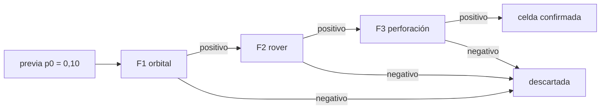

# B67-C02 — Diseño de un programa de prospección por fases

<!-- nav:top -->
[🏠 Programa](../../../../README.md) · [📚 Bloque B67](../../../tronco-comun/B67-prospeccion-y-evaluacion-de-reservas-de-recursos-extraterrestres.md) · [← Anterior: B67-C01 — Selección de sitios de extracción con criterios múltiples](../B67-C01-seleccion-de-sitios-de-extraccion-con-criterios-multiples/CLASE.md) · [Siguiente: B67-C03 — Muestreo criogénico y preservación de volátiles en muestras →](../B67-C03-muestreo-criogenico-y-preservacion-de-volatiles-en-muestras/CLASE.md)
<!-- /nav -->

## 1. Ubicación, nivel y alcance

Clase 2 del bloque B67. Nivel N3. Tras elegir un sitio hay que **confirmar** que hay recurso sin gastar lo que costaría perforar todo. Aquí diseñas un programa por fases (reconocimiento, muestreo, perforación): cada fase tiene sensibilidad, tasa de falsos positivos y costo, y solo las celdas positivas pasan a la siguiente. Usas el teorema de Bayes de [B12](../../../tronco-comun/B12-probabilidad-estadistica-e-incertidumbre.md). Las cifras son **sintéticas**.

## 2. Por qué esta clase existe

Perforar es caro y el reconocimiento orbital es barato pero impreciso. La decisión central: **¿cuántas fases conviene y con qué umbral de paso, para llegar a una probabilidad alta de recurso al menor costo?**

## 3. Lo que podrás hacer al terminar

1. Aplicar el teorema de Bayes a un resultado positivo de una fase.
2. Encadenar tres fases y calcular la probabilidad posterior de recurso.
3. Calcular la fracción de celdas que entra a cada fase y el costo esperado por celda.
4. Comparar el programa por fases con perforar todo directamente.
5. Verificar la fórmula con una simulación Monte Carlo.
6. Expresar el programa con razones de verosimilitud (cuotas).

La evidencia es la **ficha del programa de prospección por fases** del ejercicio 12 (sección 20).

## 4. Con qué llegas y cómo comprobarlo

1. ¿Qué es una probabilidad condicional?
2. ¿Qué es la sensibilidad de una prueba?
3. ¿Qué es un falso positivo?
4. ¿Qué es un costo esperado?
5. ¿Qué es una simulación Monte Carlo?

<details>
<summary>Ver respuestas</summary>

1. La probabilidad de un suceso sabiendo que otro ocurrió. 2. La probabilidad de dar positivo cuando el recurso existe. 3. Un positivo cuando el recurso no existe. 4. El promedio del costo ponderado por la probabilidad de cada caso. 5. Repetir un experimento aleatorio con semilla fija para estimar frecuencias.
</details>

Con cuatro o cinco aciertos, sigue; si no, repasa los prerrequisitos.

## 5. Un caso de contexto y casos de referencia

De 1 km² de celdas, el `10 %` tiene hielo explotable (previa). El reconocimiento orbital (sensibilidad `0,85`, falsos positivos `0,20`, costo `0,1` UM) deja una probabilidad de `0,3208` tras un positivo; el muestreo con rover (`0,90`, `0,10`, `2,0` UM) la sube a `0,8095`; la perforación (`0,95`, `0,02`, `10` UM) a `0,9951`. UM son unidades monetarias arbitrarias. Es el **ejemplo conductor**; todo es **sintético**. La página de la misión VIPER de NASA (consultada) describe un rover que recorre una región polar y usa una barrena de 1 m, y sirve solo como contexto de que la prospección móvil existe, no como fuente de estas cifras.

## 6. Vocabulario

La **previa** `p0` es la probabilidad de recurso antes de medir. La **sensibilidad** `S` es `P(positivo | recurso)`; la **tasa de falsos positivos** `F`, `P(positivo | no recurso)`. La **posterior** es `P(recurso | positivo)`. La **razón de verosimilitud** de una fase es `S/F`. Una **fase** es una etapa de medición con costo propio. El **valor neto esperado** es el valor del recurso hallado menos el costo.

## 7. Modelo mental: un embudo con filtros cada vez más finos

Cada fase deja pasar solo a las celdas que dieron positivo; las primeras son baratas y dejan pasar muchos falsos positivos, las últimas son caras y casi no los dejan.



*Descripción textual:* las celdas entran a F1; las positivas pasan a F2 y luego a F3; las negativas se descartan en cualquier fase; al final queda un conjunto con probabilidad alta de recurso.

Analogía: un embudo con filtros cada vez más finos. Límite: se supone independencia entre fases dado el estado real de la celda; si dos fases fallan por la misma causa, la posterior real es menor que la calculada.

## 8. La explicación, paso a paso

### 8.1 Bayes en una fase

`P(recurso | +) = p·S / (p·S + (1 − p)·F)`.

### 8.2 Tres fases en cadena

| Fase | Fracción de celdas que entra | P(recurso \| positivo) |
|---|---|---|
| F1 reconocimiento orbital | 1,0000 | 0,3208 |
| F2 muestreo con rover | 0,2650 | 0,8095 |
| F3 perforación de confirmación | 0,0945 | 0,9951 |

Supera las tres fases el `0,07304` de las celdas, y de ellas el `99,51 %` tiene recurso real.

### 8.3 Costo y valor

El costo esperado es `1,5750` UM por celda con fases, frente a `10` UM perforando todo. Con un valor de `60` UM por celda con depósito confirmado, el valor neto esperado es `2,7855` UM por celda con fases y `−4,3000` UM perforando todo. El programa por fases **encuentra menos hielo** (`0,07268` frente a `0,09500` de las celdas) porque pierde las celdas con recurso que dieron negativo en fases baratas, pero cuesta una fracción.

### 8.4 Cuotas

Con cuotas, la posterior es `cuota previa × S1/F1 × S2/F2 × S3/F3`. La razón conjunta vale `1816,9`; con cuota previa `0,1111` la posterior es `0,9951`, igual que la cadena.

### 8.5 Simulación

Con 400 000 celdas (semilla 6702) pasa el `0,07272` (analítico `0,07304`), el `99,56 %` tiene recurso (analítico `99,51 %`) y el costo es `1,5715` UM (analítico `1,5750`). Las diferencias están dentro de 4 desviaciones del muestreo.

## 9. Magnitudes, símbolos y unidades

| Símbolo | Qué es | Unidad | Valor / nota |
|---|---|---|---|
| `p0` | probabilidad previa de recurso | adimensional | 0,10 |
| `S`, `F` | sensibilidad, falsos positivos | adimensional | por fase |
| `c` | costo por celda | UM | 0,1; 2,0; 10 |
| `V` | valor de una celda confirmada | UM | 60 (ilustrativo) |

## 10. Convenciones y referencias

Celdas de 1 km². UM: unidad monetaria arbitraria. Fases independientes dado el estado real. Semilla `6702`, `N = 400 000`. Versiones: Python 3.12.9, numpy 2.4.4. Tolerancias: fracciones dentro de 4 desviaciones de muestreo; costo dentro de 0,01 UM; igualdad de cuotas y cadena a `1e-12`.

## 11. De dónde sale lo que afirmamos

| ID | Fuente | Localizador | Respalda | Estado |
|---|---|---|---|---|
| S1 | NASA, *VIPER (Volatiles Investigating Polar Exploration Rover)* | https://science.nasa.gov/mission/viper | la misión tiene como objetivo mapear la ubicación del hielo de agua y otros recursos, con un rover y una barrena de 1 m | Consultada el 2026-11-09 |

Límites: de S1 solo se usa el contexto (objetivo, barrena de 1 m, duración prevista de 100 días); la página es inconsistente sobre el número de instrumentos y no se usa; sensibilidades, falsos positivos, costos y valor son inventados; el teorema de Bayes es un resultado estándar que se verifica numéricamente, no se cita.

## 12. Cómo ver el programa

| Magnitud | Valor |
|---|---|
| fracción que supera las tres fases | 0,07304 |
| posterior tras tres positivos | 0,9951 |
| costo esperado por celda | 1,5750 UM |
| costo de perforar todo | 10,0000 UM |

Descripción larga: la probabilidad de recurso sube de `0,10` a `0,32`, `0,81` y `0,995` con cada positivo, mientras el número de celdas que se mide cae a una décima.

## 13. Ejemplo trabajado: la posterior tras F1

**Paso 1 · Numerador.** `0,10 · 0,85 = 0,085`.

**Paso 2 · Denominador.** `0,085 + 0,90 · 0,20 = 0,265`.

**Paso 3 · Posterior.** `0,085/0,265 = 0,3208`. Y `0,265` es también la fracción de celdas que entra a F2.

## 14. Distintas formas de describir un programa de prospección

**Por Bayes:** posterior fase a fase. **Por cuotas:** producto de razones de verosimilitud. **Por costo:** costo esperado acumulado. **Por simulación:** frecuencia en un conjunto de celdas.

## 15. Práctica guiada

**Ejercicio 1 · con los pasos indicados.** Calcula la fracción de celdas que supera F1. *Pasos:* `p0·S + (1 − p0)·F`.

<details><summary>Solución comentada</summary>

`0,10·0,85 + 0,90·0,20 = 0,265`.
</details>

**Ejercicio 2 · con una pista.** Calcula la posterior tras F2 desde `0,3208`. *Pista:* usa Bayes con `S = 0,90`, `F = 0,10`.

<details><summary>Solución comentada</summary>

`0,3208·0,9/(0,3208·0,9 + 0,6792·0,1) = 0,2887/0,3566 = 0,8095`.
</details>

**Ejercicio 3 · casi autónomo.** ¿Por qué el costo de F2 se multiplica por `0,265` y no por 1?

<details><summary>Solución comentada</summary>

Porque solo el `26,5 %` de las celdas pasa de F1 a F2.
</details>

## 16. Práctica autónoma, transferencia e integrador

**Ejercicio 4 · autónomo.** Calcula el costo esperado de las tres fases.

<details><summary>Solución comentada</summary>

`0,1·1 + 2·0,265 + 10·0,0945 = 0,1 + 0,53 + 0,945 ≈ 1,575` UM.
</details>

**Ejercicio 5 · autónomo.** Calcula la razón de verosimilitud conjunta.

<details><summary>Solución comentada</summary>

`(0,85/0,20)·(0,90/0,10)·(0,95/0,02) = 4,25·9·47,5 ≈ 1816,9`.
</details>

**Ejercicio 6 · autónomo.** Con la previa `0,10`, ¿cuál es la cuota previa?

<details><summary>Solución comentada</summary>

`0,10/0,90 = 0,1111`; la posterior final es `0,1111·1816,9/(1 + 0,1111·1816,9) = 0,9951`.
</details>

**Ejercicio 7 · autónomo.** ¿Cuánto hielo por celda se halla perforando todo con sensibilidad `0,95`?

<details><summary>Solución comentada</summary>

`0,10·0,95 = 0,095`, frente a `0,07268` con fases.
</details>

**Ejercicio 8 · autónomo.** Calcula el valor neto de perforar todo.

<details><summary>Solución comentada</summary>

`60·0,095 − 10 = −4,3` UM por celda.
</details>

**Ejercicio 9 · transferencia.** Si la previa fuera `0,02` en vez de `0,10`, ¿qué pasa con la posterior final?

<details><summary>Solución comentada</summary>

Baja: la cuota previa es `0,0204` y la posterior `0,0204·1816,9/(1 + 0,0204·1816,9) ≈ 0,974`; con previas bajas hacen falta fases más discriminantes.
</details>

**Ejercicio 10 · transferencia.** F1 y F2 usan datos del mismo sensor. ¿Qué ocurre con la posterior?

<details><summary>Solución comentada</summary>

Las fases no son independientes; multiplicar sus razones sobreestima la confianza. Hay que modelar la dependencia o tratar F1 y F2 como una sola fase.
</details>

**Ejercicio 11 · transferencia.** Un directivo pide saltarse F1 «para ir más rápido». Responde con cifras.

<details><summary>Solución comentada</summary>

Sin F1, F2 se aplica a todas las celdas: el costo de F2 pasa de `0,53` a `2,0` UM por celda y el programa pierde su ventaja.
</details>

**Ejercicio 12 · integrador.** Elabora tu *ficha del programa de prospección por fases*: tabla de fases, posterior, costo, comparación con perforar todo y contraste con la simulación.

<details><summary>Solución comentada</summary>

Secciones 8.1–8.5.
</details>

## 17. Laboratorio: programa de tres fases con actualización bayesiana

El script [fases.py](fases.py) calcula la cadena bayesiana, el costo y la simulación (**comprueba** la fracción, la pureza, el costo y la igualdad con las cuotas).

**Datos:** sensibilidades, falsos positivos, costos y valor sintéticos; semilla 6702. **Predice antes de ejecutar:** ¿cuántas celdas por cada cien llegan a la perforación? (alrededor de 9.) **Ejecución del 2026-11-09 (Python 3.12.9, numpy 2.4.4):**

```text
Python 3.12.9 ; numpy 2.4.4
DATOS SINTETICOS: sensibilidades, costos y valor inventados para la clase
fase                             entran    P(hielo|positivo)
  F1 reconocimiento orbital         1.0000   0.3208
  F2 muestreo con rover             0.2650   0.8095
  F3 perforacion de confirmacion    0.0945   0.9951
Fraccion que supera las 3 fases: 0.07304 ; de ellas con hielo real: 0.9951
Costo esperado por celda con fases: 1.5750 UM
Costo por celda perforando todo directamente: 10.0000 UM
Valor neto esperado por celda: con fases = 2.7855 UM ; perforar todo = -4.3000 UM
Hielo hallado por celda: con fases = 0.07268 ; perforar todo = 0.09500
Monte Carlo (N=400000, semilla 6702): fraccion que pasa = 0.07272 ; con hielo real = 0.9956 ; costo/celda = 1.5715
Razon de verosimilitud conjunta = 1816.9 ; posterior por cuotas = 0.9951 (coincide)
Pruebas superadas.
```

```bash
python programa/clases/B67/B67-C02-diseno-de-un-programa-de-prospeccion-por-fases/fases.py
```

**Límites:** fases independientes y probabilidades conocidas; en la práctica se estiman con datos.

## 18. Errores frecuentes y cómo corregirlos

**Aplicar el costo de cada fase a todas las celdas.** Se corrige con 8.3.

**Confundir sensibilidad con posterior.** `0,85` no es `0,32`; se corrige con 8.1.

**Multiplicar razones de fases dependientes.** Se corrige con el ejercicio 11.

**Presentar las cifras como de una misión real.** Se corrige con la sección 11.

## 19. Cómo sabrás que vas bien

Tras 8.2: ¿qué resultado esperabas y cuál obtuviste? Si dudas, repasa el ejemplo 13. Tras el laboratorio: ¿qué comprueba cada `assert`? (ver la sección 17).

## 20. Qué entregas y cómo se evalúa

El producto es tu **ficha del programa de prospección por fases** (ejercicio 12).

| Criterio | Inicial | En desarrollo | Logrado | Destacado |
|---|---|---|---|---|
| Conceptos | Los confunde | Parciales | Conceptos de la clase con sus condiciones | Explica los límites del modelo |
| Cálculo | Sin unidades | Con errores | Tablas completas con unidades | Calcula casos nuevos |
| Numérico | Sin comprobar | Un caso | Contraste con la solución analítica o con la simulación | Interpreta las diferencias |
| Fuentes | Sin fuente | Sin fecha | Fuentes con fecha de consulta | Declara lo no consultado |
| Límites | No los nombra | Uno | Tres | Discute qué falta del modelo |

**Condiciones críticas (no se compensan con promedio):** rotular los datos como sintéticos; no presentar lo simulado como observado; no inferir reservas de ningún sitio real; citar solo lo consultado.

## 21. Ética, seguridad y límites

Clase educativa: los modelos son simplificados y los datos son sintéticos; no se estima, certifica ni reporta ninguna reserva real, ni se evalúa un sitio o una empresa concretos. Una probabilidad posterior alta no autoriza una perforación ni una inversión. Accesibilidad: tablas equivalentes a las gráficas, fórmulas en texto, ejercicios sin conexión.

## 22. Para cerrar y seguir

Un programa de tres fases lleva la probabilidad de recurso de `0,10` a `0,9951` por `1,575` UM por celda, frente a `10` UM de perforar todo. Queda una pregunta: cuando se toma la muestra, ¿cómo se evita perder justo lo que se quiere medir?

**Glosario español–inglés.** previa · *prior*; posterior · *posterior*; sensibilidad · *sensitivity*; falso positivo · *false positive*; razón de verosimilitud · *likelihood ratio*.

**Continuidad.** [B67-C03](../B67-C03-muestreo-criogenico-y-preservacion-de-volatiles-en-muestras/CLASE.md) estudia el muestreo criogénico.

**Referencias:** ver sección 11.

<!-- nav:bottom -->
---

[← Anterior: B67-C01 — Selección de sitios de extracción con criterios múltiples](../B67-C01-seleccion-de-sitios-de-extraccion-con-criterios-multiples/CLASE.md) · [📚 Bloque B67](../../../tronco-comun/B67-prospeccion-y-evaluacion-de-reservas-de-recursos-extraterrestres.md) · [Siguiente: B67-C03 — Muestreo criogénico y preservación de volátiles en muestras →](../B67-C03-muestreo-criogenico-y-preservacion-de-volatiles-en-muestras/CLASE.md)
<!-- /nav -->
