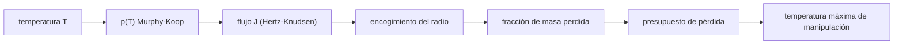

# B67-C03 — Muestreo criogénico y preservación de volátiles en muestras

<!-- nav:top -->
[🏠 Programa](../../../../README.md) · [📚 Bloque B67](../../../tronco-comun/B67-prospeccion-y-evaluacion-de-reservas-de-recursos-extraterrestres.md) · [← Anterior: B67-C02 — Diseño de un programa de prospección por fases](../B67-C02-diseno-de-un-programa-de-prospeccion-por-fases/CLASE.md) · [Siguiente: B67-C04 — Estimación de reservas y categorías de recursos →](../B67-C04-estimacion-de-reservas-y-categorias-de-recursos/CLASE.md)
<!-- /nav -->

## 1. Ubicación, nivel y alcance

Clase 3 del bloque B67. Nivel N3. Una muestra de regolito helado que se calienta o queda expuesta al vacío pierde justo lo que se quiere medir. Aquí calculas la presión de vapor del hielo con una ecuación publicada, el flujo máximo de sublimación al vacío (Hertz–Knudsen) y el **presupuesto de pérdida** de granos de hielo: cuánto tiempo puede estar una muestra a una temperatura antes de perder el `1 %` de su masa. Usas la física de [B05](../../../tronco-comun/B05-fisica-fundamental-para-el-espacio.md). Los granos son **sintéticos**.

## 2. Por qué esta clase existe

Un error de manipulación de unos grados puede cambiar la pérdida en órdenes de magnitud, porque la presión de vapor del hielo crece exponencialmente con la temperatura. La decisión central: **¿hasta qué temperatura y por cuánto tiempo se puede manipular una muestra sin que la pérdida invalide la medida?**

## 3. Lo que podrás hacer al terminar

1. Evaluar la presión de vapor del hielo con la ecuación de Murphy y Koop (2005).
2. Calcular el flujo máximo de sublimación al vacío con Hertz–Knudsen.
3. Convertir el flujo en tiempo de pérdida del `1 %` de la masa de un grano.
4. Hallar la temperatura máxima de manipulación para una hora de exposición.
5. Explicar por qué los granos finos pierden proporcionalmente más.
6. Reconocer cuándo el modelo de vacío abierto no aplica (recipiente cerrado).

La evidencia es la **ficha del presupuesto de pérdida de una muestra** del ejercicio 12 (sección 20).

## 4. Con qué llegas y cómo comprobarlo

1. ¿Qué es la presión de vapor?
2. ¿Qué es la sublimación?
3. ¿Qué es una función exponencial?
4. ¿Cómo se convierte una fracción de masa en una de radio en una esfera?
5. ¿Qué es una cota superior?

<details>
<summary>Ver respuestas</summary>

1. La presión del vapor en equilibrio con la fase condensada a una temperatura. 2. El paso directo de sólido a gas. 3. Una que crece multiplicándose por un factor constante en cada paso igual de su variable. 4. La masa crece con el cubo del radio: `m ∝ r³`. 5. Un valor que el resultado real no excede.
</details>

Con cuatro o cinco aciertos, sigue; si no, repasa los prerrequisitos.

## 5. Un caso de contexto y casos de referencia

Un grano esférico de hielo puro de `100 µm` de radio, expuesto al vacío a `150 K`, pierde el `1 %` de su masa en `9,2 h`; a `170 K`, en `295 s`; a `200 K`, en `1,44 s`. La presión de vapor del hielo en el punto triple (`273,16 K`) que da la ecuación es `611,657 Pa`. Es el **ejemplo conductor**; los granos son **sintéticos** y el flujo es una **cota superior** (coeficiente de evaporación igual a 1).

## 6. Vocabulario

La **presión de vapor del hielo** `p(T)` es la de equilibrio. El **flujo de Hertz–Knudsen** `J = m·α·p/√(2π m k_B T)` es la masa que sale por unidad de área y tiempo hacia el vacío; `α` es el coeficiente de evaporación (1 = máximo). El **presupuesto de pérdida** es el tiempo o la temperatura que se permiten para perder una fracción dada. La **entalpia de sublimación** `L` mide cuánta energía cuesta pasar una mol de sólido a gas.

## 7. Modelo mental: una playa con la marea subiendo

Piensa en un montón de arena de playa y una marea que sube: a baja marea no pasa nada; al subir un poco, el agua se lleva granos finos casi enseguida. La temperatura es esa marea, y los granos finos son los primeros en desaparecer.



*Descripción textual:* la temperatura fija la presión de vapor; la presión fija el flujo hacia el vacío; el flujo encoge el radio del grano y da la fracción de masa perdida; con un límite de pérdida se obtiene un tiempo o una temperatura máximos.

Analogía: una playa con la marea subiendo. Límite: el modelo es de vacío abierto y hielo puro: en un recipiente cerrado el vapor se acumula y detiene la pérdida, y el hielo mezclado con regolito sublima más despacio.

## 8. La explicación, paso a paso

### 8.1 Presión de vapor

La ecuación (7) de Murphy y Koop (2005), con `T` en K y `p` en Pa y válida para `T > 110 K`, es `p = exp(9,550426 − 5723,265/T + 3,53068·ln T − 0,00728332·T)`. En el punto triple da `611,657 Pa`, coincidente con la referencia usual de `611,657 Pa` (no consultada) dentro de `0,5 %`, que es la tolerancia que impone el laboratorio.

### 8.2 Flujo y tiempo de pérdida

| `T` (K) | `p` (Pa) | `J` (kg m⁻² s⁻¹) | tiempo para perder el 1 % (`r = 100 µm`) |
|---|---|---|---|
| 110 | 2,577 × 10⁻¹² | 4,562 × 10⁻¹⁵ | > 10³ años |
| 130 | 1,203 × 10⁻⁸ | 1,959 × 10⁻¹¹ | 4,35 × 10³ h |
| 150 | 6,106 × 10⁻⁶ | 9,258 × 10⁻⁹ | 9,2 h |
| 170 | 7,310 × 10⁻⁴ | 1,041 × 10⁻⁶ | 295 s |
| 200 | 1,627 × 10⁻¹ | 2,136 × 10⁻⁴ | 1,44 s |
| 250 | 7,602 × 10¹ | 8,929 × 10⁻² | 0,00343 s |

Entre `150 K` y `170 K` el flujo se multiplica por unas `112`. Esa sensibilidad es lo que hace crítico el control de temperatura.

### 8.3 Coherencia termodinámica

La derivada de `ln p` respecto de `1/T` da la entalpia de sublimación implícita: `50,63 kJ/mol` a `150 K`, `51,03` a `200 K` y `51,14` a `250 K`. Es del orden de los `51 kJ/mol` que se conoce para el hielo (cifra de memoria, no consultada), y es una comprobación de que la ecuación está bien escrita, no una medición.

### 8.4 Encogimiento del grano

Con flujo constante `r(t) = r₀ − J t/ρ` (densidad `917 kg/m³`, referencia estándar no consultada). Una integración por pasos y la fórmula analítica dan lo mismo: tres días a `150 K` hacen perder el `7,6472 %` de la masa en ambos casos.

### 8.5 Temperatura máxima y tamaño del grano

Para perder como máximo el `1 %` en una hora con granos de `100 µm`, la temperatura no debe pasar de `158,78 K`. A `170 K` durante una hora, un grano de `10 µm` pierde el `79,328 %`, uno de `100 µm` el `11,767 %` y uno de `1 mm` el `1,221 %`: los granos finos pierden más porque la superficie por unidad de masa crece al bajar el radio.

## 9. Magnitudes, símbolos y unidades

| Símbolo | Qué es | Unidad | Valor / nota |
|---|---|---|---|
| `T` | temperatura | K | 110–273 |
| `p` | presión de vapor del hielo | Pa | ecuación (7) |
| `J` | flujo de masa por sublimación | kg m⁻² s⁻¹ | cota superior |
| `α` | coeficiente de evaporación | adimensional | 1 |
| `r` | radio del grano | m | 10⁻⁵–10⁻³ |
| `ρ` | densidad del hielo | kg m⁻³ | 917 |

## 10. Convenciones y referencias

Granos esféricos de hielo puro en vacío abierto, temperatura uniforme, `α = 1`. `k_B = 1,380649 × 10⁻²³ J/K`, `R = 8,314462618 J/(mol K)`, `m(H₂O) = 18,01528 u`, `u = 1,66053907 × 10⁻²⁷ kg`: valores de referencia estándar, **no consultados** para esta clase. Versiones: Python 3.12.9, numpy 2.4.4. Tolerancias: punto triple dentro de `0,5 %`; derivada numérica frente a analítica dentro de `1e-6`; integración frente a analítica dentro de `1e-9`.

## 11. De dónde sale lo que afirmamos

| ID | Fuente | Localizador | Respalda | Estado |
|---|---|---|---|---|
| S1 | D. M. Murphy y T. Koop, «Review of the vapour pressures of ice and supercooled water for atmospheric applications», *Q. J. R. Meteorol. Soc.* 131 (608), 1539–1565 (2005), DOI 10.1256/qj.04.94 | https://zenodo.org/records/1236243 (PDF, ecuación (7), p. 4 del archivo) | la ecuación de la presión de vapor del hielo y su validez para `T > 110 K` | Texto del PDF extraído y leído el 2026-11-09 (solo el pasaje de la ecuación (7)) |

Límites: de S1 solo se leyó el pasaje de la ecuación (7); no se leyó el resto del artículo ni se contrastó con otras parametrizaciones; la fórmula de Hertz–Knudsen y las constantes físicas son resultados estándar que no se citan de un texto; los granos son sintéticos y no hay datos de muestras reales.

## 12. Cómo ver el presupuesto de pérdida

| Magnitud | Valor |
|---|---|
| tiempo para perder el 1 % a 150 K | 9,2 h |
| temperatura máxima (1 h, 1 %) | 158,78 K |
| pérdida de un grano de 10 µm en 1 h a 170 K | 79,328 % |
| pérdida de un grano de 1 mm en 1 h a 170 K | 1,221 % |

Descripción larga: el tiempo de pérdida cae de horas a segundos en menos de 50 K, y los granos finos se pierden antes.

## 13. Ejemplo trabajado: el flujo y el tiempo a 150 K

**Paso 1 · Presión.** `p(150 K) = 6,106 × 10⁻⁶ Pa`.

**Paso 2 · Flujo.** `m = 2,9915 × 10⁻²⁶ kg`; `√(2π m k_B T) = 1,973 × 10⁻²³`; `J = m p /1,973 × 10⁻²³ = 9,258 × 10⁻⁹ kg m⁻² s⁻¹`.

**Paso 3 · Radio perdido.** Para perder el 1 % de la masa, `r₀(1 − 0,99^(1/3)) = 3,344 × 10⁻⁷ m`.

**Paso 4 · Tiempo.** `3,344 × 10⁻⁷ · 917 / 9,258 × 10⁻⁹ = 3,31 × 10⁴ s = 9,2 h`.

## 14. Distintas formas de describir la pérdida de una muestra

**Por flujo:** kg m⁻² s⁻¹ a una temperatura. **Por tiempo:** el necesario para perder una fracción. **Por temperatura:** la máxima para un tiempo y una fracción. **Por tamaño:** la fracción perdida según el radio.

## 15. Práctica guiada

**Ejercicio 1 · con los pasos indicados.** Calcula el cociente de flujos entre `170 K` y `150 K`. *Pasos:* divide `1,041 × 10⁻⁶` entre `9,258 × 10⁻⁹`.

<details><summary>Solución comentada</summary>

`≈ 112`.
</details>

**Ejercicio 2 · con una pista.** Calcula la fracción de masa que corresponde a una pérdida del `0,335 %` del radio. *Pista:* `m ∝ r³`.

<details><summary>Solución comentada</summary>

`1 − (1 − 0,00335)³ ≈ 0,01`, es decir, el `1 %` de la masa.
</details>

**Ejercicio 3 · casi autónomo.** ¿Por qué el flujo es una cota superior?

<details><summary>Solución comentada</summary>

Porque se usó `α = 1`: la evaporación real es igual o menor.
</details>

## 16. Práctica autónoma, transferencia e integrador

**Ejercicio 4 · autónomo.** Si `α = 0,1`, ¿cuánto vale el tiempo de pérdida a `150 K`?

<details><summary>Solución comentada</summary>

El flujo se divide por 10; el tiempo se multiplica por 10: `≈ 92 h`.
</details>

**Ejercicio 5 · autónomo.** ¿Qué temperatura máxima da el laboratorio para una hora y el `1 %`?

<details><summary>Solución comentada</summary>

`158,78 K`.
</details>

**Ejercicio 6 · autónomo.** Un grano de `100 µm` pasa tres días a `150 K`. ¿Qué masa se pierde?

<details><summary>Solución comentada</summary>

`7,6472 %`.
</details>

**Ejercicio 7 · autónomo.** ¿Cuál es la entalpia de sublimación implícita a `200 K`?

<details><summary>Solución comentada</summary>

`51,03 kJ/mol`.
</details>

**Ejercicio 8 · autónomo.** ¿Qué fracción pierde un grano de `1 mm` en una hora a `170 K`?

<details><summary>Solución comentada</summary>

`1,221 %`, que es casi `3·Δr/r` con `Δr = 4,1 µm`.
</details>

**Ejercicio 9 · transferencia.** Una bolsa de muestras sube a `200 K` durante diez minutos. ¿Qué dice el modelo para granos de `100 µm`?

<details><summary>Solución comentada</summary>

Pérdida total en segundos si estuvieran descubiertos en vacío. En una bolsa cerrada el vapor se acumula hasta el equilibrio y se pierde mucho menos; el modelo de vacío abierto no aplica y hay que modelar el recipiente.
</details>

**Ejercicio 10 · transferencia.** Un procedimiento exige no pasar de `150 K`. ¿Cómo lo justificas con los resultados de la clase?

<details><summary>Solución comentada</summary>

A `150 K` hay `9,2 h` para perder el `1 %` de granos de `100 µm`; a `170 K` solo `295 s`. Con `150 K` se deja margen de horas.
</details>

**Ejercicio 11 · transferencia.** El regolito de la muestra tiene hielo mezclado con minerales. ¿Qué cambia?

<details><summary>Solución comentada</summary>

La pérdida real es menor que la de hielo puro expuesto (el vapor debe difundir por poros); la cota de la clase es conservadora para la manipulación pero no mide la pérdida real.
</details>

**Ejercicio 12 · integrador.** Elabora tu *ficha del presupuesto de pérdida de una muestra*: tabla de flujos y tiempos, temperatura máxima, efecto del tamaño y límites del modelo.

<details><summary>Solución comentada</summary>

Secciones 8.1–8.5.
</details>

## 17. Laboratorio: presupuesto de pérdida de hielo de un grano expuesto al vacío

El script [criogenico.py](criogenico.py) evalúa `p(T)`, el flujo, los tiempos de pérdida y la temperatura máxima (**comprueba** el punto triple, la monotonía, la derivada y la integración).

**Datos:** granos sintéticos; ecuación (7) de Murphy y Koop; constantes de referencia no consultadas. **Predice antes de ejecutar:** ¿cuánto tarda un grano de 100 µm en perder el 1 % a 150 K? (unas 9 h.) **Ejecución del 2026-11-09 (Python 3.12.9, numpy 2.4.4):**

```text
Python 3.12.9 ; numpy 2.4.4
DATOS SINTETICOS: granos de hielo puro de 100 um de radio (ilustrativo, no es una muestra real)
p_hielo(273,16 K) = 611.657 Pa (punto triple de referencia ~ 611,657 Pa, no consultado)
T [K]   p [Pa]        J [kg m-2 s-1]   t(1 % masa, r=100 um)
  110  2.577e-12  4.562e-15      >1e3 anios
  130  1.203e-08  1.959e-11      4.35e+03 h
  150  6.106e-06  9.258e-09      9.2 h
  170  7.310e-04  1.041e-06      295 s
  200  1.627e-01  2.136e-04      1.44 s
  250  7.602e+01  8.929e-02      0.00343 s
Entalpia de sublimacion implicita a 150 K = 50.63 kJ/mol
Entalpia de sublimacion implicita a 200 K = 51.03 kJ/mol
Entalpia de sublimacion implicita a 250 K = 51.14 kJ/mol
Perdida en 3 d a 150 K: numerica 7.6472 % ; analitica 7.6472 %
Temperatura maxima de manipulacion (1 h, perdida <= 1 %, r=100 um): 158.78 K
  radio      10 um: perdida en 1 h a 170 K = 79.328 %
  radio     100 um: perdida en 1 h a 170 K = 11.767 %
  radio    1000 um: perdida en 1 h a 170 K = 1.221 %
Pruebas superadas.
```

```bash
python programa/clases/B67/B67-C03-muestreo-criogenico-y-preservacion-de-volatiles-en-muestras/criogenico.py
```

**Límites:** hielo puro, vacío abierto, temperatura uniforme y `α = 1`.

## 18. Errores frecuentes y cómo corregirlos

**Usar la ecuación fuera de `T > 110 K`.** La ecuación solo está dada para ese rango; se corrige con 8.1.

**Olvidar la masa molecular en el flujo.** Sin `m` se obtienen moléculas por segundo, no kilogramos; se corrige con 8.2.

**Tomar el flujo como la pérdida real.** Es una cota con `α = 1`; se corrige con el ejercicio 4.

**Aplicar el modelo a un recipiente cerrado.** Se corrige con el ejercicio 9.

## 19. Cómo sabrás que vas bien

Tras 8.2: ¿qué resultado esperabas y cuál obtuviste? Si dudas, repasa el ejemplo 13. Tras el laboratorio: ¿qué comprueba cada `assert`? (ver la sección 17).

## 20. Qué entregas y cómo se evalúa

El producto es tu **ficha del presupuesto de pérdida de una muestra** (ejercicio 12).

| Criterio | Inicial | En desarrollo | Logrado | Destacado |
|---|---|---|---|---|
| Conceptos | Los confunde | Parciales | Conceptos de la clase con sus condiciones | Explica los límites del modelo |
| Cálculo | Sin unidades | Con errores | Tablas completas con unidades | Calcula casos nuevos |
| Numérico | Sin comprobar | Un caso | Contraste con la solución analítica o con la simulación | Interpreta las diferencias |
| Fuentes | Sin fuente | Sin fecha | Fuentes con fecha de consulta | Declara lo no consultado |
| Límites | No los nombra | Uno | Tres | Discute qué falta del modelo |

**Condiciones críticas (no se compensan con promedio):** rotular los datos como sintéticos; no presentar lo simulado como observado; no inferir reservas de ningún sitio real; citar solo lo consultado.

## 21. Ética, seguridad y límites

Clase educativa: los modelos son simplificados y los datos son sintéticos; no se estima, certifica ni reporta ninguna reserva real, ni se evalúa un sitio o una empresa concretos. Los resultados no son un protocolo de manipulación de muestras reales, que exige validación con material y equipo reales. Accesibilidad: tablas equivalentes a las gráficas, fórmulas en texto, ejercicios sin conexión.

## 22. Para cerrar y seguir

El hielo pierde el `1 %` de un grano de `100 µm` en `9,2 h` a `150 K` y en `295 s` a `170 K`; por eso la temperatura se vigila más que cualquier otra variable. Queda una pregunta: ¿cómo se estima la reserva de todo un depósito cuando cada muestra tiene incertidumbre?

**Glosario español–inglés.** presión de vapor · *vapor pressure*; sublimación · *sublimation*; coeficiente de evaporación · *evaporation coefficient*; muestra criogénica · *cryogenic sample*; entalpia de sublimación · *enthalpy of sublimation*.

**Continuidad.** [B67-C04](../B67-C04-estimacion-de-reservas-y-categorias-de-recursos/CLASE.md) estudia la estimación de reservas y sus categorías.

**Referencias:** ver sección 11.

<!-- nav:bottom -->
---

[← Anterior: B67-C02 — Diseño de un programa de prospección por fases](../B67-C02-diseno-de-un-programa-de-prospeccion-por-fases/CLASE.md) · [📚 Bloque B67](../../../tronco-comun/B67-prospeccion-y-evaluacion-de-reservas-de-recursos-extraterrestres.md) · [Siguiente: B67-C04 — Estimación de reservas y categorías de recursos →](../B67-C04-estimacion-de-reservas-y-categorias-de-recursos/CLASE.md)
<!-- /nav -->
