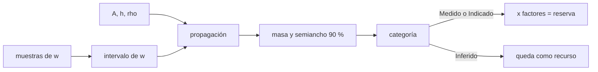

# B67-C04 — Estimación de reservas y categorías de recursos

<!-- nav:top -->
[🏠 Programa](../../../../README.md) · [📚 Bloque B67](../../../tronco-comun/B67-prospeccion-y-evaluacion-de-reservas-de-recursos-extraterrestres.md) · [← Anterior: B67-C03 — Muestreo criogénico y preservación de volátiles en muestras](../B67-C03-muestreo-criogenico-y-preservacion-de-volatiles-en-muestras/CLASE.md) · [Siguiente: B67-C05 — Modelos geoestadísticos de distribución de volátiles →](../B67-C05-modelos-geoestadisticos-de-distribucion-de-volatiles/CLASE.md)
<!-- /nav -->

## 1. Ubicación, nivel y alcance

Clase 4 del bloque B67. Nivel N3. Con datos de varias muestras hay que decir **cuánto** hay y **con qué confianza**. Aquí propagas las incertidumbres del área, el espesor, la densidad y la fracción de hielo a la masa de un bloque, clasificas el resultado en categorías de confianza (Inferido, Indicado, Medido), conviertes a reserva con factores modificadores y compruebas que el intervalo de la fracción de hielo cubre lo que dice cubrir. Usas la estadística de [B12](../../../tronco-comun/B12-probabilidad-estadistica-e-incertidumbre.md). La regla de categorías es **didáctica** y no reproduce ninguna norma.

## 2. Por qué esta clase existe

Decir «hay 330 kt» sin intervalo ni categoría invita a decisiones equivocadas. La decisión central: **¿cuánto del recurso se puede llamar reserva, y qué falta para subir de categoría?**

## 3. Lo que podrás hacer al terminar

1. Calcular la masa de un bloque a partir de área, espesor, densidad y fracción de hielo.
2. Propagar incertidumbres relativas independientes y contrastar con Monte Carlo.
3. Aplicar una regla de categorías por el semiancho relativo del intervalo al 90 %.
4. Convertir recursos en reservas con factores modificadores, excluyendo lo Inferido.
5. Comprobar la cobertura de un intervalo con pocas muestras.
6. Decir qué medición mejoraría la categoría de un bloque.

La evidencia es la **ficha de recursos y reservas de un bloque** del ejercicio 12 (sección 20).

## 4. Con qué llegas y cómo comprobarlo

1. ¿Qué es la media de una muestra y su error estándar?
2. ¿Qué es un intervalo de confianza del 90 %?
3. ¿Cómo se combinan incertidumbres relativas independientes en un producto?
4. ¿Qué es una densidad aparente?
5. ¿Qué es un valor sintético?

<details>
<summary>Ver respuestas</summary>

1. La suma dividida por `n`; el error estándar es `s/√n`. 2. Un rango que, repetido el muestreo, contendría el valor verdadero el 90 % de las veces. 3. Se suman los cuadrados y se saca la raíz. 4. La masa de regolito por unidad de volumen, con sus huecos. 5. Uno inventado para la clase, no medido.
</details>

Con cuatro o cinco aciertos, sigue; si no, repasa los prerrequisitos.

## 5. Un caso de contexto y casos de referencia

Un bloque sintético de `4 km²` de área, `2 m` de espesor y `1500 kg/m³` de densidad aparente, con una fracción de hielo `w` de media `3 %` por muestra. Con `48` muestras: `w = 2,71 %`, masa `325,29 kt` con semiancho del `28,4 %`; con `12`, `335,69 kt` y `34,5 %`; con `3`, `466,57 kt` y `36,8 %`. Es el **ejemplo conductor**; todo es **sintético**. La página de CRIRSCO (consultada) solo dice que esa organización desarrolla definiciones estándar internacionales para reportar recursos y reservas minerales; sus definiciones no se consultaron.

## 6. Vocabulario

Un **recurso** es una acumulación estimada con perspectiva razonable de extracción. Una **reserva** es la parte del recurso que, aplicados los **factores modificadores** (accesibilidad, recuperación), se puede extraer. Las **categorías** (aquí Inferido, Indicado, Medido) expresan la confianza en la estimación. El **semiancho relativo** del intervalo al 90 % mide esa confianza. Una **regla de categorías** convierte esa medida en una etiqueta; la de esta clase es **didáctica**.

## 7. Modelo mental: una cuenta de ahorros con saldo incierto

Piensa en estimar cuánto dinero hay en una caja sin abrirla por completo: con pocas monedas contadas, el saldo estimado es poco confiable; con más monedas, y sabiendo bien el tamaño de la caja, se puede decir «entre tanto y tanto».



*Descripción textual:* las muestras dan la fracción de hielo con su intervalo; junto con área, espesor y densidad se propaga la incertidumbre a la masa; el semiancho define la categoría; solo lo Medido o Indicado se convierte en reserva tras los factores modificadores.

Analogía: una cuenta de ahorros con saldo incierto. Límite: las entradas se suponen independientes y normales; la masa de un bloque sin correlación espacial no sustituye al modelo geoestadístico de la clase siguiente.

## 8. La explicación, paso a paso

### 8.1 La masa y su incertidumbre

`M = A·h·ρ·w`. Con incertidumbres relativas independientes `σ_A = 2 %`, `σ_h = 15 %`, `σ_ρ = 5 %` y la de `w` según las muestras, `σ_rel = √(σ_A² + σ_h² + σ_ρ² + σ_w²)` y el semiancho al 90 % es `1,645·σ_rel`.

### 8.2 Tres bloques con distinto número de muestras

| `n` muestras | `w` medio (%) | semiancho `w` (%) | `M` (kt) | semiancho `M` (%) analítico / MC | categoría |
|---|---|---|---|---|---|
| 3 | 3,89 | 1,00 | 466,57 | 36,8 / 36,8 | Inferido |
| 12 | 2,80 | 0,63 | 335,69 | 34,5 / 34,5 | Indicado |
| 48 | 2,71 | 0,29 | 325,29 | 28,4 / 28,5 | Indicado |

El Monte Carlo (200 000 sorteos por bloque, semilla 6704) coincide con la propagación analítica dentro de `0,1` punto porcentual.

### 8.3 Regla didáctica de categorías

Semiancho relativo `≤ 15 %`: Medido; `≤ 35 %`: Indicado; mayor: Inferido. Con `48` muestras el bloque **no** llega a Medido porque el espesor aporta por sí solo un `15 %`: más muestras de `w` no resuelven lo que limita el área o el espesor.

### 8.4 De recurso a reserva

Con accesibilidad `0,6` y recuperación `0,8` y sin convertir lo Inferido: el bloque de `3` muestras aporta `0` kt de reserva; el de `12`, `161,13` kt; el de `48`, `156,14` kt. En total hay `1127,55` kt de recurso y `317,27` kt de reserva.

### 8.5 Cobertura del intervalo de `w`

Con 5000 repeticiones por tamaño (semilla 6704), el intervalo de `1,645·s/√n` contiene la media verdadera el `73,9 %` de las veces con `n = 3`, el `85,7 %` con `12` y el `89,4 %` con `48`. Con pocas muestras el intervalo normal es demasiado angosto: la categoría Inferido de `n = 3` es, además, optimista.

## 9. Magnitudes, símbolos y unidades

| Símbolo | Qué es | Unidad | Valor / nota |
|---|---|---|---|
| `A` | área del bloque | m² | 4 × 10⁶ (σ 2 %) |
| `h` | espesor del depósito | m | 2 (σ 15 %) |
| `ρ` | densidad aparente | kg m⁻³ | 1500 (σ 5 %) |
| `w` | fracción másica de hielo | adimensional | gamma, media 0,03 |
| `M` | masa de hielo | kt | 10⁶ kg |

## 10. Convenciones y referencias

Bloque único de espesor y densidad uniformes. Intervalos al 90 % con `z = 1,6449`. Factores modificadores `F_acc = 0,6` y `F_rec = 0,8` ilustrativos. Semilla `6704`. Versiones: Python 3.12.9, numpy 2.4.4. Tolerancias: analítico frente a Monte Carlo dentro de `0,03` en el semiancho relativo; cobertura con 48 muestras entre `87 %` y `93 %`.

## 11. De dónde sale lo que afirmamos

| ID | Fuente | Localizador | Respalda | Estado |
|---|---|---|---|---|
| S1 | CRIRSCO, página principal de la *International Reporting Template* | https://crirsco.com/templates/international-reporting-template/ | solo que CRIRSCO desarrolla definiciones estándar para reportar recursos y reservas minerales | Consultada el 2026-11-09 (descripción general; las definiciones de categorías no figuraban en la página) |

Límites: no se consultaron las definiciones de Inferido, Indicado, Medido, Probable ni Probado de CRIRSCO ni de ninguna norma; la regla de categorías de la clase (15 % y 35 %) y los factores modificadores son didácticos e inventados; ninguna cifra describe un depósito real.

## 12. Cómo ver la reserva

| Magnitud | Valor |
|---|---|
| masa con 48 muestras | 325,29 kt ± 28,4 % (90 %) |
| categoría de ese bloque | Indicado |
| reserva total de los tres bloques | 317,27 kt |
| cobertura del intervalo con n = 3 | 73,9 % |

Descripción larga: el semiancho baja de `36,8 %` a `28,4 %` al pasar de `3` a `48` muestras, y se estanca porque el espesor y la densidad también pesan.

## 13. Ejemplo trabajado: el semiancho con 48 muestras

**Paso 1 · Sigmas relativas.** `σ_A = 0,02`; `σ_h = 0,15`; `σ_ρ = 0,05`; `σ_w = 0,29/2,71/1,645 = 0,065`.

**Paso 2 · Suma cuadrática.** `0,0004 + 0,0225 + 0,0025 + 0,0042 = 0,0296`; `σ_rel = 0,172`.

**Paso 3 · Semiancho al 90 %.** `1,645 · 0,172 = 0,283`, es decir `28,3 %` (el laboratorio da `28,4 %` con los números sin redondear).

**Paso 4 · Categoría.** `28,4 % ≤ 35 %` y `> 15 %`: Indicado.

## 14. Distintas formas de describir una estimación de reservas

**Por masa:** valor central en kt. **Por intervalo:** semiancho relativo al 90 %. **Por categoría:** etiqueta según la regla. **Por conversión:** recurso por factores modificadores igual a reserva.

## 15. Práctica guiada

**Ejercicio 1 · con los pasos indicados.** Calcula la masa con `A = 4 × 10⁶ m²`, `h = 2 m`, `ρ = 1500 kg/m³` y `w = 2,71 %`. *Pasos:* multiplica y pasa a kt.

<details><summary>Solución comentada</summary>

`4 × 10⁶ · 2 · 1500 · 0,0271 = 3,25 × 10⁸ kg = 325 kt`.
</details>

**Ejercicio 2 · con una pista.** Convierte los `335,69 kt` del bloque de 12 muestras en reserva. *Pista:* multiplica por `0,6` y por `0,8`.

<details><summary>Solución comentada</summary>

`335,69 · 0,48 = 161,13 kt`.
</details>

**Ejercicio 3 · casi autónomo.** ¿Por qué el bloque de 3 muestras no aporta reserva?

<details><summary>Solución comentada</summary>

Porque su semiancho (`36,8 %`) es mayor que `35 %`: es Inferido, y lo Inferido no se convierte en reserva.
</details>

## 16. Práctica autónoma, transferencia e integrador

**Ejercicio 4 · autónomo.** Calcula el semiancho al 90 % del bloque de 48 muestras si el espesor se mide con `5 %` en vez de `15 %`.

<details><summary>Solución comentada</summary>

`σ² = 0,0004 + 0,0025 + 0,0025 + 0,0042 = 0,0096`; `σ = 0,098`; semiancho `16,1 %`: sigue siendo Indicado.
</details>

**Ejercicio 5 · autónomo.** Y si además la densidad se mide con `3 %`?

<details><summary>Solución comentada</summary>

`σ² = 0,0004 + 0,0025 + 0,0009 + 0,0042 = 0,0080`; `σ = 0,0896`; semiancho `14,7 %`: Medido.
</details>

**Ejercicio 6 · autónomo.** ¿Qué aporta más a la incertidumbre del bloque de 48 muestras?

<details><summary>Solución comentada</summary>

El espesor: `0,0225` de los `0,0296` de varianza relativa, el `76 %`.
</details>

**Ejercicio 7 · autónomo.** ¿Qué significa que el intervalo del `90 %` cubra el `73,9 %` con `n = 3`?

<details><summary>Solución comentada</summary>

Que con tres muestras el intervalo normal es demasiado angosto; debería usarse una distribución con colas más pesadas o más muestras.
</details>

**Ejercicio 8 · autónomo.** Calcula el total de reserva si el bloque de 12 se reclasifica a Medido con los mismos factores.

<details><summary>Solución comentada</summary>

Sería igual (`161,13 kt`): los factores no dependen de la categoría; la categoría solo decide si se convierte.
</details>

**Ejercicio 9 · transferencia.** Un informe da «330 kt de reservas» sin intervalo. ¿Qué preguntas haces?

<details><summary>Solución comentada</summary>

Con qué muestras, qué intervalo, qué categoría, qué factores modificadores y qué se incluyó en «reserva».
</details>

**Ejercicio 10 · transferencia.** Se descubre que el espesor se midió con un radar que sobreestima `10 %`. ¿Cómo cambia la masa?

<details><summary>Solución comentada</summary>

Baja un `10 %` y aparece un sesgo, no solo incertidumbre; hay que corregirlo o ampliar el intervalo.
</details>

**Ejercicio 11 · transferencia.** Un inversor pide llamar «reserva» a todo el recurso. Responde.

<details><summary>Solución comentada</summary>

Lo Inferido no tiene confianza suficiente y los factores modificadores aún no se aplicaron; mezclarlos con reservas engaña sobre lo que realmente se puede extraer.
</details>

**Ejercicio 12 · integrador.** Elabora tu *ficha de recursos y reservas de un bloque*: masa, intervalo, categoría, conversión a reserva y qué medición subiría la categoría.

<details><summary>Solución comentada</summary>

Secciones 8.1–8.5.
</details>

## 17. Laboratorio: de la masa de un bloque a la reserva con categorías

El script [reservas.py](reservas.py) propaga la incertidumbre, clasifica tres bloques, convierte a reservas y prueba la cobertura (**comprueba** analítico frente a Monte Carlo y la cobertura con 48 muestras).

**Datos:** bloque, densidad y regla de categorías sintéticos; semilla 6704. **Predice antes de ejecutar:** ¿llegará algún bloque a Medido? (no, por el espesor.) **Ejecución del 2026-11-09 (Python 3.12.9, numpy 2.4.4):**

```text
Python 3.12.9 ; numpy 2.4.4
DATOS SINTETICOS: bloque, densidades y regla de categorias inventados
n muestras  w medio [%]  semiancho w [%]  M [kt]  semiancho M [%] (analitico / MC)  categoria
    3        3.89         1.00         466.57     36.8 /   36.8        Inferido
   12        2.80         0.63         335.69     34.5 /   34.5        Indicado
   48        2.71         0.29         325.29     28.4 /   28.5        Indicado
Conversion a reservas (factores modificadores F_acc=0,6; F_rec=0,8; solo Medido/Indicado):
  bloque con n= 3: recurso  466.57 kt ; reserva    0.00 kt (Inferido)
  bloque con n=12: recurso  335.69 kt ; reserva  161.13 kt (Indicado)
  bloque con n=48: recurso  325.29 kt ; reserva  156.14 kt (Indicado)
Total recursos 1127.55 kt ; total reservas 317.27 kt
Cobertura empirica del intervalo al 90 % de w (5000 repeticiones, semilla 6704):
  n= 3: 73.9 %
  n=12: 85.7 %
  n=48: 89.4 %
Pruebas superadas.
```

```bash
python programa/clases/B67/B67-C04-estimacion-de-reservas-y-categorias-de-recursos/reservas.py
```

**Límites:** entradas independientes y normales y una regla de categorías inventada.

## 18. Errores frecuentes y cómo corregirlos

**Informar la masa sin intervalo.** Se corrige con 8.1 y 8.2.

**Creer que más muestras de `w` bastan.** Se corrige con 8.3.

**Contar lo Inferido como reserva.** Se corrige con 8.4.

**Citar una norma que no se consultó.** Se corrige con la sección 11.

## 19. Cómo sabrás que vas bien

Tras 8.2: ¿qué resultado esperabas y cuál obtuviste? Si dudas, repasa el ejemplo 13. Tras el laboratorio: ¿qué comprueba cada `assert`? (ver la sección 17).

## 20. Qué entregas y cómo se evalúa

El producto es tu **ficha de recursos y reservas de un bloque** (ejercicio 12).

| Criterio | Inicial | En desarrollo | Logrado | Destacado |
|---|---|---|---|---|
| Conceptos | Los confunde | Parciales | Conceptos de la clase con sus condiciones | Explica los límites del modelo |
| Cálculo | Sin unidades | Con errores | Tablas completas con unidades | Calcula casos nuevos |
| Numérico | Sin comprobar | Un caso | Contraste con la solución analítica o con la simulación | Interpreta las diferencias |
| Fuentes | Sin fuente | Sin fecha | Fuentes con fecha de consulta | Declara lo no consultado |
| Límites | No los nombra | Uno | Tres | Discute qué falta del modelo |

**Condiciones críticas (no se compensan con promedio):** rotular los datos como sintéticos; no presentar lo simulado como observado; no inferir reservas de ningún sitio real; citar solo lo consultado.

## 21. Ética, seguridad y límites

Clase educativa: los modelos son simplificados y los datos son sintéticos; no se estima, certifica ni reporta ninguna reserva real, ni se evalúa un sitio o una empresa concretos. Estos números no constituyen una declaración de reservas ni de recursos de ningún depósito real. Accesibilidad: tablas equivalentes a las gráficas, fórmulas en texto, ejercicios sin conexión.

## 22. Para cerrar y seguir

Con tres bloques sintéticos, `1127,55 kt` de recurso se reducen a `317,27 kt` de reserva tras excluir lo Inferido y aplicar los factores. Queda una pregunta: ¿cómo se estiman los valores entre muestras para construir los bloques?

**Glosario español–inglés.** recurso · *resource*; reserva · *reserve*; factor modificador · *modifying factor*; categoría de confianza · *confidence category*; semiancho · *half-width*.

**Continuidad.** [B67-C05](../B67-C05-modelos-geoestadisticos-de-distribucion-de-volatiles/CLASE.md) estudia los modelos geoestadísticos.

**Referencias:** ver sección 11.

<!-- nav:bottom -->
---

[← Anterior: B67-C03 — Muestreo criogénico y preservación de volátiles en muestras](../B67-C03-muestreo-criogenico-y-preservacion-de-volatiles-en-muestras/CLASE.md) · [📚 Bloque B67](../../../tronco-comun/B67-prospeccion-y-evaluacion-de-reservas-de-recursos-extraterrestres.md) · [Siguiente: B67-C05 — Modelos geoestadísticos de distribución de volátiles →](../B67-C05-modelos-geoestadisticos-de-distribucion-de-volatiles/CLASE.md)
<!-- /nav -->
