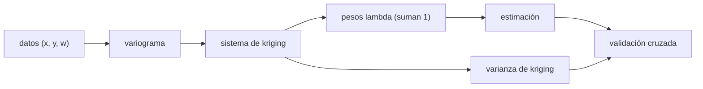

# B67-C05 — Modelos geoestadísticos de distribución de volátiles

<!-- nav:top -->
[🏠 Programa](../../../../README.md) · [📚 Bloque B67](../../../tronco-comun/B67-prospeccion-y-evaluacion-de-reservas-de-recursos-extraterrestres.md) · [← Anterior: B67-C04 — Estimación de reservas y categorías de recursos](../B67-C04-estimacion-de-reservas-y-categorias-de-recursos/CLASE.md) · [Siguiente: B67-C06 — Pérdida de volátiles por sublimación y migración térmica →](../B67-C06-perdida-de-volatiles-por-sublimacion-y-migracion-termica/CLASE.md)
<!-- /nav -->

## 1. Ubicación, nivel y alcance

Clase 5 del bloque B67. Nivel N3. Las muestras de hielo son puntos; el depósito es un campo. Aquí estimas la fracción de hielo entre las muestras con **kriging ordinario**: ajustas un variograma (cómo se parecen dos puntos según su distancia), resuelves el sistema lineal de pesos, obtienes una estimación **y su varianza**, y la comparas con el promedio y con la interpolación por distancia inversa. Usas el álgebra lineal de [B10](../../../tronco-comun/B10-algebra-lineal-y-matematicas-geometricas.md) y la estadística de [B12](../../../tronco-comun/B12-probabilidad-estadistica-e-incertidumbre.md). El campo es **sintético**, generado con una covarianza conocida.

## 2. Por qué esta clase existe

Promediar muestras ignora que dos puntos cercanos se parecen más que dos lejanos, y una interpolación sin varianza no dice dónde se sabe poco. La decisión central: **¿qué valor y qué incertidumbre se asigna a un punto sin muestra, y dónde conviene muestrear más?**

## 3. Lo que podrás hacer al terminar

1. Definir pepita, meseta y rango de un variograma y escribir el modelo exponencial.
2. Plantear y resolver el sistema de kriging ordinario con la restricción de suma de pesos igual a 1.
3. Calcular la varianza de kriging y construir un intervalo al 90 %.
4. Comprobar propiedades del kriging (pesos que suman 1, exactitud en los datos).
5. Comparar kriging, distancia inversa y media global con el error en puntos no muestreados.
6. Validar el modelo con validación cruzada y reconocer el efecto de un nugget mal especificado.

La evidencia es la **ficha del modelo geoestadístico** del ejercicio 12 (sección 20).

## 4. Con qué llegas y cómo comprobarlo

1. ¿Qué es la covarianza entre dos puntos?
2. ¿Qué es resolver un sistema lineal?
3. ¿Qué es la varianza de un estimador?
4. ¿Qué es una validación cruzada?
5. ¿Qué es una realización sintética?

<details>
<summary>Ver respuestas</summary>

1. Una medida de cuánto varían juntos. 2. Hallar las incógnitas que cumplen varias ecuaciones lineales a la vez. 3. Cuánto varía el estimador de una muestra a otra. 4. Predecir cada dato con un modelo ajustado sin él. 5. Un campo generado con una receta aleatoria conocida.
</details>

Con cuatro o cinco aciertos, sigue; si no, repasa los prerrequisitos.

## 5. Un caso de contexto y casos de referencia

Un campo de `20 × 20` celdas de `100 m` (`2 km × 2 km`) con media `3 %` y desviación `1 %`, generado con covarianza exponencial de rango `400 m` (semilla 6705). Se «muestrean» `40` celdas y se estiman las otras `360`. El kriging da un error de `0,00687` en fracción másica, la distancia inversa `0,00729` y la media global `0,00997`. Es el **ejemplo conductor**; el campo es **sintético**, por eso se conoce la respuesta correcta.

## 6. Vocabulario

El **semivariograma** `γ(h)` es la mitad de la varianza de la diferencia entre dos puntos a distancia `h`. La **pepita** (*nugget*) es su valor en `h → 0` (ruido o variación a escala menor que el muestreo); la **meseta** (*sill*) es el nivel en que se aplana; el **rango** es la distancia en que se aplana por primera vez. El **kriging ordinario** es el mejor estimador lineal insesgado con media constante desconocida. La **varianza de kriging** mide la incertidumbre de la estimación.

## 7. Modelo mental: adivinar la nieve entre dos estaciones

Si tienes nieve medida en dos estaciones, tu mejor estimación en un punto intermedio pesa más a la más cercana; y sabes más cerca de una estación que en medio del valle.



*Descripción textual:* los datos dan el variograma; el variograma llena el sistema lineal de kriging; su solución son los pesos, la estimación y la varianza; la validación cruzada comprueba que modelo y datos concuerdan.

Analogía: adivinar la nieve entre dos estaciones. Límite: se supone media constante y variograma que solo depende de la distancia; con tendencia o anisotropía hace falta kriging universal o variogramas direccionales.

## 8. La explicación, paso a paso

### 8.1 El variograma exponencial

`γ(h) = c₀ + (σ² − c₀)(1 − e^(−h/a))` para `h > 0` y `γ(0) = 0`, con `σ² = 10⁻⁴` (desviación `1 %`), `a = 400 m` y pepita `c₀ = 0`. A `h = 200 m`, `γ = 3,935 × 10⁻⁵`; a `h = 1200 m` (3 veces `a`) se alcanza el `95,02 %` de la meseta, y por eso `3a` se llama rango práctico del modelo exponencial.

### 8.2 El sistema de kriging

Para `n` datos se resuelve `[[Γ, 1],[1ᵀ, 0]] [λ, μ]ᵀ = [γ₀, 1]ᵀ`, donde `Γ` contiene los `γ` entre datos y `γ₀` los `γ` entre datos y el punto nuevo. La estimación es `λᵀ z` y la varianza `λᵀγ₀ + μ`. El laboratorio comprueba dos propiedades: los pesos suman 1 (error máximo `6,7 × 10⁻¹⁶`) y, en un punto de dato, la estimación es exacta y la varianza cero.

### 8.3 Resultado en las 360 celdas sin muestra

| Método | Error cuadrático medio (fracción másica) |
|---|---|
| kriging ordinario | 0,00687 |
| distancia inversa (p = 2) | 0,00729 |
| media global | 0,00997 |

El intervalo al 90 % de kriging cubre el `87,8 %` de las celdas, con una desviación media de kriging de `0,657 %`. Con 40 datos y un campo corto-correlacionado el kriging mejora poco a la distancia inversa y bastante a la media.

### 8.4 Validación cruzada y variograma empírico

Dejando uno fuera, la media del error estandarizado al cuadrado es `1,12` (ideal ≈ 1): el modelo no subestima mucho su propia incertidumbre. El variograma empírico de esta única realización es:

| `h` (m) | γ empírico | γ teórico |
|---|---|---|
| 100 | 2,115 × 10⁻⁵ | 2,212 × 10⁻⁵ |
| 200 | 4,213 × 10⁻⁵ | 3,935 × 10⁻⁵ |
| 400 | 7,267 × 10⁻⁵ | 6,321 × 10⁻⁵ |
| 800 | 9,932 × 10⁻⁵ | 8,647 × 10⁻⁵ |
| 1200 | 1,130 × 10⁻⁴ | 9,502 × 10⁻⁵ |

Las diferencias a lags grandes (hasta `19 %` a `1200 m`) son fluctuación de una sola realización de un campo de solo `2 km`, no un error del modelo.

### 8.5 Un nugget mal especificado

Si se supone una pepita `c₀ = 5 × 10⁻⁵` (la mitad de la meseta) que el campo no tiene, el error sube de `0,00687` a `0,00750`: declarar ruido que no existe empeora la interpolación.

## 9. Magnitudes, símbolos y unidades

| Símbolo | Qué es | Unidad | Valor / nota |
|---|---|---|---|
| `γ(h)` | semivariograma | adimensional² (fracción²) | 0 a 10⁻⁴ |
| `σ²` | meseta | fracción² | 10⁻⁴ |
| `a` | rango del modelo exponencial | m | 400 |
| `c₀` | pepita | fracción² | 0 |
| `λ` | pesos de kriging | adimensional | suman 1 |
| `w` | fracción másica de hielo | adimensional | media 0,03 |

## 10. Convenciones y referencias

Coordenadas planas en metros, celdas de `100 m`. Covarianza exponencial `σ² e^(−h/a)` para generar el campo y variograma teórico conocido para krigear (no se ajusta a los datos). Semilla `6705`. Versiones: Python 3.12.9, numpy 2.4.4. Tolerancias: pesos suman 1 dentro de `1e-9`; exactitud en datos dentro de `1e-7`.

## 11. De dónde sale lo que afirmamos

| ID | Fuente | Localizador | Respalda | Estado |
|---|---|---|---|---|
| S1 | GIS Geography, «Semi-Variogram: Nugget, Range and Sill» | https://gisgeography.com/semi-variogram-nugget-range-sill/ | definiciones divulgativas de pepita, meseta y rango | Consultada el 2026-11-09 |

Límites: S1 es una página divulgativa, no un texto de referencia revisado; no se leyeron los trabajos de Matheron ni un libro de geoestadística, y la atribución del kriging a Matheron proviene de resultados de búsqueda secundarios; las ecuaciones del kriging ordinario son resultados estándar que el laboratorio verifica (pesos, exactitud), no se citan de un texto.

## 12. Cómo ver el kriging

| Magnitud | Valor |
|---|---|
| error del kriging | 0,00687 |
| error de la distancia inversa | 0,00729 |
| error de la media global | 0,00997 |
| validación cruzada (ideal ≈ 1) | 1,12 |

Descripción larga: el kriging mejora a la media en un `31 %` y a la distancia inversa en un `6 %`, y es el único que dice cuánto se equivoca.

## 13. Ejemplo trabajado: el variograma a 200 m

**Paso 1 · Exponente.** `h/a = 200/400 = 0,5`.

**Paso 2 · Factor.** `1 − e^(−0,5) = 0,3935`.

**Paso 3 · Variograma.** `γ(200) = 10⁻⁴ · 0,3935 = 3,935 × 10⁻⁵`, que es el valor de la tabla 8.4.

## 14. Distintas formas de describir el campo de hielo

**Por variograma:** cómo cambia la semejanza con la distancia. **Por pesos:** combinación lineal de los datos. **Por varianza:** incertidumbre de cada punto. **Por validación:** error estandarizado dejando uno fuera.

## 15. Práctica guiada

**Ejercicio 1 · con los pasos indicados.** Calcula `γ(100 m)` con `σ² = 10⁻⁴` y `a = 400 m`. *Pasos:* `h/a = 0,25`.

<details><summary>Solución comentada</summary>

`10⁻⁴(1 − e^(−0,25)) = 2,212 × 10⁻⁵`.
</details>

**Ejercicio 2 · con una pista.** ¿A qué distancia el modelo alcanza el `95 %` de la meseta? *Pista:* `1 − e^(−x) = 0,95`.

<details><summary>Solución comentada</summary>

`x ≈ 3`; `h = 3a = 1200 m`.
</details>

**Ejercicio 3 · casi autónomo.** ¿Por qué los pesos de kriging ordinario deben sumar 1?

<details><summary>Solución comentada</summary>

Para que el estimador sea insesgado cuando la media es constante pero desconocida.
</details>

## 16. Práctica autónoma, transferencia e integrador

**Ejercicio 4 · autónomo.** Calcula la mejora relativa del kriging frente a la media global.

<details><summary>Solución comentada</summary>

`(0,00997 − 0,00687)/0,00997 = 31 %`.
</details>

**Ejercicio 5 · autónomo.** Calcula la mejora relativa del kriging frente a la distancia inversa.

<details><summary>Solución comentada</summary>

`(0,00729 − 0,00687)/0,00729 = 5,8 %`.
</details>

**Ejercicio 6 · autónomo.** En un punto de dato, ¿cuánto valen la estimación y la varianza de kriging?

<details><summary>Solución comentada</summary>

La estimación es el propio dato y la varianza es cero (con pepita cero).
</details>

**Ejercicio 7 · autónomo.** La cobertura del intervalo al 90 % fue `87,8 %`. ¿Es aceptable?

<details><summary>Solución comentada</summary>

Sí con 360 celdas correlacionadas; la desviación de `2,2` puntos cabe en la variación esperable y la validación cruzada de `1,12` concuerda.
</details>

**Ejercicio 8 · autónomo.** ¿Qué ocurre con el error si se supone una pepita de `5 × 10⁻⁵`?

<details><summary>Solución comentada</summary>

Sube de `0,00687` a `0,00750` (9 %).
</details>

**Ejercicio 9 · transferencia.** Dos muestras a `10 m` de distancia dan `1 %` y `5 %`. ¿Qué indica sobre la pepita?

<details><summary>Solución comentada</summary>

Que hay variación a escala menor que el muestreo (pepita alta) o error de medida; el variograma debe tener pepita distinta de cero.
</details>

**Ejercicio 10 · transferencia.** Se quiere decidir dónde perforar una muestra más. ¿Qué mapa usas?

<details><summary>Solución comentada</summary>

El de varianza de kriging: se perfora donde sea mayor, porque ahí la muestra reduce más la incertidumbre.
</details>

**Ejercicio 11 · transferencia.** El depósito tiene una tendencia norte-sur. ¿Qué falla del kriging ordinario?

<details><summary>Solución comentada</summary>

La suposición de media constante; hay que usar kriging universal o restar la tendencia.
</details>

**Ejercicio 12 · integrador.** Elabora tu *ficha del modelo geoestadístico*: variograma, error frente a la media y a la distancia inversa, cobertura y validación cruzada.

<details><summary>Solución comentada</summary>

Secciones 8.1–8.5.
</details>

## 17. Laboratorio: variograma y kriging ordinario sobre un campo sintético

El script [kriging.py](kriging.py) genera un campo con covarianza conocida, krigea 360 celdas y valida (**comprueba** pesos que suman 1, exactitud en los datos, mejora sobre la media y la cobertura).

**Datos:** campo sintético de 20 × 20 celdas; semilla 6705; variograma teórico conocido. **Predice antes de ejecutar:** ¿quién tendrá el menor error: kriging, distancia inversa o media? (el kriging.) **Ejecución del 2026-11-09 (Python 3.12.9, numpy 2.4.4):**

```text
Python 3.12.9 ; numpy 2.4.4
DATOS SINTETICOS: campo generado con covarianza exponencial conocida (semilla 6705)
Campo verdadero: media = 2.531 %, desviacion = 0.990 % (teorico 1.0 %)
Pesos suman 1 (maximo |suma-1| = 6.7e-16) ; exacto en los puntos de dato (varianza 0)
RMSE sobre 360 celdas no muestreadas [fraccion masica]: kriging = 0.00687 ; IDW p=2 = 0.00729 ; media global = 0.00997
Cobertura del intervalo al 90 % de kriging: 87.8 % ; desviacion media de kriging = 0.657 %
Validacion cruzada (dejar uno fuera): media del error estandarizado al cuadrado = 1.12 (ideal ~ 1)
lag [m]  gamma empirico  gamma teorico
     100   2.115e-05     2.212e-05
     200   4.213e-05     3.935e-05
     400   7.267e-05     6.321e-05
     800   9.932e-05     8.647e-05
    1200   1.130e-04     9.502e-05
nugget=0.0e+00: RMSE = 0.00687
nugget=5.0e-05: RMSE = 0.00750
Pruebas superadas.
```

```bash
python programa/clases/B67/B67-C05-modelos-geoestadisticos-de-distribucion-de-volatiles/kriging.py
```

**Límites:** media constante, isotropía y variograma conocido; en datos reales hay que ajustarlo.

## 18. Errores frecuentes y cómo corregirlos

**Pesos sin restricción de suma 1.** Se corrige con 8.2.

**Ajustar el variograma con muy pocas parejas.** Con 40 datos el empírico es ruidoso; se corrige con 8.4.

**Inventar una pepita.** Se corrige con 8.5.

**Ignorar la varianza de kriging.** Se corrige con 8.3.

## 19. Cómo sabrás que vas bien

Tras 8.3: ¿qué resultado esperabas y cuál obtuviste? Si dudas, repasa el ejemplo 13. Tras el laboratorio: ¿qué comprueba cada `assert`? (ver la sección 17).

## 20. Qué entregas y cómo se evalúa

El producto es tu **ficha del modelo geoestadístico** (ejercicio 12).

| Criterio | Inicial | En desarrollo | Logrado | Destacado |
|---|---|---|---|---|
| Conceptos | Los confunde | Parciales | Conceptos de la clase con sus condiciones | Explica los límites del modelo |
| Cálculo | Sin unidades | Con errores | Tablas completas con unidades | Calcula casos nuevos |
| Numérico | Sin comprobar | Un caso | Contraste con la solución analítica o con la simulación | Interpreta las diferencias |
| Fuentes | Sin fuente | Sin fecha | Fuentes con fecha de consulta | Declara lo no consultado |
| Límites | No los nombra | Uno | Tres | Discute qué falta del modelo |

**Condiciones críticas (no se compensan con promedio):** rotular los datos como sintéticos; no presentar lo simulado como observado; no inferir reservas de ningún sitio real; citar solo lo consultado.

## 21. Ética, seguridad y límites

Clase educativa: los modelos son simplificados y los datos son sintéticos; no se estima, certifica ni reporta ninguna reserva real, ni se evalúa un sitio o una empresa concretos. Un mapa de kriging no es una medición: sus incertidumbres dependen del variograma supuesto. Accesibilidad: tablas equivalentes a las gráficas, fórmulas en texto, ejercicios sin conexión.

## 22. Para cerrar y seguir

El kriging estima 360 celdas con un error `31 %` menor que la media, y avisa dónde sabe menos con su varianza. Queda una pregunta: ¿cuánto de lo estimado sigue ahí cuando se extrae y se almacena?

**Glosario español–inglés.** variograma · *variogram*; pepita · *nugget*; meseta · *sill*; rango · *range*; kriging ordinario · *ordinary kriging*.

**Continuidad.** [B67-C06](../B67-C06-perdida-de-volatiles-por-sublimacion-y-migracion-termica/CLASE.md) estudia la pérdida de volátiles por sublimación y migración térmica.

**Referencias:** ver sección 11.

<!-- nav:bottom -->
---

[← Anterior: B67-C04 — Estimación de reservas y categorías de recursos](../B67-C04-estimacion-de-reservas-y-categorias-de-recursos/CLASE.md) · [📚 Bloque B67](../../../tronco-comun/B67-prospeccion-y-evaluacion-de-reservas-de-recursos-extraterrestres.md) · [Siguiente: B67-C06 — Pérdida de volátiles por sublimación y migración térmica →](../B67-C06-perdida-de-volatiles-por-sublimacion-y-migracion-termica/CLASE.md)
<!-- /nav -->
