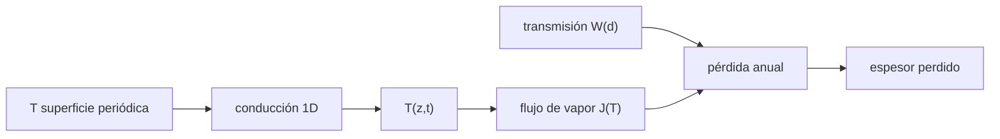

# B67-C06 — Pérdida de volátiles por sublimación y migración térmica

<!-- nav:top -->
[🏠 Programa](../../../../README.md) · [📚 Bloque B67](../../../tronco-comun/B67-prospeccion-y-evaluacion-de-reservas-de-recursos-extraterrestres.md) · [← Anterior: B67-C05 — Modelos geoestadísticos de distribución de volátiles](../B67-C05-modelos-geoestadisticos-de-distribucion-de-volatiles/CLASE.md) · [Siguiente: B67-C07 — Sensores para volátiles: espectrometría de neutrones y de masas →](../B67-C07-sensores-para-volatiles-espectrometria-de-neutrones-y-de-masas/CLASE.md)
<!-- /nav -->

## 1. Ubicación, nivel y alcance

Clase 6 del bloque B67. Nivel N3. El hielo enterrado bajo regolito seco no se pierde por estar enterrado, sino por **qué tan caliente se pone y qué tan difícil es salir**. Aquí resuelves la conducción de calor 1D con Crank–Nicolson y la contrastas con la onda térmica analítica, y con la presión de vapor de la clase anterior calculas la pérdida anual por unidad de área a distintas profundidades. Usas [B05](../../../tronco-comun/B05-fisica-fundamental-para-el-espacio.md) y los métodos numéricos de [B11](../../../tronco-comun/B11-ecuaciones-diferenciales-y-simulacion-numerica.md). Todos los valores son **ilustrativos**.

## 2. Por qué esta clase existe

Una oscilación de temperatura de pocos kelvin cambia la pérdida en órdenes de magnitud, y esa oscilación decae con la profundidad. La decisión central: **¿a qué profundidad el hielo es estable, y cuánto engaña usar la temperatura media?**

## 3. Lo que podrás hacer al terminar

1. Resolver la conducción 1D con Crank–Nicolson y comparar con la onda térmica analítica.
2. Calcular la profundidad de penetración térmica `δ`.
3. Estimar el flujo de vapor del hielo enterrado con una transmisión de poro.
4. Mostrar que usar la temperatura media subestima la pérdida (desigualdad de Jensen).
5. Calcular el espesor de hielo perdido en un intervalo largo.
6. Reconocer que la pérdida real depende de parámetros que aquí son ilustrativos.

La evidencia es la **ficha de pérdida térmica de un depósito** del ejercicio 12 (sección 20).

## 4. Con qué llegas y cómo comprobarlo

1. ¿Qué es la difusividad térmica?
2. ¿Qué es una ecuación diferencial en derivadas parciales?
3. ¿Qué es una condición de frontera?
4. ¿Qué es una función convexa?
5. ¿Qué es un valor ilustrativo?

<details>
<summary>Ver respuestas</summary>

1. La rapidez con que una temperatura se propaga en un material: `κ = k/(ρ c)`. 2. Una que relaciona derivadas respecto de varias variables. 3. El valor o el flujo que se impone en el borde del dominio. 4. Una cuyo promedio de valores es mayor o igual que el valor en el promedio. 5. Un valor propuesto para el ejemplo, no medido.
</details>

Con cuatro o cinco aciertos, sigue; si no, repasa los prerrequisitos.

## 5. Un caso de contexto y casos de referencia

Un regolito seco con `κ = 10⁻⁸ m²/s`, temperatura de superficie `140 K ± 80 K` con periodo de `29,53 d`. La profundidad de penetración es `δ = 0,0901 m`. El hielo a `0,3 m` ve una oscilación de `±2,9 K` y pierde `8,78 × 10⁻⁶ kg/m²` al año; si se usara la temperatura media, `7,38 × 10⁻⁶`. Es el **ejemplo conductor**; todos los valores son **ilustrativos**.

## 6. Vocabulario

La **onda térmica** es la oscilación que penetra en el suelo: `T = Tm + ΔT e^(−z/δ) cos(ωt − z/δ)`. La **profundidad de penetración** es `δ = √(2κ/ω)`. La **transmisión de poro** `W = 1/(1 + 3d/(8 r_p))` es la fracción de moléculas que, saliendo del hielo, atraviesan una capa de espesor `d` con poros de radio `r_p`. La **desigualdad de Jensen** dice que, si el flujo crece más que linealmente con `T`, el flujo medio supera al flujo a la temperatura media.

## 7. Modelo mental: una cuerda que se agita por un extremo

Si agitas una cuerda larga de un extremo, la onda se apaga con la distancia; a cierta distancia casi no se ve. El suelo hace lo mismo con la temperatura, y el hielo cerca de la superficie siente el vaivén completo.



*Descripción textual:* la temperatura de la superficie se propaga por conducción y se amortigua con la profundidad; a la profundidad del hielo se calcula el flujo de vapor, se multiplica por la transmisión del regolito y se integra en el tiempo.

Analogía: una cuerda que se agita por un extremo. Límite: se ignora el calor latente de la sublimación, la dependencia de `κ` con la temperatura, la radiación en los poros y el transporte del vapor por otros caminos; la transmisión es una relación de ingeniería que no se consultó.

## 8. La explicación, paso a paso

### 8.1 La onda térmica numérica y la analítica

Con `κ = 10⁻⁸ m²/s` y `ω = 2π/29,53 d`, `δ = 0,0901 m`. Con Crank–Nicolson (nodos cada `1 cm`, 720 pasos por periodo, 6 periodos y el último analizado):

| `z` (m) | amplitud numérica (K) | amplitud analítica (K) | error relativo |
|---|---|---|---|
| 0,00 | 80,0000 | 80,0000 | 0,00 % |
| 0,09 | 29,4379 | 29,4691 | 0,11 % |
| 0,18 | 10,8317 | 10,8553 | 0,22 % |
| 0,27 | 3,9848 | 3,9987 | 0,35 % |

A `z = δ` el retraso de fase es `0,995 rad` (analítico `1,000 rad`). La amplitud cae un factor `e` por cada `δ`.

### 8.2 Hielo enterrado: pérdida anual

Con `r_p = 50 µm`, la pérdida por unidad de área al año con la `T(t)` calculada y con la temperatura media:

| `d` (m) | `T` media (K) | amplitud (K) | `W` | pérdida con `T(t)` (kg/m²) | con `T` media (kg/m²) | cociente |
|---|---|---|---|---|---|---|
| 0,10 | 139,992 | 26,343 | 1,33 × 10⁻³ | 3,3435 × 10⁻³ | 2,2188 × 10⁻⁵ | 150,7 |
| 0,20 | 139,985 | 8,674 | 6,66 × 10⁻⁴ | 3,6966 × 10⁻⁵ | 1,1079 × 10⁻⁵ | 3,34 |
| 0,30 | 139,981 | 2,859 | 4,44 × 10⁻⁴ | 8,7773 × 10⁻⁶ | 7,3775 × 10⁻⁶ | 1,19 |
| 0,50 | 139,981 | 0,311 | 2,67 × 10⁻⁴ | 4,4366 × 10⁻⁶ | 4,4270 × 10⁻⁶ | 1,002 |

La temperatura media es casi la misma a todas las profundidades; lo que cambia es la oscilación. A `0,1 m` la media subestima la pérdida 150 veces.

### 8.3 Lectura

Pasar de `0,1 m` a `0,2 m` reduce la pérdida unas `90` veces: `W` baja a la mitad y la onda térmica se amortigua. A `0,3 m` el hielo pierde unos `0,010 m` en `10⁶` años (cota superior para el modelo de la clase, con parámetros ilustrativos). No se infiere de esto la estabilidad de ningún hielo lunar real.

## 9. Magnitudes, símbolos y unidades

| Símbolo | Qué es | Unidad | Valor / nota |
|---|---|---|---|
| `κ` | difusividad térmica | m² s⁻¹ | 10⁻⁸ (ilustrativo) |
| `δ` | profundidad de penetración | m | 0,0901 |
| `Tm`, `ΔT` | temperatura media y amplitud en superficie | K | 140; 80 |
| `d` | profundidad del hielo | m | 0,1–0,5 |
| `r_p` | radio efectivo de poro | m | 50 × 10⁻⁶ |
| `W` | transmisión de poro | adimensional | 2,7 × 10⁻⁴ – 1,3 × 10⁻³ |

## 10. Convenciones y referencias

Eje `z` hacia abajo desde la superficie. Frontera superior de temperatura impuesta, inferior sin flujo (a `1,5 m`, más de `16 δ`). Presión de vapor de Murphy y Koop (2005), ecuación (7), con `T > 110 K`. Constantes de referencia no consultadas (ver C03). Versiones: Python 3.12.9, numpy 2.4.4. Tolerancias: numérico frente a analítico dentro de `3 %` en amplitud y `0,1 rad` en fase; flujo con `T(t)` mayor o igual que con `T` media.

## 11. De dónde sale lo que afirmamos

| ID | Fuente | Localizador | Respalda | Estado |
|---|---|---|---|---|
| S1 | D. M. Murphy y T. Koop, *Q. J. R. Meteorol. Soc.* 131 (608), 1539–1565 (2005), DOI 10.1256/qj.04.94 | https://zenodo.org/records/1236243 (ecuación (7)) | presión de vapor del hielo para `T > 110 K` | Texto del PDF extraído y leído el 2026-11-09 (solo el pasaje de la ecuación (7)) |

Límites: solo se leyó el pasaje de la ecuación (7); la onda térmica de estado periódico y Crank–Nicolson son resultados estándar que el laboratorio contrasta entre sí, sin citar un texto; la transmisión de poro de tubo largo, `κ`, `r_p` y las temperaturas son ilustrativos y no se consultaron.

## 12. Cómo ver la pérdida térmica

| Magnitud | Valor |
|---|---|
| `δ` | 0,0901 m |
| amplitud a 0,3 m | 2,859 K |
| pérdida a 0,3 m al año | 8,78 × 10⁻⁶ kg/m² |
| cociente con/sin oscilación a 0,1 m | 150,7 |

Descripción larga: la pérdida cae unas dos órdenes de magnitud entre `0,1 m` y `0,2 m`, y la oscilación, no la media, la explica.

## 13. Ejemplo trabajado: la profundidad de penetración

**Paso 1 · Frecuencia.** `ω = 2π/(29,53 · 86 400 s) = 2,463 × 10⁻⁶ s⁻¹`.

**Paso 2 · Cociente.** `2κ/ω = 2 · 10⁻⁸/2,463 × 10⁻⁶ = 8,12 × 10⁻³ m²`.

**Paso 3 · Raíz.** `δ = 0,0901 m`.

**Paso 4 · Amplitud a 0,18 m.** `80 · e^(−2) = 10,83 K`, cerca del `10,86 K` calculado (con retrasos de fase y rejilla).

## 14. Distintas formas de describir la pérdida de hielo enterrado

**Por onda:** amplitud y fase a cada profundidad. **Por flujo:** kg m⁻² s⁻¹ en función de `T`. **Por año:** pérdida por unidad de área. **Por espesor:** metros de hielo perdidos en el intervalo.

## 15. Práctica guiada

**Ejercicio 1 · con los pasos indicados.** Calcula `W` para `d = 0,1 m` y `r_p = 50 µm`. *Pasos:* `3d/(8 r_p) = 750`.

<details><summary>Solución comentada</summary>

`1/(1 + 750) = 1,33 × 10⁻³`.
</details>

**Ejercicio 2 · con una pista.** Calcula la amplitud de temperatura a `z = 2δ` si en la superficie es `80 K`. *Pista:* `e^(−2)`.

<details><summary>Solución comentada</summary>

`80 · 0,1353 = 10,8 K`.
</details>

**Ejercicio 3 · casi autónomo.** ¿Por qué la temperatura media no basta para estimar la pérdida?

<details><summary>Solución comentada</summary>

Porque el flujo crece exponencialmente con `T`: los picos de temperatura pierden mucho más de lo que ahorran los valles.
</details>

## 16. Práctica autónoma, transferencia e integrador

**Ejercicio 4 · autónomo.** ¿Qué profundidad de penetración tendría una oscilación anual (periodo `365 d`) con el mismo `κ`?

<details><summary>Solución comentada</summary>

`δ ∝ √periodo`: `0,0901·√(365/29,53) = 0,317 m`.
</details>

**Ejercicio 5 · autónomo.** Calcula `W` para `d = 0,5 m`.

<details><summary>Solución comentada</summary>

`1/(1 + 3·0,5/(8·50 × 10⁻⁶)) = 1/3751 = 2,67 × 10⁻⁴`.
</details>

**Ejercicio 6 · autónomo.** ¿Cuántas veces es mayor la pérdida a `0,1 m` que a `0,2 m`?

<details><summary>Solución comentada</summary>

`≈ 90`.
</details>

**Ejercicio 7 · autónomo.** Si el regolito se hace más poroso (`r_p` doble), ¿qué pasa con `W` a `0,1 m`?

<details><summary>Solución comentada</summary>

`W = 1/(1 + 375) = 2,66 × 10⁻³`: se duplica y la pérdida también.
</details>

**Ejercicio 8 · autónomo.** ¿Qué dice la desigualdad de Jensen sobre el cociente de la tabla 8.2?

<details><summary>Solución comentada</summary>

Que el cociente nunca baja de 1; solo vale ≈ 1 donde la amplitud es muy pequeña (`0,5 m`).
</details>

**Ejercicio 9 · transferencia.** Un modelo usa la temperatura media diaria para estimar sublimación. ¿Qué error sistemático comete?

<details><summary>Solución comentada</summary>

Subestima la pérdida (Jensen), tanto más cuanto mayor la amplitud.
</details>

**Ejercicio 10 · transferencia.** Se quiere guardar una muestra enterrada en un depósito térmico. ¿Qué profundidad eliges?

<details><summary>Solución comentada</summary>

Una de varias `δ` (por ejemplo `0,5 m` en este modelo), donde la oscilación es menor del `1 %` de la superficial, y se verifica con la pérdida de la tabla 8.2.
</details>

**Ejercicio 11 · transferencia.** El modelo no incluye calor latente. ¿Hacia dónde sesga?

<details><summary>Solución comentada</summary>

Hacia sobrestimar la pérdida: la sublimación enfría la superficie del hielo y reduce `T` y el flujo.
</details>

**Ejercicio 12 · integrador.** Elabora tu *ficha de pérdida térmica de un depósito*: onda numérica frente a analítica, tabla de pérdidas por profundidad, efecto de Jensen y límites.

<details><summary>Solución comentada</summary>

Secciones 8.1–8.3.
</details>

## 17. Laboratorio: onda térmica en regolito seco y pérdida de hielo enterrado

El script [migracion.py](migracion.py) resuelve la conducción 1D, compara con la onda analítica y calcula la pérdida (**comprueba** el error en amplitud y fase y la desigualdad de Jensen).

**Datos:** `κ`, temperaturas y `r_p` ilustrativos. **Predice antes de ejecutar:** ¿a qué profundidad la media y la oscilación dan casi lo mismo? (a unos 0,5 m.) **Ejecución del 2026-11-09 (Python 3.12.9, numpy 2.4.4):**

```text
Python 3.12.9 ; numpy 2.4.4
DATOS ILUSTRATIVOS: kappa, temperaturas y radio de poro inventados para la clase
delta = sqrt(2 kappa / w) = 0.0901 m (periodo 29.53 d)
z [m]   amplitud numerica [K]  amplitud analitica [K]  error relativo
  0.00     80.0000              80.0000               0.00 %
  0.09     29.4379              29.4691               0.11 %
  0.18     10.8317              10.8553               0.22 %
  0.27      3.9848               3.9987               0.35 %
Desfase en z = delta: 0.995 rad (analitico 1,000 rad)
Hielo enterrado: perdida anual por unidad de area, T(t) numerica frente a T media
d [m]  T media [K]  amp [K]  W        perdida/anio con T(t) [kg/m2]  con T media [kg/m2]  cociente
 0.10   139.992   26.343  1.33e-03      3.3435e-03                2.2188e-05      150.688
 0.20   139.985    8.674  6.66e-04      3.6966e-05                1.1079e-05      3.337
 0.30   139.981    2.859  4.44e-04      8.7773e-06                7.3775e-06      1.190
 0.50   139.981    0.311  2.67e-04      4.4366e-06                4.4270e-06      1.002
A d = 0.3 m: espesor de hielo perdido en 1e6 anios = 0.010 m (solo la parte de vapor que escapa; cota superior)
Perdida a 0,1 m / perdida a 0,2 m = 90.4
Pruebas superadas.
```

```bash
python programa/clases/B67/B67-C06-perdida-de-volatiles-por-sublimacion-y-migracion-termica/migracion.py
```

**Límites:** un solo material, conducción pura y transmisión de poro aproximada.

## 18. Errores frecuentes y cómo corregirlos

**Usar la temperatura media.** Se corrige con 8.2.

**Confundir profundidad con estabilidad.** Importa la amplitud de `T`, no solo la profundidad; se corrige con 8.2.

**Olvidar que `δ` depende del periodo.** Se corrige con el ejercicio 4.

**Tomar la pérdida como cierta.** Los parámetros son ilustrativos; se corrige con 8.3.

## 19. Cómo sabrás que vas bien

Tras 8.1: ¿qué resultado esperabas y cuál obtuviste? Si dudas, repasa el ejemplo 13. Tras el laboratorio: ¿qué comprueba cada `assert`? (ver la sección 17).

## 20. Qué entregas y cómo se evalúa

El producto es tu **ficha de pérdida térmica de un depósito** (ejercicio 12).

| Criterio | Inicial | En desarrollo | Logrado | Destacado |
|---|---|---|---|---|
| Conceptos | Los confunde | Parciales | Conceptos de la clase con sus condiciones | Explica los límites del modelo |
| Cálculo | Sin unidades | Con errores | Tablas completas con unidades | Calcula casos nuevos |
| Numérico | Sin comprobar | Un caso | Contraste con la solución analítica o con la simulación | Interpreta las diferencias |
| Fuentes | Sin fuente | Sin fecha | Fuentes con fecha de consulta | Declara lo no consultado |
| Límites | No los nombra | Uno | Tres | Discute qué falta del modelo |

**Condiciones críticas (no se compensan con promedio):** rotular los datos como sintéticos; no presentar lo simulado como observado; no inferir reservas de ningún sitio real; citar solo lo consultado.

## 21. Ética, seguridad y límites

Clase educativa: los modelos son simplificados y los datos son sintéticos; no se estima, certifica ni reporta ninguna reserva real, ni se evalúa un sitio o una empresa concretos. Los resultados no predicen la estabilidad de ningún hielo real; son un modelo para razonar sobre órdenes de magnitud. Accesibilidad: tablas equivalentes a las gráficas, fórmulas en texto, ejercicios sin conexión.

## 22. Para cerrar y seguir

Con oscilaciones ilustrativas, el hielo a `0,1 m` pierde 150 veces más de lo que daría la temperatura media y a `0,5 m` casi nada. Queda una pregunta: ¿qué sensor mide el hielo que queda?

**Glosario español–inglés.** onda térmica · *thermal wave*; profundidad de penetración · *penetration depth*; Crank–Nicolson · *Crank–Nicolson*; transmisión · *transmission probability*; desigualdad de Jensen · *Jensen's inequality*.

**Continuidad.** [B67-C07](../B67-C07-sensores-para-volatiles-espectrometria-de-neutrones-y-de-masas/CLASE.md) estudia los sensores para volátiles.

**Referencias:** ver sección 11.

<!-- nav:bottom -->
---

[← Anterior: B67-C05 — Modelos geoestadísticos de distribución de volátiles](../B67-C05-modelos-geoestadisticos-de-distribucion-de-volatiles/CLASE.md) · [📚 Bloque B67](../../../tronco-comun/B67-prospeccion-y-evaluacion-de-reservas-de-recursos-extraterrestres.md) · [Siguiente: B67-C07 — Sensores para volátiles: espectrometría de neutrones y de masas →](../B67-C07-sensores-para-volatiles-espectrometria-de-neutrones-y-de-masas/CLASE.md)
<!-- /nav -->
