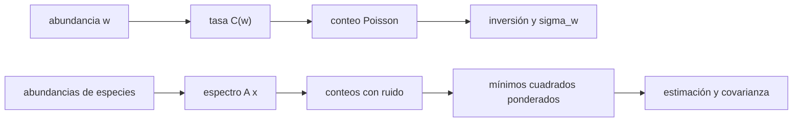

# B67-C07 — Sensores para volátiles: espectrometría de neutrones y de masas

<!-- nav:top -->
[🏠 Programa](../../../../README.md) · [📚 Bloque B67](../../../tronco-comun/B67-prospeccion-y-evaluacion-de-reservas-de-recursos-extraterrestres.md) · [← Anterior: B67-C06 — Pérdida de volátiles por sublimación y migración térmica](../B67-C06-perdida-de-volatiles-por-sublimacion-y-migracion-termica/CLASE.md) · [Siguiente: B67-C08 — Informe de disponibilidad de volátiles con incertidumbre →](../B67-C08-informe-de-disponibilidad-de-volatiles-con-incertidumbre/CLASE.md)
<!-- /nav -->

## 1. Ubicación, nivel y alcance

Clase 7 del bloque B67. Nivel N3. Dos sensores responden a «¿cuánto volátil hay?»: el **espectrómetro de neutrones**, que ve la depresión de los neutrones epitérmicos donde hay hidrógeno, y el **espectrómetro de masas**, que separa las especies químicas por su masa sobre carga. Aquí modelas ambos con respuestas **sintéticas**: inviertes el conteo de neutrones con su incertidumbre de Poisson, calculas el tiempo de integración para detectar una abundancia y desmezclas un espectro de cinco especies con mínimos cuadrados ponderados. Usas [B12](../../../tronco-comun/B12-probabilidad-estadistica-e-incertidumbre.md) y [B10](../../../tronco-comun/B10-algebra-lineal-y-matematicas-geometricas.md).

## 2. Por qué esta clase existe

Un sensor no mide «agua»: mide cuentas, y de ellas se infiere la abundancia con un modelo. La decisión central: **¿cuánto tiempo de medición y qué canales hacen falta para detectar y separar un volátil con la incertidumbre requerida?**

## 3. Lo que podrás hacer al terminar

1. Modelar la tasa de neutrones epitérmicos como función decreciente de la abundancia de hidrógeno.
2. Invertir un conteo de Poisson y propagar su incertidumbre.
3. Calcular el tiempo de integración para detectar una abundancia a 3 sigma.
4. Plantear un espectro de masas como mezcla lineal de patrones de fragmentación.
5. Resolver la desmezcla por mínimos cuadrados ponderados y estimar la covarianza.
6. Reconocer el sesgo de ponderar con lo observado y la pérdida de rango al quitar un canal.

La evidencia es la **ficha de detección y cuantificación de volátiles** del ejercicio 12 (sección 20).

## 4. Con qué llegas y cómo comprobarlo

1. ¿Qué es una distribución de Poisson?
2. ¿Qué es la propagación de incertidumbre?
3. ¿Qué es un sistema de ecuaciones lineales sobredeterminado?
4. ¿Qué es el rango de una matriz?
5. ¿Qué es un sensor sintético?

<details>
<summary>Ver respuestas</summary>

1. La de los conteos de eventos independientes; su varianza es igual a su media. 2. Calcular cómo la incertidumbre de una entrada pasa a una salida. 3. Uno con más ecuaciones que incógnitas, que se resuelve por mínimos cuadrados. 4. El número de columnas linealmente independientes. 5. Un modelo inventado de respuesta, no un instrumento real.
</details>

Con cuatro o cinco aciertos, sigue; si no, repasa los prerrequisitos.

## 5. Un caso de contexto y casos de referencia

Un detector sintético de neutrones epitérmicos con `20 cuentas/s` sobre suelo seco y una respuesta `C(w) = C0/(1 + a·w)` con `a = 0,05` por `%` de hidrógeno equivalente en agua: con `w = 1 %`, `19,0476 cuentas/s` (una depresión de `4,76 %`); detectarlo a 3 sigma exige `198 s`. Para masas, cinco especies (H₂O, CO₂, CH₄, NH₃, H₂S) en seis canales. Es el **ejemplo conductor**; todo es **sintético**. Como referencia cualitativa, el resumen de Feldman et al. (1998), obtenido por búsqueda web, informa depresiones del flujo epitérmico en los polos lunares de `4,6 %` (norte) y `3,0 %` (sur), compatibles con hidrógeno bajo menos de `40 cm` de regolito seco; la coincidencia numérica con `4,76 %` de la clase **no** es una comparación.

## 6. Vocabulario

La **tasa de neutrones epitérmicos** baja donde el hidrógeno los modera. La **abundancia equivalente en agua (WEH)** es la masa de agua que daría la misma señal por cada 100 de regolito. El **conteo de Poisson** tiene varianza igual a su media. La **espectrometría de masas** separa iones por su relación masa/carga (`m/z`); cada especie deja un **patrón de fragmentación** en varios canales. La **desmezcla** es el cálculo de las abundancias que explican el espectro medido.

## 7. Modelo mental: contar gente en una sala por el ruido

Contar neutrones es como estimar cuánta gente hay en una sala por el ruido: más personas, más ruido; y el ruido tiene su propia variabilidad. Separar especies en un espectro es distinguir voces que se solapan.



*Descripción textual:* un parámetro físico (la abundancia) produce una señal media; el azar de Poisson la convierte en un conteo; el cálculo inverso devuelve la abundancia con su incertidumbre, y lo mismo con el espectro de masas.

Analogía: contar gente en una sala por el ruido. Límite: las respuestas de la clase son modelos inventados y la de los neutrones ignora la profundidad, la composición, la topografía y la resolución espacial, que dominan la interpretación real.

## 8. La explicación, paso a paso

### 8.1 Neutrones: respuesta e inversión

`C(w) = C0/(1 + a·w)` con `C0 = 20 cuentas/s`. El conteo en `t` segundos es Poisson de media `C·t`; la abundancia se recupera con `w = (C0/C − 1)/a` y la incertidumbre se propaga con `σ_w = (C0/(a·C²))·√(C/t)`.

| `w` (%) | `C` (cuentas/s) | depresión (%) | `σ_w` a 1 h (%) analítico | `σ_w` Monte Carlo (%) | sesgo MC (%) |
|---|---|---|---|---|---|
| 0,5 | 19,5122 | 2,44 | 0,0773 | 0,0773 | +0,0006 |
| 1,0 | 19,0476 | 4,76 | 0,0802 | 0,0803 | +0,0002 |
| 3,0 | 17,3913 | 13,04 | 0,0919 | 0,0919 | +0,0001 |
| 10,0 | 13,3333 | 33,33 | 0,1369 | 0,1370 | +0,0006 |

El Monte Carlo (200 000 repeticiones por fila, semilla 6707) coincide con la propagación dentro del `3 %` y el sesgo es despreciable.

### 8.2 Tiempo para detectar

Detectar `w` a 3 sigma sobre el suelo seco exige `C0 − C(w) ≥ 3√(C0/t)`, de donde `t = 9·C0/(C0 − C)²`: `756,5 s` para `0,5 %`, `198,4 s` para `1 %` y `54,4 s` para `2 %`. Bajar a la mitad la abundancia cuadruplica aproximadamente el tiempo.

### 8.3 Masas: la matriz de patrones

Seis canales (`m/z` 16, 17, 18, 32, 34, 44) y cinco especies. El CH₄ y el NH₃ se solapan en `m/z` 16 y 17; el H₂O aporta `0,23` a `m/z` 17. La matriz tiene rango `5` y número de condición `2,6`.

### 8.4 Desmezcla y su incertidumbre

Con abundancias verdaderas `[800, 120, 60, 25, 15]` cuentas, 20 000 espectros con ruido de Poisson (semilla 6707) y mínimos cuadrados ponderados:

| Especie | verdadero | media (pesos observados) | media (pesos del modelo) | `σ` predicha | `σ` Monte Carlo |
|---|---|---|---|---|---|
| H₂O | 800,0 | 799,96 | 799,96 | 28,44 | 28,47 |
| CO₂ | 120,0 | 120,01 | 120,01 | 10,95 | 11,02 |
| CH₄ | 60,0 | 59,84 | 59,84 | 17,24 | 17,16 |
| NH₃ | 25,0 | 25,16 | 25,16 | 17,54 | 17,48 |
| H₂S | 15,0 | 14,26 | 15,01 | 3,23 | 3,23 |

Con los pesos tomados de lo observado, la especie más escasa (H₂S) sale sesgada a la baja un `4,9 %`; con los pesos fijados por el modelo, el sesgo desaparece. La covarianza predicha concuerda con la simulada dentro del `5 %`.

### 8.5 Un canal que no se puede perder

Sin el canal `m/z` 17, la matriz pasa de rango `5` a rango `4`: con cinco especies y cuatro ecuaciones independientes, CH₄ y NH₃ ya no se separan.

## 9. Magnitudes, símbolos y unidades

| Símbolo | Qué es | Unidad | Valor / nota |
|---|---|---|---|
| `C` | tasa de neutrones epitérmicos | cuentas s⁻¹ | `C0 = 20` |
| `w` | hidrógeno equivalente en agua | % masa | 0,5–10 |
| `a` | coeficiente de respuesta | % ⁻¹ | 0,05 |
| `t` | tiempo de integración | s | 3600 |
| `A` | matriz de patrones (canales × especies) | adimensional | inventada |
| `x` | abundancias de especies | cuentas | `[800, 120, 60, 25, 15]` |

## 10. Convenciones y referencias

Cuentas por segundo en un canal de energía epitérmico (no se fija el intervalo de energías: modelo ilustrativo). Canales de masas identificados por `m/z` entero. Semilla `6707`. Versiones: Python 3.12.9, numpy 2.4.4. Tolerancias: `σ_w` analítica frente a Monte Carlo dentro de `3 %`; covarianza de la desmezcla dentro de `5 %`; sesgo con pesos del modelo dentro de 4 errores estándar de la media.

## 11. De dónde sale lo que afirmamos

| ID | Fuente | Localizador | Respalda | Estado |
|---|---|---|---|---|
| S1 | W. C. Feldman et al., «Fluxes of Fast and Epithermal Neutrons from Lunar Prospector: Evidence for Water Ice at the Lunar Poles», *Science* 281, 1496 (1998), DOI 10.1126/science.281.5382.1496 | resultados de búsqueda web del 2026-11-09 (resumen) | depresión epitérmica de `4,6 %` y `3,0 %` en los polos, sin depresión en neutrones rápidos, hidrógeno bajo ≤ 40 cm de regolito seco | Solo resumen vía búsqueda web, el 2026-11-09; el texto del artículo no se consultó |
| S2 | NASA, *VIPER* | https://science.nasa.gov/mission/viper | la misión portaba instrumentos para medir la distribución, el estado físico y la composición del hielo, con una barrena de 1 m | Consultada el 2026-11-09 (la página no nombra los instrumentos y es inconsistente en su número) |

Límites: de S1 solo se tomó un resumen secundario; la física de la moderación de neutrones y la espectrometría de masas son resultados estándar que no se citan de un texto; la respuesta `C(w)`, los patrones de fragmentación y las abundancias son inventados; S2 sirve solo de contexto.

## 12. Cómo ver la detección

| Magnitud | Valor |
|---|---|
| depresión a `w = 1 %` | 4,76 % |
| `σ_w` a 1 h | 0,0802 % |
| tiempo para 3σ a 1 % | 198,4 s |
| sesgo del H₂S con pesos observados | −4,9 % |

Descripción larga: detectar `1 %` de hidrógeno equivalente cuesta poco tiempo con este detector sintético; cuantificar una especie escasa en un espectro mezclado es lo que exige más cuidado.

## 13. Ejemplo trabajado: la incertidumbre en `w` a 1 %

**Paso 1 · Tasa.** `C(1) = 20/1,05 = 19,0476 cuentas/s`.

**Paso 2 · Incertidumbre del conteo.** `σ_C = √(19,0476/3600) = 0,0727 cuentas/s`.

**Paso 3 · Derivada.** `dw/dC = C0/(a·C²) = 20/(0,05 · 362,8) = 1,1025`.

**Paso 4 · Propagación.** `σ_w = 1,1025 · 0,0727 = 0,0802 %`.

## 14. Distintas formas de describir la detección de un volátil

**Por tasa:** cuentas por segundo según la abundancia. **Por contraste:** depresión relativa. **Por tiempo:** el necesario para 3σ. **Por canales:** qué especie se separa con qué canal.

## 15. Práctica guiada

**Ejercicio 1 · con los pasos indicados.** Calcula `C(3)` y la depresión con `C0 = 20`, `a = 0,05`. *Pasos:* `20/(1 + 0,15)`.

<details><summary>Solución comentada</summary>

`17,3913 cuentas/s`; depresión `13,04 %`.
</details>

**Ejercicio 2 · con una pista.** Invierte `C = 17,3913` para obtener `w`. *Pista:* `w = (C0/C − 1)/a`.

<details><summary>Solución comentada</summary>

`(1,15 − 1)/0,05 = 3 %`.
</details>

**Ejercicio 3 · casi autónomo.** ¿Por qué la incertidumbre es Poisson y no gaussiana con sigma fija?

<details><summary>Solución comentada</summary>

Porque los conteos son eventos independientes y su varianza crece con la media.
</details>

## 16. Práctica autónoma, transferencia e integrador

**Ejercicio 4 · autónomo.** ¿Cuánto tarda detectar `w = 2 %` a 3σ?

<details><summary>Solución comentada</summary>

`54,4 s`.
</details>

**Ejercicio 5 · autónomo.** Si el tiempo se cuadruplica, ¿cómo cambia `σ_w`?

<details><summary>Solución comentada</summary>

Se reduce a la mitad (`σ ∝ 1/√t`).
</details>

**Ejercicio 6 · autónomo.** ¿Qué número de condición tiene la matriz de patrones?

<details><summary>Solución comentada</summary>

`2,6`, con rango 5.
</details>

**Ejercicio 7 · autónomo.** ¿Por qué los pesos del modelo evitan el sesgo del H₂S?

<details><summary>Solución comentada</summary>

Porque no dependen del conteo aleatorio observado; con pesos observados, los conteos bajos se ponderan más y sesgan a la baja.
</details>

**Ejercicio 8 · autónomo.** ¿Qué le pasa a la matriz si se elimina el canal `m/z` 17?

<details><summary>Solución comentada</summary>

Su rango baja de 5 a 4: CH₄ y NH₃ dejan de separarse.
</details>

**Ejercicio 9 · transferencia.** Un colega observa una depresión de `4 %` en un mapa real y concluye `1 %` de agua. ¿Qué le dices?

<details><summary>Solución comentada</summary>

La relación de la clase es inventada; la real depende del instrumento, la composición, la profundidad y la topografía. Hay que usar la calibración del instrumento.
</details>

**Ejercicio 10 · transferencia.** Se quiere detectar `0,5 %` en la mitad de tiempo. ¿Qué haces?

<details><summary>Solución comentada</summary>

El tiempo necesario es `756 s`; en la mitad no se llega a 3σ. Hay que aumentar el área de detección, bajar el fondo o aceptar menos confianza.
</details>

**Ejercicio 11 · transferencia.** Un instrumento no tiene el canal que separa dos especies. ¿Qué haces?

<details><summary>Solución comentada</summary>

Admitir que no se pueden cuantificar por separado y reportar la suma; o usar otro sensor o una restricción física.
</details>

**Ejercicio 12 · integrador.** Elabora tu *ficha de detección y cuantificación de volátiles*: respuesta, tiempo de detección, desmezcla con covarianza y límites.

<details><summary>Solución comentada</summary>

Secciones 8.1–8.5.
</details>

## 17. Laboratorio: conteo de neutrones y desmezcla de un espectro de masas

El script [sensores.py](sensores.py) simula conteos de neutrones y espectros de masas con ruido de Poisson (**comprueba** `σ_w`, la covarianza de la desmezcla, el sesgo y el rango).

**Datos:** respuestas inventadas; semilla 6707. **Predice antes de ejecutar:** ¿qué especie saldrá más sesgada con pesos observados? (la más escasa, H₂S.) **Ejecución del 2026-11-09 (Python 3.12.9, numpy 2.4.4):**

```text
Python 3.12.9 ; numpy 2.4.4
DATOS SINTETICOS: modelos de respuesta inventados; no son de un instrumento real
A) Neutrones epitermicos
w [%]   C [cuentas/s]  depresion [%]  sigma_w a 1 h [%]  sigma_w MC [%]  sesgo MC [%]
  0.5    19.5122         2.44         0.0773            0.0773        +0.0006
  1.0    19.0476         4.76         0.0802            0.0803        +0.0002
  3.0    17.3913        13.04         0.0919            0.0919        +0.0001
 10.0    13.3333        33.33         0.1369            0.1370        +0.0006
Tiempo de integracion para detectar w con 3 sigma sobre el fondo seco (w=0):
  w = 0.5 %  ->  t =    756.5 s (0.21 h)
  w = 1.0 %  ->  t =    198.4 s (0.06 h)
  w = 2.0 %  ->  t =     54.4 s (0.02 h)
B) Espectrometria de masas: desmezcla de 5 especies en 6 canales
Numero de condicion de la matriz de patrones: 2.6
especie  verdadero  media(pesos observados)  media(pesos del modelo)  sigma predicha  sigma MC
  H2O       800.0        799.96                  799.96              28.44         28.47
  CO2       120.0        120.01                  120.01              10.95         11.02
  CH4        60.0         59.84                   59.84              17.24         17.16
  NH3        25.0         25.16                   25.16              17.54         17.48
  H2S        15.0         14.26                   15.01               3.23          3.23
Rango de la matriz de patrones: 5 con los 6 canales ; 4 sin el canal m/z 17 (5 especies)
Pruebas superadas.
```

```bash
python programa/clases/B67/B67-C07-sensores-para-volatiles-espectrometria-de-neutrones-y-de-masas/sensores.py
```

**Límites:** modelos inventados; sin fondo, deriva, calibración ni resolución espacial.

## 18. Errores frecuentes y cómo corregirlos

**Tratar el conteo como determinista.** Se corrige con 8.1.

**Ponderar con lo observado en conteos bajos.** Se corrige con 8.4.

**Usar menos canales que especies.** Se corrige con 8.5.

**Presentar la respuesta de la clase como la de un instrumento real.** Se corrige con la sección 11.

## 19. Cómo sabrás que vas bien

Tras 8.1: ¿qué resultado esperabas y cuál obtuviste? Si dudas, repasa el ejemplo 13. Tras el laboratorio: ¿qué comprueba cada `assert`? (ver la sección 17).

## 20. Qué entregas y cómo se evalúa

El producto es tu **ficha de detección y cuantificación de volátiles** (ejercicio 12).

| Criterio | Inicial | En desarrollo | Logrado | Destacado |
|---|---|---|---|---|
| Conceptos | Los confunde | Parciales | Conceptos de la clase con sus condiciones | Explica los límites del modelo |
| Cálculo | Sin unidades | Con errores | Tablas completas con unidades | Calcula casos nuevos |
| Numérico | Sin comprobar | Un caso | Contraste con la solución analítica o con la simulación | Interpreta las diferencias |
| Fuentes | Sin fuente | Sin fecha | Fuentes con fecha de consulta | Declara lo no consultado |
| Límites | No los nombra | Uno | Tres | Discute qué falta del modelo |

**Condiciones críticas (no se compensan con promedio):** rotular los datos como sintéticos; no presentar lo simulado como observado; no inferir reservas de ningún sitio real; citar solo lo consultado.

## 21. Ética, seguridad y límites

Clase educativa: los modelos son simplificados y los datos son sintéticos; no se estima, certifica ni reporta ninguna reserva real, ni se evalúa un sitio o una empresa concretos. Los modelos no sirven para interpretar datos de un instrumento real, que requiere su calibración y sus incertidumbres propias. Accesibilidad: tablas equivalentes a las gráficas, fórmulas en texto, ejercicios sin conexión.

## 22. Para cerrar y seguir

Un detector de neutrones sintético ve `1 %` de agua en `198 s` y un espectrómetro de masas separa cinco especies si tiene los canales adecuados. Queda una pregunta: ¿cómo se junta todo en un informe con incertidumbre?

**Glosario español–inglés.** neutrón epitérmico · *epithermal neutron*; espectrómetro de masas · *mass spectrometer*; patrón de fragmentación · *fragmentation pattern*; desmezcla · *unmixing*; conteo de Poisson · *Poisson counting*.

**Continuidad.** [B67-C08](../B67-C08-informe-de-disponibilidad-de-volatiles-con-incertidumbre/CLASE.md) estudia el informe de disponibilidad.

**Referencias:** ver sección 11.

<!-- nav:bottom -->
---

[← Anterior: B67-C06 — Pérdida de volátiles por sublimación y migración térmica](../B67-C06-perdida-de-volatiles-por-sublimacion-y-migracion-termica/CLASE.md) · [📚 Bloque B67](../../../tronco-comun/B67-prospeccion-y-evaluacion-de-reservas-de-recursos-extraterrestres.md) · [Siguiente: B67-C08 — Informe de disponibilidad de volátiles con incertidumbre →](../B67-C08-informe-de-disponibilidad-de-volatiles-con-incertidumbre/CLASE.md)
<!-- /nav -->
