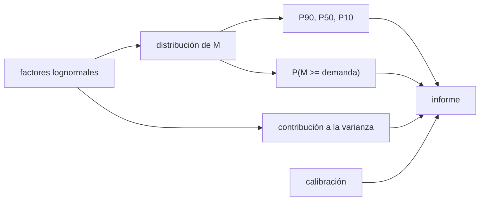

# B67-C08 — Informe de disponibilidad de volátiles con incertidumbre

<!-- nav:top -->
[🏠 Programa](../../../../README.md) · [📚 Bloque B67](../../../tronco-comun/B67-prospeccion-y-evaluacion-de-reservas-de-recursos-extraterrestres.md) · [← Anterior: B67-C07 — Sensores para volátiles: espectrometría de neutrones y de masas](../B67-C07-sensores-para-volatiles-espectrometria-de-neutrones-y-de-masas/CLASE.md) · [Siguiente: B68-C01 — Desorción térmica de hielos interestelares →](../../B68/B68-C01-desorcion-termica-de-hielos-interestelares/CLASE.md)
<!-- /nav -->

## 1. Ubicación, nivel y alcance

Clase 8 del bloque B67 y cierre del bloque. Nivel N3. Reúnes lo anterior (área, espesor, densidad, fracción de hielo, accesibilidad, recuperación y pérdida) en una **distribución de la masa disponible**, la resumes con percentiles, calculas la probabilidad de cubrir una demanda, ves qué factor domina la incertidumbre, compruebas la calibración de los intervalos y generas el texto de un informe. Usas [B12](../../../tronco-comun/B12-probabilidad-estadistica-e-incertidumbre.md). Todo es **sintético**.

## 2. Por qué esta clase existe

Un informe que da un único número invita a decisiones frágiles; uno que da un intervalo mal calibrado, también. La decisión central: **¿qué cifras y qué advertencias debe llevar un informe de disponibilidad para que quien decide sepa cuánto puede confiar en él?**

## 3. Lo que podrás hacer al terminar

1. Combinar factores lognormales independientes en una distribución de la masa.
2. Calcular P90, P50 y P10 de forma analítica y por Monte Carlo.
3. Calcular la probabilidad de superar una demanda.
4. Atribuir la varianza de la masa a cada factor.
5. Comprobar la calibración de un intervalo y mostrar qué pasa si se subestima la incertidumbre.
6. Redactar un informe con alcance, método, resultado, dominantes y límites.

La evidencia es la **ficha del informe de disponibilidad con incertidumbre** del ejercicio 12 (sección 20).

## 4. Con qué llegas y cómo comprobarlo

1. ¿Qué es una distribución lognormal?
2. ¿Qué es un percentil?
3. ¿Qué es la calibración de un intervalo?
4. ¿Qué es la varianza explicada por un factor?
5. ¿Qué es un resultado sintético?

<details>
<summary>Ver respuestas</summary>

1. Aquella cuyo logaritmo es normal; el producto de lognormales independientes es lognormal. 2. El valor bajo el cual queda una fracción dada de la distribución. 3. Que contenga el valor verdadero con la frecuencia que declara. 4. La parte de la varianza total que se debe a él. 5. Uno obtenido con datos inventados, no medidos.
</details>

Con cuatro o cinco aciertos, sigue; si no, repasa los prerrequisitos.

## 5. Un caso de contexto y casos de referencia

Siete factores sintéticos con medianas y sigmas logarítmicas inventadas dan una masa disponible de mediana `147,74 kt` con `σ_ln = 0,2867`: `P90 = 102,3 kt`, `P50 = 147,7 kt`, `P10 = 213,3 kt`; la probabilidad de disponer de al menos `150 kt` es `47,9 %`. Es el **ejemplo conductor**; todo es **sintético**. Como ejemplo de cómo se reporta una medición con incertidumbre, el resumen de Colaprete et al. (2010), obtenido por búsqueda web, informa para el impacto del LCROSS `155 ± 12 kg` de vapor y hielo de agua en el campo de visión del instrumento y `5,6 ± 2,9 %` en masa de hielo en el regolito del sitio; el texto del artículo no se consultó.

## 6. Vocabulario

**P90** es el valor que la masa supera con probabilidad `90 %` (el lado conservador); **P50**, la mediana; **P10**, el que supera con `10 %`. (Es la convención de este curso, didáctica.) La **disponibilidad** a una demanda `D` es `P(M ≥ D)`. La **contribución a la varianza** de un factor es su `σ²` entre la suma de las `σ²` en la escala logarítmica. La **calibración** de un intervalo es su cobertura empírica frente a su cobertura declarada.

## 7. Modelo mental: la previsión del tiempo con probabilidad

Una previsión que dice «lloverá el 30 %» solo es útil si, de los días en que lo dice, llueve cerca del 30 %. Un informe de disponibilidad es lo mismo: sus percentiles valen si están calibrados.



*Descripción textual:* los factores se combinan en una distribución de la masa; de ella salen los percentiles, la disponibilidad y la atribución de varianza; la calibración comprueba que los intervalos son honestos y todo converge en el informe.

Analogía: la previsión del tiempo con probabilidad. Límite: factores independientes y lognormales, sin correlación espacial, costo ni calendario; un informe real exige además una declaración de la persona competente y la norma aplicable.

## 8. La explicación, paso a paso

### 8.1 Distribución analítica

Si `M` es el producto de factores lognormales independientes, `ln M` es normal con media `Σ ln(mediana_i)` y varianza `Σ σ_i²`. Aquí `μ = 18,8110` (en `ln kg`) y `σ_ln = 0,2867`; la mediana es `147,74 kt`.

### 8.2 Percentiles: analítico y Monte Carlo

| Percentil | analítico (kt) | Monte Carlo (kt) | diferencia relativa |
|---|---|---|---|
| P10 | 213,34 | 213,35 | 0,002 % |
| P50 | 147,74 | 147,85 | 0,071 % |
| P90 | 102,31 | 102,55 | 0,234 % |

Con `N = 400 000` (semilla 6708). La disponibilidad de `150 kt` es `47,89 %` analítica y `47,97 %` por Monte Carlo.

### 8.3 Qué domina la incertidumbre

| Factor | contribución analítica | correlación² MC |
|---|---|---|
| A (área) | 0,49 % | 0,50 % |
| h (espesor) | 27,37 % | 27,48 % |
| ρ (densidad) | 3,04 % | 2,98 % |
| w (fracción de hielo) | 48,66 % | 48,44 % |
| f_acc | 12,17 % | 12,14 % |
| f_rec | 7,79 % | 7,57 % |
| f_ret | 0,49 % | 0,51 % |

La fracción de hielo y el espesor explican el `76 %` de la incertidumbre: son los factores en que más rinde medir mejor.

### 8.4 Calibración

Si la observación tiene error lognormal `σ_o = 0,30` y se declara un intervalo central de `80 %` (`±1,2816 σ_o`), la cobertura empírica es `80,08 %`. Si se declara la mitad de la incertidumbre real, la cobertura cae a `47,97 %`: el intervalo parece preciso pero acierta menos de la mitad de las veces.

### 8.5 El informe generado

El laboratorio genera un texto con cinco secciones (alcance y datos, método, resultado con incertidumbre, qué domina, límites), rotula el bloque como sintético y verifica que `P10 > P50 > P90`. El texto íntegro está en la sección 17.

## 9. Magnitudes, símbolos y unidades

| Símbolo | Qué es | Unidad | Valor / nota |
|---|---|---|---|
| `M` | masa disponible | kt | mediana 147,74 |
| `μ`, `σ_ln` | parámetros de `ln M` (`M` en kg) | adimensional | 18,8110; 0,2867 |
| `P90`, `P50`, `P10` | percentiles de superación | kt | 102,3; 147,7; 213,3 |
| `D` | demanda | kt | 150 |
| `σ_o` | error de observación | adimensional (log) | 0,30 |

## 10. Convenciones y referencias

Percentiles de superación (P90 = superado con 90 %). Factores lognormales independientes; `M = A h ρ w f_acc f_rec f_ret`. Semilla `6708`, `N = 400 000`. Versiones: Python 3.12.9, numpy 2.4.4. Tolerancias: percentiles analítico frente a Monte Carlo dentro de `1 %`; disponibilidad dentro de `0,5` puntos; cobertura del intervalo al 80 % dentro de `1` punto.

## 11. De dónde sale lo que afirmamos

| ID | Fuente | Localizador | Respalda | Estado |
|---|---|---|---|---|
| S1 | A. Colaprete et al., «Detection of Water in the LCROSS Ejecta Plume», *Science* 330, 463–468 (2010) | resultados de búsqueda web del 2026-11-09 (resumen) | un ejemplo de reporte de una medición de volátiles con incertidumbre: `155 ± 12 kg` y `5,6 ± 2,9 %` en masa | Solo resumen vía búsqueda web, el 2026-11-09; el texto del artículo no se consultó |

Límites: de S1 solo se tomaron las cifras que dio un resumen secundario, y solo como ejemplo de formato de reporte; la convención P90/P50/P10, la lognormalidad y todos los valores de los factores son didácticos e inventados; no se consultó ninguna norma de reporte de recursos o reservas.

## 12. Cómo ver la disponibilidad

| Magnitud | Valor |
|---|---|
| P90 / P50 / P10 | 102,3 / 147,7 / 213,3 kt |
| P(M ≥ 150 kt) | 47,9 % |
| factores dominantes | w 48,7 %; h 27,4 % |
| cobertura al 80 % con incertidumbre a la mitad | 48,0 % |

Descripción larga: el rango entre P90 y P10 es de más del doble, y casi tres cuartas partes de esa amplitud se deben a dos factores medibles.

## 13. Ejemplo trabajado: los percentiles

**Paso 1 · Mediana.** `4 × 10⁶ · 2 · 1500 · 0,027 · 0,6 · 0,8 · 0,95 = 1,4774 × 10⁸ kg = 147,74 kt`.

**Paso 2 · Sigma.** `√(0,02² + 0,15² + 0,05² + 0,20² + 0,10² + 0,08² + 0,02²) = √0,0822 = 0,2867`.

**Paso 3 · Factor de percentil.** `e^(1,2816 · 0,2867) = 1,444`.

**Paso 4 · P10 y P90.** `147,74 · 1,444 = 213,3 kt`; `147,74/1,444 = 102,3 kt`.

## 14. Distintas formas de describir la disponibilidad

**Por percentiles:** P90, P50 y P10. **Por probabilidad:** `P(M ≥ D)`. **Por varianza:** contribución de cada factor. **Por texto:** informe con alcance, método, resultado y límites.

## 15. Práctica guiada

**Ejercicio 1 · con los pasos indicados.** Calcula `σ_ln` si solo hubiera tres factores con `σ = 0,15; 0,20; 0,10`. *Pasos:* suma de cuadrados.

<details><summary>Solución comentada</summary>

`√(0,0225 + 0,04 + 0,01) = √0,0725 = 0,269`.
</details>

**Ejercicio 2 · con una pista.** Calcula P10 si la mediana es `100 kt` y `σ_ln = 0,3`. *Pista:* multiplica por `e^(1,2816 σ)`.

<details><summary>Solución comentada</summary>

`100 · e^(0,3845) = 146,9 kt`.
</details>

**Ejercicio 3 · casi autónomo.** ¿Por qué P90 es menor que P50?

<details><summary>Solución comentada</summary>

Porque P90 es el valor superado con `90 %` de probabilidad: queda en la cola baja.
</details>

## 16. Práctica autónoma, transferencia e integrador

**Ejercicio 4 · autónomo.** Calcula P90 para la mediana `147,74 kt` y `σ_ln = 0,2867`.

<details><summary>Solución comentada</summary>

`147,74/1,444 = 102,3 kt`.
</details>

**Ejercicio 5 · autónomo.** ¿Qué fracción de la varianza explican w y h juntos?

<details><summary>Solución comentada</summary>

`48,66 + 27,37 = 76,03 %`.
</details>

**Ejercicio 6 · autónomo.** Si el espesor se midiera con `σ = 0,05`, ¿cuál sería la nueva `σ_ln`?

<details><summary>Solución comentada</summary>

`√(0,0822 − 0,0225 + 0,0025) = √0,0622 = 0,2494`.
</details>

**Ejercicio 7 · autónomo.** ¿Cuál sería entonces P90?

<details><summary>Solución comentada</summary>

`147,74 · e^(−1,2816 · 0,2494) = 147,74/1,377 = 107,3 kt`.
</details>

**Ejercicio 8 · autónomo.** Explica la cobertura de `47,97 %` cuando se declara la mitad de la incertidumbre.

<details><summary>Solución comentada</summary>

Un intervalo `±1,28 σ_o/2` equivale a `±0,64 σ_o` reales: cubre solo ≈ `48 %`.
</details>

**Ejercicio 9 · transferencia.** Quien decide pide «un solo número». ¿Qué le entregas?

<details><summary>Solución comentada</summary>

P50 con su rango P90–P10 y la probabilidad de cubrir su demanda, advirtiendo que un solo número oculta la dispersión.
</details>

**Ejercicio 10 · transferencia.** La correlación entre espesor y fracción de hielo es positiva. ¿Qué cambia?

<details><summary>Solución comentada</summary>

La varianza de `ln M` aumenta (se suman covarianzas) y los percentiles se separan; el modelo independiente subestima la incertidumbre.
</details>

**Ejercicio 11 · transferencia.** Se detecta que `f_rec` se tomó de un caso favorable. ¿Qué haces con el informe?

<details><summary>Solución comentada</summary>

Reportarlo como supuesto, volver a calcular con un rango más amplio y marcar el resultado como condicionado a ese supuesto.
</details>

**Ejercicio 12 · integrador.** Elabora tu *ficha del informe de disponibilidad con incertidumbre*: percentiles, disponibilidad, dominantes, calibración y el texto del informe.

<details><summary>Solución comentada</summary>

Secciones 8.1–8.5 y la salida de la sección 17.
</details>

## 17. Laboratorio: de los factores al informe con P90, P50 y P10

El script [informe.py](informe.py) combina siete factores, calcula percentiles, disponibilidad, varianza y calibración y genera el informe (**comprueba** analítico frente a Monte Carlo, la suma de contribuciones, la cobertura y las secciones del texto).

**Datos:** siete factores sintéticos; semilla 6708. **Predice antes de ejecutar:** ¿qué factor dominará la incertidumbre? (la fracción de hielo.) **Ejecución del 2026-11-09 (Python 3.12.9, numpy 2.4.4):**

```text
Python 3.12.9 ; numpy 2.4.4
DATOS SINTETICOS: medianas e incertidumbres inventadas para la clase
mu(ln M[kg]) = 18.8110 ; sigma_ln = 0.2867 ; mediana = 147.74 kt
percentil   analitico [kt]   Monte Carlo [kt]   diferencia relativa
  P10           213.34           213.35          0.002 %
  P50           147.74           147.85          0.071 %
  P90           102.31           102.55          0.234 %
Disponibilidad para 150 kt: analitica 47.89 % ; Monte Carlo 47.97 %
Contribucion a la varianza de ln M (analitica / correlacion^2 con ln M en MC):
  A        0.49 %  /    0.50 %
  h       27.37 %  /   27.48 %
  rho      3.04 %  /    2.98 %
  w       48.66 %  /   48.44 %
  f_acc   12.17 %  /   12.14 %
  f_rec    7.79 %  /    7.57 %
  f_ret    0.49 %  /    0.51 %
Calibracion del intervalo central al 80 % con error de medida sigma_ln = 0.3: cobertura = 80.08 %
Con la incertidumbre declarada a la mitad, la cobertura cae a 47.97 %
---- informe generado ----
# Informe de disponibilidad de volatiles - BLOQUE SINTETICO
## 1. Alcance y datos
Datos SINTETICOS inventados; no describen ningun sitio real. Unidades: kt de hielo disponible.
## 2. Metodo
Producto de 7 factores lognormales independientes; solucion analitica y Monte Carlo.
## 3. Resultado con incertidumbre
P90 = 102.3 kt ; P50 = 147.7 kt ; P10 = 213.3 kt (superacion con 90 %, 50 %, 10 %).
Probabilidad de disponer de al menos 150 kt: 47.9 %.
## 4. Que domina la incertidumbre
w: 48.7 %; h: 27.4 %; f_acc: 12.2 % de la varianza de ln M.
## 5. Limites
Factores independientes y lognormales; sin correlacion espacial; sin costo ni calendario.
---- fin del informe ----
Pruebas superadas.
```

```bash
python programa/clases/B67/B67-C08-informe-de-disponibilidad-de-volatiles-con-incertidumbre/informe.py
```

**Límites:** factores independientes y lognormales; el informe es una plantilla didáctica.

## 18. Errores frecuentes y cómo corregirlos

**Reportar solo la mediana.** Se corrige con 8.2.

**Invertir P90 y P10.** Se corrige con la sección 6.

**Declarar intervalos más angostos de lo que el dato permite.** Se corrige con 8.4.

**Presentar el bloque sintético como un depósito.** Se corrige con la sección 21.

## 19. Cómo sabrás que vas bien

Tras 8.2: ¿qué resultado esperabas y cuál obtuviste? Si dudas, repasa el ejemplo 13. Tras el laboratorio: ¿qué comprueba cada `assert`? (ver la sección 17).

## 20. Qué entregas y cómo se evalúa

El producto es tu **ficha del informe de disponibilidad con incertidumbre** (ejercicio 12).

| Criterio | Inicial | En desarrollo | Logrado | Destacado |
|---|---|---|---|---|
| Conceptos | Los confunde | Parciales | Conceptos de la clase con sus condiciones | Explica los límites del modelo |
| Cálculo | Sin unidades | Con errores | Tablas completas con unidades | Calcula casos nuevos |
| Numérico | Sin comprobar | Un caso | Contraste con la solución analítica o con la simulación | Interpreta las diferencias |
| Fuentes | Sin fuente | Sin fecha | Fuentes con fecha de consulta | Declara lo no consultado |
| Límites | No los nombra | Uno | Tres | Discute qué falta del modelo |

**Condiciones críticas (no se compensan con promedio):** rotular los datos como sintéticos; no presentar lo simulado como observado; no inferir reservas de ningún sitio real; citar solo lo consultado.

## 21. Ética, seguridad y límites

Clase educativa: los modelos son simplificados y los datos son sintéticos; no se estima, certifica ni reporta ninguna reserva real, ni se evalúa un sitio o una empresa concretos. Este informe no es una declaración de reservas ni cumple ninguna norma de reporte; solo enseña a escribir con incertidumbre. Accesibilidad: tablas equivalentes a las gráficas, fórmulas en texto, ejercicios sin conexión.

## 22. Para cerrar y seguir

Un bloque sintético tiene `102 / 148 / 213 kt` (P90/P50/P10), una probabilidad de `47,9 %` de cubrir `150 kt`, y su incertidumbre la dominan dos factores medibles. Con esto termina el bloque: de elegir un sitio a reportar lo que hay, con la incertidumbre a la vista.

**Glosario español–inglés.** percentil de superación · *exceedance percentile*; disponibilidad · *availability*; calibración · *calibration*; lognormal · *lognormal*; informe técnico · *technical report*.

**Continuidad.** Esta es la última clase del bloque B67; la continuidad es el siguiente bloque del programa.

**Referencias:** ver sección 11.

<!-- nav:bottom -->
---

[← Anterior: B67-C07 — Sensores para volátiles: espectrometría de neutrones y de masas](../B67-C07-sensores-para-volatiles-espectrometria-de-neutrones-y-de-masas/CLASE.md) · [📚 Bloque B67](../../../tronco-comun/B67-prospeccion-y-evaluacion-de-reservas-de-recursos-extraterrestres.md) · [Siguiente: B68-C01 — Desorción térmica de hielos interestelares →](../../B68/B68-C01-desorcion-termica-de-hielos-interestelares/CLASE.md)
<!-- /nav -->
