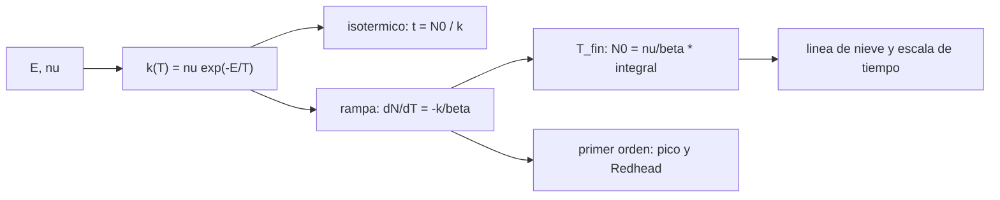

# B68-C01 — Desorción térmica de hielos interestelares

<!-- nav:top -->
[🏠 Programa](../../../../README.md) · [📚 Bloque B68](../../../tronco-comun/B68-quimica-de-granos-y-hielos-interestelares.md) · [← Anterior: B67-C08 — Informe de disponibilidad de volátiles con incertidumbre](../../B67/B67-C08-informe-de-disponibilidad-de-volatiles-con-incertidumbre/CLASE.md) · [Siguiente: B68-C02 — Fotodesorción de hielos interestelares →](../B68-C02-fotodesorcion-de-hielos-interestelares/CLASE.md)
<!-- /nav -->

## 1. Ubicación, nivel y alcance

Clase 1 del bloque B68. Nivel N3. Antes de esta clase sabes que los granos de polvo interestelar se cubren de hielos (la clase B55-C05 los presenta como parte de la materia del medio interestelar). Aquí aprendes **cuándo y con qué rapidez un hielo vuelve al gas por calor**: la ecuación de Polanyi–Wigner de orden cero y de orden uno, el tiempo de residencia, la desorción programada por temperatura (TPD) y el efecto de la incertidumbre de la energía de enlace. Usas álgebra y exponenciales ([B10](../../../tronco-comun/B10-algebra-lineal-y-matematicas-geometricas.md)). La clase no modela ninguna nube real: usa parámetros publicados de laboratorio y ejemplos sintéticos rotulados.

## 2. Por qué esta clase existe

Un hielo de CO que dura mil millones de años a 15 K desaparece en un segundo a 30 K. Esa sensibilidad exponencial decide dónde está la «línea de nieve» de cada molécula y qué hay en el gas. La decisión central: **¿a qué temperatura y en cuánto tiempo se evapora un hielo, y cuánta incertidumbre arrastra ese número?**

## 3. Lo que podrás hacer al terminar

1. Escribir la tasa de desorción de orden cero y de orden uno con sus unidades.
2. Calcular el tiempo de residencia isotérmico de una capa de hielo.
3. Simular una TPD con rampa lineal y hallar la temperatura en que se agota la película, con una vía cerrada y otra numérica.
4. Estimar cuánto cambia esa temperatura si la energía de enlace o la velocidad de calentamiento cambian.
5. Recuperar una energía de enlace desde el pico de una TPD de primer orden con la aproximación de Redhead.
6. Explicar por qué una temperatura de laboratorio no es la temperatura de sublimación de una nube.

La evidencia es la **ficha de la desorción térmica** del ejercicio 12 (sección 20).

## 4. Con qué llegas y cómo comprobarlo

1. ¿Qué es una exponencial decreciente?
2. ¿Qué es una energía expresada en kelvin (`E/k_B`)?
3. ¿Qué es una monocapa (ML)?
4. ¿Qué es una integración numérica con paso fijo?
5. ¿Qué es un valor sintético?

<details>
<summary>Ver respuestas</summary>

1. Una función `e^(-x)` que baja con rapidez creciente al aumentar `x`. 2. La energía dividida por la constante de Boltzmann: un número en K. 3. Una capa de moléculas que cubre la superficie; aquí, por convención, `1e15` moléculas cm⁻². 4. Avanzar la solución en pasos pequeños de tamaño constante. 5. Un valor propuesto para el ejemplo, no medido.
</details>

Con cuatro o cinco aciertos, sigue; si no, repasa los prerrequisitos.

## 5. Un caso de contexto y casos de referencia

Un experimento de ultra alto vacío deposita 10 ML de CO a 10 K y calienta a `0,2 K s⁻¹`. El estudio de Kruczkiewicz y colaboradores (2024) ajusta la desorción de capa múltiple de orden cero con una energía de enlace de `1040 ± 104 K` y un factor `8,7 × 10¹⁴ ML s⁻¹`. Con esos números, la película de CO se agota cerca de los `31 K`. Es el **ejemplo conductor**. El espesor y la rampa son los del experimento citado; el espesor de 10 ML en este ejemplo es **sintético** (el estudio usa 1,6 ML para el CO puro) y se rotula así.

## 6. Vocabulario

La **desorción** es el paso de una molécula del hielo al gas. La **energía de enlace** `E` (en K) es la energía que ata la molécula a la superficie dividida por `k_B`. El **factor preexponencial** `ν` es la frecuencia de intento (en ML s⁻¹ para orden cero, en s⁻¹ para orden uno). El **orden cero** significa que la tasa no depende de cuánto hielo queda (capa múltiple: solo desorbe la superficie); el **orden uno**, que es proporcional a lo que queda (submonocapa). La **TPD** (desorción programada por temperatura) calienta con rampa lineal `T = T₀ + βt` y mide la tasa de salida. El **tiempo de residencia** es el inverso de la tasa.

## 7. Modelo mental: un balde con un agujero que se agranda

Imagina un balde con un agujero que se agranda exponencialmente con la temperatura. En orden cero el agujero deja salir un caudal fijo, sin importar el nivel: el balde se vacía de golpe cuando el agujero es suficiente. En orden uno el caudal baja con el nivel y el vaciado es exponencial.



*Descripción textual:* de la energía y el factor sale la tasa; con ella se calcula el tiempo isotérmico o, con una rampa, la temperatura en que se agota la película, y de ahí la escala de tiempo astrofísica.

Límite de la analogía: un hielo real tiene poros, mezclas y cambio de fase (el agua amorfa cristaliza cerca de 154 K según Kruczkiewicz y colaboradores), y el agujero no es el mismo para cada molécula.

## 8. La explicación, paso a paso

### 8.1 La tasa de desorción

La probabilidad por unidad de tiempo de que una molécula escape es `k(T) = ν e^(-E/T)`, con `E` en K y `T` en K. En orden cero (capa múltiple) la tasa de pérdida es `-dN/dt = k₀(T) = ν e^(-E/T)` en ML s⁻¹: no depende de `N` mientras quede hielo. En orden uno `-dN/dt = ν₁ e^(-E/T) N`. Para una película de `N₀` ML a temperatura constante, el tiempo de residencia de orden cero es `t = N₀ / k₀`.

| `T` (K) | `t` para 1 ML de CO (s) |
|---|---|
| 15 | 1,484 × 10¹⁵ |
| 20 | 4,403 × 10⁷ |
| 25 | 1,340 × 10³ |
| 30 | 1,306 |

De 15 K a 30 K el tiempo cae 15 órdenes de magnitud; a 15 K equivale a unos 47 millones de años (`1,484 × 10¹⁵ s`) y a 20 K a un año y medio.

### 8.2 La rampa lineal (TPD)

Con `T = T₀ + βt`, la ecuación es `dN/dT = -(ν/β) e^(-E/T)`. Para orden cero hay una solución cerrada: `∫ e^(-E/T') dT' = F(T) = T e^(-E/T) − E·E₁(E/T)`, donde `E₁` es la integral exponencial. La película de `N₀` ML se agota cuando `N₀ = (ν/β)[F(T) − F(T₀)]`. Esa condición se resuelve por bisección. La vía independiente integra `dN/dT` con Runge–Kutta de cuarto orden y paso de 0,002 K. En orden cero la tasa crece de forma exponencial hasta que la película se acaba, de modo que el pico y el final coinciden y la caída es abrupta.

| Especie | `E` (K) | `ν` (ML s⁻¹) | `T_fin` cerrada (K) | `T_fin` RK4 (K) |
|---|---|---|---|---|
| CO | 1040 | 8,7 × 10¹⁴ | 30,980 | 30,980 |
| CH₃OH | 5531 | 8,8 × 10¹⁶ | 139,890 | 139,890 |
| H₂O (amorfa) | 6638 | 8,7 × 10¹⁷ | 158,430 | 158,430 |

Las dos vías difieren menos de `3 × 10⁻⁷ K`: la integral y la ecuación diferencial coinciden. Los valores de `E` y `ν` son los de capa múltiple de orden cero de Kruczkiewicz y colaboradores (2024), que informan una incertidumbre de `±96` a `±253 K` según la especie; el espesor de 10 ML es sintético.

### 8.3 Cuánto pesa la incertidumbre

Con `E` nominal del CO, `T_fin = 30,98 K`. Si `E` baja un 10 % (a 936 K), `T_fin = 27,97 K`; si sube un 10 %, `33,99 K`: un intervalo de 6 K para una variación que ya es del orden de la incertidumbre publicada (`±104 K`, 10 %). La velocidad de calentamiento pesa menos: de `0,02` a `0,2` a `2 K s⁻¹`, `T_fin` va de `29,09` a `30,98` y a `33,12 K`, unos 2 K por década de `β`.

### 8.4 Primer orden y la aproximación de Redhead

Si el hielo es una submonocapa, la tasa es proporcional a `N`. El máximo de la TPD cumple, con buena aproximación, `E = T_p [ln(ν₁ T_p/β) − 3,46]` (aproximación de Redhead, relación estándar que **no se consultó** y que el laboratorio verifica). Con una TPD sintética de `E = 1040 K` y `ν₁ = 10¹³ s⁻¹` (sintéticos), el pico sale a `32,927 K` y la fórmula devuelve `1039,7 K`: error `0,02 %`.

### 8.5 De la TPD a la escala de tiempo astrofísica

Una nube vive del orden de `10⁶` años (escala **sintética** para este ejemplo). Pedir que 1 ML dure ese tiempo da `T = E / ln(ν t)`: para el CO de Kruczkiewicz y colaboradores `15,88 K`; con el CO de Minissale y colaboradores (1390 K; `9,14 × 10¹⁴ s⁻¹`, valores que esa misma tabla cita) `21,21 K`; con el agua de Fraser y colaboradores (`5773 K`; `10³⁰ molec cm⁻² s⁻¹`, es decir `10¹⁵ ML s⁻¹` con la convención de 1 ML) `88,0 K`. Dos conjuntos de parámetros publicados para la misma molécula difieren 5,3 K en la temperatura de sublimación: esa es la incertidumbre honesta.

### 8.6 Lectura

El cálculo de laboratorio da `31 K` para el CO, y el astrofísico `16–21 K`. No hay contradicción: la rampa de `0,2 K s⁻¹` termina en segundos y la nube dispone de millones de años. Citar la temperatura de una TPD como «temperatura de sublimación» sin decir la escala de tiempo es un error de lectura.

## 9. Magnitudes, símbolos y unidades

| Símbolo | Qué es | Unidad | Valor / nota |
|---|---|---|---|
| `E` | energía de enlace sobre `k_B` | K | CO 1040; CH₃OH 5531; H₂O amorfa 6638 |
| `ν` | factor preexponencial de orden cero | ML s⁻¹ | `8,7 × 10¹⁴` (CO) |
| `ν₁` | factor de orden uno | s⁻¹ | `10¹³` (sintético) |
| `β` | velocidad de calentamiento | K s⁻¹ | 0,2 |
| `N` | espesor | ML | 1 ML = `10¹⁵` moléculas cm⁻² (convención) |
| `T_fin` | temperatura en que se agota la película | K | 30,98 (CO, 10 ML) |
| `t` | tiempo de residencia | s | 1,340 × 10³ (1 ML de CO a 25 K) |

## 10. Convenciones y referencias

Temperaturas en kelvin; energías divididas por `k_B` (`k_B = 1,380 649 × 10⁻²³ J K⁻¹`, exacta, CODATA 2022 consultada el 2026-11-09); `E` en J mol⁻¹ se obtiene con `R = 8,314 462 618 J mol⁻¹ K⁻¹`. Sistema de referencia: no aplica (química del estado sólido); la rampa es lineal y homogénea.

## 11. De dónde sale lo que afirmamos

| ID | Fuente | Localizador | Respalda | Consulta | Estado |
|---|---|---|---|---|---|
| S1 | Kruczkiewicz et al., *Comprehensive laboratory constraints on thermal desorption of interstellar ice analogues*, A&A (2024) | arXiv:2404.02695, texto completo, Tabla 3 y §4.2 | `E`, `ν` de CO, CH₃OH y agua amorfa; `β = 0,2 K s⁻¹`; ecuación `k = ν exp(−E/RT)`; cristalización a ~154 K | 2026-11-09 | Consultada (PDF) |
| S2 | Fraser, Collings, McCoustra y Williams, *Thermal desorption of water-ice in the interstellar medium*, MNRAS 327, 1165 (2001) | arXiv:astro-ph/0107487 | orden cero; `E = 5773 ± 60 K`; `A = 10^(30±2) molec cm⁻² s⁻¹` | 2026-11-09 | Solo resumen |
| S3 | NIST, CODATA 2022 | physics.nist.gov/cuu/Constants/Table/allascii.txt | `k_B`, `R` | 2026-11-09 | Consultada |
| S4 | Garrod y Herbst, A&A (2006) | arXiv:astro-ph/0607560 | contexto: los hielos se evaporan al calentarse el gas de 10 K a más de 100 K | 2026-11-09 | Solo resumen |

Límites: los valores de `E` y `ν` de la fila S1 son los de la tabla de capa múltiple; la aproximación de Redhead no se consultó y la verifica el laboratorio; el CO de Minissale y colaboradores se cita tal como aparece en la Tabla 3 de S1, sin consultar su artículo.

## 12. Cómo ver la desorción térmica

| Magnitud | Valor |
|---|---|
| `T_fin` del CO (10 ML, 0,2 K/s) | 30,98 K |
| Variación de `T_fin` con `E ± 10 %` | −3,0 K / +3,0 K |
| Error de Redhead (sintético) | 0,02 % |
| `T` de vida de 1 ML = 10⁶ años (CO) | 15,88 K |

Descripción larga: la tasa crece exponencialmente con `T`; una TPD de orden cero es una curva que sube y cae de golpe, y desplazar la energía desplaza toda la curva casi sin cambiar su forma.

## 13. Ejemplo trabajado: 1 ML de CO a 25 K

**Paso 1 · Exponente.** `E/T = 1040/25 = 41,6`.

**Paso 2 · Tasa.** `k₀ = 8,7 × 10¹⁴ · e^(−41,6) = 8,7 × 10¹⁴ · 8,57 × 10⁻¹⁹ = 7,5 × 10⁻⁴ ML s⁻¹`.

**Paso 3 · Tiempo.** `t = 1 / 7,5 × 10⁻⁴ = 1,34 × 10³ s`, unos 22 minutos.

**Paso 4 · Verificación.** La tabla de 8.1 da `1,340 × 10³ s`.

## 14. Distintas formas de describir la desorción

**Isotérmica:** tiempo de residencia a `T` fija. **Con rampa:** temperatura de agotamiento y pico. **Por orden:** cero (capa múltiple) frente a uno (submonocapa). **Por escala de tiempo:** laboratorio (segundos) frente a nube (millones de años).

## 15. Práctica guiada

**Ejercicio 1 · con los pasos indicados.** Calcula la tasa de orden cero de 1 ML de CO a 20 K. *Pasos:* `E/T`, exponencial, producto con `ν`.

<details><summary>Solución comentada</summary>

`E/T = 52`; `e^(−52) = 2,6 × 10⁻²³`; `k₀ = 2,3 × 10⁻⁸ ML s⁻¹`; el tiempo es `4,4 × 10⁷ s` (1,4 años), como la tabla de 8.1.
</details>

**Ejercicio 2 · con una pista.** Fraser y colaboradores dan `A = 10³⁰ molec cm⁻² s⁻¹`. Exprésalo en ML s⁻¹. *Pista:* 1 ML = `10¹⁵` moléculas cm⁻².

<details><summary>Solución comentada</summary>

`10³⁰ / 10¹⁵ = 10¹⁵ ML s⁻¹`. Depende de la convención de monocapa, por eso se declara.
</details>

**Ejercicio 3 · casi autónomo.** ¿A qué temperatura 1 ML de CO (Kruczkiewicz) dura `10⁶` años?

<details><summary>Solución comentada</summary>

`t = 3,156 × 10¹³ s`; `ν t = 2,75 × 10²⁸`; `ln = 65,48`; `T = 1040 / 65,48 = 15,88 K`.
</details>

## 16. Práctica autónoma, transferencia e integrador

**Ejercicio 4.** ¿Qué amplitud tiene el intervalo de `T_fin` del CO si `E` varía `±10 %`?

<details><summary>Solución comentada</summary>

`33,99 − 27,97 = 6,02 K` (sección 8.3).
</details>

**Ejercicio 5.** ¿Cuánto separa las `T_fin` del metanol y del agua amorfa?

<details><summary>Solución comentada</summary>

`158,43 − 139,89 = 18,5 K`.
</details>

**Ejercicio 6.** Tiempo de residencia de orden uno a 20 K con `E = 1040 K` y `ν₁ = 10¹³ s⁻¹` (sintético).

<details><summary>Solución comentada</summary>

`τ = e^(52) / 10¹³ = 3,8 × 10²² / 10¹³ = 3,8 × 10⁹ s`, unos 120 años.
</details>

**Ejercicio 7.** ¿Cuánto difieren las temperaturas de sublimación a `10⁶` años del CO con los dos juegos de parámetros?

<details><summary>Solución comentada</summary>

`21,21 − 15,88 = 5,3 K`.
</details>

**Ejercicio 8.** ¿Cuánto sube `T_fin` del CO al pasar de `β = 0,2` a `2 K s⁻¹`?

<details><summary>Solución comentada</summary>

`33,12 − 30,98 = 2,1 K`.
</details>

**Ejercicio 9 · transferencia.** **Transferencia.** Un colega dice «el CO se sublima a 31 K en las nubes». Responde con los números de la clase.

<details><summary>Solución comentada</summary>

31 K es el final de una rampa de segundos con 10 ML; con `10⁶` años, 1 ML dura solo hasta unos 16–21 K según los parámetros. Hay que declarar la escala de tiempo.
</details>

**Ejercicio 10 · transferencia.** **Transferencia.** Kruczkiewicz y colaboradores informan que el hielo de agua compacto atrapa hasta ~20 % de CO relativo a su agua. ¿Cómo afecta eso a leer una TPD?

<details><summary>Solución comentada</summary>

Una parte del CO sale en la cristalización del agua (~154 K) y no a 30 K; un modelo de capa múltiple pura subestimaría el CO que permanece en el hielo.
</details>

**Ejercicio 11 · transferencia.** **Transferencia.** ¿Por qué no se ajusta orden cero a una submonocapa?

<details><summary>Solución comentada</summary>

Porque con pocas moléculas la tasa depende de cuántas quedan: es de orden uno (sección 6 y 8.4).
</details>

**Ejercicio 12.** **Integrador.** Elabora tu *ficha de la desorción térmica*: parámetros con fuente, tabla de tiempos isotérmicos, `T_fin` por dos vías y su sensibilidad, y la lectura a escala astrofísica.

<details><summary>Solución modelo</summary>

Secciones 8.1–8.6, con unidades en cada cifra y el rótulo «sintético» para el espesor y las escalas de tiempo.
</details>

## 17. Laboratorio: TPD y tiempos de residencia

El script [desorcion.py](desorcion.py) calcula la tasa de Polanyi–Wigner, la `T_fin` por la integral cerrada con `E₁` y por RK4, la sensibilidad a `E` y a `β`, la aproximación de Redhead y las temperaturas de vida de `10⁶` años (**comprueba** `E₁` contra valores tabulados, la diferencia cerrada–RK4 < 10⁻³ K y el error de Redhead < 5 %).

**Datos:** parámetros de S1 y S2; todo lo demás **sintético**. **Predice antes de ejecutar:** ¿qué `T_fin` tendrá el CO con `E` un 10 % menor? (menor, cerca de 28 K.) **Ejecución del 2026-11-09 (Python 3.12.9):**

```text
Python 3.12.9 (biblioteca estandar)
E1(2) = 0.0489005107 (tabulado 0.0489005107) ; E1(10) = 4.156969e-06 (tabulado 4.156969e-06)
TPD de orden cero, 10 ML, beta = 0.2 K/s (parametros de Kruczkiewicz 2024, Tabla 3)
       especie   E [K]  nu [ML/s]  T_fin cerrado [K]  T_fin RK4 [K]  |dif| [K]
            CO    1040   8.70e+14            30.9803        30.9803   2.71e-07
         CH3OH    5531   8.80e+16           139.8896       139.8896   8.54e-08
  H2O (amorfa)    6638   8.70e+17           158.4303       158.4303   6.69e-08
Tiempo isotermico de 1 ML de CO (E = 1040 K, nu = 8.7e14 ML/s):
  T =   15 K -> t = 1.484e+15 s
  T =   20 K -> t = 4.403e+07 s
  T =   25 K -> t = 1.340e+03 s
  T =   30 K -> t = 1.306e+00 s
Sensibilidad de T_fin del CO a E: -10 % -> 27.97 K ; nominal -> 30.98 K ; +10 % -> 33.99 K
T_fin del CO segun beta: 0.02 K/s -> 29.09 K ; 0.2 K/s -> 30.98 K ; 2 K/s -> 33.12 K
Primer orden SINTETICO (E = 1040 K, nu = 1e13 s^-1): T_pico = 32.927 K ; E por Redhead = 1039.7 K ; error = 0.02 %
T con vida de 1 ML = 1e6 anos (SINTETICO): CO Kruczkiewicz = 15.88 K ; CO Minissale (1390 K) = 21.21 K ; H2O Fraser = 88.0 K
Pruebas superadas.
```

```bash
python programa/clases/B68/B68-C01-desorcion-termica-de-hielos-interestelares/desorcion.py
```

**Límites:** especie pura, `ν` constante, sin poros ni cambio de fase, sin atrapamiento.

## 18. Errores frecuentes y cómo corregirlos

**Usar orden uno para una película gruesa.** Se corrige con la sección 6 y 8.1.

**Mezclar ML s⁻¹ con s⁻¹.** Se corrige con la tabla de la sección 9.

**Citar `T_fin` de laboratorio como temperatura de sublimación astrofísica.** Se corrige con 8.5–8.6.

**Olvidar que `E` tiene incertidumbre.** Se corrige con 8.3.

## 19. Cómo sabrás que vas bien

Tras la sección 8: ¿qué resultado esperabas y cuál obtuviste? Si dudas, repasa el ejemplo 13. Tras el laboratorio: ¿por qué dos métodos distintos dan la misma `T_fin`? (ver la sección 17).

## 20. Qué entregas y cómo se evalúa

El producto es tu **ficha de la desorción térmica** (ejercicio 12).

| Criterio | Inicial | En desarrollo | Logrado | Destacado |
|---|---|---|---|---|
| Conceptos | Los confunde | Parciales | orden, `E`, `ν` y rampa | Explica los límites |
| Cálculo | Sin unidades | Con errores | Tablas completas | Calcula casos nuevos |
| Numérico | Sin comprobar | Un método | Dos vías que coinciden | Interpreta las diferencias |
| Fuentes | Sin fuente | Sin fecha | fuentes con fecha | Declara lo no consultado |
| Límites | No los nombra | Uno | Tres | Discute qué falta del modelo |

**Condiciones críticas (no se compensan con promedio):** rotular lo sintético; no presentar un parámetro de laboratorio como universal; citar solo lo consultado.

## 21. Ética, seguridad y límites

Clase educativa: el modelo es de campo medio y de una sola especie. Los criógenos del laboratorio (sección de C04) exigen formación de seguridad propia. Accesibilidad: tablas equivalentes a las gráficas, fórmulas en texto, ejercicios sin conexión.

## 22. Para cerrar y seguir

Una película de CO de 10 ML se agota hacia los `31 K` en una rampa de `0,2 K s⁻¹`, la incertidumbre de `E` mueve ese valor `±3 K` y la escala de tiempo de una nube lo baja a `16–21 K`. Queda una pregunta: ¿cómo sale una molécula del hielo cuando no hay calor, solo luz?

**Glosario español–inglés.** desorción térmica · *thermal desorption*; energía de enlace · *binding energy*; factor preexponencial · *pre-exponential factor*; desorción programada por temperatura · *temperature-programmed desorption (TPD)*; tiempo de residencia · *residence time*.

**Continuidad.** [B68-C02](../B68-C02-fotodesorcion-de-hielos-interestelares/CLASE.md) estudia la fotodesorción.

**Referencias:** ver sección 11.

<!-- nav:bottom -->
---

[← Anterior: B67-C08 — Informe de disponibilidad de volátiles con incertidumbre](../../B67/B67-C08-informe-de-disponibilidad-de-volatiles-con-incertidumbre/CLASE.md) · [📚 Bloque B68](../../../tronco-comun/B68-quimica-de-granos-y-hielos-interestelares.md) · [Siguiente: B68-C02 — Fotodesorción de hielos interestelares →](../B68-C02-fotodesorcion-de-hielos-interestelares/CLASE.md)
<!-- /nav -->
