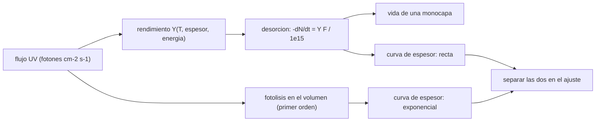

# B68-C02 — Fotodesorción de hielos interestelares

<!-- nav:top -->
[🏠 Programa](../../../../README.md) · [📚 Bloque B68](../../../tronco-comun/B68-quimica-de-granos-y-hielos-interestelares.md) · [← Anterior: B68-C01 — Desorción térmica de hielos interestelares](../B68-C01-desorcion-termica-de-hielos-interestelares/CLASE.md) · [Siguiente: B68-C03 — Irradiación de hielos por rayos cósmicos y UV: radiólisis y productos →](../B68-C03-irradiacion-de-hielos-por-rayos-cosmicos-y-uv-radiolisis-y-productos/CLASE.md)
<!-- /nav -->

## 1. Ubicación, nivel y alcance

Clase 2 del bloque B68. Nivel N3. La clase B68-C01 mostró que a 15 K el CO no se evapora por calor en tiempos astrofísicos, y aun así hay CO en el gas de las nubes frías. Aquí estudias un mecanismo no térmico: la **fotodesorción**, la expulsión de moléculas del hielo por fotones ultravioleta. Calculas rendimientos por fotón, su dependencia de la temperatura, del espesor y de la energía del fotón, la vida de una capa bajo un flujo dado y cómo separar la desorción de la fotólisis en una curva de espesor frente a fluencia. Usas promedios y propagación de incertidumbre. La clase no reproduce ninguna nube: los flujos son sintéticos y los rendimientos son de laboratorio.

## 2. Por qué esta clase existe

Si un hielo de CO a 15 K es estable térmicamente durante millones de años, la presencia de CO gaseoso en regiones frías exige otro mecanismo. La decisión central: **¿cuántas moléculas expulsa cada fotón y de qué depende ese número?**

## 3. Lo que podrás hacer al terminar

1. Definir el rendimiento de fotodesorción en moléculas por fotón.
2. Evaluar el rendimiento del CO a una temperatura y el del CO₂ a un espesor dados con las fórmulas publicadas.
3. Calcular cuánto dura una monocapa bajo un flujo ultravioleta.
4. Promediar el rendimiento sobre un espectro y propagar su incertidumbre por dos vías.
5. Ajustar una curva de espesor con un término lineal (desorción) y otro exponencial (fotólisis) y reconocer el sesgo de ajustar solo una recta.
6. Explicar por qué el rendimiento depende de la longitud de onda.

La evidencia es la **ficha de la fotodesorción** del ejercicio 12 (sección 20).

## 4. Con qué llegas y cómo comprobarlo

1. ¿Qué es la desorción de orden cero?
2. ¿Qué es una fluencia?
3. ¿Qué es la propagación de incertidumbre?
4. ¿Qué es una simulación Monte Carlo con semilla fija?
5. ¿Qué es un valor sintético?

<details>
<summary>Ver respuestas</summary>

1. Una pérdida a tasa constante, independiente de cuánto hielo queda (B68-C01). 2. Los fotones acumulados por unidad de área (fotones cm⁻²). 3. Calcular cuánta incertidumbre de la salida procede de las de las entradas. 4. Repetir con números aleatorios generados de forma reproducible. 5. Un valor propuesto para el ejemplo, no medido.
</details>

Con cuatro o cinco aciertos, sigue; si no, repasa los prerrequisitos.

## 5. Un caso de contexto y casos de referencia

Öberg, van Dishoeck y Linnartz (2009) irradian hielo de CO con una lámpara de hidrógeno (7–10,5 eV) a 15–18 K y miden `2,7 ± 1,3 × 10⁻³` moléculas por fotón. Fayolle y colaboradores (2011) lo repiten con radiación de sincrotrón monocromática y obtienen, para CO de 10 ML a 18 K, valores entre `6,9 × 10⁻³` y `2,8 × 10⁻²` moléculas por fotón según la energía. Es el **ejemplo conductor**. Los flujos con que se calcula la vida de una capa son **sintéticos**.

## 6. Vocabulario

La **fotodesorción** es la expulsión de moléculas de un hielo por absorción de fotones. El **rendimiento** `Y` es el número de moléculas desorbidas por fotón incidente. La **fluencia** `Φ` es el número de fotones acumulados por cm². La **DIET** (desorción inducida por transiciones electrónicas) es el mecanismo en que la excitación electrónica de una molécula de la superficie provoca su salida; Fayolle y colaboradores lo proponen para el CO porque el rendimiento sigue el espectro de absorción del hielo. La **fotólisis** es la ruptura de moléculas en el volumen del hielo. Una **ML** es una monocapa (por convención `10¹⁵` moléculas cm⁻²).

## 7. Modelo mental: lluvia sobre una arena

Piensa en una lluvia de granizo (fotones) sobre una superficie de arena (hielo): cada impacto lanza algunos granos fuera (desorción), y los impactos más profundos rompen granos sin lanzarlos (fotólisis). Pocas veces el granizo lanza algo, pero la lluvia es larga.



*Descripción textual:* el flujo y el rendimiento dan la tasa de desorción; la fotólisis añade una pérdida exponencial; el espesor medido en infrarrojo mezcla ambas y se separan con un ajuste.

Límite: un hielo real recibe un espectro continuo y lleva mezclas; el rendimiento de la mezcla no es la suma de los puros.

## 8. La explicación, paso a paso

### 8.1 Rendimiento del CO con la temperatura

Öberg y colaboradores encuentran que, entre 15 y 27 K, el rendimiento del CO puro baja de forma aproximadamente lineal: `Y(T) = 2,7 × 10⁻³ − (T − 15)·1,7 × 10⁻⁴` moléculas/fotón (ellos mismos advierten que la linealidad puede ser casual). Una posible causa que proponen es la reestructuración del hielo en una configuración más compacta.

| `T` (K) | `Y` (moléculas/fotón) |
|---|---|
| 15 | 2,700 × 10⁻³ |
| 18 | 2,190 × 10⁻³ |
| 21 | 1,680 × 10⁻³ |
| 24 | 1,170 × 10⁻³ |
| 27 | 0,660 × 10⁻³ |

La fórmula solo vale en 15–27 K; fuera de ese intervalo no se usa.

### 8.2 Rendimiento del CO₂ y el espesor

Para CO₂ a 15–18 K, Öberg y colaboradores dan `Y(x) = 1,2 × 10⁻³ (1 − e^(−x/2,9)) + 1,1 × 10⁻³ (1 − e^(−x/4,6))`, con `x` en ML: dos términos, uno para el CO₂ que sale tras disociarse y recombinarse y otro para el CO que sale. El rendimiento crece con el espesor porque los fotones actúan en las ~10 capas superiores, y se satura.

| `x` (ML) | `Y` (moléculas/fotón) |
|---|---|
| 1 | 5,65 × 10⁻⁴ |
| 2 | 9,86 × 10⁻⁴ |
| 5 | 1,715 × 10⁻³ |
| 10 | 2,137 × 10⁻³ |
| 20 | 2,285 × 10⁻³ |

El límite es `2,30 × 10⁻³` y se alcanza el 90 % a `x = 8,63 ML`.

### 8.3 Cuánto dura una monocapa

La desorción es de orden cero: `dN/dt = −Y F / 10¹⁵` en ML s⁻¹, con `F` en fotones cm⁻² s⁻¹. Con `Y = 2,7 × 10⁻³` (CO, 15 K) y flujos **sintéticos** de `10³`, `10⁴` y `10⁵` fotones cm⁻² s⁻¹, 1 ML dura `1,17 × 10⁷`, `1,17 × 10⁶` y `1,17 × 10⁵` años. Contrasta con C01: a 15 K el calor no vacía la capa en `10⁶` años (hasta ~47 millones de años por 1 ML), pero un flujo moderado de fotones sí compite.

### 8.4 El rendimiento depende de la energía

Fayolle y colaboradores miden CO de 10 ML a 18 K con sincrotrón. Los rendimientos absolutos son:

| Energía (eV) | `Y` (moléculas/fotón) | Incertidumbre |
|---|---|---|
| 8,2 | 2,8 × 10⁻² | 1,7 × 10⁻² |
| 9,2 | 1,3 × 10⁻² | 0,91 × 10⁻² |
| 10,2 | 6,9 × 10⁻³ | 2,4 × 10⁻³ |
| 11,2 | 9,3 × 10⁻³ | 3,4 × 10⁻³ |

La dependencia sigue las transiciones electrónicas del hielo de CO (el resumen señala el máximo cerca de 150 nm, la transición A¹Π, y rendimientos bajos en Lyman α, 121,6 nm, donde el CO casi no absorbe). Estos valores son mayores que el `2,7 × 10⁻³` de la lámpara de Öberg y colaboradores: no es el mismo espectro ni el mismo montaje, y esta clase **no resuelve** la diferencia; la señala como una incertidumbre sistemática que un modelo debe declarar.

### 8.5 Promedio sobre un espectro y propagación de la incertidumbre

Si el espectro ultravioleta tiene pesos `w_i` en las cuatro energías, `Ȳ = Σ w_i Y_i` y, con errores independientes, `σ² = Σ (w_i σ_i)²`. Con pesos **sintéticos** `(0,1; 0,2; 0,4; 0,3)` (más fotones a 10–11 eV): `Ȳ = 1,095 × 10⁻²` y `σ = 2,86 × 10⁻³`. Con `(0,5; 0,3; 0,1; 0,1)` (más fotones a 8–9 eV): `Ȳ = 1,95 × 10⁻²` y `σ = 8,94 × 10⁻³`. Un Monte Carlo con 200 000 muestras y errores gaussianos independientes (hipótesis **sintética**) reproduce las desviaciones con diferencias de `0,04 %` y `0,13 %`. El mismo hielo rinde casi el doble según el perfil espectral.

### 8.6 Separar desorción y fotólisis

Öberg y colaboradores ajustan el espesor frente a la fluencia con la suma de una función lineal (orden cero, la desorción de superficie) y una exponencial (primer orden, la fotólisis). Con una curva **sintética** `N = 10 − Y'Φ − 1,5(1 − e^(−0,35Φ))` (`Φ` en `10¹⁷` fotones cm⁻²; `Y = 2,7 × 10⁻³`) y ruido gaussiano de 0,02 ML con semilla fija, el ajuste recupera `Y = 2,701 × 10⁻³` y `σ = 0,35`, mientras que una recta sola da `3,182 × 10⁻³`, un sesgo de `+17,9 %` porque atribuye a la desorción la pérdida por fotólisis.

### 8.7 Lectura

Un rendimiento no es una constante de la molécula: depende de la temperatura, del espesor, de la energía y del método de medida. Usarlo en un modelo exige declarar cuál de esos casos se está usando y con qué incertidumbre.

## 9. Magnitudes, símbolos y unidades

| Símbolo | Qué es | Unidad | Valor / nota |
|---|---|---|---|
| `Y` | rendimiento de fotodesorción | moléculas/fotón | `2,7 × 10⁻³` (CO, 15 K) |
| `F` | flujo de fotones | fotones cm⁻² s⁻¹ | `10³–10⁵` (sintético) |
| `Φ` | fluencia | fotones cm⁻² | `10¹⁷` por unidad del ajuste |
| `x` | espesor | ML | 1 ML = `10¹⁵` moléculas cm⁻² |
| `σ_f` | constante de fotólisis | (10¹⁷ fotones cm⁻²)⁻¹ | 0,35 (sintético) |
| `w_i` | peso espectral | — | sintético |

## 10. Convenciones y referencias

Fotones en eV (`1 eV = 1,602 176 634 × 10⁻¹⁹ J`, exacto, CODATA 2022 consultada el 2026-11-09); longitud de onda en nm. Sistema de referencia: no aplica. Se informa el rendimiento por fotón **incidente**, como en las fuentes.

## 11. De dónde sale lo que afirmamos

| ID | Fuente | Localizador | Respalda | Consulta | Estado |
|---|---|---|---|---|---|
| S1 | Öberg, van Dishoeck y Linnartz, *Photodesorption of ices I: CO, N₂ and CO₂*, A&A 496, 281 (2009) | arXiv:0809.1333, texto completo | `Y_CO(T)`, `Y_N₂ < 2×10⁻⁴`, `Y_CO₂(x)`, método lineal + exponencial | 2026-11-09 | Consultada (PDF) |
| S2 | Fayolle, Bertin, Romanzin, Michaut, Öberg, Linnartz y Fillion, *CO ice photodesorption: a wavelength-dependent study*, ApJ 739, L36 (2011) | arXiv:1109.0281, texto completo, Tabla 1 | rendimientos a 8,2–11,2 eV; DIET; dependencia de la absorción del hielo | 2026-11-09 | Consultada (PDF) |
| S3 | Dartois et al., A&A 647, A177 (2021) | arXiv:2102.04499, introducción | lista de mecanismos de desorción no térmica (contexto) | 2026-11-09 | Consultada (PDF) |
| S4 | NIST, CODATA 2022 | physics.nist.gov/cuu/Constants/Table/allascii.txt | `1 eV` en J | 2026-11-09 | Consultada |

No consultado: Paardekooper et al. (2016, A&A 596, A72); la página del editor devolvió 403 y solo se leyó su metadato bibliográfico, por lo que no respalda ninguna cifra. Límites: los flujos, los pesos espectrales y los errores gaussianos son sintéticos; no se comparan con ningún espectro observado de nube.

## 12. Cómo ver la fotodesorción

| Magnitud | Valor |
|---|---|
| `Y` del CO a 15 K | `2,70 × 10⁻³` |
| `Y` del CO a 27 K | `0,66 × 10⁻³` |
| 90 % del límite del CO₂ | `x = 8,63 ML` |
| Sesgo de ajustar solo una recta | `+17,9 %` |

Descripción larga: el rendimiento del CO baja a la cuarta parte entre 15 y 27 K; el del CO₂ crece con el espesor y se satura en unas 9 ML; ajustar solo una recta sobrestima la desorción.

## 13. Ejemplo trabajado: vida de 1 ML de CO a 15 K con `F = 10⁴`

**Paso 1 · Rendimiento.** `Y = 2,7 × 10⁻³` moléculas/fotón.

**Paso 2 · Tasa.** `dN/dt = 2,7 × 10⁻³ · 10⁴ / 10¹⁵ = 2,7 × 10⁻¹⁴ ML s⁻¹`.

**Paso 3 · Tiempo.** `1 / 2,7 × 10⁻¹⁴ = 3,7 × 10¹³ s`.

**Paso 4 · En años.** `3,7 × 10¹³ / 3,156 × 10⁷ = 1,17 × 10⁶ años` (flujo sintético).

## 14. Distintas formas de describir la fotodesorción

**Por rendimiento:** moléculas por fotón. **Por tiempo:** vida de una monocapa. **Por espectro:** promedio ponderado con incertidumbre. **Por curva:** recta más exponencial en el espesor.

## 15. Práctica guiada

**Ejercicio 1 · con los pasos indicados.** Calcula `Y` del CO a 21 K. *Pasos:* resta 15 y multiplica por `1,7 × 10⁻⁴`.

<details><summary>Solución comentada</summary>

`2,7 × 10⁻³ − 6 · 1,7 × 10⁻⁴ = 1,68 × 10⁻³` moléculas/fotón.
</details>

**Ejercicio 2 · con una pista.** Calcula `Y` del CO₂ con `x = 5 ML`. *Pista:* evalúa los dos términos.

<details><summary>Solución comentada</summary>

`1,2 × 10⁻³(1 − e^(−1,724)) = 0,987 × 10⁻³` y `1,1 × 10⁻³(1 − e^(−1,087)) = 0,728 × 10⁻³`; suma `1,715 × 10⁻³`.
</details>

**Ejercicio 3 · casi autónomo.** ¿Por qué `Y` sube con el espesor del CO₂?

<details><summary>Solución comentada</summary>

Porque los fotones actúan sobre las ~10 capas superiores (sección 8.2); con más capas hay más moléculas que pueden salir hasta la saturación.
</details>

## 16. Práctica autónoma, transferencia e integrador

**Ejercicio 4.** Vida de 1 ML de CO a 15 K con `F = 10⁵` (sintético).

<details><summary>Solución comentada</summary>

`10¹⁵ / (2,7 × 10⁻³ · 10⁵) = 3,7 × 10¹² s = 1,17 × 10⁵ años`.
</details>

**Ejercicio 5.** Cociente entre `Y` a 8,2 eV y a 10,2 eV (Fayolle).

<details><summary>Solución comentada</summary>

`2,8 × 10⁻² / 6,9 × 10⁻³ = 4,06`.
</details>

**Ejercicio 6.** Rendimiento del CO a 27 K respecto del de 15 K.

<details><summary>Solución comentada</summary>

`0,66 × 10⁻³ / 2,7 × 10⁻³ = 0,244`: cae a menos de la cuarta parte.
</details>

**Ejercicio 7.** Con los pesos `(0,25; 0,25; 0,25; 0,25)` calcula `Ȳ` con la tabla 8.4.

<details><summary>Solución comentada</summary>

`(2,8 × 10⁻² + 1,3 × 10⁻² + 6,9 × 10⁻³ + 9,3 × 10⁻³)/4 = 1,43 × 10⁻²`.
</details>

**Ejercicio 8.** Con esos mismos pesos, calcula `σ`.

<details><summary>Solución comentada</summary>

`σ = 0,25 · √[(1,7 × 10⁻²)² + (0,91 × 10⁻²)² + (2,4 × 10⁻³)² + (3,4 × 10⁻³)²] = 0,25 · 1,97 × 10⁻² = 4,9 × 10⁻³`.
</details>

**Ejercicio 9 · transferencia.** **Transferencia.** Un modelo usa `Y = 10⁻³` para todo hielo de CO. ¿Qué le dirías?

<details><summary>Solución comentada</summary>

Que `Y` depende de la temperatura (8.1), del espectro (8.4–8.5) y del método; debe declarar cuál usa y su incertidumbre.
</details>

**Ejercicio 10 · transferencia.** **Transferencia.** El ajuste de una curva de espesor da un `Y` mayor al ajustar solo una recta. ¿Qué explica el sesgo?

<details><summary>Solución comentada</summary>

La fotólisis también reduce el espesor; sin el término exponencial se atribuye a la desorción (8.6).
</details>

**Ejercicio 11 · transferencia.** **Transferencia.** ¿Qué distingue una vida térmica de una fotodesorbida a 15 K?

<details><summary>Solución comentada</summary>

La térmica cae exponencialmente con `T` (C01); la fotodesorbida es lineal en el flujo y casi independiente de `T`; compiten según el flujo y la temperatura.
</details>

**Ejercicio 12.** **Integrador.** Elabora tu *ficha de la fotodesorción*: rendimientos con fuente y condiciones, vida de una monocapa con flujo rotulado sintético, promedio espectral con su incertidumbre por dos vías, y ajuste lineal más exponencial.

<details><summary>Solución modelo</summary>

Secciones 8.1–8.7, con unidades y el rótulo «sintético» en flujos, pesos y curva.
</details>

## 17. Laboratorio: rendimientos, promedio espectral y ajuste

El script [fotodesorcion.py](fotodesorcion.py) evalúa los rendimientos publicados, la vida de una monocapa, el promedio espectral con propagación analítica y Monte Carlo, y el ajuste lineal más exponencial de una curva sintética (**comprueba** la monotonía en `T`, el límite del CO₂, la coincidencia analítica–Monte Carlo < 3 % y el ajuste < 15 %).

**Datos:** S1 y S2; flujos, pesos y curva **sintéticos**. **Predice antes de ejecutar:** ¿el ajuste con exponencial dará un `Y` mayor o menor que el de la recta? (menor.) **Ejecución del 2026-11-09 (Python 3.12.9):**

```text
Python 3.12.9 (biblioteca estandar)
CO puro, 15-27 K (Oberg 2009): Y(T) = 2.7e-3 - (T-15) 1.7e-4 moleculas/foton
  T =   15 K -> Y = 2.700e-03
  T =   18 K -> Y = 2.190e-03
  T =   21 K -> Y = 1.680e-03
  T =   24 K -> Y = 1.170e-03
  T =   27 K -> Y = 6.600e-04
CO2 (Oberg 2009): Y(x) = 1.2e-3 (1-exp(-x/2.9)) + 1.1e-3 (1-exp(-x/4.6))
  x =   1.0 ML -> Y = 5.649e-04
  x =   2.0 ML -> Y = 9.858e-04
  x =   5.0 ML -> Y = 1.715e-03
  x =  10.0 ML -> Y = 2.137e-03
  x =  20.0 ML -> Y = 2.285e-03
  limite x -> infinito = 2.30e-03 ; 90 % del limite a x = 8.63 ML
Vida de 1 ML de CO a 15 K (flujos SINTETICOS):
  F = 1e+03 fotones cm^-2 s^-1 -> 1.174e+07 anos
  F = 1e+04 fotones cm^-2 s^-1 -> 1.174e+06 anos
  F = 1e+05 fotones cm^-2 s^-1 -> 1.174e+05 anos
Fayolle 2011, Tabla 1 (CO 10 ML, 18 K): 8.2 eV -> 2.8e-02 ; 9.2 eV -> 1.3e-02 ; 10.2 eV -> 6.9e-03 ; 11.2 eV -> 9.3e-03
  Espectro A (sint.: mas fotones a 10-11 eV): Y medio = 1.095e-02 ; sigma analitica = 2.857e-03 ; Monte Carlo media = 1.094e-02, sigma = 2.856e-03 ; dif. sigma = 0.04 %
  Espectro B (sint.: mas fotones a 8-9 eV): Y medio = 1.952e-02 ; sigma analitica = 8.937e-03 ; Monte Carlo media = 1.953e-02, sigma = 8.926e-03 ; dif. sigma = 0.13 %
Curva SINTETICA de espesor: Y verdadero = 2.70e-03 ; ajuste lineal+exp = 2.701e-03 (sigma_f ajustada = 0.35, verdadera 0.35) ; solo recta = 3.182e-03
Pruebas superadas.
```

```bash
python programa/clases/B68/B68-C02-fotodesorcion-de-hielos-interestelares/fotodesorcion.py
```

**Límites:** especie pura, errores independientes gaussianos supuestos, curva sintética de dos términos.

## 18. Errores frecuentes y cómo corregirlos

**Usar `Y` fuera de su intervalo de temperatura.** Se corrige con 8.1.

**Tratar el rendimiento como constante de la molécula.** Se corrige con 8.4–8.7.

**Ajustar solo una recta al espesor.** Se corrige con 8.6.

**Presentar un flujo sintético como el de una nube.** Se corrige con la sección 5 y 11.

## 19. Cómo sabrás que vas bien

Tras la sección 8: ¿qué resultado esperabas y cuál obtuviste? Si dudas, repasa el ejemplo 13. Tras el laboratorio: ¿por qué el Monte Carlo concuerda con la fórmula de la varianza? (ver la sección 17).

## 20. Qué entregas y cómo se evalúa

El producto es tu **ficha de la fotodesorción** (ejercicio 12).

| Criterio | Inicial | En desarrollo | Logrado | Destacado |
|---|---|---|---|---|
| Conceptos | Los confunde | Parciales | rendimiento, fluencia y DIET | Explica los límites |
| Cálculo | Sin unidades | Con errores | Tablas completas | Calcula casos nuevos |
| Numérico | Sin comprobar | Una vía | Dos vías que coinciden | Interpreta las diferencias |
| Fuentes | Sin fuente | Sin fecha | fuentes con fecha | Declara lo no consultado |
| Límites | No los nombra | Uno | Tres | Discute qué falta del modelo |

**Condiciones críticas (no se compensan con promedio):** rotular lo sintético; no presentar un rendimiento como constante universal; citar solo lo consultado.

## 21. Ética, seguridad y límites

Clase educativa: el modelo es de una especie pura y de campo medio. Accesibilidad: tablas equivalentes a las gráficas, fórmulas en texto, ejercicios sin conexión.

## 22. Para cerrar y seguir

Un hielo de CO a 15 K rinde `2,7 × 10⁻³` moléculas por fotón en un montaje, entre `7 × 10⁻³` y `2,8 × 10⁻²` en otro según la energía, y una monocapa dura del orden de `10⁵–10⁷` años bajo flujos sintéticos de `10³–10⁵` fotones cm⁻² s⁻¹. Queda una pregunta: ¿qué pasa con el hielo cuando la energía recibida no lo expulsa, sino que lo transforma?

**Glosario español–inglés.** fotodesorción · *photodesorption*; rendimiento · *yield*; fluencia · *fluence*; fotólisis · *photolysis*; desorción inducida por transiciones electrónicas · *desorption induced by electronic transitions (DIET)*.

**Continuidad.** [B68-C03](../B68-C03-irradiacion-de-hielos-por-rayos-cosmicos-y-uv-radiolisis-y-productos/CLASE.md) estudia la irradiación y sus productos.

**Referencias:** ver sección 11.

<!-- nav:bottom -->
---

[← Anterior: B68-C01 — Desorción térmica de hielos interestelares](../B68-C01-desorcion-termica-de-hielos-interestelares/CLASE.md) · [📚 Bloque B68](../../../tronco-comun/B68-quimica-de-granos-y-hielos-interestelares.md) · [Siguiente: B68-C03 — Irradiación de hielos por rayos cósmicos y UV: radiólisis y productos →](../B68-C03-irradiacion-de-hielos-por-rayos-cosmicos-y-uv-radiolisis-y-productos/CLASE.md)
<!-- /nav -->
