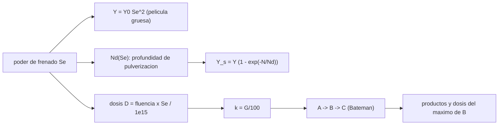

# B68-C03 — Irradiación de hielos por rayos cósmicos y UV: radiólisis y productos

<!-- nav:top -->
[🏠 Programa](../../../../README.md) · [📚 Bloque B68](../../../tronco-comun/B68-quimica-de-granos-y-hielos-interestelares.md) · [← Anterior: B68-C02 — Fotodesorción de hielos interestelares](../B68-C02-fotodesorcion-de-hielos-interestelares/CLASE.md) · [Siguiente: B68-C04 — Laboratorio de astroquímica de hielos en ultra alto vacío criogénico →](../B68-C04-laboratorio-de-astroquimica-de-hielos-en-ultra-alto-vacio-criogenico/CLASE.md)
<!-- /nav -->

## 1. Ubicación, nivel y alcance

Clase 3 del bloque B68. Nivel N3. Las clases B68-C01 y B68-C02 trataron la pérdida de moléculas del hielo por calor y por fotones. Aquí tratas la **energía que el hielo absorbe y que cambia su química**: la pulverización (*sputtering*) por iones pesados rápidos, la dosis, el valor G, la cinética de destrucción de un reactivo y de aparición y desaparición de productos, y la diferencia conceptual entre **fotoquímica** y **química de radiación**. Usas exponenciales y ecuaciones diferenciales lineales de primer orden. La clase no integra ningún espectro de rayos cósmicos: usa un conjunto de parámetros de laboratorio con iones rápidos y ejemplos sintéticos rotulados.

## 2. Por qué esta clase existe

Un hielo en una nube densa recibe poca luz ultravioleta externa, pero sigue recibiendo partículas energéticas y fotones secundarios. Esas dosis lentas transforman la composición del hielo durante millones de años. La decisión central: **¿cuánta energía hay que depositar para destruir una fracción dada del hielo, cuántas moléculas se expulsan y qué productos aparecen?**

## 3. Lo que podrás hacer al terminar

1. Distinguir fotoquímica y química de radiación con las definiciones de la literatura.
2. Calcular el rendimiento de pulverización de una película gruesa de CO, CO₂ o H₂O con el poder de frenado electrónico.
3. Corregir el rendimiento por el espesor finito de la película.
4. Convertir fluencia de iones en dosis por molécula y el valor G en una constante cinética.
5. Resolver la cadena A → B → C con la solución cerrada y con una integración numérica, y hallar la dosis a la que el producto intermedio es máximo.
6. Nombrar qué no cubre el modelo (mezclas, radicales, flujo de rayos cósmicos real).

La evidencia es la **ficha de la radiólisis** del ejercicio 12 (sección 20).

## 4. Con qué llegas y cómo comprobarlo

1. ¿Qué es una constante cinética de primer orden?
2. ¿Qué es un eV?
3. ¿Qué es una columna de moléculas (moléculas cm⁻²)?
4. ¿Qué es una integración de Runge–Kutta?
5. ¿Qué es un valor sintético?

<details>
<summary>Ver respuestas</summary>

1. La razón `k` en `dA/dx = −kA`; da una caída `e^(−kx)`. 2. Una unidad de energía: `1,602 176 634 × 10⁻¹⁹ J`. 3. El número de moléculas por unidad de área a lo largo de la trayectoria. 4. Un método de paso fijo de cuarto orden para ecuaciones diferenciales. 5. Un valor propuesto para el ejemplo, no medido.
</details>

Con cuatro o cinco aciertos, sigue; si no, repasa los prerrequisitos.

## 5. Un caso de contexto y casos de referencia

Dartois y colaboradores (2021) irradian películas de CO y CO₂ a unos 10 K con iones pesados rápidos y miden cuántas moléculas salen por ion. Para CO, el rendimiento de película gruesa sigue `Y = 3,87 × 10⁻² Se²` moléculas/ion, con `Se` en eV por `10¹⁵` moléculas cm⁻². Es el **ejemplo conductor**. Los valores de `Se`, los espesores evaluados y los valores G de la cadena de reacciones son **sintéticos**.

## 6. Vocabulario

La **radiación ionizante** es la que produce ionización; incluye partículas energéticas (rayos cósmicos) y fotones muy energéticos. La **fotoquímica** es la que inicia una excitación electrónica inducida por un fotón sin ionizar; la **química de radiación** estudia los cambios por absorción de radiación capaz de ionizar (definiciones de Arumainayagam y colaboradores). El **poder de frenado electrónico** `Se` es la energía depositada por unidad de recorrido (aquí, eV por `10¹⁵` moléculas cm⁻²). La **pulverización** es la expulsión de moléculas por el paso de un ion. La **profundidad de pulverización** `Nd` es la columna de hielo desde la que se expulsan moléculas. La **dosis** `D` es la energía depositada por molécula (eV/molécula). El **valor G** es el número de moléculas formadas o destruidas por cada 100 eV depositados.

## 7. Modelo mental: una pista de piedras en un estanque de arena

Cada ion pesado atraviesa el hielo y deja una pista caliente; las moléculas salen de la pista cercana a la superficie, y a lo largo de ella se rompen moléculas y se forman otras. Más energía en la pista, más moléculas expulsadas, pero con una ley cuadrática, no lineal.



*Descripción textual:* de `Se` salen el rendimiento de pulverización (con corrección por espesor) y la dosis; con el valor G la dosis da la constante cinética y la cadena de reacciones da los productos.

Límite: una pista real es un volumen no uniforme, no la media que usa el modelo.

## 8. La explicación, paso a paso

### 8.1 Dos tipos de química

Arumainayagam y colaboradores (2019) definen la química de radiación como el estudio de los cambios por absorción de radiación con energía suficiente para ionizar y la fotoquímica como la iniciada por excitación electrónica sin ionización. Señalan que la luz ultravioleta de vacío (6,2–12,4 eV) puede además iniciar química de radiación, porque el umbral para producir electrones secundarios es más bajo en fase condensada que en fase gaseosa. Citan cuatro rasgos propios de la química de radiación: cascadas de electrones secundarios de menos de 20 eV (la fuerza motriz dominante), reacciones iniciadas por cationes, distribución no uniforme de intermediarios y química no selectiva con múltiples productos.

### 8.2 Pulverización de película gruesa

Dartois y colaboradores usan, para película gruesa, `Y∞ = Y₀ Se²` con `Y₀ = 3,87 × 10⁻²` (CO), `8,65 × 10⁻³` (CO₂) y `5,93 × 10⁻³` (H₂O), y `Se` en eV por `10¹⁵` moléculas cm⁻². Duplicar `Se` cuadruplica `Y`.

| Especie | `Se = 10` | `Se = 50` | `Se = 100` |
|---|---|---|---|
| CO | 3,87 | 96,75 | 387,0 |
| CO₂ | 0,86 | 21,62 | 86,50 |
| H₂O | 0,59 | 14,83 | 59,30 |

(Moléculas por ion; los tres valores de `Se` son una elección **sintética** para ilustrar.) Con `Se = 100` y CO, un ion expulsa unas 387 moléculas y se necesita una fluencia de `2,58 × 10¹²` iones cm⁻² para pulverizar 1 ML de película gruesa.

### 8.3 Película delgada

Si la película es más delgada que la profundidad desde la que salen las moléculas, el rendimiento baja: `Y_s = Y∞ [1 − e^(−N/Nd)]`. Los ajustes del artículo dan `Nd = 10^14,25 Se^0,95 cm⁻²` para CO y `Nd = 10^13,20 Se^1,18 cm⁻²` para CO₂ (con incertidumbres de los exponentes de `±0,17` y `±0,19`; el artículo concluye que la profundidad crece casi linealmente con `Se`).

| Especie | `Se` | `Nd` (ML) | `Y_s/Y∞` para 1, 10, 100 ML |
|---|---|---|---|
| CO | 10 | 1,58 | 0,468 ; 0,998 ; 1,000 |
| CO | 50 | 7,31 | 0,128 ; 0,745 ; 1,000 |
| CO | 100 | 14,13 | 0,068 ; 0,507 ; 0,999 |
| CO₂ | 50 | 1,60 | 0,464 ; 0,998 ; 1,000 |
| CO₂ | 100 | 3,63 | 0,241 ; 0,936 ; 1,000 |

Cuando `N = Nd`, `Y_s/Y∞ = 1 − 1/e = 0,63212` (el laboratorio lo comprueba con CO, `Se = 50`). Consecuencia: una capa fina de hielo, como la del inicio de la formación de manto, se pulveriza menos que una gruesa.

### 8.4 Dosis y valor G

Cada ion que pasa por 1 cm² deposita `Se` eV por cada `10¹⁵` moléculas de la columna, de modo que por molécula `D = Φ Se / 10¹⁵` eV con `Φ` en iones cm⁻². Con `Se = 100` y `Φ = 10¹³` iones cm⁻² la dosis es `1 eV/molécula`. El valor G (moléculas por 100 eV) se traduce en una constante cinética por unidad de dosis: `k = G/100` por (eV/molécula). Es una **definición**, no un resultado consultado.

### 8.5 La cadena A → B → C

Con constantes `k₁` (A → B) y `k₂` (B → C): `dA/dD = −k₁A`; `dB/dD = k₁A − k₂B`; `C = 1 − A − B`, en fracciones de la cantidad inicial de A. La solución cerrada (Bateman) es `A = e^(−k₁D)` y `B = k₁/(k₂−k₁) (e^(−k₁D) − e^(−k₂D))`. El máximo de `B` ocurre en `D* = ln(k₁/k₂)/(k₁−k₂)`.

Con valores G **sintéticos** `G₁ = 20` y `G₂ = 5` (es decir `k₁ = 0,20` y `k₂ = 0,05` por eV/molécula):

| `D` (eV/molécula) | A | B | C |
|---|---|---|---|
| 2,000 | 0,67032 | 0,31269 | 0,01699 |
| 5,000 | 0,36788 | 0,54790 | 0,08423 |
| 9,242 | 0,15749 | 0,62996 | 0,21255 |
| 15,000 | 0,04979 | 0,56344 | 0,38677 |
| 30,000 | 0,00248 | 0,29420 | 0,70332 |

El máximo de B es `0,62996` a `D* = 9,242 eV/molécula`. La integración RK4 con 2000 pasos coincide con la solución cerrada a `1,2 × 10⁻¹⁴`. Con `Se = 100` (sintético) esa dosis exige `9,24 × 10¹³` iones cm⁻²; con un flujo sintético de `10⁹` iones cm⁻² s⁻¹, `9,2 × 10⁴ s`, es decir un día.

### 8.6 Lectura

El rendimiento de pulverización crece con el cuadrado de `Se` y depende del espesor; la química depende de la dosis y de los valores G de cada paso. Ninguna de las dos cantidades dice por sí sola cuánto cambia un hielo real: faltan el flujo de partículas, el espectro de energías y la composición de la mezcla. El artículo de Dartois y colaboradores describe cómo integrar `Y_s` sobre el espectro de rayos cósmicos (con un flujo diferencial de partículas); esta clase **no hace esa integral** porque no se consultó ningún espectro de flujo.

## 9. Magnitudes, símbolos y unidades

| Símbolo | Qué es | Unidad | Valor / nota |
|---|---|---|---|
| `Se` | poder de frenado electrónico | eV por `10¹⁵` moléc. cm⁻² | 10, 50, 100 (sintético) |
| `Y₀` | prefactor de pulverización | moléc./ion por (eV/`10¹⁵` cm⁻²)² | 3,87e-2 (CO) |
| `Nd` | profundidad de pulverización | cm⁻² (o ML) | 14,13 ML (CO, `Se = 100`) |
| `Φ` | fluencia de iones | iones cm⁻² | `10¹³` |
| `D` | dosis | eV/molécula | 1–30 |
| `G` | valor G | moléculas/100 eV | 20 y 5 (sintético) |
| `k` | constante por dosis | (eV/molécula)⁻¹ | `G/100` |

## 10. Convenciones y referencias

Hielos a unos 10 K; iones pesados rápidos; 1 ML = `10¹⁵` moléculas cm⁻² (convención). `1 eV = 1,602 176 634 × 10⁻¹⁹ J` (exacto, CODATA 2022, consultado el 2026-11-09). Sistema de referencia: no aplica.

## 11. De dónde sale lo que afirmamos

| ID | Fuente | Localizador | Respalda | Consulta | Estado |
|---|---|---|---|---|---|
| S1 | Dartois, Chabot, Barkach, Rothard, Boduch, Augé y Agnihotri, *Cosmic ray sputtering yield of interstellar ice mantles*, A&A 647, A177 (2021) | arXiv:2102.04499, texto completo (ec. 2–3, ajustes de las figs. 7–8, conclusiones) | `Y₀`, forma `1 − e^(−N/Nd)`, `Nd(Se)`, rendimiento constante en película gruesa | 2026-11-09 | Consultada (PDF) |
| S2 | Arumainayagam et al., *Extraterrestrial prebiotic molecules: photochemistry vs. radiation chemistry of interstellar ices*, Chem. Soc. Rev. 48, 2293 (2019) | DOI 10.1039/C7CS00443E | definiciones de fotoquímica y química de radiación; electrones secundarios < 20 eV; UV de vacío 6,2–12,4 eV | 2026-11-09 | Solo resumen (acceso cerrado) |
| S3 | NIST, CODATA 2022 | physics.nist.gov/cuu/Constants/Table/allascii.txt | `1 eV` en J | 2026-11-09 | Consultada |

Límites: la definición de valor G es la estándar de la radioquímica y no se tomó de una fuente consultada; los valores G, los `Se` evaluados y los flujos son sintéticos; el rendimiento de H₂O de película delgada no se calcula porque el artículo (en las partes leídas) solo da su `Y₀` aquí.

## 12. Cómo ver la radiólisis

| Magnitud | Valor |
|---|---|
| `Y∞` del CO a `Se = 100` | 387 moléc./ion |
| `Nd` del CO a `Se = 100` | 14,13 ML |
| Máximo de B (sintético) | 0,630 a 9,24 eV/molécula |
| Diferencia Bateman − RK4 | `1,2 × 10⁻¹⁴` |

Descripción larga: la pulverización crece como `Se²` y se satura con el espesor; en la cadena de reacciones el reactivo cae exponencialmente, el intermedio sube y baja, y el producto final crece.

## 13. Ejemplo trabajado: película de 10 ML de CO con `Se = 50`

**Paso 1 · Película gruesa.** `Y∞ = 3,87 × 10⁻² · 50² = 96,75` moléc./ion.

**Paso 2 · Profundidad.** `Nd = 10^14,25 · 50^0,95 = 1,778 × 10¹⁴ · 41,1 = 7,31 × 10¹⁵ cm⁻² = 7,31 ML`.

**Paso 3 · Corrección.** `1 − e^(−10/7,31) = 1 − 0,2546 = 0,745`.

**Paso 4 · Rendimiento de la película.** `Y_s = 96,75 · 0,745 = 72,1` moléc./ion.

## 14. Distintas formas de describir la irradiación

**Por ion:** rendimiento de pulverización. **Por energía:** dosis y valor G. **Por tiempo:** fluencia dividida por flujo. **Por especie:** destrucción del reactivo y aparición de productos.

## 15. Práctica guiada

**Ejercicio 1 · con los pasos indicados.** Calcula `Y∞` del CO₂ con `Se = 50`. *Pasos:* `Se²` y multiplica por `Y₀`.

<details><summary>Solución comentada</summary>

`8,65 × 10⁻³ · 2500 = 21,6` moléc./ion.
</details>

**Ejercicio 2 · con una pista.** ¿Qué dosis produce `Φ = 10¹³` iones cm⁻² con `Se = 100`? *Pista:* `D = Φ Se / 10¹⁵`.

<details><summary>Solución comentada</summary>

`10¹³ · 100 / 10¹⁵ = 1 eV/molécula`.
</details>

**Ejercicio 3 · casi autónomo.** Si `G = 20`, ¿cuánto vale `k`?

<details><summary>Solución comentada</summary>

`k = 20/100 = 0,20` por (eV/molécula).
</details>

## 16. Práctica autónoma, transferencia e integrador

**Ejercicio 4.** ¿Cuánto cambia `Y∞` del CO si `Se` pasa de 50 a 100?

<details><summary>Solución comentada</summary>

Se multiplica por 4: de 96,75 a 387,0.
</details>

**Ejercicio 5.** Dosis a la que cae a la mitad el reactivo A con `k₁ = 0,20`.

<details><summary>Solución comentada</summary>

`D = ln 2 / 0,20 = 3,47 eV/molécula`.
</details>

**Ejercicio 6.** Dosis del máximo de B con `k₁ = 0,20` y `k₂ = 0,05`.

<details><summary>Solución comentada</summary>

`D* = ln 4 / 0,15 = 9,242 eV/molécula`.
</details>

**Ejercicio 7.** Fluencia para pulverizar 1 ML de CO grueso con `Se = 100`.

<details><summary>Solución comentada</summary>

`10¹⁵ / 387 = 2,58 × 10¹²` iones cm⁻².
</details>

**Ejercicio 8.** ¿Qué fracción del rendimiento grueso da 1 ML de CO₂ con `Se = 100`?

<details><summary>Solución comentada</summary>

`Nd = 3,63 ML`; `1 − e^(−1/3,63) = 0,241`.
</details>

**Ejercicio 9 · transferencia.** **Transferencia.** Un colega afirma que un manto de 1 ML se pulveriza igual que uno de 100 ML. Responde.

<details><summary>Solución comentada</summary>

No: con `Se` alto 1 ML rinde solo ~7 % del grueso (CO, `Se = 100`); la profundidad de pulverización es de decenas de ML (8.3).
</details>

**Ejercicio 10 · transferencia.** **Transferencia.** ¿Por qué no basta el modelo de esta clase para predecir la abundancia de un producto en una nube?

<details><summary>Solución comentada</summary>

Faltan el flujo y el espectro de partículas, la composición de la mezcla, los radicales y la química de superficie; los valores G de la clase son sintéticos (8.6).
</details>

**Ejercicio 11 · transferencia.** **Transferencia.** Un experimento con UV de 10 eV, ¿es solo fotoquímica?

<details><summary>Solución comentada</summary>

No necesariamente: el UV de vacío puede iniciar además química de radiación porque el umbral para electrones secundarios es más bajo en fase condensada (8.1).
</details>

**Ejercicio 12.** **Integrador.** Elabora tu *ficha de la radiólisis*: rendimiento de pulverización con corrección de espesor, dosis, valor G, cadena A → B → C con dos vías y lo que el modelo no cubre.

<details><summary>Solución modelo</summary>

Secciones 8.1–8.6, con unidades y el rótulo «sintético» para `Se`, G y flujos.
</details>

## 17. Laboratorio: pulverización, dosis y cadena de reacciones

El script [radiolisis.py](radiolisis.py) calcula `Y∞` y `Y_s`, convierte fluencia en dosis, resuelve A → B → C con Bateman y con RK4 y halla la dosis del máximo de B (**comprueba** el cociente 4, el valor `1 − 1/e`, Bateman frente a RK4 < 10⁻⁸ y el máximo de B).

**Datos:** S1 para los ajustes; todo lo demás **sintético**. **Predice antes de ejecutar:** ¿qué fracción del rendimiento grueso da una película de 1 ML de CO con `Se = 100`? (muy poca, ~7 %.) **Ejecución del 2026-11-09 (Python 3.12.9):**

```text
Python 3.12.9 (biblioteca estandar)
Pulverizacion de pelicula gruesa, Y_inf = Y0 Se^2 [moleculas/ion] (Dartois 2021):
    CO Se =    10 eV/1e15 cm^-2 -> Y_inf =       3.87
    CO Se =    50 eV/1e15 cm^-2 -> Y_inf =      96.75
    CO Se =   100 eV/1e15 cm^-2 -> Y_inf =     387.00
   CO2 Se =    10 eV/1e15 cm^-2 -> Y_inf =       0.86
   CO2 Se =    50 eV/1e15 cm^-2 -> Y_inf =      21.62
   CO2 Se =   100 eV/1e15 cm^-2 -> Y_inf =      86.50
   H2O Se =    10 eV/1e15 cm^-2 -> Y_inf =       0.59
   H2O Se =    50 eV/1e15 cm^-2 -> Y_inf =      14.83
   H2O Se =   100 eV/1e15 cm^-2 -> Y_inf =      59.30
Pelicula delgada: Nd [ML] y Y_s/Y_inf para N = 1 ML, 10 ML, 100 ML
    CO Se =    10 -> Nd =      1.58 ML ; 0.4679 ; 0.9982 ; 1.0000
    CO Se =    50 -> Nd =      7.31 ML ; 0.1278 ; 0.7453 ; 1.0000
    CO Se =   100 -> Nd =     14.13 ML ; 0.0683 ; 0.5073 ; 0.9992
   CO2 Se =    10 -> Nd =      0.24 ML ; 0.9845 ; 1.0000 ; 1.0000
   CO2 Se =    50 -> Nd =      1.60 ML ; 0.4642 ; 0.9981 ; 1.0000
   CO2 Se =   100 -> Nd =      3.63 ML ; 0.2407 ; 0.9363 ; 1.0000
CO, Se = 100: fluencia para pulverizar 1 ML grueso = 2.584e+12 iones cm^-2
CO, Se = 50: con N = Nd (7.31 ML), Y_s/Y_inf = 0.63212 (teorico 1 - 1/e = 0.63212)
Cadena A->B->C SINTETICA: G1 = 20, G2 = 5 moleculas/100 eV -> k1 = 0.20, k2 = 0.05 por (eV/molecula)
 D [eV/mol]         A         B         C
      2.000   0.67032   0.31269   0.01699
      5.000   0.36788   0.54790   0.08423
      9.242   0.15749   0.62996   0.21255
     15.000   0.04979   0.56344   0.38677
     30.000   0.00248   0.29420   0.70332
Dosis del maximo de B: D* = ln(k1/k2)/(k1-k2) = 9.242 eV/molecula ; B(D*) = 0.62996
Diferencia maxima Bateman - RK4 = 1.21e-14
Con Se = 100 (SINTETICO): fluencia para D* = 9.242e+13 iones cm^-2 ; a 1e9 iones cm^-2 s^-1 -> 9.24e+04 s
Pruebas superadas.
```

```bash
python programa/clases/B68/B68-C03-irradiacion-de-hielos-por-rayos-cosmicos-y-uv-radiolisis-y-productos/radiolisis.py
```

**Límites:** hielo puro, cinética de primer orden en la dosis, sin radicales ni mezclas, `Nd` extrapolado fuera de los `Se` medidos.

## 18. Errores frecuentes y cómo corregirlos

**Pensar que `Y` es lineal en `Se`.** Se corrige con 8.2.

**Usar el rendimiento de película gruesa en una capa fina.** Se corrige con 8.3.

**Confundir fluencia con dosis.** Se corrige con 8.4.

**Presentar valores G sintéticos como medidos.** Se corrige con 8.5 y la sección 11.

## 19. Cómo sabrás que vas bien

Tras la sección 8: ¿qué resultado esperabas y cuál obtuviste? Si dudas, repasa el ejemplo 13. Tras el laboratorio: ¿por qué la solución cerrada y la numérica coinciden? (ver la sección 17).

## 20. Qué entregas y cómo se evalúa

El producto es tu **ficha de la radiólisis** (ejercicio 12).

| Criterio | Inicial | En desarrollo | Logrado | Destacado |
|---|---|---|---|---|
| Conceptos | Los confunde | Parciales | `Se`, dosis, G, `Nd` | Explica los límites |
| Cálculo | Sin unidades | Con errores | Tablas completas | Calcula casos nuevos |
| Numérico | Sin comprobar | Una vía | Dos vías que coinciden | Interpreta las diferencias |
| Fuentes | Sin fuente | Sin fecha | fuentes con fecha | Declara lo no consultado |
| Límites | No los nombra | Uno | Tres | Discute qué falta del modelo |

**Condiciones críticas (no se compensan con promedio):** rotular lo sintético; no presentar un rendimiento de laboratorio como flujo cósmico; citar solo lo consultado.

## 21. Ética, seguridad y límites

Clase educativa: el modelo es de campo medio y de hielo puro. Los experimentos reales con aceleradores y radiación ionizante exigen formación y protocolos de protección radiológica. Accesibilidad: tablas equivalentes a las gráficas, fórmulas en texto, ejercicios sin conexión.

## 22. Para cerrar y seguir

Un ion con `Se = 100` expulsa unas 387 moléculas de una película gruesa de CO y solo ~7 % de eso de una monocapa; con valores G sintéticos, el intermedio de una cadena alcanza su máximo a ~9 eV/molécula. Queda una pregunta: ¿cómo se mide todo esto en un laboratorio y con qué precauciones?

**Glosario español–inglés.** pulverización · *sputtering*; poder de frenado · *stopping power*; dosis · *dose*; valor G · *G-value*; química de radiación · *radiation chemistry*; fotoquímica · *photochemistry*.

**Continuidad.** [B68-C04](../B68-C04-laboratorio-de-astroquimica-de-hielos-en-ultra-alto-vacio-criogenico/CLASE.md) describe el laboratorio de ultra alto vacío criogénico.

**Referencias:** ver sección 11.

<!-- nav:bottom -->
---

[← Anterior: B68-C02 — Fotodesorción de hielos interestelares](../B68-C02-fotodesorcion-de-hielos-interestelares/CLASE.md) · [📚 Bloque B68](../../../tronco-comun/B68-quimica-de-granos-y-hielos-interestelares.md) · [Siguiente: B68-C04 — Laboratorio de astroquímica de hielos en ultra alto vacío criogénico →](../B68-C04-laboratorio-de-astroquimica-de-hielos-en-ultra-alto-vacio-criogenico/CLASE.md)
<!-- /nav -->
