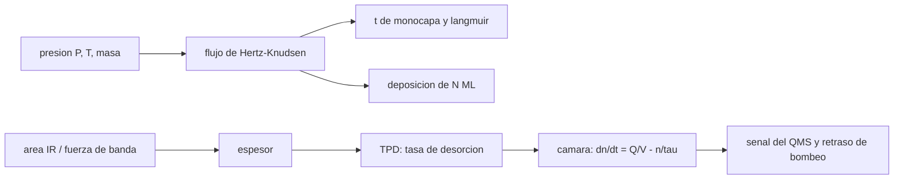

# B68-C04 — Laboratorio de astroquímica de hielos en ultra alto vacío criogénico

<!-- nav:top -->
[🏠 Programa](../../../../README.md) · [📚 Bloque B68](../../../tronco-comun/B68-quimica-de-granos-y-hielos-interestelares.md) · [← Anterior: B68-C03 — Irradiación de hielos por rayos cósmicos y UV: radiólisis y productos](../B68-C03-irradiacion-de-hielos-por-rayos-cosmicos-y-uv-radiolisis-y-productos/CLASE.md) · [Siguiente: B69-C01 — Principio Doppler y resolución en azimut del SAR →](../../B69/B69-C01-principio-doppler-y-resolucion-en-azimut-del-sar/CLASE.md)
<!-- /nav -->

## 1. Ubicación, nivel y alcance

Clase 4 y última del bloque B68. Nivel N3. Las tres clases anteriores usaron parámetros medidos en laboratorio; esta explica **cómo se obtienen** y qué hay que dimensionar para que el experimento valga: el flujo de moléculas sobre una superficie (Hertz–Knudsen), el tiempo de contaminación, la dosis en langmuir, el espesor del hielo por infrarrojo y la respuesta de la cámara durante una desorción programada (TPD). Usas la teoría cinética elemental y ecuaciones diferenciales de primer orden. La clase no describe un laboratorio concreto: la cámara, las presiones y la banda infrarroja son **sintéticas** y se rotulan así.

## 2. Por qué esta clase existe

Un hielo de 10 ML de CO sobre una superficie a 10 K se contamina con agua residual en horas si la presión de fondo no es lo bastante baja, y una TPD con bombeo insuficiente deforma el pico que se mide. La decisión central: **¿qué presión de fondo, qué velocidad de bombeo y qué calibración de espesor hacen creíble un parámetro de desorción?**

## 3. Lo que podrás hacer al terminar

1. Calcular el flujo de Hertz–Knudsen de un gas a una temperatura y presión dadas.
2. Estimar el tiempo para cubrir una monocapa y el equivalente en langmuir.
3. Calcular el tiempo de deposición de un hielo por dosificación de fondo.
4. Obtener el espesor de un hielo desde el área de una banda infrarroja con una fuerza de banda declarada.
5. Estimar la presión máxima y el retraso de bombeo de una TPD en una cámara dada.
6. Reconocer los riesgos de seguridad de un montaje criogénico y de vacío (sin sustituir la formación de laboratorio).

La evidencia es la **ficha del montaje criogénico** del ejercicio 12 (sección 20).

## 4. Con qué llegas y cómo comprobarlo

1. ¿Qué es una presión en pascales y en mbar?
2. ¿Qué es una monocapa (ML)?
3. ¿Qué es una constante de tiempo de bombeo?
4. ¿Qué es la ley de Beer–Lambert?
5. ¿Qué es un valor sintético?

<details>
<summary>Ver respuestas</summary>

1. Fuerza por unidad de área; `1 mbar = 100 Pa`. 2. La cantidad de moléculas que cubre una superficie; aquí `10¹⁵` moléculas cm⁻² por convención. 3. `τ = V/S`, volumen entre velocidad de bombeo. 4. La atenuación de la luz es proporcional a la columna de absorbentes. 5. Un valor propuesto para el ejemplo, no medido.
</details>

Con cuatro o cinco aciertos, sigue; si no, repasa los prerrequisitos.

## 5. Un caso de contexto y casos de referencia

Los experimentos de las clases anteriores se hacen en cámaras de ultra alto vacío con una superficie enfriada a 10–18 K. Kruczkiewicz y colaboradores (2024) hacen TPD a `0,2 K s⁻¹` desde 10 K y detectan los gases con un espectrómetro de masas cuadrupolar; Fayolle y colaboradores (2011) vigilan el hielo con espectroscopía infrarroja de absorción–reflexión (RAIRS) y espectrometría de masas al mismo tiempo, con un flujo de sincrotrón del orden de `10¹⁴` fotones s⁻¹; Öberg y colaboradores (2009) usan una lámpara de hidrógeno de 7–10,5 eV a 15–60 K. Es el **ejemplo conductor**. Las presiones, el volumen, la velocidad de bombeo y la banda infrarroja que se calculan aquí son **sintéticos**.

## 6. Vocabulario

El **ultra alto vacío (UHV)** es el régimen de presiones por debajo de `10⁻⁹` mbar, donde el gas residual casi no cubre la superficie durante un experimento. El **flujo de Hertz–Knudsen** es el número de moléculas que golpea una superficie por unidad de área y tiempo. La **probabilidad de adhesión** es la fracción de las que se quedan (aquí 1). El **langmuir** es una unidad de dosis: `10⁻⁶ Torr · s`. La **RAIRS** es una espectroscopía infrarroja de reflexión sobre una superficie metálica. La **TPD** es la desorción programada por temperatura (B68-C01). El **espectrómetro de masas cuadrupolar (QMS)** mide el gas por masa. La **velocidad de bombeo** `S` (L s⁻¹) mide qué volumen de gas evacua la bomba por segundo.

## 7. Modelo mental: una cubeta bajo una lluvia fina

El gas residual es una lluvia fina sobre una cubeta fría (la superficie): a presión alta se llena pronto; el UHV reduce la lluvia para que la cubeta se llene en horas. En la TPD, el hielo que se evapora es una descarga súbita de agua y la bomba es el sumidero: si el sumidero es lento, el nivel medido se retrasa respecto de lo que se evapora.



*Descripción textual:* el flujo de Hertz–Knudsen fija la contaminación y la deposición; el espesor sale del infrarrojo; la TPD entrega una tasa que la cámara con bombeo transforma en la señal del espectrómetro, con un retraso.

Límite: una cámara real no es perfectamente mezclada y la superficie bombea por sí misma (criobombeo), por lo que el modelo es de orden de magnitud.

## 8. La explicación, paso a paso

### 8.1 Flujo de Hertz–Knudsen y langmuir

El flujo de un gas ideal sobre una superficie es `Φ = P / √(2π m k_B T)`. Con `k_B = 1,380 649 × 10⁻²³ J K⁻¹` y `u = 1,660 539 069 × 10⁻²⁷ kg` (CODATA 2022), `Φ = 3,5127 × 10²² P / √(M T)` moléculas cm⁻² s⁻¹ con `P` en Torr, `M` en g/mol y `T` en K. Ese coeficiente derivado coincide a `0,08 %` con el `3,51 × 10²²` que recuerdan los manuales (**no consultado**: se contrasta aquí con la derivación). Para CO a 300 K, 1 langmuir equivale a `0,383 ML` con adhesión 1: el langmuir es del orden de una monocapa, no exactamente una.

### 8.2 Contaminación

El tiempo para cubrir 1 ML con adhesión 1 es `t = 10¹⁵ / Φ`. Con gas a 300 K y presiones **sintéticas**:

| `P` (mbar) | H₂O (s) | CO (s) |
|---|---|---|
| 10⁻¹¹ | 2,79 × 10⁵ | 3,48 × 10⁵ |
| 10⁻¹⁰ | 2,79 × 10⁴ | 3,48 × 10⁴ |
| 10⁻⁹ | 2,79 × 10³ | 3,48 × 10³ |
| 10⁻⁸ | 2,79 × 10² | 3,48 × 10² |
| 10⁻⁷ | 27,9 | 34,8 |

A `10⁻¹⁰` mbar, el agua residual cubre una monocapa en unas 7,8 horas; a `10⁻⁷` mbar, en 28 s. Un experimento de varias horas con un hielo de 1 ML exige UHV. La relación entre ambos tiempos es `√(28,010/18,015) = 1,247`.

### 8.3 Deposición por dosificación de fondo

Para depositar 10 ML de CO se necesita `t = 10 · 10¹⁵ / Φ`: `3,48 × 10⁴ s` a `10⁻⁹` mbar, `3,48 × 10³ s` (58 min) a `10⁻⁸` mbar y `348 s` a `10⁻⁷` mbar. Por eso la deposición se hace con presiones más altas que la de fondo y con la válvula de dosificación, y luego se restablece el UHV.

### 8.4 Espesor por infrarrojo

El espesor sale del área de la banda: `N = ln(10) ∫A_ν dν / A`, con `A_ν` absorbancia en base 10 y `A` la fuerza de banda (cm por molécula). Con una banda gaussiana **sintética** (pico 0,02, FWHM 5 cm⁻¹, centrada en 2140 cm⁻¹) el área es `0,106447 cm⁻¹` por Simpson y por la fórmula cerrada `pico·σ√(2π)`, y con `A = 10⁻¹⁷ cm/molécula` (valor **ilustrativo**, no consultado) el espesor es `24,51 ML`. La fuerza de banda es la incertidumbre dominante: si fuese el doble, el espesor sería la mitad. En RAIRS la calibración del espesor es distinta: Fayolle y colaboradores calibran la absorbancia de 1 ML con una desorción isotérmica monitoreada por RAIRS y la verifican con la TPD y con la exposición (9–10 ML).

### 8.5 La TPD en una cámara bombeada

Una película de 10 ML de CO (parámetros de B68-C01, `E = 1040 K`, `ν = 8,7 × 10¹⁴ ML s⁻¹`) con rampa de `0,2 K s⁻¹` se agota a `T = 30,98 K`. Si su área es 1 cm² y la cámara tiene `V = 20 L` y `S = 100 L/s` (todo **sintético**), la constante de bombeo es `τ = V/S = 0,2 s`. La presión máxima en la cámara es `9,1 × 10⁻⁷` mbar: cuatro órdenes de magnitud sobre una base de `10⁻¹⁰`. La señal se retrasa `4,06 %` respecto del estado cuasiestacionario `Q τ / V`, una cifra cercana a la razón `τ / τ_subida = 0,2/4,6 = 4,3 %`, con `τ_subida = T²/(Eβ) = 4,6 s` (el tiempo en que la tasa crece `e` veces). Con `S = 10 L/s` el retraso sube a `30,55 %`. El balance de masa (moléculas bombeadas frente a depositadas) cierra a `4 × 10⁻¹⁴` en términos relativos.

### 8.6 Lectura

Cada decisión de diseño tiene un número: la presión de fondo fija cuánto dura el hielo limpio; la dosificación fija el tiempo de deposición; la fuerza de banda fija la incertidumbre del espesor; y el bombeo fija el retraso con que se ve una TPD. Un parámetro de desorción solo es creíble con esas cifras declaradas.

## 9. Magnitudes, símbolos y unidades

| Símbolo | Qué es | Unidad | Valor / nota |
|---|---|---|---|
| `P` | presión | mbar (1 mbar = 100 Pa) | `10⁻¹¹–10⁻⁷` (sintético) |
| `Φ` | flujo de Hertz–Knudsen | moléc. cm⁻² s⁻¹ | `2,87 × 10¹¹` (CO, 10⁻⁹ mbar) |
| `t` | tiempo de monocapa | s | `3,48 × 10³` (CO, 10⁻⁹ mbar) |
| `A` | fuerza de banda | cm/molécula | `10⁻¹⁷` (ilustrativa) |
| `N` | espesor | ML | 24,51 (sintético) |
| `V`, `S` | volumen y velocidad de bombeo | L, L s⁻¹ | 20, 100 (sintéticos) |
| `τ` | constante de bombeo | s | 0,2 |

## 10. Convenciones y referencias

`1 ML = 10¹⁵` moléculas cm⁻² (convención); `1 Torr = 101 325/760 Pa` (definición); gas a 300 K con adhesión 1 (sintético). Masas molares de uso corriente (28,010 y 18,015 g/mol), **no consultadas** en esta sesión. Constantes de CODATA 2022 (consultadas el 2026-11-09). Sistema de referencia: no aplica.

## 11. De dónde sale lo que afirmamos

| ID | Fuente | Localizador | Respalda | Consulta | Estado |
|---|---|---|---|---|---|
| S1 | Kruczkiewicz et al., A&A (2024) | arXiv:2404.02695, texto completo (§2–3, Tabla 1) | TPD en UHV desde 10 K a 0,2 K s⁻¹; detección por QMS; `k = ν exp(−E/RT)`; parámetros del CO | 2026-11-09 | Consultada (PDF) |
| S2 | Fayolle et al., ApJ 739, L36 (2011) | arXiv:1109.0281, texto completo (§2) | UHV; RAIRS y QMS simultáneos; calibración de ML por desorción isotérmica; ~10¹⁴ fotones s⁻¹ | 2026-11-09 | Consultada (PDF) |
| S3 | Öberg et al., A&A 496, 281 (2009) | arXiv:0809.1333, resumen | UHV, lámpara de H₂ (7–10,5 eV), 15–60 K, RAIRS y masas | 2026-11-09 | Consultada (PDF) |
| S4 | NIST, CODATA 2022 | physics.nist.gov/cuu/Constants/Table/allascii.txt | `k_B`, `u`, eV | 2026-11-09 | Consultada |

No consultado: fuerzas de banda infrarroja publicadas, especificaciones de bombas o criostatos y normas de seguridad de laboratorio. Límites: el coeficiente de manual `3,51 × 10²²` es un recuerdo contrastado con la derivación, no una cita; la cámara, las presiones, la banda y `A` son sintéticos o ilustrativos.

## 12. Cómo ver el montaje

| Magnitud | Valor |
|---|---|
| Monocapa de H₂O a 10⁻¹⁰ mbar | 2,79 × 10⁴ s (7,8 h) |
| 1 langmuir de CO | 0,383 ML |
| Espesor por infrarrojo (sintético) | 24,51 ML |
| Retraso de bombeo (100 L/s / 10 L/s) | 4,06 % / 30,55 % |

Descripción larga: los tiempos de monocapa cambian un factor 10 por cada década de presión; el retraso de la TPD crece al disminuir la velocidad de bombeo.

## 13. Ejemplo trabajado: contaminación por agua a `10⁻¹⁰` mbar

**Paso 1 · Presión en pascales.** `10⁻¹⁰ mbar = 10⁻⁸ Pa`.

**Paso 2 · Flujo.** `Φ = 10⁻⁸ / √(2π · 18,015 · 1,66054 × 10⁻²⁷ · 1,380649 × 10⁻²³ · 300) · 10⁻⁴ = 3,58 × 10¹⁰` moléc. cm⁻² s⁻¹.

**Paso 3 · Tiempo.** `t = 10¹⁵ / 3,58 × 10¹⁰ = 2,79 × 10⁴ s`.

**Paso 4 · En horas.** `2,79 × 10⁴ / 3600 = 7,75 h`.

## 14. Distintas formas de describir el montaje

**Por flujo:** moléculas cm⁻² s⁻¹. **Por tiempo:** monocapa y deposición. **Por dosis:** langmuir. **Por señal:** presión de la cámara durante la TPD.

## 15. Práctica guiada

**Ejercicio 1 · con los pasos indicados.** Tiempo para cubrir 1 ML de CO a `10⁻⁹` mbar. *Pasos:* flujo y `10¹⁵/Φ`.

<details><summary>Solución comentada</summary>

`Φ = 2,87 × 10¹¹`; `t = 3,48 × 10³ s` (58 min).
</details>

**Ejercicio 2 · con una pista.** Relación entre los tiempos de monocapa del CO y del agua a igual `P` y `T`. *Pista:* `t ∝ √M`.

<details><summary>Solución comentada</summary>

`√(28,010/18,015) = 1,247`.
</details>

**Ejercicio 3 · casi autónomo.** ¿Qué dosis en langmuir es 1 ML de CO a 300 K?

<details><summary>Solución comentada</summary>

`1/0,383 = 2,6 L`.
</details>

## 16. Práctica autónoma, transferencia e integrador

**Ejercicio 4.** Tiempo para depositar 10 ML de CO a `10⁻⁷` mbar.

<details><summary>Solución comentada</summary>

`348 s` (5,8 min).
</details>

**Ejercicio 5.** Espesor de la banda sintética si `A = 2 × 10⁻¹⁷`.

<details><summary>Solución comentada</summary>

`24,51/2 = 12,26 ML`.
</details>

**Ejercicio 6.** Constante de bombeo de `V = 20 L` y `S = 10 L/s`.

<details><summary>Solución comentada</summary>

`τ = 2 s`, diez veces mayor que con 100 L/s: el retraso sube a `30,55 %`.
</details>

**Ejercicio 7.** `τ_subida` de una TPD con `T = 30,98 K`, `E = 1040 K`, `β = 0,2 K s⁻¹`.

<details><summary>Solución comentada</summary>

`T²/(Eβ) = 959,8/208 = 4,6 s`.
</details>

**Ejercicio 8.** ¿Cuántas veces mayor es la presión de la TPD que una base de `10⁻¹⁰` mbar?

<details><summary>Solución comentada</summary>

`9,1 × 10⁻⁷ / 10⁻¹⁰ = 9,1 × 10³`, es decir unas 9000 veces.
</details>

**Ejercicio 9 · transferencia.** **Transferencia.** Un experimento de 1 ML de CO tarda 2 h a `10⁻⁹` mbar. ¿Tiene sentido esperar un hielo limpio?

<details><summary>Solución comentada</summary>

Con CO el tiempo de monocapa es 58 min y con agua 47 min: en 2 h se acumulan más de dos monocapas de contaminante; hay que bajar la presión (8.2).
</details>

**Ejercicio 10 · transferencia.** **Transferencia.** Un colega usa una fuerza de banda tomada de un artículo sin citarla. ¿Qué respondes?

<details><summary>Solución comentada</summary>

La fuerza de banda es la incertidumbre dominante del espesor (8.4); debe citarse con fuente, temperatura y fase.
</details>

**Ejercicio 11 · transferencia.** **Transferencia.** El pico de una TPD aparece ensanchado. ¿Qué dos causas verificarías primero?

<details><summary>Solución comentada</summary>

El retraso de bombeo (S insuficiente, 8.5) y los gradientes de temperatura de la muestra.
</details>

**Ejercicio 12.** **Integrador.** Elabora tu *ficha del montaje criogénico*: presión de fondo y tiempo de contaminación, plan de deposición, calibración del espesor con su incertidumbre y retraso de bombeo de la TPD.

<details><summary>Solución modelo</summary>

Secciones 8.1–8.6, con unidades y el rótulo «sintético» o «ilustrativo» en presiones, cámara y fuerza de banda.
</details>

## 17. Laboratorio: dimensionar un montaje

El script [montaje_uhv.py](montaje_uhv.py) calcula el flujo de Hertz–Knudsen, los tiempos de monocapa y de deposición, el espesor por infrarrojo y la respuesta de una cámara bombeada a una TPD (**comprueba** el coeficiente contra el de manual < 0,5 %, Simpson frente a fórmula cerrada, balance de masa < 10⁻³ y retraso < 10 %).

**Datos:** constantes de CODATA y parámetros de S1; todo lo demás **sintético** o **ilustrativo**. **Predice antes de ejecutar:** ¿qué pasa con el retraso si se reduce la velocidad de bombeo diez veces? (sube varias veces: de 4 % a 31 %.) **Ejecución del 2026-11-09 (Python 3.12.9):**

```text
Python 3.12.9 (biblioteca estandar)
Coeficiente de Hertz-Knudsen derivado de CODATA = 3.5127e+22 molec cm^-2 s^-1 Torr^-1 g^0.5 mol^-0.5 K^0.5 ; coeficiente de manual (no consultado) = 3.51e+22 ; dif. = 0.08 %
Tiempo para cubrir 1 ML con probabilidad de adhesion 1, gas a 300 K (SINTETICO en P):
  P [mbar]        H2O [s]         CO [s]
     1e-11     2.7902e+05     3.4792e+05
     1e-10     2.7902e+04     3.4792e+04
     1e-09     2.7902e+03     3.4792e+03
     1e-08     2.7902e+02     3.4792e+02
     1e-07     2.7902e+01     3.4792e+01
1 langmuir (1e-6 Torr s) de CO a 300 K = 0.383 ML
Tiempo para depositar 10 ML de CO por dosificacion de fondo: 1e-09 mbar -> 34791.51 s ; 1e-08 mbar -> 3479.15 s ; 1e-07 mbar -> 347.92 s
Espesor por infrarrojo (banda gaussiana SINTETICA, A = 1e-17 cm/molec ilustrativa): area Simpson = 0.106447 cm^-1 ; cerrada = 0.106447 cm^-1 ; N = 24.51 ML
TPD de 10 ML de CO (E = 1040 K, nu = 8.7e14 ML/s, 0.2 K/s) en camara de 20 L: T_fin = 30.98 K ; P pico (area 1 cm^2, S = 100 L/s) = 9.09e-07 mbar
Retraso del bombeo en el pico: S = 100 L/s -> 4.06 % ; S = 10 L/s -> 30.55 % ; balance de masa = -3.86e-14
Pruebas superadas.
```

```bash
python programa/clases/B68/B68-C04-laboratorio-de-astroquimica-de-hielos-en-ultra-alto-vacio-criogenico/montaje_uhv.py
```

**Límites:** cámara bien mezclada, sin criobombeo, adhesión 1, gas a 300 K, fuerza de banda ilustrativa.

## 18. Errores frecuentes y cómo corregirlos

**Confundir mbar con Torr y pascal.** Se corrige con la sección 10.

**Asumir que el langmuir es exactamente una monocapa.** Se corrige con 8.1.

**Citar un espesor sin la fuerza de banda.** Se corrige con 8.4.

**Ignorar el retraso de bombeo en la TPD.** Se corrige con 8.5.

## 19. Cómo sabrás que vas bien

Tras la sección 8: ¿qué resultado esperabas y cuál obtuviste? Si dudas, repasa el ejemplo 13. Tras el laboratorio: ¿por qué el balance de masa debe cerrar? (ver la sección 17).

## 20. Qué entregas y cómo se evalúa

El producto es tu **ficha del montaje criogénico** (ejercicio 12).

| Criterio | Inicial | En desarrollo | Logrado | Destacado |
|---|---|---|---|---|
| Conceptos | Los confunde | Parciales | flujo, langmuir, espesor, TPD | Explica los límites |
| Cálculo | Sin unidades | Con errores | Tablas completas | Calcula casos nuevos |
| Numérico | Sin comprobar | Una vía | Dos vías que coinciden | Interpreta las diferencias |
| Fuentes | Sin fuente | Sin fecha | fuentes con fecha | Declara lo no consultado |
| Límites | No los nombra | Uno | Tres | Discute qué falta del modelo |

**Condiciones críticas (no se compensan con promedio):** rotular lo sintético; no presentar un montaje inventado como uno real; citar solo lo consultado.

## 21. Ética, seguridad y límites

Clase educativa: no describe un procedimiento de operación. Un laboratorio real implica riesgos que exigen formación y autorización propias: criógenos (el nitrógeno líquido y el helio desplazan el oxígeno y causan quemaduras por frío), equipos a alto vacío (implosión de ventanas y vidrio), gases comprimidos y tóxicos (el monóxido de carbono es tóxico), fuentes de radiación o aceleradores (protección radiológica) y lámparas ultravioleta. Siga siempre los protocolos de su institución. Accesibilidad: tablas equivalentes a las gráficas, fórmulas en texto, ejercicios sin conexión.

## 22. Para cerrar y seguir

Un hielo limpio exige presiones de fondo del orden de `10⁻¹⁰` mbar (7,8 h por monocapa de agua), una TPD exige una velocidad de bombeo que siga la subida de la tasa (4 % de retraso con 100 L/s, 31 % con 10 L/s) y un espesor creíble exige declarar la fuerza de banda. Con eso se cierra el bloque: un parámetro de desorción, de fotodesorción o de radiólisis vale lo que valgan las condiciones declaradas de su medida. Queda una pregunta: ¿cómo se acoplan estos mecanismos en un modelo gas–grano completo?

**Glosario español–inglés.** ultra alto vacío · *ultra-high vacuum (UHV)*; flujo de Hertz–Knudsen · *Hertz–Knudsen flux*; langmuir · *langmuir*; espectroscopía infrarroja de absorción–reflexión · *reflection–absorption infrared spectroscopy (RAIRS)*; velocidad de bombeo · *pumping speed*.

**Continuidad.** Cierra el bloque B68; el siguiente es [B69](../../../tronco-comun/B69-radar-de-apertura-sintetica-e-interferometria-profundizacion.md). Para volver al inicio, [B68-C01](../B68-C01-desorcion-termica-de-hielos-interestelares/CLASE.md).

**Referencias:** ver sección 11.

<!-- nav:bottom -->
---

[← Anterior: B68-C03 — Irradiación de hielos por rayos cósmicos y UV: radiólisis y productos](../B68-C03-irradiacion-de-hielos-por-rayos-cosmicos-y-uv-radiolisis-y-productos/CLASE.md) · [📚 Bloque B68](../../../tronco-comun/B68-quimica-de-granos-y-hielos-interestelares.md) · [Siguiente: B69-C01 — Principio Doppler y resolución en azimut del SAR →](../../B69/B69-C01-principio-doppler-y-resolucion-en-azimut-del-sar/CLASE.md)
<!-- /nav -->
