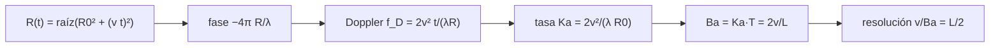

# B69-C01 — Principio Doppler y resolución en azimut del SAR

<!-- nav:top -->
[🏠 Programa](../../../../README.md) · [📚 Bloque B69](../../../tronco-comun/B69-radar-de-apertura-sintetica-e-interferometria-profundizacion.md) · [← Anterior: B68-C04 — Laboratorio de astroquímica de hielos en ultra alto vacío criogénico](../../B68/B68-C04-laboratorio-de-astroquimica-de-hielos-en-ultra-alto-vacio-criogenico/CLASE.md) · [Siguiente: B69-C02 — Formación de imágenes SAR →](../B69-C02-formacion-de-imagenes-sar/CLASE.md)
<!-- /nav -->

## 1. Ubicación, nivel y alcance

Clase 1 del bloque B69. Nivel N3. Un radar de apertura sintética (SAR) obtiene una resolución fina en la dirección de vuelo (**azimut**) sin una antena enorme: usa el movimiento del satélite y la variación de la frecuencia Doppler de cada blanco. Aquí calculas la historia de fase de un blanco puntual, su tasa Doppler, el ancho de banda Doppler y la resolución, y compruebas que la compresión de esa señal da una anchura de 5,3 m para una antena de 12 m. Esta clase explica el principio que [B57](../../../tronco-comun/B57-observacion-terrestre-y-geociencias-orbitales.md) presenta sin desarrollar. Todo el sensor es **sintético** (banda C ilustrativa), no el de un satélite real.

## 2. Por qué esta clase existe

Sin el principio Doppler, la resolución en azimut de un radar quedaría fijada por el ancho del haz de la antena: a 850 km, una antena de 12 m (λ = 0,0555 m) iluminaría una franja de unos 3,9 km. La decisión central: **¿qué resolución obtiene el sistema, de qué depende y qué hay que muestrear para no perderla?**

## 3. Lo que podrás hacer al terminar

1. Escribir la distancia al blanco `R(t)` y la fase `φ(t) = −4πR(t)/λ`.
2. Derivar la frecuencia Doppler y su tasa `Ka = 2v²/(λR₀)`.
3. Calcular el tiempo de iluminación `T = λR₀/(Lv)` y el ancho de banda `Ba = Ka·T = 2v/L`.
4. Deducir que la resolución de azimut es `v/Ba = L/2`, independiente de la distancia y de la longitud de onda.
5. Comprobar la condición de muestreo `PRF ≥ Ba`.
6. Medir la anchura a −3 dB tras la compresión y compararla con `0,886 v/Ba`.

La evidencia es la **ficha del principio Doppler** del ejercicio 12 (sección 20).

## 4. Con qué llegas y cómo comprobarlo

1. ¿Qué es la frecuencia Doppler?
2. ¿Qué es la fase de una onda y cómo se relaciona con la distancia recorrida?
3. ¿Qué es un filtro adaptado?
4. ¿Qué es un valor sintético?
5. ¿Qué es una verificación?

<details>
<summary>Ver respuestas</summary>

1. El corrimiento de la frecuencia de una señal por el movimiento relativo entre fuente y observador. 2. Es el ángulo de la onda; un recorrido de una longitud de onda equivale a 2π rad. 3. Un filtro que correlaciona la señal con una réplica conocida para concentrar su energía en un pico. 4. Un dato generado por un modelo, no medido. 5. Comparar un cálculo con un caso independiente.
</details>

Con cuatro o cinco aciertos, sigue; si no, repasa los prerrequisitos.

## 5. Un caso de contexto y casos de referencia

Con λ = 0,0555 m, v = 7100 m/s, R₀ = 850 km y una antena de L = 12 m (todo **ilustrativo**), el tiempo de iluminación es `T = 0,5537 s`, la tasa Doppler `Ka = 2137,15 Hz/s` y el ancho de banda `Ba = 1183,3 Hz`. La resolución resulta `v/Ba = 6,000 m`. Es el **ejemplo conductor**. La página de NASA Earthdata (S1) describe el mismo principio de forma cualitativa: acumular adquisiciones sucesivas de una antena corta para simular una larga.

## 6. Vocabulario

La **dirección de azimut** es la de vuelo; el **alcance oblicuo** `R` es la distancia al blanco. La **apertura sintética** es el tramo de órbita, de longitud `vT`, durante el cual el blanco está iluminado. La **frecuencia Doppler** `f_D` varía con el tiempo lento `t`. La **tasa Doppler** `Ka` es la pendiente de esa variación. El **ancho de banda Doppler** `Ba` es el intervalo de `f_D` barrido en `T`. La **PRF** (frecuencia de repetición de pulsos) es el muestreo del tiempo lento.

## 7. Modelo mental: oír pasar una sirena

Una sirena que se acerca suena más aguda y, al alejarse, más grave; el cambio ocurre más rápido cuanto más cerca pasa. El satélite «oye» lo mismo de cada blanco: una frecuencia que baja de forma casi lineal mientras el blanco cruza el haz. Cuanta más variación de frecuencia se registra, más fino se localiza el blanco.



*Descripción textual:* la distancia al blanco determina la fase; su derivada es la frecuencia Doppler, cuya variación en el tiempo de iluminación da el ancho de banda y, con él, la resolución.

Analogía: una sirena que pasa. Límite: la sirena emite su propio sonido; el radar emite y recibe el eco, por eso la fase usa el doble de camino (4π, no 2π).

## 8. La explicación, paso a paso

### 8.1 La historia de fase

El blanco está a la distancia mínima `R₀` cuando `t = 0` y el satélite avanza a `v`, por lo que `R(t) = √(R₀² + (vt)²) ≈ R₀ + v²t²/(2R₀)`. El eco acumula la fase de ida y vuelta `φ(t) = −4πR(t)/λ`, una parábola en `t`.

### 8.2 Frecuencia Doppler y su tasa

La frecuencia Doppler es `f_D = −(1/2π) dφ/dt = 2v²t/(λR)`, que cerca de `t = 0` vale `Ka·t` con `Ka = 2v²/(λR₀)`. Con los datos del ejemplo conductor, `Ka = 2137,15 Hz/s`; el laboratorio la obtiene derivando numéricamente la fase exacta y el error es menor que 0,001 %.

### 8.3 Cuánto tiempo se ve el blanco

El haz de la antena tiene un ancho angular `λ/L`; a la distancia `R₀` ilumina un tramo `λR₀/L` en el suelo, que el satélite recorre en `T = λR₀/(Lv) = 0,5537 s`. La apertura sintética mide `vT = 3931 m`.

### 8.4 Ancho de banda y resolución

En ese tiempo la frecuencia Doppler barre `Ba = Ka·T = 2v/L = 1183,3 Hz` (de −591,6 a +591,5 Hz). Tras la compresión, una señal de ancho de banda `Ba` en el tiempo da un pico de anchura `≈ 1/Ba`, que en el suelo es `v/Ba = L/2 = 6,00 m`. La resolución es **independiente de `R₀`**: si el blanco está más lejos, el haz lo ilumina más tiempo (`T` crece) pero `Ka` baja en la misma proporción. El laboratorio lo comprueba con 400, 850 y 1200 km: siempre 6,000 m.

### 8.5 Muestreo

El tiempo lento se muestrea a la `PRF`; para no tener aliasing hace falta `PRF ≥ Ba`. Con 1700 Hz el cociente es 1,44.

### 8.6 Lectura

Una antena más corta ensancha el haz, aumenta `Ba` y mejora la resolución, pero exige una `PRF` mayor, y eso reduce la franja de terreno que puede observarse sin ambigüedad (ejercicio 10). Las cifras son sintéticas y el modelo ignora la migración de celda, que se trata en B69-C02.

## 9. Magnitudes, símbolos y unidades

| Símbolo | Qué es | Unidad | Valor / nota |
|---|---|---|---|
| `λ` | longitud de onda | m | 0,0555 (ilustrativa) |
| `v` | velocidad del satélite | m/s | 7100 |
| `R₀` | distancia oblicua mínima | m | 850 000 |
| `L` | longitud de la antena en azimut | m | 12 |
| `Ka` | tasa Doppler | Hz/s | 2137,15 |
| `T` | tiempo de iluminación | s | 0,5537 |
| `Ba` | ancho de banda Doppler | Hz | 1183,3 |
| `PRF` | frecuencia de repetición de pulsos | Hz | 1700 |

## 10. Convenciones y referencias

Sistema de referencia del sensor: `x` en la dirección de vuelo, tiempo lento `t = 0` en la máxima aproximación. Convención de fase `φ = −4πR/λ`; `f_D` positiva después de la máxima aproximación (el blanco se aleja). Versiones: Python 3.12.9, numpy 2.4.4. Tolerancias: `Ka` 1 %, anchura a −3 dB 3 %.

## 11. De dónde sale lo que afirmamos

| ID | Fuente | Localizador | Respalda | Estado |
|---|---|---|---|---|
| S1 | NASA Earthdata, «Synthetic Aperture Radar (SAR)» | https://www.earthdata.nasa.gov/learn/earth-observation-data-basics/sar | describe cualitativamente que un SAR combina adquisiciones sucesivas de una antena corta para simular una larga y que la resolución depende de la razón longitud de onda/longitud de antena (página divulgativa; consultada completa el 2026-11-09) | Consultada |

Límites: la fuente es divulgativa y solo respalda el principio cualitativo; las fórmulas de esta clase las verifica el laboratorio contra el cálculo numérico, y no se consultó un libro de texto ni un artículo revisado.

## 12. Cómo ver el ancho de banda Doppler

| Magnitud | Valor |
|---|---|
| `Ka` numérica | 2137,15 Hz/s |
| `Ba` | 1183,3 Hz |
| `PRF/Ba` | 1,44 |
| anchura a −3 dB | 5,304 m |
| `0,886 v/Ba` | 5,316 m |
| `L/2` | 6,00 m |

Descripción larga: la frecuencia Doppler es una recta que va de −591,6 Hz a +591,5 Hz en 0,5537 s; la compresión da un pico de 5,3 m de ancho a −3 dB.

## 13. Ejemplo trabajado: la resolución con una antena de 12 m

**Paso 1 · Tiempo de iluminación.** `T = λR₀/(Lv) = 0,0555 × 850 000 /(12 × 7100) = 0,5537 s`.

**Paso 2 · Tasa Doppler.** `Ka = 2v²/(λR₀) = 2 × 7100² /(0,0555 × 850 000) = 2137,1 Hz/s`.

**Paso 3 · Ancho de banda.** `Ba = Ka·T = 1183,3 Hz = 2v/L`.

**Paso 4 · Resolución.** `v/Ba = 7100/1183,3 = 6,00 m`, es decir `L/2`.

## 14. Distintas formas de abordar el problema

**Por la apertura:** una apertura real de resolución 6 m a 850 km necesitaría `λR₀/6 = 7862 m`. **Por el Doppler:** se usa `vT = 3931 m` de órbita, la mitad, porque la fase cuenta el camino de ida y vuelta. **Por el cálculo numérico:** derivar la fase exacta y comprimir. Los tres métodos concuerdan.

## 15. Práctica guiada

**Ejercicio 1 · guiado.** Calcula `Ba = 2v/L` para L = 12 m y v = 7100 m/s. *Pasos:* sustituye (sección 8.4).

<details><summary>Solución comentada</summary>

`Ba = 2 × 7100/12 = 1183,3 Hz`.
</details>

**Ejercicio 2 · guiado.** Calcula `T` con los datos del ejemplo. *Pista:* sección 8.3.

<details><summary>Solución comentada</summary>

`T = 0,0555 × 850 000/(12 × 7100) = 0,5537 s`.
</details>

**Ejercicio 3 · guiado.** Calcula `Ka`. *Casi autónomo:* sección 8.2.

<details><summary>Solución comentada</summary>

`Ka = 2 × 7100²/(0,0555 × 850 000) = 2137 Hz/s`.
</details>


## 16. Práctica autónoma, transferencia e integrador

**Ejercicio 4 · autónomo.** ¿Cuál es la `PRF` mínima para no tener aliasing y cuánto margen deja 1700 Hz?

<details><summary>Solución comentada</summary>

La mínima es `Ba = 1183 Hz`; el margen es `1700/1183 = 1,44`.
</details>

**Ejercicio 5 · autónomo.** Repite el cálculo de `T`, `Ba` y la resolución para R₀ = 400 km.

<details><summary>Solución comentada</summary>

`T = 0,261 s`; `Ba = 1183,3 Hz`; resolución 6,000 m: no cambia.
</details>

**Ejercicio 6 · autónomo.** Con una antena de 6 m, ¿qué resolución se obtiene y qué pasa con la PRF de 1700 Hz?

<details><summary>Solución comentada</summary>

Resolución 3 m; `Ba = 2366,7 Hz > 1700 Hz`: hay aliasing, se necesita `PRF ≥ 2367 Hz`.
</details>

**Ejercicio 7 · autónomo.** ¿Cuánto vale la anchura a −3 dB tras la compresión?

<details><summary>Solución comentada</summary>

`0,886 v/Ba = 5,316 m`; el laboratorio mide 5,304 m.
</details>

**Ejercicio 8 · autónomo.** ¿Qué longitud de apertura real daría 6 m a 850 km y cómo se compara con `vT`?

<details><summary>Solución comentada</summary>

`λR₀/6 = 7862 m`, el doble de `vT = 3931 m`, por el camino de ida y vuelta.
</details>

**Ejercicio 9 · transferencia.** Con λ = 0,23 m (banda L, ilustrativa) y los mismos demás datos, ¿cambia la resolución y cambia `T`?

<details><summary>Solución comentada</summary>

La resolución sigue siendo `L/2 = 6 m`; `T = λR₀/(Lv)` crece en la razón 0,23/0,0555 = 4,14, hasta 2,29 s.
</details>

**Ejercicio 10 · transferencia.** Una antena más corta mejora la resolución. ¿Por qué no usar siempre una de 1 m? Usa que la franja máxima sin ambigüedad es `c/(2·PRF)`.

<details><summary>Solución comentada</summary>

Con 1700 Hz la franja máxima es `c/(2PRF) = 88,2 km`; con una `PRF` de 2367 Hz (antena de 6 m) baja a 63,3 km. La resolución fina cuesta cobertura.
</details>

**Ejercicio 11 · transferencia.** Si el satélite fuera a la mitad de velocidad, ¿cambia la resolución en azimut? ¿Y `Ba`?

<details><summary>Solución comentada</summary>

La resolución `L/2` no cambia; `Ba = 2v/L` se reduce a la mitad.
</details>

**Ejercicio 12 · integrador.** Elabora tu *ficha del principio Doppler*: la historia de fase del ejemplo, `Ka`, `T`, `Ba`, la resolución, el margen de muestreo y la comparación con la anchura medida.

<details><summary>Solución modelo</summary>

Secciones 8.1–8.6 y los resultados de la sección 17.
</details>


## 17. Laboratorio: fase, Doppler y resolución en azimut

El script [doppler_azimut.py](doppler_azimut.py) calcula la fase exacta de un blanco, deriva su frecuencia Doppler, comprime el eco con un filtro adaptado (con interpolación de Fourier) y mide la anchura a −3 dB (**comprueba** `Ka` al 1 %, el ancho de banda al 1 % y la anchura al 3 %).

**Datos:** sin datos observados; parámetros del sensor **ilustrativos** (sintéticos). **Predice antes de ejecutar:** ¿la resolución cambiará con la distancia? (no: `v/Ba = L/2` siempre.) **Ejecución del 2026-11-09 (Python 3.12.9, numpy 2.4.4):**

```text
Python 3.12.9 ; numpy 2.4.4
T = 0.5537 s ; Ka = 2137.15 Hz/s ; Ba = 1183.3 Hz ; 2v/L = 1183.3 Hz ; PRF = 1700 Hz
Ka numerico = 2137.15 Hz/s (error -0.000 %)
Doppler en los bordes del haz: -591.6 y 591.5 Hz (ancho +1183.1 Hz)
PRF/Ba = 1.44 (>1: sin aliasing)
Ancho a -3 dB = 5.304 m ; teorico 0.886 v/Ba = 5.316 m ; L/2 = 6.00 m
R0 =    400 km -> T = 0.261 s ; Ba = 1183.3 Hz ; v/Ba = 6.000 m
R0 =    850 km -> T = 0.554 s ; Ba = 1183.3 Hz ; v/Ba = 6.000 m
R0 =   1200 km -> T = 0.782 s ; Ba = 1183.3 Hz ; v/Ba = 6.000 m
Apertura real equivalente para 6.0 m a 850 km: 7862 m ; apertura sintetica v T = 3931 m
Pruebas superadas.
```

```bash
python programa/clases/B69/B69-C01-principio-doppler-y-resolucion-en-azimut-del-sar/doppler_azimut.py
```

**Límites:** blanco puntual único, sin migración de celda, antena uniforme y sin ruido.

## 18. Errores frecuentes y cómo corregirlos

**Creer que la resolución depende de la distancia.** Se corrige con 8.4.

**Confundir ancho de haz con resolución.** El haz ilumina 3,9 km; la resolución es 6 m. Se corrige con 8.3.

**Olvidar el factor 2 de ida y vuelta.** Se corrige con 8.1.

**Presentar el sensor como real.** Se corrige con la sección 10.

## 19. Cómo sabrás que vas bien

Tras la sección 8: ¿qué resultado esperabas y cuál obtuviste? Si dudas, repasa el ejemplo 13. Tras el laboratorio: ¿qué comprueba? (ver la sección 17). 

## 20. Qué entregas y cómo se evalúa

El producto es tu **ficha del principio Doppler** (ejercicio 12).

| Criterio | Inicial | En desarrollo | Logrado | Destacado |
|---|---|---|---|---|
| Conceptos | Los confunde | Parciales | Los de la clase, con sus límites | Los aplica a un caso nuevo |
| Cálculo | Sin unidades | Con errores | Tablas completas con unidades | Calcula casos nuevos |
| Numérico | Sin comprobar | Un caso | Contraste con la referencia analítica | Interpreta las diferencias |
| Fuentes | Sin fuente | Sin fecha | Fuentes con fecha | Declara lo no consultado |
| Límites | No los nombra | Uno | Tres | Discute qué falta del modelo |

**Condiciones críticas (no se compensan con promedio):** rotular los datos como sintéticos; no presentar lo simulado como observado; citar solo lo consultado.

## 21. Ética, seguridad y límites

Clase educativa: los modelos son simplificados y los datos, sintéticos; no se interpreta ninguna escena real ni se evalúa el riesgo de ningún terreno. La clase no describe ningún satélite real ni permite inferir capacidades de vigilancia. Accesibilidad: tablas equivalentes a las gráficas, fórmulas en texto, ejercicios sin conexión.

## 22. Para cerrar y seguir

El principio Doppler explica por qué `v/Ba = L/2 = 6 m` y la compresión lo confirma (5,30 m a −3 dB, frente a 5,32 m teóricos). Queda una pregunta: ¿cómo se pasa de ecos crudos a una imagen cuando el blanco migra entre celdas de alcance?

**Glosario español–inglés.** azimut · *azimuth*; tasa Doppler · *Doppler rate*; filtro adaptado · *matched filter*; apertura sintética · *synthetic aperture*; frecuencia de repetición de pulsos · *pulse repetition frequency (PRF)*.

**Continuidad.** [B69-C02](../B69-C02-formacion-de-imagenes-sar/CLASE.md) forma una imagen completa.

**Referencias:** ver sección 11.

<!-- nav:bottom -->
---

[← Anterior: B68-C04 — Laboratorio de astroquímica de hielos en ultra alto vacío criogénico](../../B68/B68-C04-laboratorio-de-astroquimica-de-hielos-en-ultra-alto-vacio-criogenico/CLASE.md) · [📚 Bloque B69](../../../tronco-comun/B69-radar-de-apertura-sintetica-e-interferometria-profundizacion.md) · [Siguiente: B69-C02 — Formación de imágenes SAR →](../B69-C02-formacion-de-imagenes-sar/CLASE.md)
<!-- /nav -->
