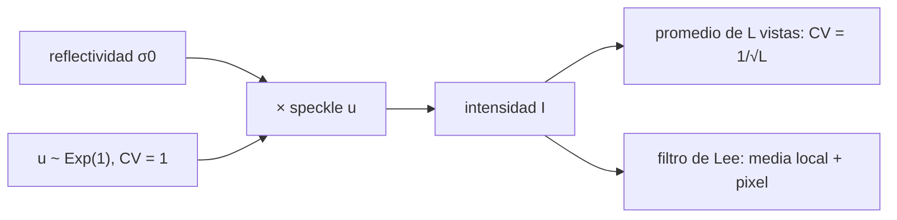

# B69-C03 — Ruido speckle y filtrado en imágenes SAR

<!-- nav:top -->
[🏠 Programa](../../../../README.md) · [📚 Bloque B69](../../../tronco-comun/B69-radar-de-apertura-sintetica-e-interferometria-profundizacion.md) · [← Anterior: B69-C02 — Formación de imágenes SAR](../B69-C02-formacion-de-imagenes-sar/CLASE.md) · [Siguiente: B69-C04 — Polarimetría SAR →](../B69-C04-polarimetria-sar/CLASE.md)
<!-- /nav -->

## 1. Ubicación, nivel y alcance

Clase 3 del bloque B69. Nivel N3. Una imagen SAR de una zona homogénea no es lisa: tiene un granulado llamado **speckle**, que no es ruido térmico sino interferencia de los muchos dispersores de cada celda. Aquí caracterizas su estadística (contraste, número equivalente de vistas), la reduces con promedio multivista y con el filtro de Lee y mides qué se gana y qué se pierde en los bordes. Usas [B12](../../../tronco-comun/B12-probabilidad-estadistica-e-incertidumbre.md). Todo es **sintético**.

## 2. Por qué esta clase existe

Un valor de píxel aislado de una imagen SAR no mide la reflectividad de la superficie: es una muestra de una distribución muy ancha. La decisión central: **¿cuánto hay que promediar o filtrar para estimar la reflectividad con una incertidumbre dada, y a qué precio en resolución?**

## 3. Lo que podrás hacer al terminar

1. Explicar el speckle como suma de fasores y como ruido multiplicativo.
2. Calcular el contraste `CV` y el número equivalente de vistas `ENL = media²/varianza`.
3. Predecir `CV = 1/√L` al promediar `L` vistas independientes.
4. Aplicar el filtro de Lee con una ventana de 7 × 7.
5. Medir la ganancia de ENL y el sesgo de la media.
6. Evaluar la preservación de un borde.

La evidencia es la **ficha del speckle y su filtrado** del ejercicio 12 (sección 20).

## 4. Con qué llegas y cómo comprobarlo

1. ¿Qué es una distribución de probabilidad?
2. ¿Qué son la media y la varianza?
3. ¿Qué es un número complejo y su módulo al cuadrado?
4. ¿Qué es una simulación con semilla fija?
5. ¿Qué es una verificación?

<details>
<summary>Ver respuestas</summary>

1. Una función que da la probabilidad de cada valor. 2. La media es el valor promedio; la varianza mide la dispersión alrededor de ella. 3. Un número con parte real e imaginaria; `|z|²` es su intensidad. 4. Una simulación con números aleatorios repetible. 5. Comparar un cálculo con un caso independiente.
</details>

Con cuatro o cinco aciertos, sigue; si no, repasa los prerrequisitos.

## 5. Un caso de contexto y casos de referencia

En una región homogénea de reflectividad 1 (unidades arbitrarias), una vista tiene `CV = 0,9987` y `ENL = 1,003`; con 16 vistas, `CV = 0,2503` y `ENL = 15,96`. El filtro de Lee sube el ENL de 1,01 a 21,19 sin sesgar la media (0,984 → 0,984). Es el **ejemplo conductor**; la escena es **sintética**. La página de NASA Earthdata (S1) cuenta que el speckle aparece cuando la resolución no separa los dispersores y que el multivista lo reduce.

## 6. Vocabulario

El **speckle** es el granulado de interferencia. La **intensidad** es `I = |z|²`. El **contraste** `CV` es la desviación típica dividida por la media. El **ENL** (número equivalente de vistas) mide cuánto speckle queda. El **multivista** promedia `L` vistas independientes. El **filtro de Lee** mezcla la media local y el pixel según el contraste local.

## 7. Modelo mental: muchos espejitos al sol

Como la luz que rebota en un suelo de arena: cada grano refleja con fase distinta y, al sumarlos, algunos puntos brillan y otros quedan oscuros aunque la arena sea uniforme. El patrón se repite si se mira desde el mismo punto.



*Descripción textual:* la intensidad es la reflectividad multiplicada por un speckle exponencial; se reduce promediando vistas o con un filtro adaptativo.

Analogía: granos de arena al sol. Límite: el speckle SAR se repite en adquisiciones idénticas; no es aleatorio entre ellas.

## 8. La explicación, paso a paso

### 8.1 Estadística de una vista

Con muchos dispersores de fase uniforme, el campo complejo es gaussiano circular. La intensidad `I = |z|²` sigue una exponencial con `CV = 1`: la simulación da `0,9987`. La amplitud sigue una distribución de Rayleigh con `CV = √(4/π − 1) = 0,5227`; la simulación da `0,5222`.

### 8.2 Multivista

Al promediar `L` vistas independientes, `CV = 1/√L` y `ENL = L`. El laboratorio obtiene `CV = 0,4993; 0,3335; 0,2503` para `L = 4, 9, 16`. El precio: cada vista se obtiene dividiendo el ancho de banda, por lo que la resolución empeora `L` veces.

### 8.3 Filtro de Lee

En cada pixel: `x̂ = m + k (I − m)`, con `m` la media local en 7 × 7 y `k = 1 − Cu²/Ci²` acotado a [0, 1], con `Cu = 1/√L` el contraste del speckle y `Ci` el local. En una zona homogénea `Ci ≈ Cu`, `k ≈ 0` y se sale la media; cerca de un borde `Ci` es grande, `k → 1` y se conserva el pixel.

### 8.4 Resultados

En la zona de reflectividad 1, el ENL pasa de 1,01 a 21,19; en la de 4, de 0,94 a 16,60; las medias no cambian (0,984 → 0,984 y 4,112 → 4,115).

### 8.5 El borde

En un borde de cociente real 4,00, los cuatro pixeles de cada lado dan 3,79 en la imagen cruda, 2,43 con Lee y 1,93 con un promedio simple 7 × 7: Lee conserva mejor el borde, pero lo suaviza.

### 8.6 Lectura

Filtrar no crea información: cambia resolución por precisión. Las cifras son sintéticas, con speckle totalmente desarrollado e independiente entre pixeles; una imagen real tiene correlación espacial por el sobremuestreo y blancos brillantes que violan el modelo.

## 9. Magnitudes, símbolos y unidades

| Símbolo | Qué es | Unidad | Valor / nota |
|---|---|---|---|
| `I` | intensidad | adimensional (lineal) | módulo al cuadrado del campo |
| `σ₀` | reflectividad media | unidades arbitrarias | 1 y 4 |
| `CV` | contraste | — | 1/√L |
| `ENL` | número equivalente de vistas | — | media²/varianza |
| `L` | vistas promediadas | — | 1, 4, 9, 16 |
| `k` | peso del filtro de Lee | — | 0 a 1 |

## 10. Convenciones y referencias

Escena de 256 × 256 pixeles (fila, columna); borde en la columna 128; semilla 20261109; ventana 7 × 7. Versiones: Python 3.12.9, numpy 2.4.4. Tolerancias: CV 2 % (una vista) y 3 % (multivista); ENL de Lee > 4 × el original.

## 11. De dónde sale lo que afirmamos

| ID | Fuente | Localizador | Respalda | Estado |
|---|---|---|---|---|
| S1 | NASA Earthdata, «Synthetic Aperture Radar (SAR)» | https://www.earthdata.nasa.gov/learn/earth-observation-data-basics/sar | indica que el speckle aparece cuando la resolución no separa los dispersores individuales, que se repite en condiciones de adquisición idénticas y que el multivista lo reduce (página divulgativa; consultada completa el 2026-11-09) | Consultada |

Límites: la fuente es divulgativa y respalda solo la descripción cualitativa del speckle; sus estadísticas y el filtro de Lee los verifica el laboratorio con simulación, y no se consultó el artículo original del filtro.

## 12. Cómo ver el speckle antes y después

| Magnitud | Antes | Después (Lee) |
|---|---|---|
| ENL, zona σ₀ = 1 | 1,01 | 21,19 |
| ENL, zona σ₀ = 4 | 0,94 | 16,60 |
| cociente del borde (verdad 4,00) | 3,79 | 2,43 |

Descripción larga: dos mitades de una imagen, una oscura y otra clara; el granulado es intenso antes del filtro y casi desaparece en las zonas planas después.

## 13. Ejemplo trabajado: el contraste con 9 vistas

**Paso 1 · Contraste.** `CV = 1/√9 = 0,3333`.

**Paso 2 · ENL.** `ENL = 1/CV² = 9`.

**Paso 3 · Precisión.** La desviación relativa de la reflectividad estimada baja a un tercio de la de una vista.

## 14. Distintas formas de abordar el problema

**Por promedio de vistas:** simple, pierde resolución. **Por filtro de Lee:** adaptativo, conserva bordes mejor. **Por modelo:** se estima `σ₀` y su incertidumbre (ENL).

## 15. Práctica guiada

**Ejercicio 1 · guiado.** ¿Cuál es el `CV` de la intensidad con L = 4? *Pasos:* `1/√L`.

<details><summary>Solución comentada</summary>

`0,5`; el laboratorio da 0,4993.
</details>

**Ejercicio 2 · guiado.** ¿Cuál es el ENL de 16 vistas?

<details><summary>Solución comentada</summary>

16.
</details>

**Ejercicio 3 · guiado.** ¿Cuál es el `CV` de la amplitud Rayleigh? *Casi autónomo:* `√(4/π − 1)`.

<details><summary>Solución comentada</summary>

`√0,2732 = 0,5227`.
</details>


## 16. Práctica autónoma, transferencia e integrador

**Ejercicio 4 · autónomo.** ¿Cuántas vistas hacen falta para `CV = 0,1`?

<details><summary>Solución comentada</summary>

`L = 1/0,1² = 100`.
</details>

**Ejercicio 5 · autónomo.** ¿Cuánto ganó el ENL de la zona σ₀ = 1 con Lee?

<details><summary>Solución comentada</summary>

`21,19/1,01 = 21`.
</details>

**Ejercicio 6 · autónomo.** Un promedio 4 × 4 de pixeles independientes, ¿qué ENL da y qué pasa con la resolución?

<details><summary>Solución comentada</summary>

ENL 16; la resolución empeora 4 veces en cada eje.
</details>

**Ejercicio 7 · autónomo.** Si el pixel de intensidad media 4 tiene una vista, ¿cuánto vale su desviación típica?

<details><summary>Solución comentada</summary>

Igual a la media, 4, porque `CV = 1`.
</details>

**Ejercicio 8 · autónomo.** ¿Qué vale `k` en una zona homogénea?

<details><summary>Solución comentada</summary>

`k ≈ 0`: la salida es la media local.
</details>

**Ejercicio 9 · transferencia.** Un colega promedia en dB. ¿Por qué es mejor promediar en lineal?

<details><summary>Solución comentada</summary>

El logaritmo de una variable exponencial tiene media sesgada (analíticamente −2,5 dB respecto del log de la media; valor teórico no medido en el laboratorio), de modo que promediar en dB subestima la reflectividad.
</details>

**Ejercicio 10 · transferencia.** Hay un blanco brillante puntual en la zona homogénea. ¿Qué hará Lee?

<details><summary>Solución comentada</summary>

Su contraste local es alto, `k → 1`, y lo conserva; un promedio simple lo esparciría.
</details>

**Ejercicio 11 · transferencia.** La resolución de azimut es 6 m y quieres 12 vistas con 4 en azimut y 3 en alcance; ¿qué resolución resulta en azimut?

<details><summary>Solución comentada</summary>

`4 × 6 = 24 m`; en alcance se multiplica por 3.
</details>

**Ejercicio 12 · integrador.** Elabora tu *ficha del speckle y su filtrado*: estadística de una vista, tabla multivista, resultados de Lee y lectura del borde.

<details><summary>Solución modelo</summary>

Secciones 8.1–8.6 y los resultados de la sección 17.
</details>


## 17. Laboratorio: estadística del speckle y filtro de Lee

El script [speckle.py](speckle.py) simula speckle totalmente desarrollado, mide `CV` y ENL de una y `L` vistas y filtra una escena sintética de dos regiones con Lee 7 × 7 (**comprueba** el CV al 2–3 %, el ENL al menos 4 veces mayor y el sesgo de la media menor del 3 %).

**Datos:** sin datos observados; escena **sintética** de dos regiones (σ₀ = 1 y 4) y semilla `20261109`. **Predice antes de ejecutar:** ¿el ENL de 16 vistas será cercano a 16? (sí, por `CV = 1/√L`.) **Ejecución del 2026-11-09 (Python 3.12.9, numpy 2.4.4):**

```text
Python 3.12.9 ; numpy 2.4.4
Una vista: media = 0.9985 ; CV = 0.9987 (teorico 1) ; ENL = 1.003
Amplitud: CV = 0.5222 (Rayleigh teorico 0.5227)
Multilook (promedio de L vistas independientes):
  L =  1: CV = 1.0037 (1/sqrt(L) = 1.0000) ; ENL = 0.99
  L =  4: CV = 0.4993 (1/sqrt(L) = 0.5000) ; ENL = 4.01
  L =  9: CV = 0.3335 (1/sqrt(L) = 0.3333) ; ENL = 8.99
  L = 16: CV = 0.2503 (1/sqrt(L) = 0.2500) ; ENL = 15.96
Zona homogenea sigma0 = 1: ENL 1.01 -> 21.19 ; media 0.984 -> 0.984
Zona homogenea sigma0 = 4: ENL 0.94 -> 16.60 ; media 4.112 -> 4.115
Cociente de medias a ambos lados del borde (4 columnas): crudo 3.79 ; Lee 2.43 ; media 7x7 1.93 ; verdad 4.00
Pruebas superadas.
```

```bash
python programa/clases/B69/B69-C03-ruido-speckle-y-filtrado-en-imagenes-sar/speckle.py
```

**Límites:** speckle independiente entre pixeles y regiones homogéneas amplias.

## 18. Errores frecuentes y cómo corregirlos

**Creer que el speckle es ruido térmico.** Se corrige con 8.1.

**Promediar en dB.** Se corrige con el ejercicio 10.

**Filtrar y creer que se ganó información.** Se corrige con 8.6.

**Presentar la escena como real.** Se corrige con la sección 10.

## 19. Cómo sabrás que vas bien

Tras la sección 8: ¿qué resultado esperabas y cuál obtuviste? Si dudas, repasa el ejemplo 13. Tras el laboratorio: ¿qué comprueba? (ver la sección 17). 

## 20. Qué entregas y cómo se evalúa

El producto es tu **ficha del speckle y su filtrado** (ejercicio 12).

| Criterio | Inicial | En desarrollo | Logrado | Destacado |
|---|---|---|---|---|
| Conceptos | Los confunde | Parciales | Los de la clase, con sus límites | Los aplica a un caso nuevo |
| Cálculo | Sin unidades | Con errores | Tablas completas con unidades | Calcula casos nuevos |
| Numérico | Sin comprobar | Un caso | Contraste con la referencia analítica | Interpreta las diferencias |
| Fuentes | Sin fuente | Sin fecha | Fuentes con fecha | Declara lo no consultado |
| Límites | No los nombra | Uno | Tres | Discute qué falta del modelo |

**Condiciones críticas (no se compensan con promedio):** rotular los datos como sintéticos; no presentar lo simulado como observado; citar solo lo consultado.

## 21. Ética, seguridad y límites

Clase educativa: los modelos son simplificados y los datos, sintéticos; no se interpreta ninguna escena real ni se evalúa el riesgo de ningún terreno. No se interpreta ninguna escena real; el filtrado no debe usarse para ocultar o inventar rasgos. Accesibilidad: tablas equivalentes a las gráficas, fórmulas en texto, ejercicios sin conexión.

## 22. Para cerrar y seguir

El speckle tiene `CV = 1` en una vista y baja como `1/√L`; Lee multiplicó el ENL por 21 conservando la media, pero suavizó el borde (2,43 frente a 4,00). Queda una pregunta: ¿qué información adicional dan los canales de polarización?

**Glosario español–inglés.** speckle · *speckle*; vistas · *looks*; número equivalente de vistas · *equivalent number of looks (ENL)*; coeficiente de variación · *coefficient of variation*; filtro de Lee · *Lee filter*.

**Continuidad.** [B69-C04](../B69-C04-polarimetria-sar/CLASE.md) estudia la polarimetría.

**Referencias:** ver sección 11.

<!-- nav:bottom -->
---

[← Anterior: B69-C02 — Formación de imágenes SAR](../B69-C02-formacion-de-imagenes-sar/CLASE.md) · [📚 Bloque B69](../../../tronco-comun/B69-radar-de-apertura-sintetica-e-interferometria-profundizacion.md) · [Siguiente: B69-C04 — Polarimetría SAR →](../B69-C04-polarimetria-sar/CLASE.md)
<!-- /nav -->
