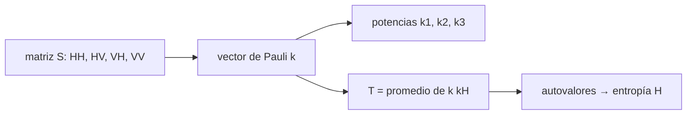

# B69-C04 — Polarimetría SAR

<!-- nav:top -->
[🏠 Programa](../../../../README.md) · [📚 Bloque B69](../../../tronco-comun/B69-radar-de-apertura-sintetica-e-interferometria-profundizacion.md) · [← Anterior: B69-C03 — Ruido speckle y filtrado en imágenes SAR](../B69-C03-ruido-speckle-y-filtrado-en-imagenes-sar/CLASE.md) · [Siguiente: B69-C05 — Coherencia interferométrica y decorrelación →](../B69-C05-coherencia-interferometrica-y-decorrelacion/CLASE.md)
<!-- /nav -->

## 1. Ubicación, nivel y alcance

Clase 4 del bloque B69. Nivel N3. Un SAR puede transmitir y recibir con polarización horizontal (H) o vertical (V): cada combinación (HH, HV, VH, VV) responde de forma distinta a la superficie. Aquí construyes la **matriz de dispersión**, el **vector de Pauli**, las invariancias bajo rotación y la **entropía** de una mezcla de blancos. Usas [B42-C08](../../../tronco-comun/B42-optica-fisica-y-optica-adaptativa.md) solo como idea de polarización de la luz; aquí es la del radar. Los blancos son **sintéticos** e idealizados.

## 2. Por qué esta clase existe

Con un solo canal no se distingue un suelo desnudo de un edificio. La decisión central: **¿qué mecanismo de dispersión domina en un pixel y qué conclusiones se pueden sacar con seguridad de las potencias de los canales?**

## 3. Lo que podrás hacer al terminar

1. Escribir la matriz de dispersión `S` y la reciprocidad `Shv = Svh`.
2. Calcular el vector de Pauli y las potencias `|k₁|²`, `|k₂|²`, `|k₃|²`.
3. Verificar que el span `|Shh|² + 2|Shv|² + |Svv|²` es `|k|²`.
4. Comprobar el efecto de girar un blanco alrededor de la línea de visión.
5. Calcular la matriz de coherencia y la entropía.
6. Relacionar canales con mecanismos de dispersión según la fuente consultada.

La evidencia es la **ficha de la polarimetría** del ejercicio 12 (sección 20).

## 4. Con qué llegas y cómo comprobarlo

1. ¿Qué es la polarización de una onda?
2. ¿Qué es una matriz y un vector complejo?
3. ¿Qué es un autovalor?
4. ¿Qué es una rotación en el plano?
5. ¿Qué es una verificación?

<details>
<summary>Ver respuestas</summary>

1. La orientación del campo eléctrico de la onda. 2. Una tabla de números complejos y una lista de ellos. 3. Un número `λ` tal que `Av = λv` para algún vector `v`. 4. Un giro de los ejes por un ángulo dado. 5. Comparar un cálculo con un caso independiente.
</details>

Con cuatro o cinco aciertos, sigue; si no, repasa los prerrequisitos.

## 5. Un caso de contexto y casos de referencia

Un plano o esfera (`S = diag(1, 1)`) tiene `|k₁|² = 2`; un diedro (`diag(1, −1)`) tiene `|k₂|² = 2`; girado 45° pasa toda su potencia (`2`) a `|k₃|²`. Una mezcla de tres blancos ortogonales tiene entropía 1,0000. Es el **ejemplo conductor**; los blancos son **sintéticos**. NASA Earthdata (S1) asocia las superficies rugosas con VV, el volumen del dosel con polarización cruzada y el doble rebote con HH.

## 6. Vocabulario

La **matriz de dispersión** `S` da la respuesta del blanco para cada par de polarizaciones. El **vector de Pauli** `k = (Shh+Svv, Shh−Svv, 2Shv)/√2` separa dispersión de superficie (`k₁`), doble rebote (`k₂`) y polarización cruzada (`k₃`). El **span** es la potencia total. La **matriz de coherencia** `T = ⟨k kᴴ⟩` promedia. La **entropía** mide cuántos mecanismos se mezclan.

## 7. Modelo mental: una gafa polarizada

Como unas gafas polarizadas que dejan pasar el reflejo del agua en una orientación y no en otra: el canal que miras decide qué parte de la escena se ve.



*Descripción textual:* la matriz de dispersión se transforma en el vector de Pauli, cuyas potencias identifican mecanismos, y su promedio da la matriz de coherencia y la entropía.

Analogía: gafas polarizadas. Límite: el radar controla la polarización de transmisión y recepción de forma independiente y mide también la fase.

## 8. La explicación, paso a paso

### 8.1 Matriz de dispersión

`S = [[Shh, Shv], [Svh, Svv]]` en la base H–V del sensor con convención BSA (retrodispersión). En un medio recíproco `Shv = Svh`, de modo que hay tres elementos complejos independientes.

### 8.2 Pauli

Con `k = (Shh + Svv, Shh − Svv, 2Shv)/√2`, los blancos canónicos dan: plano/esfera, `(2, 0, 0)`; diedro a 0°, `(0, 2, 0)`; dipolo horizontal, `(0,5, 0,5, 0)` (span 1). El span se conserva: `|k|² = |Shh|² + 2|Shv|² + |Svv|²`.

### 8.3 Rotación

Al girar un diedro alrededor de la línea de visión, `|k₁|²` y el span no cambian, pero la potencia pasa de `k₂` a `k₃`: a 22,5° se reparte por igual (1 y 1) y a 45° toda va a `k₃`. Un diedro girado 45° se parece por tanto a un dispersor de volumen (o de polarización cruzada): sin conocer la orientación, el mecanismo es ambiguo.

### 8.4 Entropía

Un blanco único tiene entropía 0. Una mezcla 50/50 de dos blancos da `log₃ 2 = 0,6309`. Una mezcla de tres blancos ortogonales con pesos iguales da 1,0000. La entropía crece con el número de mecanismos presentes.

### 8.5 Lectura

Las potencias de los canales distinguen mecanismos, no objetos: la lectura «edificio» o «bosque» necesita contexto. Los blancos son idealizados, sin ruido ni calibración; una imagen real necesita calibración radiométrica y de fase entre canales.

## 9. Magnitudes, símbolos y unidades

| Símbolo | Qué es | Unidad | Valor / nota |
|---|---|---|---|
| `Shh, Shv, Svv` | elementos de `S` | adimensional (amplitud relativa) | complejos |
| `k` | vector de Pauli | adimensional | 3 componentes |
| span | potencia total | — | 2 para plano |
| `T` | matriz de coherencia | — | 3 × 3 |
| `H` | entropía | — (base 3) | 0 a 1 |
| `θ` | giro alrededor de la línea de visión | rad | 0 a π/2 |

## 10. Convenciones y referencias

Base H–V, convención BSA; giro `S(θ) = R(θ) S R(−θ)`. Semilla 20261109. Versiones: Python 3.12.9, numpy 2.4.4. Tolerancias: invariancias 10⁻¹²; entropía de un blanco 10⁻⁹; mezcla de tres dentro de 0,02 de 1.

## 11. De dónde sale lo que afirmamos

| ID | Fuente | Localizador | Respalda | Estado |
|---|---|---|---|---|
| S1 | NASA Earthdata, «Synthetic Aperture Radar (SAR)» | https://www.earthdata.nasa.gov/learn/earth-observation-data-basics/sar | asocia las superficies rugosas (suelo, agua) con la polarización VV, el volumen del dosel con la polarización cruzada VH/HV y el doble rebote (edificios, troncos, vegetación inundada) con HH (página divulgativa; consultada completa el 2026-11-09) | Consultada |

Límites: la fuente es divulgativa y respalda solo la asociación cualitativa canal–mecanismo; la descomposición de Pauli y la entropía se verifican en el laboratorio y no se consultó una fuente técnica para ellas.

## 12. Cómo ver las potencias de Pauli

| Blanco | span | potencia de k₁ | potencia de k₂ | potencia de k₃ |
|---|---|---|---|---|
| plano/esfera | 2,000 | 2,000 | 0,000 | 0,000 |
| diedro 0° | 2,000 | 0,000 | 2,000 | 0,000 |
| dipolo horizontal | 1,000 | 0,500 | 0,500 | 0,000 |

Descripción larga: tres barras por blanco; el plano concentra la potencia en la primera, el diedro en la segunda y el diedro girado 45° en la tercera.

## 13. Ejemplo trabajado: el vector de Pauli de un dipolo

**Paso 1 · Matriz.** `Shh = 1`, `Svv = 0`, `Shv = 0`.

**Paso 2 · Pauli.** `k = (1, 1, 0)/√2`.

**Paso 3 · Potencias.** `|k₁|² = 0,5`, `|k₂|² = 0,5`, `|k₃|² = 0`; span = 1.

## 14. Distintas formas de abordar el problema

**Por canales:** HH, HV, VV por separado. **Por Pauli:** mecanismos físicos. **Por entropía:** mezcla de mecanismos.

## 15. Práctica guiada

**Ejercicio 1 · guiado.** Pauli de `S = diag(1, −1)`. *Pasos:* sección 8.2.

<details><summary>Solución comentada</summary>

`k = (0, √2, 0)`, `|k₂|² = 2`.
</details>

**Ejercicio 2 · guiado.** Span de `diag(1, 0,5)`. *Pista:* suma de cuadrados.

<details><summary>Solución comentada</summary>

`1 + 0,25 = 1,25`.
</details>

**Ejercicio 3 · guiado.** Potencias de Pauli de `diag(1, 0,5)`. *Casi autónomo.*

<details><summary>Solución comentada</summary>

`|k₁|² = (1,5)²/2 = 1,125`; `|k₂|² = (0,5)²/2 = 0,125`; suman 1,25 = span.
</details>


## 16. Práctica autónoma, transferencia e integrador

**Ejercicio 4 · autónomo.** ¿Qué potencia de Pauli recibe un diedro girado 45°?

<details><summary>Solución comentada</summary>

Toda: `|k₃|² = 2`.
</details>

**Ejercicio 5 · autónomo.** A 22,5°, ¿cómo se reparte la potencia del diedro?

<details><summary>Solución comentada</summary>

`|k₂|² = 1` y `|k₃|² = 1`.
</details>

**Ejercicio 6 · autónomo.** Entropía de una mezcla 80/20 de dos blancos ortogonales.

<details><summary>Solución comentada</summary>

`−(0,8 ln 0,8 + 0,2 ln 0,2)/ln 3 = 0,4555`.
</details>

**Ejercicio 7 · autónomo.** ¿Por qué `|k₁|²` no cambia al girar el blanco?

<details><summary>Solución comentada</summary>

Porque `Shh + Svv` es la traza de `S`, invariante bajo `R S R⁻¹`.
</details>

**Ejercicio 8 · autónomo.** ¿Cuántos elementos complejos independientes tiene `S` si el medio es recíproco?

<details><summary>Solución comentada</summary>

Tres.
</details>

**Ejercicio 9 · transferencia.** Según la fuente consultada, ¿qué canal usarías para detectar vegetación inundada?

<details><summary>Solución comentada</summary>

HH, porque el doble rebote suelo–tronco es sensible a esa polarización (S1); es una pista cualitativa, no un clasificador.
</details>

**Ejercicio 10 · transferencia.** Un pixel muestra alta potencia en `k₃`. ¿Concluyes que es bosque?

<details><summary>Solución comentada</summary>

No: un diedro girado 45° también la produce (sección 8.3); hace falta contexto y orientación.
</details>

**Ejercicio 11 · transferencia.** Una entropía de 0,95 en un pixel: ¿qué dice y qué no?

<details><summary>Solución comentada</summary>

Que hay una mezcla de varios mecanismos; no cuáles ni su proporción.
</details>

**Ejercicio 12 · integrador.** Elabora tu *ficha de la polarimetría*: tabla de Pauli de los tres blancos, efecto de la rotación y entropías de las mezclas.

<details><summary>Solución modelo</summary>

Secciones 8.1–8.5 y los resultados de la sección 17.
</details>


## 17. Laboratorio: matriz de dispersión, Pauli y entropía

El script [polarimetria.py](polarimetria.py) calcula el vector de Pauli de blancos canónicos, verifica las invariancias bajo rotación y la entropía de mezclas (**comprueba** invariancias a 10⁻¹² y la entropía de una mezcla de tres a 0,02).

**Datos:** sin datos observados; blancos canónicos **sintéticos**; semilla `20261109`. **Predice antes de ejecutar:** ¿qué potencia queda en `k₃` tras girar 45° un diedro? (toda: 2.) **Ejecución del 2026-11-09 (Python 3.12.9, numpy 2.4.4):**

```text
Python 3.12.9 ; numpy 2.4.4
blanco           span   |k1|^2   |k2|^2   |k3|^2
plano/esfera    2.000    2.000    0.000    0.000
diedro 0 deg    2.000    0.000    2.000    0.000
dipolo horiz    1.000    0.500    0.500    0.000
Diedro girado alrededor de la linea de vision (potencias de Pauli):
    0.0 deg: |k1|^2 = 0.0000 ; |k2|^2 = 2.0000 ; |k3|^2 = 0.0000 ; span = 2.0000
   22.5 deg: |k1|^2 = 0.0000 ; |k2|^2 = 1.0000 ; |k3|^2 = 1.0000 ; span = 2.0000
   45.0 deg: |k1|^2 = 0.0000 ; |k2|^2 = 0.0000 ; |k3|^2 = 2.0000 ; span = 2.0000
   90.0 deg: |k1|^2 = 0.0000 ; |k2|^2 = 2.0000 ; |k3|^2 = 0.0000 ; span = 2.0000
Un diedro a 45 deg pasa toda su potencia a k3 (cruzada): se confunde con volumen si no se conoce la orientacion.
Entropia de un blanco unico (los tres): 0.000
Mezcla aleatoria de tres blancos ortogonales (pesos ~1/3, 20000 muestras): entropia = 1.0000
Mezcla exacta 50/50 de dos blancos: entropia = 0.6309 (log3 2 = 0.6309)
Pruebas superadas.
```

```bash
python programa/clases/B69/B69-C04-polarimetria-sar/polarimetria.py
```

**Límites:** blancos puntuales, medio recíproco, sin ruido ni calibración.

## 18. Errores frecuentes y cómo corregirlos

**Confundir canal con objeto.** Se corrige con 8.5.

**Ignorar la orientación.** Se corrige con 8.3.

**Creer que entropía alta indica caos.** Es mezcla de mecanismos: 8.4.

**Presentar blancos idealizados como medidos.** Se corrige con la sección 10.

## 19. Cómo sabrás que vas bien

Tras la sección 8: ¿qué resultado esperabas y cuál obtuviste? Si dudas, repasa el ejemplo 13. Tras el laboratorio: ¿qué comprueba? (ver la sección 17). 

## 20. Qué entregas y cómo se evalúa

El producto es tu **ficha de la polarimetría** (ejercicio 12).

| Criterio | Inicial | En desarrollo | Logrado | Destacado |
|---|---|---|---|---|
| Conceptos | Los confunde | Parciales | Los de la clase, con sus límites | Los aplica a un caso nuevo |
| Cálculo | Sin unidades | Con errores | Tablas completas con unidades | Calcula casos nuevos |
| Numérico | Sin comprobar | Un caso | Contraste con la referencia analítica | Interpreta las diferencias |
| Fuentes | Sin fuente | Sin fecha | Fuentes con fecha | Declara lo no consultado |
| Límites | No los nombra | Uno | Tres | Discute qué falta del modelo |

**Condiciones críticas (no se compensan con promedio):** rotular los datos como sintéticos; no presentar lo simulado como observado; citar solo lo consultado.

## 21. Ética, seguridad y límites

Clase educativa: los modelos son simplificados y los datos, sintéticos; no se interpreta ninguna escena real ni se evalúa el riesgo de ningún terreno. No se clasifica ninguna escena real; una clasificación por polarización requiere validación en terreno. Accesibilidad: tablas equivalentes a las gráficas, fórmulas en texto, ejercicios sin conexión.

## 22. Para cerrar y seguir

La matriz de dispersión da un vector de Pauli con span conservado, la rotación mueve la potencia entre `k₂` y `k₃` y la entropía llega a 1,0000 con tres mecanismos. Queda una pregunta: ¿cómo se mide movimiento con la fase de dos imágenes y cuándo es confiable?

**Glosario español–inglés.** matriz de dispersión · *scattering matrix*; polarización cruzada · *cross-polarization*; descomposición de Pauli · *Pauli decomposition*; entropía · *entropy*; doble rebote · *double bounce*.

**Continuidad.** [B69-C05](../B69-C05-coherencia-interferometrica-y-decorrelacion/CLASE.md) estudia la coherencia interferométrica.

**Referencias:** ver sección 11.

<!-- nav:bottom -->
---

[← Anterior: B69-C03 — Ruido speckle y filtrado en imágenes SAR](../B69-C03-ruido-speckle-y-filtrado-en-imagenes-sar/CLASE.md) · [📚 Bloque B69](../../../tronco-comun/B69-radar-de-apertura-sintetica-e-interferometria-profundizacion.md) · [Siguiente: B69-C05 — Coherencia interferométrica y decorrelación →](../B69-C05-coherencia-interferometrica-y-decorrelacion/CLASE.md)
<!-- /nav -->
