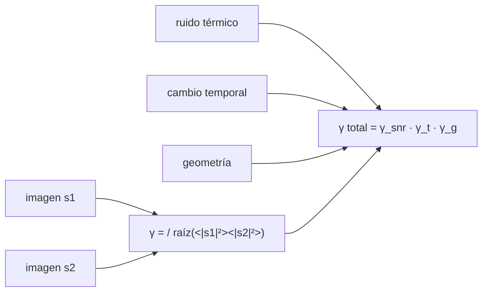

# B69-C05 — Coherencia interferométrica y decorrelación

<!-- nav:top -->
[🏠 Programa](../../../../README.md) · [📚 Bloque B69](../../../tronco-comun/B69-radar-de-apertura-sintetica-e-interferometria-profundizacion.md) · [← Anterior: B69-C04 — Polarimetría SAR](../B69-C04-polarimetria-sar/CLASE.md) · [Siguiente: B69-C06 — Deslizamientos y subsidencia medidos con InSAR →](../B69-C06-deslizamientos-y-subsidencia-medidos-con-insar/CLASE.md)
<!-- /nav -->

## 1. Ubicación, nivel y alcance

Clase 5 del bloque B69. Nivel N3. Un interferograma multiplica una imagen compleja por el conjugado de otra; su fase mide diferencias de distancia, pero solo es útil donde las dos imágenes siguen siendo parecidas. Ese parecido es la **coherencia** `γ`. Aquí defines el estimador, descubres su **sesgo** con pocas vistas y modelas tres decorrelaciones (ruido térmico, cambio temporal y geométrica). Esta clase completa lo que [B57](../../../tronco-comun/B57-observacion-terrestre-y-geociencias-orbitales.md) presenta sobre InSAR sin tratar la coherencia. Todo es **sintético**.

## 2. Por qué esta clase existe

Un interferograma sin coherencia es ruido con aspecto de franjas. La decisión central: **¿cuánto puedo fiarme de la fase de un pixel y qué la degrada?**

## 3. Lo que podrás hacer al terminar

1. Definir `γ = ⟨s₁s₂*⟩/√(⟨|s₁|²⟩⟨|s₂|²⟩)`.
2. Estimar `|γ|` con `N` vistas y conocer su sesgo para `ρ = 0`.
3. Modelar la decorrelación por SNR: `1/(1 + 1/SNR)`.
4. Modelar la temporal: `exp(−½(4πσ_d/λ)²)`.
5. Modelar la geométrica: `|sinc(n)|` con `n` ciclos de franja en la celda.
6. Componer las tres como un producto.

La evidencia es la **ficha de la coherencia** del ejercicio 12 (sección 20).

## 4. Con qué llegas y cómo comprobarlo

1. ¿Qué es un número complejo conjugado?
2. ¿Qué es una correlación entre dos variables?
3. ¿Qué es el sesgo de un estimador?
4. ¿Qué es la relación señal–ruido?
5. ¿Qué es una verificación?

<details>
<summary>Ver respuestas</summary>

1. El mismo número con la parte imaginaria cambiada de signo. 2. Una medida de cuánto varían juntas dos variables. 3. La diferencia entre la media del estimador y el valor verdadero. 4. La razón entre la potencia de la señal y la del ruido. 5. Comparar un cálculo con un caso independiente.
</details>

Con cuatro o cinco aciertos, sigue; si no, repasa los prerrequisitos.

## 5. Un caso de contexto y casos de referencia

Con 9 vistas y dos imágenes sin relación (`ρ = 0`), el estimador no da cero sino `0,2990`; teóricamente `Γ(3/2)Γ(N)/Γ(N+½) = 0,2995`. Con un SNR de 10 la coherencia cae a `0,9091`, con 5 mm de movimiento rms a `0,5294` y con 0,25 ciclos de franja en la celda a `0,9009`. Las tres juntas dan `0,4336`, y el producto de modelos `0,4312`. Es el **ejemplo conductor** y es **sintético**. NASA Earthdata (S1) señala que la coherencia decae rápido en zonas vegetadas y es mayor en banda C, y que InSAR necesita al menos dos observaciones.

## 6. Vocabulario

La **coherencia** `|γ|` va de 0 (sin relación) a 1 (copia exacta). Las **vistas** `N` son pixeles vecinos independientes promediados. La **decorrelación** es la pérdida de coherencia. La **línea de base crítica** es la separación de órbitas para la que `n = 1` ciclo de franja cruza la celda.

## 7. Modelo mental: comparar dos fotocopias

Como comparar dos fotocopias del mismo texto: si son buenas, las letras coinciden; si una se arrugó o se ensució, la comparación pierde sentido. La coherencia es esa coincidencia.



*Descripción textual:* la coherencia compara dos imágenes complejas; ruido, cambio temporal y geometría la reducen de forma multiplicativa.

Analogía: dos fotocopias. Límite: la coherencia mide parecido de la fase del speckle, no del contenido visible.

## 8. La explicación, paso a paso

### 8.1 El estimador y su sesgo

Con `N` vistas, `|γ̂|` no es insesgado: aun con `ρ = 0` vale en promedio `Γ(3/2)Γ(N)/Γ(N+½)`. El laboratorio da `0,2990` (teoría `0,2995`) para `N = 9` y `0,1782` (`0,1781`) para `N = 25`. Con `ρ = 0,5` y `N = 20` el estimador da `0,5158` (sesgo +0,016). Una coherencia estimada menor que 0,3 con pocas vistas es compatible con ninguna coherencia real.

### 8.2 Ruido térmico

Con la misma señal y ruido independiente en cada imagen, `γ_snr = 1/(1 + 1/SNR)`: SNR = 1 → 0,5000; 3 → 0,7501; 10 → 0,9091; 100 → 0,9901.

### 8.3 Cambio temporal

Si los dispersores se mueven al azar `σ_d` (rms, en la línea de visión), `γ_t = exp(−½(4πσ_d/λ)²)`: 2 mm → 0,9030; 5 mm → 0,5294 (modelo 0,5269); 10 mm → 0,0941, donde el sesgo domina. Con λ = 0,0555 m basta medio centímetro de movimiento aleatorio para perder la mitad de la coherencia.

### 8.4 Geometría

Si las dos órbitas difieren, las fases de los dispersores de una celda se desfasan de forma lineal con su posición; con `n` ciclos de franja a lo largo de la celda, `γ_g = |sinc(n)|`: 0,25 → 0,9009; 0,5 → 0,6383 (modelo 0,6366); en `n = 1` la coherencia geométrica es nula (línea de base crítica).

### 8.5 Composición

Con SNR 10, 5 mm y n = 0,25, el producto de modelos es 0,4312 y la simulación da 0,4336.

### 8.6 Lectura

Los modelos son multiplicativos y asumen dispersores independientes y un estimador sin pesos. La relación entre línea de base física y `n` depende de la geometría y no se verifica aquí.

## 9. Magnitudes, símbolos y unidades

| Símbolo | Qué es | Unidad | Valor / nota |
|---|---|---|---|
| `γ` | coherencia | — | 0 a 1 |
| `N` | vistas independientes | — | 9, 20, 25, 400, 2000 |
| `SNR` | relación señal–ruido | potencia lineal | 1 a 100 |
| `σ_d` | movimiento rms en la línea de visión | m | 0,002 a 0,02 |
| `n` | ciclos de franja a través de la celda | — | 0,25 a 1,5 |
| `λ` | longitud de onda | m | 0,0555 (ilustrativa) |

## 10. Convenciones y referencias

Pares de pixeles complejos gaussianos circulares con correlación impuesta; semilla 20261109; fase con `dφ = 4πd/λ`. Versiones: Python 3.12.9, numpy 2.4.4. Tolerancias: modelos al 0,01 donde el modelo supera 0,3.

## 11. De dónde sale lo que afirmamos

| ID | Fuente | Localizador | Respalda | Estado |
|---|---|---|---|---|
| S1 | NASA Earthdata, «Synthetic Aperture Radar (SAR)» | https://www.earthdata.nasa.gov/learn/earth-observation-data-basics/sar | indica que InSAR usa la fase de al menos dos observaciones en fechas distintas, que la coherencia decae rápido en zonas vegetadas y que es mayor en banda C (página divulgativa; consultada completa el 2026-11-09) | Consultada |

Límites: la fuente es divulgativa y respalda solo lo cualitativo; las fórmulas de decorrelación y del sesgo se verifican por simulación, y no se consultó un artículo revisado sobre coherencia.

## 12. Cómo ver la pérdida de coherencia

| Efecto | Parámetro | Medida | Modelo |
|---|---|---|---|
| ruido térmico | SNR = 10 | 0,9091 | 0,9091 |
| temporal | 5 mm | 0,5294 | 0,5269 |
| geométrica | n = 0,5 | 0,6383 | 0,6366 |
| compuesta | SNR 10, 5 mm, n 0,25 | 0,4336 | 0,4312 |

Descripción larga: cuatro curvas decrecientes; la temporal cae más rápido que las otras al aumentar el movimiento.

## 13. Ejemplo trabajado: la coherencia temporal a 5 mm

**Paso 1 · Argumento.** `4πσ_d/λ = 4π × 0,005/0,0555 = 1,132 rad`.

**Paso 2 · Exponente.** `½ × 1,132² = 0,641`.

**Paso 3 · Coherencia.** `exp(−0,641) = 0,527`.

## 14. Distintas formas de abordar el problema

**Por modelo:** fórmulas por efecto. **Por simulación:** pares con la decorrelación impuesta. **Por estimador:** `|γ̂|` con `N` vistas y su sesgo.

## 15. Práctica guiada

**Ejercicio 1 · guiado.** Coherencia por ruido con SNR = 10. *Pasos:* sección 8.2.

<details><summary>Solución comentada</summary>

`1/(1 + 0,1) = 0,9091`.
</details>

**Ejercicio 2 · guiado.** Coherencia geométrica con n = 0,5. *Pista:* `sinc(x) = sin(πx)/(πx)`.

<details><summary>Solución comentada</summary>

`sin(π/2)/(π/2) = 0,6366`.
</details>

**Ejercicio 3 · guiado.** Coherencia temporal a 5 mm (ejemplo 13). *Casi autónomo.*

<details><summary>Solución comentada</summary>

0,527.
</details>


## 16. Práctica autónoma, transferencia e integrador

**Ejercicio 4 · autónomo.** Sesgo del estimador con N = 9 y ρ = 0.

<details><summary>Solución comentada</summary>

`0,2995` teórico; el laboratorio mide 0,2990.
</details>

**Ejercicio 5 · autónomo.** Coherencia compuesta con SNR 10, σ_d 5 mm y n 0,25.

<details><summary>Solución comentada</summary>

`0,9091 × 0,5269 × 0,9003 = 0,4312`.
</details>

**Ejercicio 6 · autónomo.** ¿Qué SNR da `γ_snr = 0,8`?

<details><summary>Solución comentada</summary>

`1/(1 + 1/SNR) = 0,8` → SNR = 4 (6 dB).
</details>

**Ejercicio 7 · autónomo.** ¿Qué movimiento rms da `γ_t = 0,5`?

<details><summary>Solución comentada</summary>

`4πσ/λ = √(2 ln 2) = 1,177` → σ = 5,2 mm.
</details>

**Ejercicio 8 · autónomo.** ¿Y con λ = 0,23 m (banda L, ilustrativa) y σ = 5 mm?

<details><summary>Solución comentada</summary>

`4π × 0,005/0,23 = 0,273`, `γ_t = exp(−0,0373) = 0,963`: una longitud de onda mayor tolera más movimiento.
</details>

**Ejercicio 9 · transferencia.** Un pixel muestra coherencia estimada 0,25 con N = 9. ¿Hay coherencia real?

<details><summary>Solución comentada</summary>

No se puede afirmar: el sesgo con ρ = 0 es ya 0,30.
</details>

**Ejercicio 10 · transferencia.** Los pixeles de un bosque pierden coherencia en un mes. ¿Qué componente sospechas?

<details><summary>Solución comentada</summary>

La temporal: el movimiento de hojas y ramas, del orden de varios mm a cm, supera `λ/4π`; es coherente con lo dicho por la fuente S1 sobre zonas vegetadas.
</details>

**Ejercicio 11 · transferencia.** Para recuperar coherencia, ¿qué puedes cambiar: SNR, tiempo entre pasadas o línea de base?

<details><summary>Solución comentada</summary>

Los tres: más SNR (más potencia o más vistas), pasadas más próximas en el tiempo y una línea de base menor que la crítica (`n` pequeño).
</details>

**Ejercicio 12 · integrador.** Elabora tu *ficha de la coherencia*: tabla de las cuatro decorrelaciones con medida y modelo, el sesgo del estimador y la lectura.

<details><summary>Solución modelo</summary>

Secciones 8.1–8.6 y los resultados de la sección 17.
</details>


## 17. Laboratorio: estimación y decorrelación de la coherencia

El script [coherencia.py](coherencia.py) simula pares de pixeles complejos con correlación impuesta, mide el sesgo del estimador y compara tres decorrelaciones con sus modelos (**comprueba** el sesgo a 3 errores típicos y los modelos a 0,01 donde son mayores que 0,3).

**Datos:** sin datos observados; pares **sintéticos** con semilla `20261109`. **Predice antes de ejecutar:** ¿el estimador dará 0 con dos imágenes no relacionadas? (no: dará ≈ 0,30 con 9 vistas.) **Ejecución del 2026-11-09 (Python 3.12.9, numpy 2.4.4):**

```text
Python 3.12.9 ; numpy 2.4.4
Estimador de |gamma| con N vistas (M = 20000 pixeles por celda):
  rho     N  media estimada  error tipico
 0.90  1000          0.9000        0.0000
 0.50    20          0.5158        0.0008
 0.00     9          0.2990        0.0010
        teorico para rho = 0: 0.2995
 0.00    25          0.1782        0.0006
        teorico para rho = 0: 0.1781
Decorrelacion por ruido termico (SNR en potencia lineal):
  SNR =    1.0 (  0.0 dB): medido 0.5002 ; modelo 0.5000
  SNR =    3.0 (  4.8 dB): medido 0.7501 ; modelo 0.7500
  SNR =   10.0 ( 10.0 dB): medido 0.9091 ; modelo 0.9091
  SNR =  100.0 ( 20.0 dB): medido 0.9901 ; modelo 0.9901
Decorrelacion temporal (sigma_d: movimiento aleatorio rms en la linea de vision):
  sigma_d =   2.0 mm: medido 0.9030 ; modelo 0.9025
  sigma_d =   5.0 mm: medido 0.5294 ; modelo 0.5269
  sigma_d =  10.0 mm: medido 0.0941 ; modelo 0.0770
        (coherencia baja: el estimador con N = 400 vistas tiene un suelo de sesgo ~0.04-0.09; no se compara)
  sigma_d =  20.0 mm: medido 0.0631 ; modelo 0.0000
        (coherencia baja: el estimador con N = 400 vistas tiene un suelo de sesgo ~0.04-0.09; no se compara)
Decorrelacion geometrica (n ciclos de franja a traves de la celda de resolucion):
  n = 0.25: medido 0.9009 ; |sinc(n)| = 0.9003
  n = 0.50: medido 0.6383 ; |sinc(n)| = 0.6366
  n = 1.00: medido 0.0622 ; |sinc(n)| = 0.0000
        (coherencia baja: dominada por el suelo de sesgo del estimador; no se compara)
  n = 1.50: medido 0.2179 ; |sinc(n)| = 0.2122
        (coherencia baja: dominada por el suelo de sesgo del estimador; no se compara)
Compuesta (SNR 10, sigma_d 5 mm, n 0.25): medida 0.4336 ; producto de modelos 0.4312
Pruebas superadas.
```

```bash
python programa/clases/B69/B69-C05-coherencia-interferometrica-y-decorrelacion/coherencia.py
```

**Límites:** dispersores independientes, estimador sin pesos y sin pendiente del terreno.

## 18. Errores frecuentes y cómo corregirlos

**Creer que `|γ̂| = 0` significa «sin relación».** Se corrige con 8.1.

**Sumar las decorrelaciones.** Se multiplican: 8.5.

**Olvidar λ.** Se corrige con el ejercicio 8.

**Presentar los modelos como verificación de un sensor.** Se corrige con la sección 10.

## 19. Cómo sabrás que vas bien

Tras la sección 8: ¿qué resultado esperabas y cuál obtuviste? Si dudas, repasa el ejemplo 13. Tras el laboratorio: ¿qué comprueba? (ver la sección 17). 

## 20. Qué entregas y cómo se evalúa

El producto es tu **ficha de la coherencia** (ejercicio 12).

| Criterio | Inicial | En desarrollo | Logrado | Destacado |
|---|---|---|---|---|
| Conceptos | Los confunde | Parciales | Los de la clase, con sus límites | Los aplica a un caso nuevo |
| Cálculo | Sin unidades | Con errores | Tablas completas con unidades | Calcula casos nuevos |
| Numérico | Sin comprobar | Un caso | Contraste con la referencia analítica | Interpreta las diferencias |
| Fuentes | Sin fuente | Sin fecha | Fuentes con fecha | Declara lo no consultado |
| Límites | No los nombra | Uno | Tres | Discute qué falta del modelo |

**Condiciones críticas (no se compensan con promedio):** rotular los datos como sintéticos; no presentar lo simulado como observado; citar solo lo consultado.

## 21. Ética, seguridad y límites

Clase educativa: los modelos son simplificados y los datos, sintéticos; no se interpreta ninguna escena real ni se evalúa el riesgo de ningún terreno. No se evalúa la coherencia de ningún sitio real. Accesibilidad: tablas equivalentes a las gráficas, fórmulas en texto, ejercicios sin conexión.

## 22. Para cerrar y seguir

La coherencia estimada tiene un suelo de sesgo (0,30 con 9 vistas) y las decorrelaciones se multiplican (0,4336 medida frente a 0,4312). Queda una pregunta: si la coherencia es buena, ¿qué movimiento revela la fase?

**Glosario español–inglés.** coherencia · *coherence*; decorrelación · *decorrelation*; línea de base · *baseline*; vistas · *looks*; interferograma · *interferogram*.

**Continuidad.** [B69-C06](../B69-C06-deslizamientos-y-subsidencia-medidos-con-insar/CLASE.md) mide movimiento del suelo.

**Referencias:** ver sección 11.

<!-- nav:bottom -->
---

[← Anterior: B69-C04 — Polarimetría SAR](../B69-C04-polarimetria-sar/CLASE.md) · [📚 Bloque B69](../../../tronco-comun/B69-radar-de-apertura-sintetica-e-interferometria-profundizacion.md) · [Siguiente: B69-C06 — Deslizamientos y subsidencia medidos con InSAR →](../B69-C06-deslizamientos-y-subsidencia-medidos-con-insar/CLASE.md)
<!-- /nav -->
