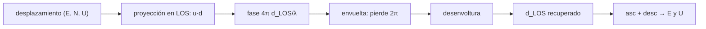

# B69-C06 — Deslizamientos y subsidencia medidos con InSAR

<!-- nav:top -->
[🏠 Programa](../../../../README.md) · [📚 Bloque B69](../../../tronco-comun/B69-radar-de-apertura-sintetica-e-interferometria-profundizacion.md) · [← Anterior: B69-C05 — Coherencia interferométrica y decorrelación](../B69-C05-coherencia-interferometrica-y-decorrelacion/CLASE.md) · [Siguiente: B69-C07 — Evaluación de la calidad de un interferograma →](../B69-C07-evaluacion-de-la-calidad-de-un-interferograma/CLASE.md)
<!-- /nav -->

## 1. Ubicación, nivel y alcance

Clase 6 del bloque B69. Nivel N3. Si la coherencia es alta, la fase interferométrica mide cuánto se acercó o alejó el suelo del sensor, pero solo en la **línea de visión**. Aquí conviertes fase en desplazamiento, ves que una franja equivale a `λ/2 = 27,75 mm`, reconstruyes un cuenco de subsidencia sintético y descompones un deslizamiento con una órbita ascendente y otra descendente. Complementa el caso de terremotos de [B57](../../../tronco-comun/B57-observacion-terrestre-y-geociencias-orbitales.md). Todo es **sintético**: ningún terreno real.

## 2. Por qué esta clase existe

Un solo interferograma no dice si el suelo bajó o se movió al este. La decisión central: **¿qué parte del movimiento real mide la línea de visión, hasta qué gradiente se puede desenvolver y qué se puede concluir?**

## 3. Lo que podrás hacer al terminar

1. Relacionar fase y desplazamiento: `Δφ = 4πd_LOS/λ`.
2. Proyectar un movimiento vertical a la línea de visión: `d_LOS = dU cosθ`.
3. Reconstruir un perfil con desenvoltura y estimar su error.
4. Aplicar el límite de gradiente `λ/4` por pixel.
5. Descomponer un movimiento este–vertical con dos geometrías.
6. Reconocer la poca sensibilidad al movimiento norte–sur.

La evidencia es la **ficha de la deformación** del ejercicio 12 (sección 20).

## 4. Con qué llegas y cómo comprobarlo

1. ¿Qué es un ángulo de incidencia?
2. ¿Qué es la fase envuelta?
3. ¿Qué es un sistema de dos ecuaciones lineales?
4. ¿Qué es el ruido de fase?
5. ¿Qué es una verificación?

<details>
<summary>Ver respuestas</summary>

1. El ángulo entre la vertical del lugar y la dirección al sensor. 2. La fase reducida al intervalo (−π, π]; pierde múltiplos de 2π. 3. Dos ecuaciones con dos incógnitas que se resuelven juntas. 4. Una variación aleatoria de la fase medida. 5. Comparar un cálculo con un caso independiente.
</details>

Con cuatro o cinco aciertos, sigue; si no, repasa los prerrequisitos.

## 5. Un caso de contexto y casos de referencia

Un cuenco gaussiano sintético con 18,0 mm de hundimiento vertical máximo y θ = 34° da un desplazamiento en la línea de visión de −14,92 mm y una fase de −3,379 rad (0,54 franjas). Con 0,3 rad de ruido por pixel, el promedio de los 5 pixeles centrales recupera −18,84 mm (error 0,84 mm). Un deslizamiento sintético de 12 mm/año al este y −5 mm/año vertical se ve como −10,75 mm/año desde la órbita ascendente y +2,46 mm/año desde la descendente. Es el **ejemplo conductor**. NASA Earthdata (S1) cita centímetros de exactitud para InSAR con dos fechas.

## 6. Vocabulario

El **desplazamiento en la línea de visión** (LOS) es la proyección del movimiento sobre la dirección al sensor. **Desenvolver** es recuperar el múltiplo de 2π perdido. Una **franja** es un ciclo de 2π. **Ascendente/descendente** son las dos geometrías de órbita. La **subsidencia** es el hundimiento del terreno.

## 7. Modelo mental: mirar un objeto por una sola rendija

Como medir cuánto se acerca una pelota con un solo ojo: sabes la parte del movimiento a lo largo de tu mirada, no el movimiento lateral. Con dos ojos en posiciones distintas, puedes reconstruirlo en parte.



*Descripción textual:* el desplazamiento se proyecta en la línea de visión, se convierte en fase, se envuelve, se desenvuelve y, con dos geometrías, se descompone en este y vertical.

Analogía: mirar con un solo ojo. Límite: la geometría de dos órbitas resuelve solo dos componentes si se supone la tercera nula.

## 8. La explicación, paso a paso

### 8.1 De fase a desplazamiento

Con la convención `d_LOS > 0` = el suelo se acerca, `Δφ = 4πd_LOS/λ`. Una franja de 2π corresponde a `λ/2 = 27,75 mm`.

### 8.2 Subsidencia

Para un hundimiento vertical `dU`, `d_LOS = dU cosθ`; con 18,0 mm y θ = 34° es −14,92 mm y una fase de −3,379 rad. El gradiente máximo entre pixeles de 20 m es 0,102 rad, muy por debajo del límite `π`.

### 8.3 Reconstrucción

La fase envuelta con ruido gaussiano de 0,3 rad (1,3 mm en LOS) tiene 10 saltos de 2π; al desenvolver, el error rms es 1,355 mm y el máximo 4,916 mm, y el mínimo de una serie ruidosa queda sesgado por el ruido. El promedio de 5 pixeles centrales da −18,84 mm de hundimiento vertical, error de 0,84 mm.

### 8.4 El límite del gradiente

Si el movimiento cambia más de `λ/4 = 13,9 mm` entre pixeles contiguos, la fase salta más de π y la desenvoltura se equivoca. En el caso fuerte (180 mm de hundimiento con s = 40 m) el gradiente máximo es 9,52 rad y el error de la desenvoltura llega a 138,75 mm (cinco franjas de error).

### 8.5 Ascendente y descendente

Con el vector unitario del suelo al sensor `u`, `d_LOS = u·d`. En el ejemplo, `u_asc = (−0,551; −0,097; +0,829)` y `u_des = (+0,551; −0,097; +0,829)` (E, N, U). El deslizamiento (12; 0; −5) mm/año da −10,75 y +2,46 mm/año. Resolver el sistema 2 × 2 con la componente norte nula devuelve 12,000 y −5,000 mm/año; con ruido de 0,5 mm/año en cada medida, el error típico es 0,65 (este) y 0,43 mm/año (vertical).

### 8.6 Lectura

Un movimiento norte de 10 mm/año produce −0,97 mm/año en ambas geometrías: casi invisible (10 %). La descomposición asume la componente norte nula y el sistema es sensible al ruido. Los datos son sintéticos y sin atmósfera; ningún resultado se transfiere a un terreno real.

## 9. Magnitudes, símbolos y unidades

| Símbolo | Qué es | Unidad | Valor / nota |
|---|---|---|---|
| `λ` | longitud de onda | m | 0,0555 (ilustrativa) |
| `θ` | ángulo de incidencia | grados | 34 |
| `d_LOS` | desplazamiento en la línea de visión | m | positivo = hacia el sensor |
| `Δφ` | fase interferométrica | rad | `4πd_LOS/λ` |
| `u` | vector unitario suelo → sensor | — | componentes (E, N, U) |
| `dU` | desplazamiento vertical | m | −0,018 (máximo) |

## 10. Convenciones y referencias

Ejes locales E, N, U en m; órbita a la derecha del rumbo (ascendente −10°, descendente 190°); pixel de 20 m; semilla 20261109. Versiones: Python 3.12.9, numpy 2.4.4. Tolerancias: hundimiento a 2 mm; separación E–U 10⁻⁹ sin ruido.

## 11. De dónde sale lo que afirmamos

| ID | Fuente | Localizador | Respalda | Estado |
|---|---|---|---|---|
| S1 | NASA Earthdata, «Synthetic Aperture Radar (SAR)» | https://www.earthdata.nasa.gov/learn/earth-observation-data-basics/sar | indica que InSAR mide cambios de la superficie con precisión de hasta centímetros usando la fase de al menos dos observaciones, con ejemplos de erupciones y terremotos (página divulgativa; consultada completa el 2026-11-09) | Consultada |

Límites: la fuente es divulgativa y no trata deslizamientos ni subsidencia; la geometría LOS y la descomposición se verifican en el laboratorio y no se consultó un artículo de aplicación.

## 12. Cómo ver el perfil de subsidencia

| Magnitud | Valor |
|---|---|
| hundimiento vertical verdadero | −18,00 mm |
| LOS verdadero | −14,92 mm |
| recuperado (5 pixeles) | −18,84 mm |
| error rms de la serie | 1,355 mm |
| LOS asc. / desc. del deslizamiento | −10,75 / +2,46 mm/año |

Descripción larga: un cuenco de 800 m de ancho aproximado, de 18 mm de fondo; la fase da apenas más de media franja.

## 13. Ejemplo trabajado: del hundimiento a la fase

**Paso 1 · LOS.** `d_LOS = −18,0 × cos 34° = −14,92 mm`.

**Paso 2 · Fase.** `Δφ = 4π(−0,01492)/0,0555 = −3,379 rad`.

**Paso 3 · Franjas.** `3,379/2π = 0,54`.

## 14. Distintas formas de abordar el problema

**Por perfil:** fase → desplazamiento por pixel. **Por descomposición:** dos geometrías. **Por límite:** gradiente máximo frente a `λ/4`.

## 15. Práctica guiada

**Ejercicio 1 · guiado.** LOS de un hundimiento de 18 mm a 34°. *Pasos:* `dU cosθ`.

<details><summary>Solución comentada</summary>

−14,92 mm.
</details>

**Ejercicio 2 · guiado.** Fase correspondiente. *Pista:* `4πd/λ`.

<details><summary>Solución comentada</summary>

−3,379 rad.
</details>

**Ejercicio 3 · guiado.** Franjas. *Casi autónomo.*

<details><summary>Solución comentada</summary>

0,54.
</details>


## 16. Práctica autónoma, transferencia e integrador

**Ejercicio 4 · autónomo.** ¿Cuánto desplazamiento LOS corresponde a una franja?

<details><summary>Solución comentada</summary>

`λ/2 = 27,75 mm`.
</details>

**Ejercicio 5 · autónomo.** Gradiente máximo de LOS por pixel para desenvolver sin ambigüedad.

<details><summary>Solución comentada</summary>

`λ/4 = 13,9 mm`.
</details>

**Ejercicio 6 · autónomo.** Un LOS de 6,2 mm de un movimiento puramente vertical, ¿cuánto es vertical?

<details><summary>Solución comentada</summary>

`6,2/0,829 = 7,5 mm`.
</details>

**Ejercicio 7 · autónomo.** Resuelve E y U con LOS asc. −10,75 y desc. +2,46 mm/año.

<details><summary>Solución comentada</summary>

E = 12,0 y U = −5,0 mm/año (sección 8.5).
</details>

**Ejercicio 8 · autónomo.** ¿Qué fracción de un movimiento norte ve la geometría del ejemplo?

<details><summary>Solución comentada</summary>

Un 10 % (0,097).
</details>

**Ejercicio 9 · transferencia.** Una ladera se mueve 10 mm hacia el este y hacia abajo 30° (componentes 8,66 E y −5,00 U). ¿Qué LOS dan ascendente y descendente?

<details><summary>Solución comentada</summary>

Asc.: −0,551×8,66 + 0,829×(−5,0) = −8,9 mm; desc.: +0,551×8,66 − 4,15 = +0,6 mm: la órbita descendente casi no lo ve.
</details>

**Ejercicio 10 · transferencia.** Un hundimiento rápido de 180 mm: ¿qué ajuste de adquisición permitiría desenvolver?

<details><summary>Solución comentada</summary>

Interferogramas con menos tiempo de separación (menos desplazamiento), pixeles más pequeños o una longitud de onda mayor; todos reducen el gradiente por pixel.
</details>

**Ejercicio 11 · transferencia.** ¿Es legítimo concluir riesgo de deslizamiento de un interferograma sintético?

<details><summary>Solución comentada</summary>

No: no es una medida, el caso es ilustrativo y se requiere validación en terreno.
</details>

**Ejercicio 12 · integrador.** Elabora tu *ficha de la deformación*: el perfil de subsidencia, la reconstrucción con error, el límite del gradiente y la descomposición ascendente–descendente.

<details><summary>Solución modelo</summary>

Secciones 8.1–8.6 y los resultados de la sección 17.
</details>


## 17. Laboratorio: de la fase al desplazamiento

El script [deformacion_insar.py](deformacion_insar.py) genera la fase de un cuenco de subsidencia y de un deslizamiento sintéticos, desenvuelve con ruido y descompone con dos geometrías (**comprueba** el hundimiento a 2 mm, el fallo con gradiente fuerte y la descomposición exacta a 10⁻⁹).

**Datos:** sin datos observados; deformación **sintética**; semilla `20261109`. **Predice antes de ejecutar:** ¿la desenvoltura fallará con 180 mm de hundimiento en 40 m? (sí.) **Ejecución del 2026-11-09 (Python 3.12.9, numpy 2.4.4):**

```text
Python 3.12.9 ; numpy 2.4.4
lambda/2 = 27.75 mm de movimiento en la linea de vision por franja (2 pi de fase)
Subsidencia vertical maxima = -18.0 mm -> LOS maximo = -14.92 mm -> fase maxima = -3.379 rad
Gradiente de fase maximo entre pixeles = 0.102 rad (limite pi = 3.142)
Fase envuelta: 10 saltos de 2 pi ; error rms de la reconstruccion = 1.355 mm ; error maximo = 4.916 mm
Hundimiento vertical recuperado (promedio de 5 pixeles centrales) = -18.84 mm (verdad -18.00 mm)
Caso de gradiente fuerte (180 mm de hundimiento en s = 40 m): gradiente maximo 9.52 rad ; error maximo de la desenvoltura = 138.75 mm
Vision ascendente: u = (E -0.551, N -0.097, U +0.829) ; descendente: u = (E +0.551, N -0.097, U +0.829)
Deslizamiento sintetico dE = +12 mm/ano, dU = -5 mm/ano: LOS ascendente = -10.75 ; descendente = +2.46 mm/ano
Descomposicion sin ruido (supone dN = 0): dE = 12.000, dU = -5.000 mm/ano
Con ruido de 0.5 mm/ano en cada LOS: error tipico en E = 0.65 mm/ano ; en U = 0.43 mm/ano
Un movimiento norte de 10 mm/ano produce LOS ascendente -0.97 y descendente -0.97 mm/ano: casi invisible
Pruebas superadas.
```

```bash
python programa/clases/B69/B69-C06-deslizamientos-y-subsidencia-medidos-con-insar/deformacion_insar.py
```

**Límites:** una dimensión, sin atmósfera ni topografía residual, y componente norte supuesta nula.

## 18. Errores frecuentes y cómo corregirlos

**Creer que InSAR mide el movimiento vertical directamente.** Se corrige con 8.2.

**Ignorar el límite del gradiente.** Se corrige con 8.4.

**Olvidar la geometría ascendente/descendente.** Se corrige con 8.5.

**Interpretar una simulación como un riesgo real.** Se corrige con la sección 10.

## 19. Cómo sabrás que vas bien

Tras la sección 8: ¿qué resultado esperabas y cuál obtuviste? Si dudas, repasa el ejemplo 13. Tras el laboratorio: ¿qué comprueba? (ver la sección 17). 

## 20. Qué entregas y cómo se evalúa

El producto es tu **ficha de la deformación** (ejercicio 12).

| Criterio | Inicial | En desarrollo | Logrado | Destacado |
|---|---|---|---|---|
| Conceptos | Los confunde | Parciales | Los de la clase, con sus límites | Los aplica a un caso nuevo |
| Cálculo | Sin unidades | Con errores | Tablas completas con unidades | Calcula casos nuevos |
| Numérico | Sin comprobar | Un caso | Contraste con la referencia analítica | Interpreta las diferencias |
| Fuentes | Sin fuente | Sin fecha | Fuentes con fecha | Declara lo no consultado |
| Límites | No los nombra | Uno | Tres | Discute qué falta del modelo |

**Condiciones críticas (no se compensan con promedio):** rotular los datos como sintéticos; no presentar lo simulado como observado; citar solo lo consultado.

## 21. Ética, seguridad y límites

Clase educativa: los modelos son simplificados y los datos, sintéticos; no se interpreta ninguna escena real ni se evalúa el riesgo de ningún terreno. No se evalúa el riesgo de ninguna ladera ni se informa sobre movimientos reales; una decisión de seguridad exige datos validados y especialistas. Accesibilidad: tablas equivalentes a las gráficas, fórmulas en texto, ejercicios sin conexión.

## 22. Para cerrar y seguir

Con coherencia alta, 0,54 franjas recuperan 18 mm de hundimiento dentro de 0,84 mm; el límite `λ/4` por pixel rompe la desenvoltura y dos geometrías separan E y U. Queda una pregunta: ¿cómo se decide que un interferograma merece confianza?

**Glosario español–inglés.** línea de visión · *line of sight (LOS)*; desenvoltura de fase · *phase unwrapping*; franja · *fringe*; subsidencia · *subsidence*; órbita ascendente · *ascending orbit*.

**Continuidad.** [B69-C07](../B69-C07-evaluacion-de-la-calidad-de-un-interferograma/CLASE.md) evalúa la calidad del interferograma.

**Referencias:** ver sección 11.

<!-- nav:bottom -->
---

[← Anterior: B69-C05 — Coherencia interferométrica y decorrelación](../B69-C05-coherencia-interferometrica-y-decorrelacion/CLASE.md) · [📚 Bloque B69](../../../tronco-comun/B69-radar-de-apertura-sintetica-e-interferometria-profundizacion.md) · [Siguiente: B69-C07 — Evaluación de la calidad de un interferograma →](../B69-C07-evaluacion-de-la-calidad-de-un-interferograma/CLASE.md)
<!-- /nav -->
