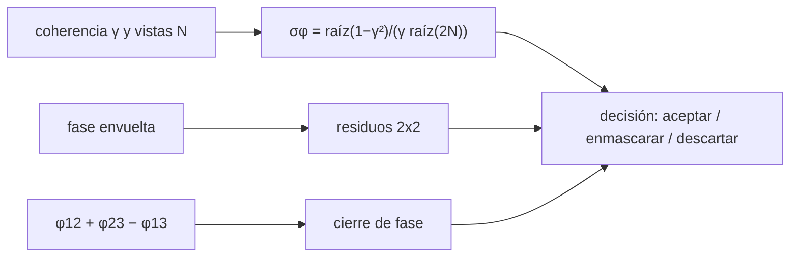

# B69-C07 — Evaluación de la calidad de un interferograma

<!-- nav:top -->
[🏠 Programa](../../../../README.md) · [📚 Bloque B69](../../../tronco-comun/B69-radar-de-apertura-sintetica-e-interferometria-profundizacion.md) · [← Anterior: B69-C06 — Deslizamientos y subsidencia medidos con InSAR](../B69-C06-deslizamientos-y-subsidencia-medidos-con-insar/CLASE.md) · [Siguiente: B70-C01 — Volcanismo basáltico: escudos, fisuras y llanuras planetarias →](../../B70/B70-C01-volcanismo-basaltico-escudos-fisuras-y-llanuras-planetarias/CLASE.md)
<!-- /nav -->

## 1. Ubicación, nivel y alcance

Clase 7 del bloque B69. Nivel N3. Antes de interpretar un movimiento hay que decidir si el interferograma es confiable. Aquí usas tres criterios cuantitativos: la **cota de la desviación de fase** según la coherencia y las vistas, los **residuos** de la fase envuelta, que impiden desenvolver sin ambigüedad, y el **cierre de fase** de tripletes de fechas, que delata sesgos. Usas [B69-C05](../B69-C05-coherencia-interferometrica-y-decorrelacion/CLASE.md) y [B69-C06](../B69-C06-deslizamientos-y-subsidencia-medidos-con-insar/CLASE.md). Todo es **sintético**.

## 2. Por qué esta clase existe

Un interferograma bonito puede ser incorrecto. La decisión central: **¿qué números justifican aceptar, enmascarar o descartar un interferograma?**

## 3. Lo que podrás hacer al terminar

1. Calcular la cota `σ_φ = √(1−γ²)/(γ√(2N))` y convertirla a mm.
2. Contar residuos con lazos de 2 × 2 pixeles.
3. Relacionar la densidad de residuos con la coherencia.
4. Calcular el cierre de fase de un triplete.
5. Distinguir un sesgo sistemático de un ruido aleatorio en el cierre.
6. Redactar un criterio de aceptación con sus límites.

La evidencia es la **ficha de la calidad del interferograma** del ejercicio 12 (sección 20).

## 4. Con qué llegas y cómo comprobarlo

1. ¿Qué es la fase envuelta?
2. ¿Qué es una desviación típica?
3. ¿Qué es una cota inferior de varianza?
4. ¿Qué es una máscara de calidad?
5. ¿Qué es una verificación?

<details>
<summary>Ver respuestas</summary>

1. La fase reducida a (−π, π]. 2. La dispersión alrededor de la media. 3. Un valor que ningún estimador insesgado puede mejorar. 4. Una selección de pixeles aceptados según un criterio. 5. Comparar un cálculo con un caso independiente.
</details>

Con cuatro o cinco aciertos, sigue; si no, repasa los prerrequisitos.

## 5. Un caso de contexto y casos de referencia

Con γ = 0,8 y N = 100, la cota da `σ_φ = 0,0530 rad` y la simulación `0,0536`, es decir 0,23 mm en LOS. Con coherencia 0,6 y 4 vistas hay 16,2 residuos por cada 1000 pixeles; con 0,2, 241,6. Un sesgo sintético de 0,25 rad en un interferograma se ve como un cierre de −0,250 rad (−1,10 mm). Es el **ejemplo conductor**; los datos son **sintéticos**.

## 6. Vocabulario

La **desviación de fase** es la incertidumbre del valor de la fase de un pixel. Un **residuo** es una inconsistencia de la fase envuelta alrededor de un lazo. El **cierre de fase** `φ₁₂ + φ₂₃ − φ₁₃` debe ser cero (mod 2π) si el triplete es consistente. Una **máscara** deja fuera los pixeles de baja calidad.

## 7. Modelo mental: revisar las cuentas por tres caminos

Como comprobar un viaje de A a C pasando por B: la suma de tramos debe coincidir con el viaje directo. Si no coincide, algo sistemático está sesgando alguno de los tramos.



*Descripción textual:* la cota de fase, los residuos y el cierre alimentan una decisión de aceptar, enmascarar o descartar el interferograma.

Analogía: comprobar un viaje con una escala. Límite: un cierre cero no demuestra ausencia de sesgo si el sesgo es común a los tres.

## 8. La explicación, paso a paso

### 8.1 Cota de la desviación de fase

`σ_φ ≈ √(1−γ²)/(γ√(2N))` (cota de Cramér–Rao, válida para `N` grande y `γ` no pequeña). La simulación da: γ = 0,8, N = 100: 0,0536 (cota 0,0530); γ = 0,9: 0,0346 (0,0342); γ = 0,6: 0,0953 (0,0943). Una fase de 0,1 rad equivale a 0,442 mm en la línea de visión.

### 8.2 Residuos

Se suman las diferencias envueltas alrededor de cada lazo de 2 × 2 pixeles; un resultado distinto de cero es un residuo. Con la fase sin ruido hay 0 residuos. Con 4 vistas, los residuos por cada 1000 pixeles son: γ = 0,95 → 0,0; 0,80 → 0,9; 0,60 → 16,2; 0,40 → 91,9; 0,20 → 241,6. La desviación de fase por pixel sube de 0,138 a 1,416 rad.

### 8.3 Cierre de fase

Para un triplete consistente el cierre máximo es 1,78 × 10⁻¹⁵ rad. Con un sesgo de 0,25 rad en el interferograma 13, el cierre medio es −0,250 rad (−1,10 mm). Con ruido (γ = 0,7, 4 vistas), la dispersión del cierre es 0,825 rad: un sesgo pequeño quedaría oculto.

### 8.4 Cómo decidir

Estos tres números no dan un umbral universal. Un criterio razonable lo fija el usuario según la precisión que necesita: por ejemplo, exigir `σ_φ` pequeña frente a la señal esperada, enmascarar donde los residuos son densos y revisar el cierre de los tripletes. El umbral que se elija debe declararse junto con el resultado.

### 8.5 Lectura

El sesgo del cierre en el ejemplo es sintético y conocido. Los pixeles reales tienen atmósfera, topografía residual y errores orbitales que este laboratorio no incluye.

## 9. Magnitudes, símbolos y unidades

| Símbolo | Qué es | Unidad | Valor / nota |
|---|---|---|---|
| `γ` | coherencia | — | 0,2 a 0,95 |
| `N` | vistas | — | 4 o 100 |
| `σ_φ` | desviación de fase | rad | 0,0346 a 1,416 |
| residuos | inconsistencias de lazo | por 1000 pixeles | 0 a 241,6 |
| cierre | `φ₁₂ + φ₂₃ − φ₁₃` | rad | 0 si consistente |
| `λ` | longitud de onda | m | 0,0555 (ilustrativa) |

## 10. Convenciones y referencias

Escena de 128 × 128 pixeles de 20 m; `Δφ = +4πd/λ` como en B69-C06; semilla 20261109. Versiones: Python 3.12.9, numpy 2.4.4. Tolerancias: cota al 5 %; residuos sin ruido 0; cierre exacto 10⁻⁹ rad.

## 11. De dónde sale lo que afirmamos

| ID | Fuente | Localizador | Respalda | Estado |
|---|---|---|---|---|
| S1 | NASA Earthdata, «Synthetic Aperture Radar (SAR)» | https://www.earthdata.nasa.gov/learn/earth-observation-data-basics/sar | indica que InSAR mide cambios de superficie con precisión de centímetros y que la coherencia es un producto que acompaña al interferograma (página divulgativa; consultada completa el 2026-11-09) | Consultada |

Límites: la fuente es divulgativa y no define criterios de calidad; la cota, los residuos y el cierre se verifican en el laboratorio y no se consultó una norma ni una guía de procesamiento.

## 12. Cómo ver la calidad en una tabla

| Coherencia | Residuos por 1000 pixeles | Desviación de fase (rad) |
|---|---|---|
| 0,95 | 0,0 | 0,138 |
| 0,80 | 0,9 | 0,341 |
| 0,60 | 16,2 | 0,639 |
| 0,40 | 91,9 | 1,015 |
| 0,20 | 241,6 | 1,416 |

Descripción larga: los residuos crecen de forma acelerada al bajar la coherencia; con coherencia 0,2 casi un cuarto de los lazos es inconsistente.

## 13. Ejemplo trabajado: la cota con coherencia 0,6

**Paso 1 · Numerador.** `√(1 − 0,36) = 0,8`.

**Paso 2 · Denominador.** `0,6 × √(2 × 100) = 8,485`.

**Paso 3 · Cota.** `0,8/8,485 = 0,0943 rad`.

## 14. Distintas formas de abordar el problema

**Por la cota:** calidad esperada. **Por residuos:** consistencia de la fase. **Por cierre:** consistencia entre fechas.

## 15. Práctica guiada

**Ejercicio 1 · guiado.** Cota de `σ_φ` con γ = 0,8 y N = 100. *Pasos:* sección 8.1.

<details><summary>Solución comentada</summary>

`√0,36/(0,8 × √200) = 0,6/11,31 = 0,0530 rad`.
</details>

**Ejercicio 2 · guiado.** Pásala a mm de LOS. *Pista:* `λ/4π`.

<details><summary>Solución comentada</summary>

`0,0530 × 0,0555/(4π) = 0,234 mm`.
</details>

**Ejercicio 3 · guiado.** Pasa 0,1 rad a mm. *Casi autónomo.*

<details><summary>Solución comentada</summary>

0,442 mm.
</details>


## 16. Práctica autónoma, transferencia e integrador

**Ejercicio 4 · autónomo.** ¿Cuántas vistas hacen falta para `σ_φ = 0,1 rad` con γ = 0,6?

<details><summary>Solución comentada</summary>

`0,8/0,6 = 1,333`; `√(2N) = 13,33`; `N = 89`.
</details>

**Ejercicio 5 · autónomo.** ¿Cuántos residuos por 1000 pixeles con γ = 0,6?

<details><summary>Solución comentada</summary>

16,2.
</details>

**Ejercicio 6 · autónomo.** ¿Qué cierre medio produce un sesgo de 0,25 rad en un interferograma?

<details><summary>Solución comentada</summary>

−0,250 rad (−1,10 mm).
</details>

**Ejercicio 7 · autónomo.** ¿Por qué la dispersión del cierre con ruido (0,825 rad) oculta un sesgo de 0,25 rad?

<details><summary>Solución comentada</summary>

Porque es tres veces mayor que el sesgo; hace falta promediar muchos pixeles.
</details>

**Ejercicio 8 · autónomo.** ¿Qué indica una densidad de residuos de 241,6 por mil?

<details><summary>Solución comentada</summary>

Que la fase envuelta es inconsistente en casi un cuarto de los lazos; la desenvoltura no es fiable.
</details>

**Ejercicio 9 · transferencia.** Un cierre nulo, ¿garantiza ausencia de sesgo?

<details><summary>Solución comentada</summary>

No: un sesgo común a los tres interferogramas (por ejemplo, una rampa orbital) puede cancelarse en el cierre; hace falta contraste con datos independientes.
</details>

**Ejercicio 10 · transferencia.** Dos interferogramas con σ_φ = 0,1 rad y 0,3 rad: ¿cuál da menos error de desplazamiento?

<details><summary>Solución comentada</summary>

El primero: 0,44 mm frente a 1,33 mm.
</details>

**Ejercicio 11 · transferencia.** ¿Con qué criterio enmascararías? Escribe uno y sus límites.

<details><summary>Solución comentada</summary>

Por ejemplo: coherencia estimada ≥ 0,5 con N ≥ 20 y densidad local de residuos < 1 %; los números son ilustrativos y deben declararse en el informe.
</details>

**Ejercicio 12 · integrador.** Elabora tu *ficha de la calidad del interferograma*: la cota de fase, la tabla de residuos, el cierre con y sin sesgo y el criterio propuesto con sus límites.

<details><summary>Solución modelo</summary>

Secciones 8.1–8.5 y los resultados de la sección 17.
</details>


## 17. Laboratorio: calidad de un interferograma sintético

El script [calidad_interferograma.py](calidad_interferograma.py) compara la dispersión simulada de la fase con la cota de Cramér–Rao, cuenta residuos en una escena sintética y calcula el cierre de un triplete con y sin sesgo (**comprueba** la cota al 5 %, 0 residuos sin ruido y el cierre exacto).

**Datos:** sin datos observados; escena **sintética** con fase suave y semilla `20261109`. **Predice antes de ejecutar:** ¿los residuos crecerán al bajar la coherencia? (sí, aceleradamente.) **Ejecución del 2026-11-09 (Python 3.12.9, numpy 2.4.4):**

```text
Python 3.12.9 ; numpy 2.4.4
 gamma     N   sigma simulada (rad)   cota CR (rad)
  0.80   100                 0.0536          0.0530
  0.90   100                 0.0346          0.0342
  0.60   100                 0.0953          0.0943
Equivalencia: 0.1 rad de fase = 0.442 mm en la linea de vision
Fase sin ruido: residuos = 0
 coherencia  vistas  residuos por 1000 pix   desv. fase pix (rad)
       0.95       4                    0.0                  0.138
       0.80       4                    0.9                  0.341
       0.60       4                   16.2                  0.639
       0.40       4                   91.9                  1.015
       0.20       4                  241.6                  1.416
Triplete consistente: cierre maximo = 1.78e-15 rad
Triplete con sesgo de 0.25 rad en el interferograma 13: cierre medio = -0.250 rad (-1.10 mm)
Tres interferogramas con ruido (gamma 0.7, 4 vistas): dispersion del cierre = 0.825 rad
Pruebas superadas.
```

```bash
python programa/clases/B69/B69-C07-evaluacion-de-la-calidad-de-un-interferograma/calidad_interferograma.py
```

**Límites:** sin atmósfera, topografía residual ni error orbital; coherencia uniforme por escena.

## 18. Errores frecuentes y cómo corregirlos

**Aceptar un interferograma solo porque tiene franjas limpias.** Se corrige con 8.2.

**Creer que un cierre nulo prueba la ausencia de sesgo.** Se corrige con 8.3.

**Usar un umbral sin declararlo.** Se corrige con 8.4.

**Presentar la escena como medida.** Se corrige con la sección 10.

## 19. Cómo sabrás que vas bien

Tras la sección 8: ¿qué resultado esperabas y cuál obtuviste? Si dudas, repasa el ejemplo 13. Tras el laboratorio: ¿qué comprueba? (ver la sección 17). 

## 20. Qué entregas y cómo se evalúa

El producto es tu **ficha de la calidad del interferograma** (ejercicio 12).

| Criterio | Inicial | En desarrollo | Logrado | Destacado |
|---|---|---|---|---|
| Conceptos | Los confunde | Parciales | Los de la clase, con sus límites | Los aplica a un caso nuevo |
| Cálculo | Sin unidades | Con errores | Tablas completas con unidades | Calcula casos nuevos |
| Numérico | Sin comprobar | Un caso | Contraste con la referencia analítica | Interpreta las diferencias |
| Fuentes | Sin fuente | Sin fecha | Fuentes con fecha | Declara lo no consultado |
| Límites | No los nombra | Uno | Tres | Discute qué falta del modelo |

**Condiciones críticas (no se compensan con promedio):** rotular los datos como sintéticos; no presentar lo simulado como observado; citar solo lo consultado.

## 21. Ética, seguridad y límites

Clase educativa: los modelos son simplificados y los datos, sintéticos; no se interpreta ninguna escena real ni se evalúa el riesgo de ningún terreno. La decisión de aceptar un resultado InSAR real debe documentar sus umbrales y su incertidumbre; esta clase no evalúa ningún interferograma observado. Accesibilidad: tablas equivalentes a las gráficas, fórmulas en texto, ejercicios sin conexión.

## 22. Para cerrar y seguir

La cota de fase (0,0530 frente a 0,0536 simulado), los residuos (de 0 a 241,6 por mil) y el cierre (−0,250 rad para un sesgo de 0,25) dan tres criterios cuantitativos, ninguno suficiente por sí solo. Esto cierra el bloque: de la señal Doppler a una decisión sobre un resultado de deformación.

**Glosario español–inglés.** residuo · *residue*; cierre de fase · *phase closure*; cota de Cramér–Rao · *Cramér–Rao bound*; máscara · *mask*; calidad del interferograma · *interferogram quality*.

**Continuidad.** Es la última clase del bloque; el siguiente tramo del programa está en la guía del bloque [B69](../../../tronco-comun/B69-radar-de-apertura-sintetica-e-interferometria-profundizacion.md).

**Referencias:** ver sección 11.

<!-- nav:bottom -->
---

[← Anterior: B69-C06 — Deslizamientos y subsidencia medidos con InSAR](../B69-C06-deslizamientos-y-subsidencia-medidos-con-insar/CLASE.md) · [📚 Bloque B69](../../../tronco-comun/B69-radar-de-apertura-sintetica-e-interferometria-profundizacion.md) · [Siguiente: B70-C01 — Volcanismo basáltico: escudos, fisuras y llanuras planetarias →](../../B70/B70-C01-volcanismo-basaltico-escudos-fisuras-y-llanuras-planetarias/CLASE.md)
<!-- /nav -->
