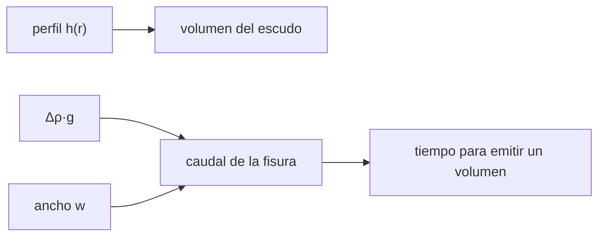

# B70-C01 — Volcanismo basáltico: escudos, fisuras y llanuras planetarias

<!-- nav:top -->
[🏠 Programa](../../../../README.md) · [📚 Bloque B70](../../../tronco-comun/B70-vulcanismo-planetario.md) · [← Anterior: B69-C07 — Evaluación de la calidad de un interferograma](../../B69/B69-C07-evaluacion-de-la-calidad-de-un-interferograma/CLASE.md) · [Siguiente: B70-C02 — Domos volcánicos y vulcanismo evolucionado →](../B70-C02-domos-volcanicos-y-vulcanismo-evolucionado/CLASE.md)
<!-- /nav -->

## 1. Ubicación, nivel y alcance

Clase 1 del bloque B70. Nivel N3. El magma basáltico es fluido y se acumula en tres formas: **escudos** de pendiente suave, **fisuras** que alimentan llanuras y **llanuras** de lava extensas. Aquí cuantificas dos cosas con cálculo propio: el volumen de un escudo a partir de su perfil y el caudal que una fisura puede entregar, y ves cómo cambian con la gravedad. Amplía el panorama de [B53](../../../tronco-comun/B53-astrogeologia-y-geodesia-planetaria.md) con el estudio de los estilos basálticos; los valores del ejemplo son ilustrativos.

## 2. Por qué esta clase existe

Una llanura de lava no dice por sí sola cuánto magma la formó ni cuánto tardó. La decisión central: **¿qué volumen y qué caudal corresponden a este edificio y a esta fisura, y qué cambiaría en otro planeta?**

## 3. Lo que podrás hacer al terminar

1. Calcular el volumen de un escudo con perfil `h = H(1 − r/R)^p`.
2. Comparar una integral numérica con la fórmula cerrada.
3. Obtener el caudal por unidad de longitud de una fisura (flujo de Poiseuille).
4. Escalar el caudal y el ancho de la fisura con la gravedad.
5. Estimar el tiempo de una erupción de fisura para un volumen dado.
6. Rotular qué es consultado, ilustrativo o sintético.

La evidencia es la **ficha del volcanismo basáltico** del ejercicio 12 (sección 20).

## 4. Con qué llegas y cómo comprobarlo

1. ¿Qué es el volumen de un sólido de revolución?
2. ¿Qué es la viscosidad?
3. ¿Qué es la gravedad superficial?
4. ¿Qué es un valor ilustrativo?
5. ¿Qué es una verificación numérica?

<details>
<summary>Ver respuestas</summary>

1. La integral de 2πr·h(r) dr. 2. La resistencia de un fluido a deformarse, en Pa·s. 3. La aceleración g del cuerpo, en m/s². 4. Un valor propuesto para el ejemplo, no medido. 5. Comparar un cálculo con una fórmula independiente.
</details>

Con cuatro o cinco aciertos, sigue; si no, repasa los prerrequisitos.

## 5. Un caso de contexto y casos de referencia

El **ejemplo conductor** es un escudo **sintético** de `H = 8 km` y `R = 150 km` con `p = 2` (volumen `94 248 km³`) y una fisura de `w = 1 m` en lava de `η = 100 Pa·s` y contraste de densidad `200 kg/m³` (todo ilustrativo; no es ningún volcán real). Wilson y Head (1994, solo resumen) razonan que la menor gravedad de Marte favorece reservorios más profundos, diques más anchos y caudales mayores [S4]; aquí solo comprobamos cómo escala el caudal de una rendija con `g`.

## 6. Vocabulario

Un **escudo** es un edificio volcánico ancho y de poca pendiente. Una **fisura** es una grieta alargada por la que sale el magma. Una **llanura volcánica** es una extensión cubierta por coladas. El **flujo de Poiseuille** es el flujo laminar viscoso entre paredes paralelas. El **gradiente de presión** `G = Δρ·g` es la fuerza de flotación por unidad de volumen que empuja el magma. `p` es el exponente del perfil.

## 7. Modelo mental: un cuenco de lava y una rendija

Imagina el escudo como un cuenco invertido cuyo perfil se ajusta con un exponente, y la fisura como una rendija por la que el fluido avanza más rápido en el centro que en las paredes.



*Descripción textual:* el perfil da el volumen del edificio; el gradiente de presión y el ancho dan el caudal de la fisura, y el cociente volumen/caudal da la duración.

Analogía: un cuenco de lava y una rendija. Límite: un edificio real no es perfectamente simétrico y el magma real se enfría y cambia de viscosidad.

## 8. La explicación, paso a paso

### 8.1 Volumen del escudo

Con `h(r) = H(1 − r/R)^p`, el volumen es `V = ∫₀ᴿ 2πr·h dr = 2πHR² / ((p+1)(p+2))`. Con `p = 1` es un cono (`πHR²/3`); si `p` crece el edificio es más «puntiagudo» y encierra menos volumen.

| p | V (km³) | V / V(cono) |
|---|---|---|
| 1 | 188 495,6 | 1,000 |
| 2 | 94 247,8 | 0,500 |
| 3 | 56 548,7 | 0,300 |

### 8.2 Flujo en una fisura

Entre dos paredes separadas `w`, con gradiente `G`, la velocidad es `u(y) = G(w²/4 − y²)/(2η)` y el flujo por unidad de longitud `q = G w³ /(12η)`. Con `w = 1 m`, `η = 100 Pa·s` y `Δρ = 200 kg/m³`:

| Cuerpo | g (m/s²) | q (L/s por m) |
|---|---|---|
| Luna | 1,62 | 270,0 |
| Marte | 3,73 | 621,7 |
| Venus | 8,87 | 1478,3 |
| Tierra | 9,80665 | 1634,4 |

### 8.3 Caudal fijo, ancho variable

Si exigimos el mismo `q` que en la Tierra, `w ∝ g^(−1/3)`: en Marte `w = 1,380 m` y en la Luna `1,823 m`. Es un resultado **de escala**, no una medida de diques reales.

### 8.4 Duración

Para emitir `1 km³` por una fisura de `10 km` con `w = 1 m` tardan `0,71 d` (Tierra), `1,86 d` (Marte) y `4,29 d` (Luna) en este modelo.

## 9. Magnitudes, símbolos y unidades

| Símbolo | Qué es | Unidad | Valor / nota |
|---|---|---|---|
| `H`, `R` | altura y radio basal | m | 8 km, 150 km (ilustrativos) |
| `p` | exponente del perfil | — | 1, 2, 3 |
| `V` | volumen | m³ | 9,42 × 10¹³ para `p = 2` |
| `η` | viscosidad | Pa·s | 100 (ilustrativa) |
| `Δρ` | contraste de densidad | kg/m³ | 200 (ilustrativo) |
| `w` | ancho de la fisura | m | 1 |
| `q` | caudal por unidad de longitud | m²/s | Poiseuille |

## 10. Convenciones y referencias

Sistema de referencia: eje `z` vertical hacia arriba, `r` radial desde el centro; fisura vertical con flujo hacia arriba por gradiente `G`. Gravedades de [S1]–[S3] y `g = 9,80665 m/s²` en la Tierra; sin viscosidad dependiente de la temperatura. Tolerancias: `10⁻⁶` en volumen, `10⁻⁹` en caudal.

## 11. De dónde sale lo que afirmamos

| ID | Fuente | Localizador | Respalda | Consulta | Estado |
|---|---|---|---|---|---|
| S1 | NASA/NSSDC, *Moon Fact Sheet* | https://nssdc.gsfc.nasa.gov/planetary/factsheet/moonfact.html | gravedad 1,62 m/s², radio medio 1737,4 km | 2026-11-09 | Hoja de datos consultada |
| S2 | NASA/NSSDC, *Mars Fact Sheet* | https://nssdc.gsfc.nasa.gov/planetary/factsheet/marsfact.html | gravedad media 3,73 m/s², radio ecuatorial 3396,2 km | 2026-11-09 | Hoja de datos consultada |
| S3 | NASA/NSSDC, *Venus Fact Sheet* | https://nssdc.gsfc.nasa.gov/planetary/factsheet/venusfact.html | gravedad media 8,87 m/s², temperatura superficial media 737 K, radio 6051,8 km | 2026-11-09 | Hoja de datos consultada |
| S4 | L. Wilson y J. W. Head III, *Mars: Review and analysis of volcanic eruption theory and relationships to observed landforms, Rev. Geophys. 32, 221–263 (1994)* | doi:10.1029/94RG01113 | efecto cualitativo de la menor gravedad y presión sobre reservorios, diques, caudales y coladas | 2026-11-09 | Solo metadatos y resumen |

Límites: del resumen de Wilson y Head solo se usa el sentido cualitativo; todo número del escudo y de la fisura es ilustrativo.

## 12. Cómo ver los resultados

| Magnitud | Valor |
|---|---|
| `V` con `p = 2` | 94 248 km³ |
| `q` en Marte | 621,7 L/s por m |
| `q` en la Tierra | 1634,4 L/s por m |
| `w` en Marte a `q` terrestre | 1,380 m |
| duración Tierra / Marte | 0,71 d / 1,86 d |

Descripción larga: el caudal crece con la gravedad y el edificio de `p = 2` contiene la mitad del volumen de un cono.

## 13. Ejemplo trabajado: el volumen del escudo sintético

**Paso 1 · Datos.** `H = 8 × 10³ m`, `R = 1,5 × 10⁵ m`, `p = 2`.

**Paso 2 · Fórmula.** `V = 2πHR²/((p+1)(p+2)) = 2π · 8×10³ · 2,25×10¹⁰ / 12`.

**Paso 3 · Cálculo.** `V = 9,4248 × 10¹³ m³ = 94 248 km³`.

**Paso 4 · Contraste.** La integral numérica de Simpson da el mismo valor.

## 14. Distintas formas de describir el problema

**Por fórmula:** volumen cerrado y `q = Gw³/(12η)`. **Por integración:** Simpson del perfil. **Por tabla:** valores por cuerpo. **Por escala:** `q ∝ g`, `w ∝ g^(−1/3)`.

## 15. Práctica guiada

**Ejercicio 1 · guiado.** Volumen de un cono (`p = 1`) con `H = 8 km` y `R = 150 km`. *Pasos:* sección 8.1.

<details><summary>Solución comentada</summary>

`πHR²/3 = π · 8×10³ · 2,25×10¹⁰/3 = 1,885 × 10¹⁴ m³ = 188 496 km³`.
</details>

**Ejercicio 2 · guiado.** Volumen con `p = 2`. *Pista:* divide por 12 en vez de 3.

<details><summary>Solución comentada</summary>

`94 248 km³`: la mitad del cono.
</details>

**Ejercicio 3 · guiado.** Caudal por metro en Marte. *Casi autónomo.*

<details><summary>Solución comentada</summary>

`G = 200 · 3,73 = 746 Pa/m`; `q = 746 · 1³/(12 · 100) = 0,6217 m²/s = 621,7 L/s` por metro.
</details>

## 16. Práctica autónoma, transferencia e integrador

**Ejercicio 4 · autónomo.** Caudal en la Luna.

<details><summary>Solución comentada</summary>

`G = 324 Pa/m`; `q = 324/1200 = 0,270 m²/s = 270 L/s`.
</details>

**Ejercicio 5 · autónomo.** Cociente de caudales Marte/Tierra.

<details><summary>Solución comentada</summary>

`3,73/9,80665 = 0,380`: coincide con `621,7/1634,4`.
</details>

**Ejercicio 6 · autónomo.** Ancho que la Luna necesita para el caudal terrestre.

<details><summary>Solución comentada</summary>

`(9,80665/1,62)^(1/3) = 1,823 m`.
</details>

**Ejercicio 7 · autónomo.** Tiempo en Venus para `1 km³` por `10 km` de fisura.

<details><summary>Solución comentada</summary>

`q = 1,478 m²/s`; caudal total `1,478 × 10⁴ m³/s`; `10⁹/1,478×10⁴ = 6,76 × 10⁴ s = 0,78 d`.
</details>

**Ejercicio 8 · autónomo.** Volumen con `p = 3` como fracción del cono.

<details><summary>Solución comentada</summary>

`56 549 km³`, es decir `0,30` del cono (`2/((4)(5)) ÷ (1/3) = 0,3`).
</details>

**Ejercicio 9 · transferencia.** **Transferencia.** Un colega dice que el ancho necesario en Marte es `3,73/9,80665` del terrestre. ¿Es correcto?

<details><summary>Solución comentada</summary>

No. A caudal fijo `w ∝ g^(−1/3)`, de modo que en Marte es `1,38` veces el terrestre, no `0,38`. Esto va en el sentido cualitativo de «diques más anchos» del resumen de [S4].
</details>

**Ejercicio 10 · transferencia.** **Transferencia.** Si la viscosidad se multiplica por 10 con el mismo `w` y `g`, ¿cómo cambia `q`? ¿Y qué ancho mantiene `q`?

<details><summary>Solución comentada</summary>

`q` se divide por 10. Para mantener `q`, `w` crece `10^(1/3) = 2,154` veces.
</details>

**Ejercicio 11 · transferencia.** **Transferencia.** Nombra tres efectos que el modelo de rendija omite.

<details><summary>Solución comentada</summary>

Enfriamiento y aumento de viscosidad, variación de `w` con la presión elástica del dique y flujo bifásico con gas. Por eso los números no se aplican a diques reales.
</details>

**Ejercicio 12 · integrador.** **Integrador.** Elabora tu *ficha del volcanismo basáltico*: volumen del escudo, caudal de la fisura en dos cuerpos, escala con `g` y límites.

<details><summary>Solución comentada</summary>

Secciones 8.1–8.4 y 18, con todos los valores rotulados como ilustrativos.
</details>

## 17. Laboratorio: volumen de un escudo y caudal de una fisura

El script [basaltico.py](basaltico.py) calcula el volumen con tres exponentes (fórmula frente a Simpson) y el caudal de la rendija (fórmula frente a integral del perfil de velocidad). **Comprueba** `10⁻⁶` y `10⁻⁹` relativos y la escala `w ∝ g^(−1/3)`.

**Datos:** gravedades de NASA/NSSDC (consultadas 2026-11-09); dimensiones, viscosidad y contraste de densidad **ilustrativos**. **Predice antes de ejecutar:** ¿cuánto menor es el caudal en la Luna que en la Tierra? (cociente `1,62/9,80665`.) **Ejecución del 2026-11-09 (Python 3.12.9):**

```text
Python 3.12.9 (biblioteca estandar)
Escudo (H = 8 km, R = 150 km, ilustrativos): volumen por exponente del perfil
  p = 1: V analitico =   188495.6 km^3 ; numerico =   188495.6 km^3 ; V/V(cono) = 1.000
  p = 2: V analitico =    94247.8 km^3 ; numerico =    94247.8 km^3 ; V/V(cono) = 0.500
  p = 3: V analitico =    56548.7 km^3 ; numerico =    56548.7 km^3 ; V/V(cono) = 0.300
Fisura (w = 1 m, eta = 100 Pa s, drho = 200 kg/m^3, ilustrativos): flujo por metro de fisura
  Luna    g = 1.62000 m/s^2: q =  270.000 L/s por metro ; numerico =  270.000
  Marte   g = 3.73000 m/s^2: q =  621.667 L/s por metro ; numerico =  621.667
  Venus   g = 8.87000 m/s^2: q = 1478.333 L/s por metro ; numerico = 1478.333
  Tierra  g = 9.80665 m/s^2: q = 1634.442 L/s por metro ; numerico = 1634.442
Ancho necesario para el caudal terrestre (q fijo): w = (12 eta q / (drho g))^(1/3)
  Luna   : w = 1.823 m ; w/w(Tierra) = 1.823 ; (g_T/g)^(1/3) = 1.823
  Marte  : w = 1.380 m ; w/w(Tierra) = 1.380 ; (g_T/g)^(1/3) = 1.380
  Venus  : w = 1.034 m ; w/w(Tierra) = 1.034 ; (g_T/g)^(1/3) = 1.034
  Tierra : w = 1.000 m ; w/w(Tierra) = 1.000 ; (g_T/g)^(1/3) = 1.000
Tiempo para emitir 1 km^3 por una fisura de 10 km con w = 1 m (flujo de rendija):
  Luna   :     4.29 dias
  Marte  :     1.86 dias
  Venus  :     0.78 dias
  Tierra :     0.71 dias
Pruebas superadas.
```

```bash
python programa/clases/B70/B70-C01-volcanismo-basaltico-escudos-fisuras-y-llanuras-planetarias/basaltico.py
```

**Límites:** rendija infinita, laminar, isoterma; sin enfriamiento.

## 18. Errores frecuentes y cómo corregirlos

**Confundir volumen de cono con el del escudo.** Se corrige con 8.1.

**Creer que `w ∝ 1/g`.** Se corrige con 8.3.

**Tomar los números ilustrativos como datos de un volcán.** Se corrige con la sección 10.

**Olvidar el enfriamiento.** Se corrige en los límites.

## 19. Cómo sabrás que vas bien

Tras la sección 8: ¿qué resultado esperabas y cuál obtuviste? Si dudas, repasa el ejemplo 13. Tras el laboratorio: ¿qué comprueba? (ver la sección 17). 

## 20. Qué entregas y cómo se evalúa

El producto es tu **ficha del volcanismo basáltico** (ejercicio 12).

| Criterio | Inicial | En desarrollo | Logrado | Destacado |
|---|---|---|---|---|
| Conceptos | Los confunde | Parciales | Conceptos de la clase | Explica los límites |
| Cálculo | Sin unidades | Con errores | Tablas completas | Calcula casos nuevos |
| Numérico | Sin comprobar | Un caso | Contraste con el caso analítico | Interpreta las diferencias |
| Fuentes | Sin fuente | Sin fecha | Fuentes con fecha | Declara lo ilustrativo y lo no consultado |
| Límites | No los nombra | Uno | Tres | Discute qué falta del modelo |

**Condiciones críticas (no se compensan con promedio):** rotular lo ilustrativo; no presentar un volumen sintético como el de un volcán real; citar solo lo consultado.

## 21. Ética, seguridad y límites

Clase educativa: los modelos son simplificados y no pronostican ninguna erupción ni sustituyen una evaluación de peligro volcánico. Los valores no representan ningún volcán. Accesibilidad: tablas equivalentes a las gráficas, fórmulas en texto, ejercicios sin conexión.

## 22. Para cerrar y seguir

El volumen de un escudo y el caudal de una fisura salen de dos fórmulas verificables (`94 248 km³` y `621,7 L/s` por metro en Marte). Queda una pregunta: ¿qué pasa si el magma es tan viscoso que no fluye lejos?

**Glosario español–inglés.** escudo · *shield volcano*; fisura · *fissure*; llanura volcánica · *volcanic plain*; caudal · *flow rate*; viscosidad · *viscosity*.

**Continuidad.** [B70-C02](../B70-C02-domos-volcanicos-y-vulcanismo-evolucionado/CLASE.md) estudia los domos de magmas evolucionados.

**Referencias:** ver sección 11.

<!-- nav:bottom -->
---

[← Anterior: B69-C07 — Evaluación de la calidad de un interferograma](../../B69/B69-C07-evaluacion-de-la-calidad-de-un-interferograma/CLASE.md) · [📚 Bloque B70](../../../tronco-comun/B70-vulcanismo-planetario.md) · [Siguiente: B70-C02 — Domos volcánicos y vulcanismo evolucionado →](../B70-C02-domos-volcanicos-y-vulcanismo-evolucionado/CLASE.md)
<!-- /nav -->
