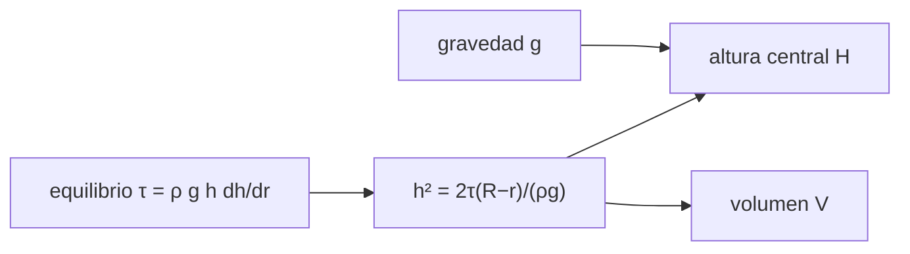

# B70-C02 — Domos volcánicos y vulcanismo evolucionado

<!-- nav:top -->
[🏠 Programa](../../../../README.md) · [📚 Bloque B70](../../../tronco-comun/B70-vulcanismo-planetario.md) · [← Anterior: B70-C01 — Volcanismo basáltico: escudos, fisuras y llanuras planetarias](../B70-C01-volcanismo-basaltico-escudos-fisuras-y-llanuras-planetarias/CLASE.md) · [Siguiente: B70-C03 — Calderas planetarias: formación y colapso →](../B70-C03-calderas-planetarias-formacion-y-colapso/CLASE.md)
<!-- /nav -->

## 1. Ubicación, nivel y alcance

Clase 2 del bloque B70. Nivel N3. Un magma evolucionado (rico en sílice, muy viscoso o con cristales) no se extiende como un basalto: se amontona en un **domo**. Aquí modelas un domo como un material con **resistencia a la fluencia** y obtienes su altura, perfil y volumen, y su dependencia con la gravedad. Los valores son ilustrativos.

## 2. Por qué esta clase existe

Una colina empinada de lava puede tener una altura que solo depende del material y de `g`. La decisión central: **¿qué altura puede alcanzar un domo de resistencia dada y qué cambiaría en otro mundo?**

## 3. Lo que podrás hacer al terminar

1. Plantear el equilibrio de un material plástico en pendiente.
2. Obtener el perfil `h² = 2τ(R − r)/(ρg)`.
3. Calcular altura y volumen y verificarlos con RK4 y Simpson.
4. Escalar la altura con `g^(−1/2)`.
5. Invertir un volumen a un radio.
6. Rotular el alcance del modelo.

La evidencia es la **ficha del domo** del ejercicio 12 (sección 20).

## 4. Con qué llegas y cómo comprobarlo

1. ¿Qué es una ecuación diferencial?
2. ¿Qué es un esfuerzo?
3. ¿Qué es la densidad?
4. ¿Qué es un valor sintético?
5. ¿Qué es la integración numérica?

<details>
<summary>Ver respuestas</summary>

1. Una relación entre una función y su derivada. 2. Una fuerza por unidad de área, en Pa. 3. Masa por unidad de volumen, en kg/m³. 4. Uno propuesto para el ejemplo. 5. Aproximar una integral con sumas.
</details>

Con cuatro o cinco aciertos, sigue; si no, repasa los prerrequisitos.

## 5. Un caso de contexto y casos de referencia

El **ejemplo conductor** es un domo **sintético** de `R = 1500 m`, `ρ = 2400 kg/m³` y `τ = 10⁵ Pa`: en la Tierra su altura central es `112,9 m` y su volumen `0,4256 km³`; con la gravedad de Marte, `183,1 m` y `0,6901 km³`. El modelo plástico perfecto procede de la mecánica del hielo (Nye 1952; solo metadatos consultados [S4]); su uso aquí a un domo de lava es una **analogía de modelado**, no una medida.

## 6. Vocabulario

Un **domo** es un edificio abovedado de magma muy viscoso. La **resistencia a la fluencia** `τ` es el esfuerzo por debajo del cual el material no se deforma. Un material **plástico perfecto** fluye a esfuerzo constante `τ`. El **vulcanismo evolucionado** es el de magmas diferenciados (más sílice, más viscosos).

## 7. Modelo mental: un montón de arena húmeda

Un montón de masa espesa no se aplana del todo: se detiene con una pendiente que equilibra su peso con su resistencia.



*Descripción textual:* el equilibrio entre el peso y la resistencia da el perfil; del perfil salen la altura y el volumen, y la gravedad los modifica.

Analogía: un montón de masa espesa. Límite: un domo real tiene corteza, cristales y enfriamiento.

## 8. La explicación, paso a paso

### 8.1 Equilibrio

En la base, el esfuerzo de corte `ρ g h |dh/dr|` iguala a `τ`. Eso da `dh/dr = −τ/(ρ g h)`. En la variable `u = h²`: `du/dr = −2τ/(ρg)`, con `u(R) = 0`.

### 8.2 Solución

`h² = 2τ(R − r)/(ρ g)`. La altura central es `H = √(2τR/(ρg))` y el volumen `V = (8π/15)√(2τ/(ρg)) R^(5/2)`.

### 8.3 Resultados

| Cuerpo | g (m/s²) | H (m) | V (km³) | H/R |
|---|---|---|---|---|
| Luna | 1,62 | 277,8 | 1,0472 | 0,185 |
| Marte | 3,73 | 183,1 | 0,6901 | 0,122 |
| Venus | 8,87 | 118,7 | 0,4475 | 0,079 |
| Tierra | 9,80665 | 112,9 | 0,4256 | 0,075 |

### 8.4 Domos de igual volumen

Para `V = 1 km³` el radio es `2111 m` en la Tierra y `1740 m` en Marte; la altura sube de `133,9 m` a `197,2 m`.

### 8.5 Lectura

`H(Marte)/H(Tierra) = √(g_T/g_M) = 1,6215`. El modelo dice que a menor gravedad el domo es más alto, a igual resistencia.

## 9. Magnitudes, símbolos y unidades

| Símbolo | Qué es | Unidad | Valor / nota |
|---|---|---|---|
| `ρ` | densidad | kg/m³ | 2400 (ilustrativa) |
| `τ` | resistencia a la fluencia | Pa | 10⁵ (ilustrativa) |
| `g` | gravedad | m/s² | NASA/NSSDC [S1]–[S3] |
| `R` | radio del domo | m | 1500 |
| `H` | altura central | m | calculada |
| `V` | volumen | m³ | calculado |

## 10. Convenciones y referencias

Sistema de referencia: base plana, `r` radial, `h` vertical. Plástico perfecto, sin viscosidad ni enfriamiento. Tolerancia: `10⁻⁹` en altura y `10⁻⁶` en volumen. Las gravedades de [S1]–[S3] son medias globales.

## 11. De dónde sale lo que afirmamos

| ID | Fuente | Localizador | Respalda | Consulta | Estado |
|---|---|---|---|---|---|
| S1 | NASA/NSSDC, *Moon Fact Sheet* | https://nssdc.gsfc.nasa.gov/planetary/factsheet/moonfact.html | gravedad 1,62 m/s², radio medio 1737,4 km | 2026-11-09 | Hoja de datos consultada |
| S2 | NASA/NSSDC, *Mars Fact Sheet* | https://nssdc.gsfc.nasa.gov/planetary/factsheet/marsfact.html | gravedad media 3,73 m/s², radio ecuatorial 3396,2 km | 2026-11-09 | Hoja de datos consultada |
| S3 | NASA/NSSDC, *Venus Fact Sheet* | https://nssdc.gsfc.nasa.gov/planetary/factsheet/venusfact.html | gravedad media 8,87 m/s², temperatura superficial media 737 K, radio 6051,8 km | 2026-11-09 | Hoja de datos consultada |
| S4 | J. F. Nye, *The Mechanics of Glacier Flow, J. Glaciol. (1952)* | doi:10.3189/s0022143000033967 | existencia del modelo plástico perfecto del flujo de hielo (solo bibliografía) | 2026-11-09 | Solo metadatos |

Límites: no se consultó ninguna medición de un domo real; la resistencia a la fluencia es ilustrativa.

## 12. Cómo ver los resultados

| Magnitud | Valor |
|---|---|
| `H` (Tierra) | 112,9 m |
| `H` (Marte) | 183,1 m |
| `V` (Tierra) | 0,4256 km³ |
| `H(M)/H(T)` | 1,6215 |

Descripción larga: el perfil es una parábola en `h²`; la altura baja con la raíz de la gravedad.

## 13. Ejemplo trabajado: la altura terrestre

**Paso 1.** `2τR = 2 · 10⁵ · 1500 = 3 × 10⁸ Pa·m`.

**Paso 2.** `ρg = 2400 · 9,80665 = 23 536 Pa/m`.

**Paso 3.** `H² = 3×10⁸/23 536 = 12 746 m²`, `H = 112,9 m`.

**Paso 4.** RK4 de `du/dr` y la fórmula coinciden a `10⁻⁹`.

## 14. Distintas formas de describir el problema

**Analítica:** `h² = 2τ(R−r)/ρg`. **Numérica:** RK4 en `u = h²` y Simpson para el volumen. **Por tabla:** valores por cuerpo. **Por escala:** `H ∝ g^(−1/2)`.

## 15. Práctica guiada

**Ejercicio 1 · guiado.** Altura de la Tierra con `R = 1500 m`. *Pasos:* sección 13.

<details><summary>Solución comentada</summary>

`H = 112,9 m`.
</details>

**Ejercicio 2 · guiado.** Altura en Marte.

<details><summary>Solución comentada</summary>

`2τR/(ρg) = 3×10⁸/8952 = 33 512`; `H = 183,1 m`.
</details>

**Ejercicio 3 · guiado.** Volumen en la Tierra. *Casi autónomo.*

<details><summary>Solución comentada</summary>

`(8π/15) · 2,915 · 8,714×10⁷ = 4,256 × 10⁸ m³ = 0,4256 km³`.
</details>

## 16. Práctica autónoma, transferencia e integrador

**Ejercicio 4 · autónomo.** `H/R` en la Tierra.

<details><summary>Solución comentada</summary>

`112,9/1500 = 0,075`.
</details>

**Ejercicio 5 · autónomo.** Cociente `H(Marte)/H(Tierra)`.

<details><summary>Solución comentada</summary>

`√(9,80665/3,73) = 1,6215`.
</details>

**Ejercicio 6 · autónomo.** Radio de un domo terrestre de `1 km³`.

<details><summary>Solución comentada</summary>

`2111 m`, con `H = 133,9 m`.
</details>

**Ejercicio 7 · autónomo.** Altura en Venus frente a la Tierra.

<details><summary>Solución comentada</summary>

`118,7` frente a `112,9 m`: `+5 %`, porque las gravedades difieren solo un 10 %.
</details>

**Ejercicio 8 · autónomo.** Si `τ` se duplica con el mismo `R`, ¿cuánto crece `H` en la Tierra?

<details><summary>Solución comentada</summary>

Por `√2`: `159,7 m`.
</details>

**Ejercicio 9 · transferencia.** **Transferencia.** Un colega afirma que la altura de un domo no depende de la gravedad. Responde.

<details><summary>Solución comentada</summary>

Falso en este modelo: `H ∝ g^(−1/2)`; en Marte sería `1,62` veces mayor a igual `τ`.
</details>

**Ejercicio 10 · transferencia.** **Transferencia.** Un domo sintético observado tiene `H = 200 m` y `R = 2000 m`. ¿Qué `τ` implica en la Tierra?

<details><summary>Solución comentada</summary>

`τ = ρ g H²/(2R) = 23 536 · 4×10⁴/4000 = 2,35 × 10⁵ Pa` (valor sintético, solo ilustra la inversión).
</details>

**Ejercicio 11 · transferencia.** **Transferencia.** Nombra dos efectos reales que el modelo omite.

<details><summary>Solución comentada</summary>

La corteza enfriada y los cristales, la variación de la viscosidad con la temperatura y el crecimiento por pulsos.
</details>

**Ejercicio 12 · integrador.** **Integrador.** Elabora tu *ficha del domo*: perfil, altura, volumen en dos cuerpos y límites.

<details><summary>Solución comentada</summary>

Secciones 8.1–8.5 y 18.
</details>

## 17. Laboratorio: perfil plástico de un domo

El script [domos.py](domos.py) integra `du/dr` con RK4, calcula el volumen con Simpson y los compara con las fórmulas cerradas; invierte `V → R` por bisección. **Comprueba** `10⁻⁹` y `10⁻⁶`.

**Datos:** gravedades NASA/NSSDC (2026-11-09); `ρ`, `τ`, `R` **ilustrativos**. **Predice antes de ejecutar:** ¿Cuánto más alto será el domo en Marte? (`√(g_T/g_M)`.) **Ejecución del 2026-11-09 (Python 3.12.9):**

```text
Python 3.12.9 (biblioteca estandar)
Domo con R = 1500 m, rho = 2400 kg/m^3, tau = 1.0e+05 Pa (ilustrativos)
  Luna    g = 1.62000: H =   277.8 m (RK4   277.8) ; V = 1.0472 km^3 (Simpson 1.0472) ; H/R = 0.185
  Marte   g = 3.73000: H =   183.1 m (RK4   183.1) ; V = 0.6901 km^3 (Simpson 0.6901) ; H/R = 0.122
  Venus   g = 8.87000: H =   118.7 m (RK4   118.7) ; V = 0.4475 km^3 (Simpson 0.4475) ; H/R = 0.079
  Tierra  g = 9.80665: H =   112.9 m (RK4   112.9) ; V = 0.4256 km^3 (Simpson 0.4256) ; H/R = 0.075
Cociente H(Marte)/H(Tierra) = 1.6215 ; sqrt(g_T/g_M) = 1.6215
Radio de un domo de 1 km^3 (resistencia fija):
  Luna   : R =  1472.6 m ; H =  275.2 m
  Marte  : R =  1739.9 m ; H =  197.2 m
  Venus  : R =  2069.0 m ; H =  139.4 m
  Tierra : R =  2111.0 m ; H =  133.9 m
Pruebas superadas.
```

```bash
python programa/clases/B70/B70-C02-domos-volcanicos-y-vulcanismo-evolucionado/domos.py
```

**Límites:** plástico perfecto, base plana, sin enfriamiento.

## 18. Errores frecuentes y cómo corregirlos

**Creer que la altura no depende de `g`.** Se corrige con 8.5.

**Tomar `τ` como una propiedad medida.** Se corrige con la sección 10.

**Olvidar que el modelo viene de la mecánica del hielo.** Se corrige en la sección 5.

**Confundir resistencia a la fluencia con viscosidad.** Se corrige en la sección 6.

## 19. Cómo sabrás que vas bien

Tras la sección 8: ¿qué resultado esperabas y cuál obtuviste? Si dudas, repasa el ejemplo 13. Tras el laboratorio: ¿qué comprueba? (ver la sección 17). 

## 20. Qué entregas y cómo se evalúa

El producto es tu **ficha del domo** (ejercicio 12).

| Criterio | Inicial | En desarrollo | Logrado | Destacado |
|---|---|---|---|---|
| Conceptos | Los confunde | Parciales | Conceptos de la clase | Explica los límites |
| Cálculo | Sin unidades | Con errores | Tablas completas | Calcula casos nuevos |
| Numérico | Sin comprobar | Un caso | Contraste con el caso analítico | Interpreta las diferencias |
| Fuentes | Sin fuente | Sin fecha | Fuentes con fecha | Declara lo ilustrativo y lo no consultado |
| Límites | No los nombra | Uno | Tres | Discute qué falta del modelo |

**Condiciones críticas (no se compensan con promedio):** rotular `τ` como ilustrativa; no presentar un domo sintético como medido; citar solo lo consultado.

## 21. Ética, seguridad y límites

Clase educativa: los modelos son simplificados y no pronostican ninguna erupción ni sustituyen una evaluación de peligro volcánico. Los domos son sintéticos. Accesibilidad: tablas equivalentes a las gráficas, fórmulas en texto, ejercicios sin conexión.

## 22. Para cerrar y seguir

El perfil plástico da `112,9 m` y `0,4256 km³` en la Tierra y `183,1 m` en Marte para el mismo material. Queda una pregunta: ¿qué ocurre cuando el techo de una cámara se hunde?

**Glosario español–inglés.** domo · *dome*; resistencia a la fluencia · *yield strength*; plástico perfecto · *perfectly plastic*; magma evolucionado · *evolved magma*.

**Continuidad.** [B70-C03](../B70-C03-calderas-planetarias-formacion-y-colapso/CLASE.md) estudia las calderas.

**Referencias:** ver sección 11.

<!-- nav:bottom -->
---

[← Anterior: B70-C01 — Volcanismo basáltico: escudos, fisuras y llanuras planetarias](../B70-C01-volcanismo-basaltico-escudos-fisuras-y-llanuras-planetarias/CLASE.md) · [📚 Bloque B70](../../../tronco-comun/B70-vulcanismo-planetario.md) · [Siguiente: B70-C03 — Calderas planetarias: formación y colapso →](../B70-C03-calderas-planetarias-formacion-y-colapso/CLASE.md)
<!-- /nav -->
