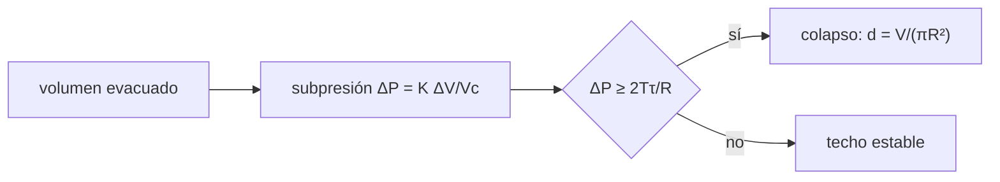

# B70-C03 — Calderas planetarias: formación y colapso

<!-- nav:top -->
[🏠 Programa](../../../../README.md) · [📚 Bloque B70](../../../tronco-comun/B70-vulcanismo-planetario.md) · [← Anterior: B70-C02 — Domos volcánicos y vulcanismo evolucionado](../B70-C02-domos-volcanicos-y-vulcanismo-evolucionado/CLASE.md) · [Siguiente: B70-C04 — Vulcanismo marciano: provincias, edades y evolución →](../B70-C04-vulcanismo-marciano-provincias-edades-y-evolucion/CLASE.md)
<!-- /nav -->

## 1. Ubicación, nivel y alcance

Clase 3 del bloque B70. Nivel N3. Una **caldera** es una depresión que resulta del hundimiento del techo de una cámara cuando se vacía. Aquí planteas una condición de colapso de un **pistón** sostenido por una falla anular y calculas cuánto hundimiento deja un volumen evacuado. Los valores son sintéticos.

## 2. Por qué esta clase existe

Evacuar magma no siempre hunde el techo. La decisión central: **¿cuánta subpresión resiste un techo y cuánto magma hay que sacar para vencerla?**

## 3. Lo que podrás hacer al terminar

1. Escribir el balance de fuerzas del pistón.
2. Obtener `ΔP_c = 2Tτ/R`.
3. Relacionar subpresión y volumen evacuado.
4. Calcular el hundimiento por balance de volumen.
5. Ajustar un coeficiente con datos sintéticos y su error.
6. Declarar los límites del modelo.

La evidencia es la **ficha de la caldera** del ejercicio 12 (sección 20).

## 4. Con qué llegas y cómo comprobarlo

1. ¿Qué es un esfuerzo de corte?
2. ¿Qué es la presión?
3. ¿Qué es un módulo de compresibilidad?
4. ¿Qué es un valor sintético?
5. ¿Qué es un ajuste por mínimos cuadrados?

<details>
<summary>Ver respuestas</summary>

1. Fuerza paralela a una superficie por unidad de área. 2. Fuerza por área, en Pa. 3. Cuánta presión produce un cambio relativo de volumen. 4. Uno propuesto para el ejemplo. 5. Elegir el parámetro que minimiza la suma de cuadrados.
</details>

Con cuatro o cinco aciertos, sigue; si no, repasa los prerrequisitos.

## 5. Un caso de contexto y casos de referencia

El **ejemplo conductor** es una caldera **sintética**: techo de `T = 2 km`, radio `R = 10 km`, resistencia de la falla anular `τ = 10 MPa`, cámara de `500 km³` con módulo efectivo `K = 10 GPa`. Resulta `ΔP_c = 4 MPa` (basta evacuar `0,2 km³`) y, evacuados `50 km³`, el pistón baja `159,2 m`. Ningún dato corresponde a una caldera real; el modelo del pistón es una idealización.

## 6. Vocabulario

El **pistón** es el bloque cilíndrico del techo que desciende. La **falla anular** es la fractura vertical que lo rodea. La **subpresión** `ΔP` es la caída de presión de la cámara respecto de la litostática. `K` es el módulo de compresibilidad efectivo de la cámara. El **balance de volumen** iguala el volumen evacuado con el hueco del hundimiento.

## 7. Modelo mental: un tapón que se desliza

Un tapón ajustado en un tubo resiste hasta que la diferencia de presión vence el rozamiento de sus paredes.



*Descripción textual:* el volumen evacuado genera subpresión; si supera la resistencia de la falla anular el techo colapsa y el hundimiento sigue del balance de volumen.

Analogía: un tapón que se desliza. Límite: el techo real se fractura de forma incremental y no es perfectamente cilíndrico.

## 8. La explicación, paso a paso

### 8.1 Condición de colapso

Fuerza hacia abajo: `πR² ΔP`. Resistencia de la falla anular: `2πR T τ`. Colapso si `ΔP ≥ ΔP_c = 2Tτ/R`. Con los datos del ejemplo, `ΔP_c = 4,000 MPa`.

### 8.2 Sensibilidad

| T (km) | R (km) | T/R | ΔP_c (MPa) |
|---|---|---|---|
| 1 | 10 | 0,10 | 2,00 |
| 2 | 10 | 0,20 | 4,00 |
| 4 | 10 | 0,40 | 8,00 |
| 2 | 20 | 0,10 | 2,00 |
| 2 | 5 | 0,40 | 8,00 |

Un techo ancho y delgado colapsa con menos subpresión.

### 8.3 Volumen mínimo a evacuar

`ΔV = ΔP_c V_c/K = 4×10⁶ · 5×10¹¹/10¹⁰ = 2×10⁸ m³ = 0,2 km³`.

### 8.4 Hundimiento

Tras el colapso, el pistón baja `d = V_ev/(πR²)`. Con `V_ev = 50 km³`, `R = 10 km`: `d = 159,2 m`.

### 8.5 Ajuste sintético

Con 40 calderas sintéticas y ruido de 5 %, el coeficiente de `d = c · V/R²` resulta `0,32527 ± 0,00254` frente a `1/π = 0,31831`: `+2,74` errores típicos, dentro de 3.

### 8.6 Lectura

La gravedad no aparece en `ΔP_c`: en este modelo la resistencia del techo depende de `T`, `τ` y `R`, no de `g`. Es una simplificación, no una conclusión sobre otros planetas.

## 9. Magnitudes, símbolos y unidades

| Símbolo | Qué es | Unidad | Valor / nota |
|---|---|---|---|
| `T` | espesor del techo | m | 2000 (sintético) |
| `R` | radio del pistón | m | 10 000 |
| `τ` | resistencia al corte de la falla | Pa | 10⁷ (sintética) |
| `ΔP_c` | subpresión crítica | Pa | 4 × 10⁶ |
| `K`, `V_c` | módulo y volumen de la cámara | Pa, m³ | 10¹⁰, 5 × 10¹¹ |
| `d` | hundimiento | m | 159,2 |

## 10. Convenciones y referencias

Sistema de referencia: eje vertical, pistón cilíndrico de radio `R`. Tolerancias: `10⁻⁹` en `ΔP_c`, `10⁻⁶` en el volumen y 3 errores típicos en el ajuste. Semilla `20261109`.

## 11. De dónde sale lo que afirmamos

| ID | Fuente | Localizador | Respalda | Consulta | Estado |
|---|---|---|---|---|---|

Límites: no se consultó ninguna fuente para el modelo del pistón; Wilson y Head (1994) no se usan aquí. La fuente solo respalda el panorama cualitativo del vulcanismo marciano; el modelo del pistón no se contrastó con ninguna fuente y sus números son sintéticos.

## 12. Cómo ver los resultados

| Magnitud | Valor |
|---|---|
| `ΔP_c` | 4,000 MPa |
| `ΔV` mínimo | 0,2 km³ |
| `d` para 50 km³ | 159,2 m |
| ajuste | 0,32527 ± 0,00254 |

Descripción larga: la subpresión crítica crece con `T/R`; el hundimiento crece con el volumen evacuado.

## 13. Ejemplo trabajado: el hundimiento de la caldera sintética

**Paso 1.** `V_ev = 50 × 10⁹ m³`, `R = 10⁴ m`.

**Paso 2.** Área `πR² = 3,1416 × 10⁸ m²`.

**Paso 3.** `d = 50×10⁹/3,1416×10⁸ = 159,2 m`.

**Paso 4.** La integral numérica del volumen del cilindro devuelve `50,0000 km³`.

## 14. Distintas formas de describir el problema

**Por fuerzas:** `πR²ΔP = 2πRTτ`. **Por volumen:** `d = V/πR²`. **Por tabla:** sensibilidad. **Por ajuste:** coeficiente `1/π`.

## 15. Práctica guiada

**Ejercicio 1 · guiado.** `ΔP_c` con `T = 1 km`, `R = 10 km`, `τ = 10 MPa`.

<details><summary>Solución comentada</summary>

`2 · 1000 · 10⁷/10⁴ = 2 MPa`.
</details>

**Ejercicio 2 · guiado.** `ΔP_c` con `T = 4 km`.

<details><summary>Solución comentada</summary>

`8 MPa`.
</details>

**Ejercicio 3 · guiado.** Hundimiento para `V = 50 km³` y `R = 10 km`. *Casi autónomo.*

<details><summary>Solución comentada</summary>

`d = 159,2 m`.
</details>

## 16. Práctica autónoma, transferencia e integrador

**Ejercicio 4 · autónomo.** `ΔP_c` con `R = 20 km`, `T = 2 km`.

<details><summary>Solución comentada</summary>

`2 MPa`.
</details>

**Ejercicio 5 · autónomo.** `ΔP_c` con `R = 5 km`.

<details><summary>Solución comentada</summary>

`8 MPa`.
</details>

**Ejercicio 6 · autónomo.** Volumen mínimo a evacuar si `ΔP_c = 2 MPa`.

<details><summary>Solución comentada</summary>

`ΔV = 2×10⁶ · 5×10¹¹/10¹⁰ = 10⁸ m³ = 0,1 km³`.
</details>

**Ejercicio 7 · autónomo.** Volumen mínimo si `K = 20 GPa` y `ΔP_c = 4 MPa`.

<details><summary>Solución comentada</summary>

`0,4 km³`: es proporcional a `K`.
</details>

**Ejercicio 8 · autónomo.** Hundimiento para `V = 50 km³` y `R = 5 km`.

<details><summary>Solución comentada</summary>

`50×10⁹/(π · 25×10⁶) = 636,6 m`.
</details>

**Ejercicio 9 · transferencia.** **Transferencia.** El modelo no contiene `g`. ¿Significa que una caldera colapsa igual en la Luna que en la Tierra?

<details><summary>Solución comentada</summary>

No. Solo que la condición del pistón, tal como se planteó, no la usa; el peso del techo, la litostática y el estado de esfuerzos sí dependen de `g` y quedan fuera de este modelo simplificado.
</details>

**Ejercicio 10 · transferencia.** **Transferencia.** El ajuste da `+2,74` errores típicos. ¿Es un fallo?

<details><summary>Solución comentada</summary>

No: queda dentro de 3, pero cerca del borde. El ruido es multiplicativo y el ajuste sin pesos subestima el error; sería razonable ponderar.
</details>

**Ejercicio 11 · transferencia.** **Transferencia.** Una caldera sintética de radio `20 km` y `d = 100 m`, ¿qué volumen evacuó?

<details><summary>Solución comentada</summary>

`π · 4×10⁸ · 100 = 1,257 × 10¹¹ m³ = 125,7 km³`.
</details>

**Ejercicio 12 · integrador.** **Integrador.** Elabora tu *ficha de la caldera*: `ΔP_c`, volumen mínimo, hundimiento, sensibilidad y límites.

<details><summary>Solución comentada</summary>

Secciones 8.1–8.6 y 18.
</details>

## 17. Laboratorio: colapso de pistón y hundimiento

El script [calderas.py](calderas.py) calcula `ΔP_c` (fórmula frente a bisección), el volumen del cilindro hundido (numérico) y el ajuste de `1/π` con datos sintéticos. **Comprueba** `10⁻⁹`, `10⁻⁶` y 3 errores típicos.

**Datos:** todo **sintético** (sin constantes físicas consultadas); semilla `20261109`. **Predice antes de ejecutar:** ¿Qué tan cerca de `1/π` quedará el coeficiente ajustado? (dentro de 3 errores típicos.) **Ejecución del 2026-11-09 (Python 3.12.9):**

```text
Python 3.12.9 (biblioteca estandar)
Techo T = 2.0 km, R = 10 km, tau = 10 MPa (ilustrativos)
  DeltaP critica = 4.000 MPa ; volumen minimo a evacuar = 0.2000 km^3 de 500 km^3 de camara
Sensibilidad (DeltaP_c proporcional a T/R):
  T = 1 km, R = 10 km: DeltaP_c = 2.00 MPa ; T/R = 0.10
  T = 2 km, R = 10 km: DeltaP_c = 4.00 MPa ; T/R = 0.20
  T = 4 km, R = 10 km: DeltaP_c = 8.00 MPa ; T/R = 0.40
  T = 2 km, R = 20 km: DeltaP_c = 2.00 MPa ; T/R = 0.10
  T = 2 km, R = 5 km: DeltaP_c = 8.00 MPa ; T/R = 0.40
Hundimiento por V_ev = 50 km^3 sobre R = 10 km: d = 159.2 m (volumen numerico 50.0000 km^3)
Ajuste sintetico (40 calderas, ruido 5 %): coeficiente = 0.32527 +- 0.00254 ; 1/pi = 0.31831 ; desviacion = +2.74 errores tipicos
Pruebas superadas.
```

```bash
python programa/clases/B70/B70-C03-calderas-planetarias-formacion-y-colapso/calderas.py
```

**Límites:** pistón rígido, falla vertical, cámara lineal.

## 18. Errores frecuentes y cómo corregirlos

**Creer que cualquier evacuación hunde el techo.** Se corrige con 8.1 y 8.3.

**Confundir subpresión con presión.** Se corrige en la sección 6.

**Omitir que los números son sintéticos.** Se corrige con la sección 10.

**Interpretar el modelo como general.** Se corrige con 8.6.

## 19. Cómo sabrás que vas bien

Tras la sección 8: ¿qué resultado esperabas y cuál obtuviste? Si dudas, repasa el ejemplo 13. Tras el laboratorio: ¿qué comprueba? (ver la sección 17). 

## 20. Qué entregas y cómo se evalúa

El producto es tu **ficha de la caldera** (ejercicio 12).

| Criterio | Inicial | En desarrollo | Logrado | Destacado |
|---|---|---|---|---|
| Conceptos | Los confunde | Parciales | Conceptos de la clase | Explica los límites |
| Cálculo | Sin unidades | Con errores | Tablas completas | Calcula casos nuevos |
| Numérico | Sin comprobar | Un caso | Contraste con el caso analítico | Interpreta las diferencias |
| Fuentes | Sin fuente | Sin fecha | Fuentes con fecha | Declara lo ilustrativo y lo no consultado |
| Límites | No los nombra | Uno | Tres | Discute qué falta del modelo |

**Condiciones críticas (no se compensan con promedio):** rotular los valores como sintéticos; no presentar el modelo como una caldera real; citar solo lo consultado.

## 21. Ética, seguridad y límites

Clase educativa: los modelos son simplificados y no pronostican ninguna erupción ni sustituyen una evaluación de peligro volcánico. Ninguna caldera real se modela. Accesibilidad: tablas equivalentes a las gráficas, fórmulas en texto, ejercicios sin conexión.

## 22. Para cerrar y seguir

El techo cede cuando `ΔP ≥ 2Tτ/R` (`4 MPa` en el ejemplo) y baja `159,2 m` con `50 km³` evacuados. Queda una pregunta: ¿cómo se datan los volcanes de otro planeta?

**Glosario español–inglés.** caldera · *caldera*; pistón · *piston*; falla anular · *ring fault*; subpresión · *underpressure*; hundimiento · *subsidence*.

**Continuidad.** [B70-C04](../B70-C04-vulcanismo-marciano-provincias-edades-y-evolucion/CLASE.md) estudia el vulcanismo de Marte y su datación.

**Referencias:** ver sección 11.

<!-- nav:bottom -->
---

[← Anterior: B70-C02 — Domos volcánicos y vulcanismo evolucionado](../B70-C02-domos-volcanicos-y-vulcanismo-evolucionado/CLASE.md) · [📚 Bloque B70](../../../tronco-comun/B70-vulcanismo-planetario.md) · [Siguiente: B70-C04 — Vulcanismo marciano: provincias, edades y evolución →](../B70-C04-vulcanismo-marciano-provincias-edades-y-evolucion/CLASE.md)
<!-- /nav -->
