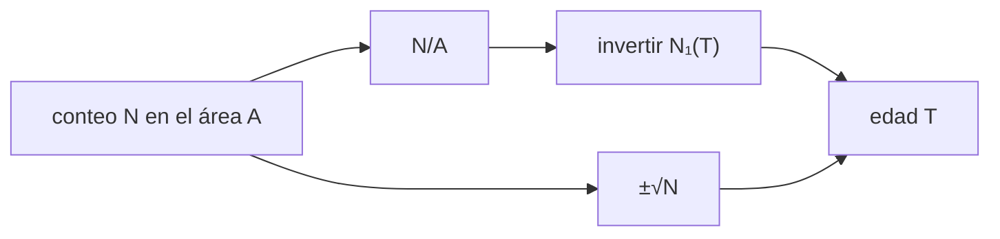

# B70-C04 — Vulcanismo marciano: provincias, edades y evolución

<!-- nav:top -->
[🏠 Programa](../../../../README.md) · [📚 Bloque B70](../../../tronco-comun/B70-vulcanismo-planetario.md) · [← Anterior: B70-C03 — Calderas planetarias: formación y colapso](../B70-C03-calderas-planetarias-formacion-y-colapso/CLASE.md) · [Siguiente: B70-C05 — Actividad volcánica venusina: llanuras, coronas e indicios de actividad reciente →](../B70-C05-actividad-volcanica-venusina-llanuras-coronas-e-indicios-de-actividad-reciente/CLASE.md)
<!-- /nav -->

## 1. Ubicación, nivel y alcance

Clase 4 del bloque B70. Nivel N3. Marte tiene provincias volcánicas como Tharsis y Olimpo; su edad relativa y absoluta se estima contando **cráteres de impacto**. Aquí aprendes a pasar de un conteo a una edad con su incertidumbre de Poisson, usando una cronología **ilustrativa**. Usas [B12](../../../tronco-comun/B12-probabilidad-estadistica-e-incertidumbre.md).

## 2. Por qué esta clase existe

Un conteo de cráteres es un número entero y ruidoso. La decisión central: **¿qué edad y qué incertidumbre le corresponden a una provincia dada su área y su conteo?**

## 3. Lo que podrás hacer al terminar

1. Escribir una función de cronología `N₁(T)`.
2. Invertirla a una edad por bisección.
3. Dar el intervalo de Poisson de la edad.
4. Comprobar la cobertura del intervalo por Monte Carlo.
5. Calcular un caudal eruptivo medio.
6. Distinguir una cronología publicada de una ilustrativa.

La evidencia es la **ficha de la edad de una provincia** del ejercicio 12 (sección 20).

## 4. Con qué llegas y cómo comprobarlo

1. ¿Qué es una distribución de Poisson?
2. ¿Qué es una desviación típica de un conteo?
3. ¿Qué es una función exponencial?
4. ¿Qué es una simulación Monte Carlo?
5. ¿Qué es un valor sintético?

<details>
<summary>Ver respuestas</summary>

1. La de los conteos de eventos independientes con tasa media fija. 2. `√N`. 3. Una función que crece proporcional a sí misma. 4. Repetir con números aleatorios de semilla fija. 5. Uno propuesto para el ejemplo.
</details>

Con cuatro o cinco aciertos, sigue; si no, repasa los prerrequisitos.

## 5. Un caso de contexto y casos de referencia

El **ejemplo conductor** son tres provincias **sintéticas**: A (`40 000 km²`, edad verdadera `3,6 Gyr`, `N = 63` cráteres ≥ 1 km), B (`25 000 km²`, `1,5 Gyr`, `N = 20`) y C (`10 000 km²`, `0,3 Gyr`, `N = 1`). Wilson y Head (1994, solo resumen) relacionan el vulcanismo marciano con su entorno de baja gravedad [S1]. La forma funcional de la cronología es del tipo usado por Hartmann y Neukum (2001); de esa fuente se consultaron solo los metadatos [S2], así que **los coeficientes usados aquí no son los publicados**.

## 6. Vocabulario

La **densidad de cráteres** `N₁` es el número acumulado de cráteres de diámetro ≥ 1 km por km². La **cronología** `N₁(T)` convierte edad `T` en densidad. La **provincia** es una región volcánica con origen común. La **edad de modelo** es la que resulta de aplicar una cronología. La **saturación** ocurre cuando nuevos impactos borran a los anteriores.

## 7. Modelo mental: gotas de lluvia en un patio

Las gotas caen al azar; cuanto más tiempo llueve, más marcas hay, y el conteo fluctúa como `√N`.



*Descripción textual:* el conteo da una densidad; la cronología la convierte en edad y la fluctuación de Poisson da el intervalo.

Analogía: gotas de lluvia en un patio. Límite: los impactos reales se superponen y saturan, y su tasa no es constante.

## 8. La explicación, paso a paso

### 8.1 La cronología

`N₁(T) = a(e^{bT} − 1) + cT`, con `a = 2,0 × 10⁻¹⁴ km⁻²`, `b = 6,0 Gyr⁻¹` y `c = 4,0 × 10⁻⁴ km⁻² Gyr⁻¹` (**ilustrativos**). En `T = 1 Gyr` da `4,0 × 10⁻⁴ km⁻²`; en `3,6 Gyr`, `1,49 × 10⁻³ km⁻²`.

### 8.2 De conteo a edad

Con `N ~ Poisson(A·N₁)`, la estimación es `N₁ = N/A` y `T` sale por bisección. El intervalo de 68 % invierte `(N ± √N)/A`.

| Provincia | A (km²) | T verdadera (Gyr) | N | T estimada (Gyr) |
|---|---|---|---|---|
| A (sintética) | 40 000 | 3,60 | 63 | 3,708 (+0,152 / −0,304) |
| B (sintética) | 25 000 | 1,50 | 20 | 2,000 (±0,447) |
| C (sintética) | 10 000 | 0,30 | 1 | 0,250 (±0,250) |

La asimetría de A viene de que `N₁` crece más rápido a edades altas.

### 8.3 Cobertura

Con 4000 ensayos de Monte Carlo, el intervalo de 68 % cubre la edad verdadera en `0,679` (media de `N` = 16) y `0,707` (media de `N` = 57), dentro del rango admitido `0,62–0,74`.

### 8.4 Caudal medio

Un volumen sintético de `3 × 10⁶ km³` en `3,6 Gyr` equivale a `8,33 × 10⁻⁴ km³/año`.

### 8.5 Lectura

Una edad con `N = 1` tiene incertidumbre del 100 %: el conteo es demasiado pobre. Las edades reales requieren la cronología publicada y la verificación de la saturación; **aquí no se dató ninguna superficie de Marte**.

## 9. Magnitudes, símbolos y unidades

| Símbolo | Qué es | Unidad | Valor / nota |
|---|---|---|---|
| `N₁` | cráteres ≥ 1 km por área | km⁻² | calculada |
| `T` | edad | Gyr | 0–5 |
| `A` | área de la provincia | km² | sintética |
| `N` | conteo | — | entero |
| `a, b, c` | coeficientes de la cronología | km⁻², Gyr⁻¹, km⁻² Gyr⁻¹ | ilustrativos |

## 10. Convenciones y referencias

Sistema de referencia: densidad acumulada de cráteres ≥ 1 km; edades en Gyr (10⁹ años). Semilla `20261109`, 4000 ensayos. Tolerancias: `10⁻¹⁰` en la ida y vuelta y cobertura entre `0,62` y `0,74`.

## 11. De dónde sale lo que afirmamos

| ID | Fuente | Localizador | Respalda | Consulta | Estado |
|---|---|---|---|---|---|
| S1 | L. Wilson y J. W. Head III, *Mars: Review and analysis of volcanic eruption theory and relationships to observed landforms, Rev. Geophys. 32, 221–263 (1994)* | doi:10.1029/94RG01113 | efecto cualitativo de la menor gravedad y presión sobre reservorios, diques, caudales y coladas | 2026-11-09 | Solo metadatos y resumen |
| S2 | W. K. Hartmann y G. Neukum, *Cratering Chronology and the Evolution of Mars, Space Sci. Rev. 96, 165–194 (2001)* | doi:10.1023/A:1011945222010 | existencia de una cronología de cráteres para Marte (solo bibliografía) | 2026-11-09 | Solo metadatos; sin abstract ni coeficientes |

Límites: los coeficientes de la cronología no son los publicados (no se consultaron); ninguna edad de Tharsis ni de Olimpo se afirma.

## 12. Cómo ver los resultados

| Magnitud | Valor |
|---|---|
| `N₁(1 Gyr)` | 4,0 × 10⁻⁴ km⁻² |
| `N₁(3,6 Gyr)` | 1,49 × 10⁻³ km⁻² |
| edad A estimada | 3,708 Gyr |
| cobertura | 0,679 y 0,707 |

Descripción larga: la curva de cronología es casi lineal hasta ~3 Gyr y luego sube de forma exponencial.

## 13. Ejemplo trabajado: la edad de la provincia A

**Paso 1.** Densidad `63/40 000 = 1,575 × 10⁻³ km⁻²`.

**Paso 2.** Se busca `T` con `N₁(T) = 1,575 × 10⁻³`.

**Paso 3.** La bisección da `T = 3,708 Gyr`.

**Paso 4.** El intervalo se obtiene invirtiendo `(63 ± 7,94)/40 000`: `+0,152 / −0,304`.

## 14. Distintas formas de describir el problema

**Por inversión:** bisección de `N₁`. **Por intervalo:** `±√N`. **Por simulación:** cobertura Monte Carlo. **Por tabla:** provincias.

## 15. Práctica guiada

**Ejercicio 1 · guiado.** `N₁(1 Gyr)`. *Pasos:* sección 8.1.

<details><summary>Solución comentada</summary>

`2×10⁻¹⁴(e⁶ − 1) + 4×10⁻⁴ ≈ 4,0 × 10⁻⁴ km⁻²` (el término exponencial es 8 × 10⁻¹²).
</details>

**Ejercicio 2 · guiado.** Cráteres esperados en B (`25 000 km²`, `1,5 Gyr`).

<details><summary>Solución comentada</summary>

`N₁ ≈ 6,0 × 10⁻⁴`; esperados `15`; observados 20.
</details>

**Ejercicio 3 · guiado.** Densidad observada en A. *Casi autónomo.*

<details><summary>Solución comentada</summary>

`63/40 000 = 1,575 × 10⁻³ km⁻²`.
</details>

## 16. Práctica autónoma, transferencia e integrador

**Ejercicio 4 · autónomo.** Incertidumbre relativa del conteo de C.

<details><summary>Solución comentada</summary>

`1/√1 = 100 %`.
</details>

**Ejercicio 5 · autónomo.** Incertidumbre relativa del conteo de A.

<details><summary>Solución comentada</summary>

`1/√63 = 12,6 %`.
</details>

**Ejercicio 6 · autónomo.** ¿Cuántos cráteres hacen falta para 10 % de incertidumbre?

<details><summary>Solución comentada</summary>

`1/√N = 0,1 → N = 100`.
</details>

**Ejercicio 7 · autónomo.** Cráteres esperados en C (`10 000 km²`, `0,3 Gyr`).

<details><summary>Solución comentada</summary>

`N₁ ≈ 1,2 × 10⁻⁴`; esperados `1,2`; observado 1.
</details>

**Ejercicio 8 · autónomo.** Ida y vuelta: ¿qué `T` devuelve `N₁ = 1,488 × 10⁻³`?

<details><summary>Solución comentada</summary>

`3,6 Gyr`.
</details>

**Ejercicio 9 · transferencia.** **Transferencia.** ¿Por qué el intervalo de A es asimétrico?

<details><summary>Solución comentada</summary>

Porque la cronología es convexa: a edades altas un cambio de `N₁` equivale a un cambio menor de `T`; el límite superior queda más cerca.
</details>

**Ejercicio 10 · transferencia.** **Transferencia.** Una lectora propone usar estas edades para fechar Tharsis. ¿Qué respondes?

<details><summary>Solución comentada</summary>

No: los coeficientes son ilustrativos y los conteos, sintéticos. Habría que usar la cronología publicada (no consultada aquí) y conteos reales.
</details>

**Ejercicio 11 · transferencia.** **Transferencia.** Nombra dos sesgos que el modelo omite.

<details><summary>Solución comentada</summary>

Saturación y borrado de cráteres, y variaciones de la tasa de impactos o del tamaño mínimo contado.
</details>

**Ejercicio 12 · integrador.** **Integrador.** Elabora tu *ficha de la edad de una provincia*: densidad, edad, intervalo, cobertura y límites.

<details><summary>Solución comentada</summary>

Secciones 8.1–8.5 y 18.
</details>

## 17. Laboratorio: edad por conteo de cráteres con intervalo de Poisson

El script [edades.py](edades.py) invierte `N₁(T)` por bisección, estima la edad de tres provincias sintéticas y verifica la cobertura del intervalo de 68 % con 4000 ensayos. **Comprueba** la ida y vuelta (`10⁻¹⁰`) y la cobertura (`0,62–0,74`).

**Datos:** todo **sintético**; coeficientes **ilustrativos** (no los publicados); semilla `20261109`. **Predice antes de ejecutar:** ¿Cubrirá el intervalo la edad verdadera cerca del 68 % de las veces? **Ejecución del 2026-11-09 (Python 3.12.9):**

```text
Python 3.12.9 (biblioteca estandar)
Ida y vuelta T -> N1 -> T superada (T = 0,5; 1; 3; 3,8 Gyr).
Provincias sinteticas: edad verdadera, conteo simulado y edad recuperada
  Provincia A (sintetica): A = 40000 km^2 ; T = 3.60 Gyr ; N(>=1 km) = 63 ; T_est = 3.708 (+0.152 / -0.304) Gyr
  Provincia B (sintetica): A = 25000 km^2 ; T = 1.50 Gyr ; N(>=1 km) = 20 ; T_est = 2.000 (+0.447 / -0.447) Gyr
  Provincia C (sintetica): A = 10000 km^2 ; T = 0.30 Gyr ; N(>=1 km) = 1 ; T_est = 0.250 (+0.250 / -0.250) Gyr
Cobertura del intervalo de 68 % (T = 1.0 Gyr, media de N = 16): 0.679
Cobertura del intervalo de 68 % (T = 3.5 Gyr, media de N = 57): 0.707
Caudal medio sintetico: 3.0e+06 km^3 en 3.6 Gyr = 8.33e-04 km^3/ano
Pruebas superadas.
```

```bash
python programa/clases/B70/B70-C04-vulcanismo-marciano-provincias-edades-y-evolucion/edades.py
```

**Límites:** sin saturación; tasa de producción de forma fija.

## 18. Errores frecuentes y cómo corregirlos

**Creer que la cronología es la publicada.** Se corrige en la sección 5.

**Ignorar la incertidumbre del conteo.** Se corrige en 8.2.

**Fechar con pocos cráteres.** Se corrige en 8.5.

**Presentar edades sintéticas como observadas.** Se corrige con la sección 10.

## 19. Cómo sabrás que vas bien

Tras la sección 8: ¿qué resultado esperabas y cuál obtuviste? Si dudas, repasa el ejemplo 13. Tras el laboratorio: ¿qué comprueba? (ver la sección 17). 

## 20. Qué entregas y cómo se evalúa

El producto es tu **ficha de la edad de una provincia** (ejercicio 12).

| Criterio | Inicial | En desarrollo | Logrado | Destacado |
|---|---|---|---|---|
| Conceptos | Los confunde | Parciales | Conceptos de la clase | Explica los límites |
| Cálculo | Sin unidades | Con errores | Tablas completas | Calcula casos nuevos |
| Numérico | Sin comprobar | Un caso | Contraste con el caso analítico | Interpreta las diferencias |
| Fuentes | Sin fuente | Sin fecha | Fuentes con fecha | Declara lo ilustrativo y lo no consultado |
| Límites | No los nombra | Uno | Tres | Discute qué falta del modelo |

**Condiciones críticas (no se compensan con promedio):** rotular coeficientes y conteos como ilustrativos o sintéticos; no afirmar una edad de una provincia real; citar solo lo consultado.

## 21. Ética, seguridad y límites

Clase educativa: los modelos son simplificados y no pronostican ninguna erupción ni sustituyen una evaluación de peligro volcánico. Ninguna superficie real se dató. Accesibilidad: tablas equivalentes a las gráficas, fórmulas en texto, ejercicios sin conexión.

## 22. Para cerrar y seguir

Un conteo de 63 cráteres en `40 000 km²` devuelve `3,71 Gyr` en la cronología ilustrativa, con un intervalo asimétrico. Queda una pregunta: ¿hay vulcanismo activo hoy en Venus?

**Glosario español–inglés.** provincia volcánica · *volcanic province*; cronología de cráteres · *crater chronology*; densidad de cráteres · *crater density*; saturación · *saturation*; intervalo de confianza · *confidence interval*.

**Continuidad.** [B70-C05](../B70-C05-actividad-volcanica-venusina-llanuras-coronas-e-indicios-de-actividad-reciente/CLASE.md) estudia la actividad volcánica de Venus.

**Referencias:** ver sección 11.

<!-- nav:bottom -->
---

[← Anterior: B70-C03 — Calderas planetarias: formación y colapso](../B70-C03-calderas-planetarias-formacion-y-colapso/CLASE.md) · [📚 Bloque B70](../../../tronco-comun/B70-vulcanismo-planetario.md) · [Siguiente: B70-C05 — Actividad volcánica venusina: llanuras, coronas e indicios de actividad reciente →](../B70-C05-actividad-volcanica-venusina-llanuras-coronas-e-indicios-de-actividad-reciente/CLASE.md)
<!-- /nav -->
