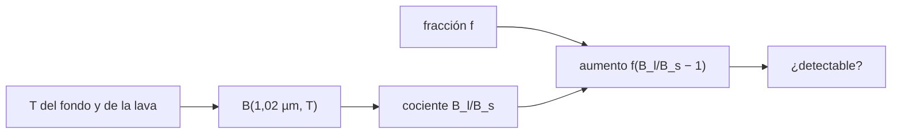

# B70-C05 — Actividad volcánica venusina: llanuras, coronas e indicios de actividad reciente

<!-- nav:top -->
[🏠 Programa](../../../../README.md) · [📚 Bloque B70](../../../tronco-comun/B70-vulcanismo-planetario.md) · [← Anterior: B70-C04 — Vulcanismo marciano: provincias, edades y evolución](../B70-C04-vulcanismo-marciano-provincias-edades-y-evolucion/CLASE.md) · [Siguiente: B70-C06 — Criovulcanismo: lavas heladas y emisión de volátiles →](../B70-C06-criovulcanismo-lavas-heladas-y-emision-de-volatiles/CLASE.md)
<!-- /nav -->

## 1. Ubicación, nivel y alcance

Clase 5 del bloque B70. Nivel N3. La superficie de Venus, oculta por nubes, se conoce sobre todo por radar y por ventanas infrarrojas. Aquí estudias **cómo se busca actividad volcánica reciente**: dos líneas de indicios publicadas (cambios en imágenes de radar y puntos brillantes transitorios) y un cálculo propio del **contraste térmico** de una lava reciente a 1,02 µm. Complementa la atmósfera de [B54](../../../tronco-comun/B54-atmosferas-y-climatologia-planetaria.md).

## 2. Por qué esta clase existe

Un punto brillante o un vent que cambia no prueba una erupción. La decisión central: **¿cuánta lava caliente hace falta en un píxel para producir un aumento medible de radiancia, y qué otras explicaciones hay que descartar?**

## 3. Lo que podrás hacer al terminar

1. Distinguir indicios de radar y térmicos y sus límites.
2. Calcular la radiancia de Planck a 1,02 µm.
3. Verificar la integral de Planck con Stefan–Boltzmann y el límite de Wien.
4. Calcular el aumento de un píxel según la fracción de lava.
5. Obtener la fracción mínima detectable.
6. Rotular lo observado, lo estimado y lo simulado.

La evidencia es la **ficha del indicio de actividad** del ejercicio 12 (sección 20).

## 4. Con qué llegas y cómo comprobarlo

1. ¿Qué es la radiancia?
2. ¿Qué es un cuerpo negro?
3. ¿Qué es una ventana atmosférica?
4. ¿Qué es un píxel mixto?
5. ¿Qué es un valor sintético?

<details>
<summary>Ver respuestas</summary>

1. La potencia emitida por área, ángulo sólido y longitud de onda. 2. Un emisor ideal cuyo espectro solo depende de la temperatura. 3. Un intervalo de longitudes de onda en el que la atmósfera es parcialmente transparente. 4. Uno que combina varias superficies. 5. Uno propuesto para el ejemplo.
</details>

Con cuatro o cinco aciertos, sigue; si no, repasa los prerrequisitos.

## 5. Un caso de contexto y casos de referencia

Herrick y Hensley (2023, solo resumen) examinaron imágenes de radar de Magellan de 1990 a 1992 y hallaron un respiradero de unos `2,2 km²` que cambió de forma en ocho meses, con coladas cuesta abajo en la segunda imagen; lo interpretan como actividad en curso [S2]. Shalygin et al. (2015, solo resumen) identificaron puntos brillantes transitorios con Venus Express, compatibles con coladas que calientan localmente la superficie y correlacionados con el rift Ganiki Chasma [S3]. El **ejemplo conductor** es un cálculo **sintético**: un píxel con una fracción `f` de lava a `1000 K` sobre un fondo de `737 K` (temperatura media de la superficie [S1]).

## 6. Vocabulario

Una **corona** es una estructura circular asociada a procesos del manto (concepto; no se calcula aquí). Una **llanura** volcánica es una extensión de coladas. La **radiancia** `B(λ,T)` de Planck describe la emisión de un cuerpo negro. El **píxel mixto** suma la emisión de fondo y de lava. La **fracción** `f` es la parte del píxel cubierta por lava caliente.

## 7. Modelo mental: una brasa en una habitación caliente

Una brasa muy brillante en un cuarto ya tibio se nota si ocupa algo de la vista; cuanto más corta la longitud de onda, más contrasta, porque la emisión crece de forma exponencial con la temperatura.



*Descripción textual:* las temperaturas dan radiancias; su cociente y la fracción del píxel dan el aumento, que se compara con el ruido.

Analogía: una brasa en una habitación caliente. Límite: la atmósfera de Venus modifica la señal y las superficies reales no son cuerpos negros.

## 8. La explicación, paso a paso

### 8.1 Radiancia de Planck

`B(λ,T) = 2hc²/λ⁵ · 1/(exp(hc/(λkT)) − 1)`, con `h`, `k` y `c` definidos por el SI [S4]. Verificación: la integral numérica sobre todo `λ` coincide con `σT⁴/π` (`5,3252 × 10³ W m⁻² sr⁻¹` a `737 K` y `1,8049 × 10⁴` a `1000 K`) y a `300 K` el límite de Wien se cumple a `10⁻⁴`.

### 8.2 Cociente a 1,02 µm

`B(737 K) = 5,2582 × 10⁵` y `B(1000 K) = 8,0708 × 10⁷ W m⁻² sr⁻¹ m⁻¹`: cociente `153,5`.

| T de la lava (K) | B_l/B_s |
|---|---|
| 800 | 4,51 |
| 900 | 32,02 |
| 1000 | 153,49 |
| 1200 | 1610,96 |

### 8.3 Píxel mixto

El aumento relativo es `f(B_l/B_s − 1)`:

| f | aumento |
|---|---|
| 0,001 | 15,25 % |
| 0,010 | 152,49 % |
| 0,050 | 762,45 % |
| 0,100 | 1524,90 % |

Para un aumento de `5 %` basta `f = 0,0003`; para `20 %`, `f = 0,0013`.

### 8.4 Lectura

La señal es muy sensible a la temperatura de la lava. Pero esto es un **cálculo idealizado**: no incluye la atmósfera ni la emisividad real, y un punto brillante podría deberse a otras causas (nubes, geometría de observación). Los indicios publicados [S2] y [S3] son **observados**; este cálculo es **simulado**.

## 9. Magnitudes, símbolos y unidades

| Símbolo | Qué es | Unidad | Valor / nota |
|---|---|---|---|
| `B` | radiancia espectral | W m⁻² sr⁻¹ m⁻¹ | calculada |
| `λ` | longitud de onda | m | 1,02 × 10⁻⁶ |
| `T_s` | fondo | K | 737 (NASA/NSSDC [S1]) |
| `T_l` | lava | K | 1000 (ilustrativa) |
| `f` | fracción del píxel | — | 0,001–0,1 |
| `σ` | Stefan–Boltzmann | W m⁻² K⁻⁴ | 5,670374 × 10⁻⁸ (calculada) |

## 10. Convenciones y referencias

Cuerpo negro, emisividad 1, sin atmósfera. `h = 6,62607015 × 10⁻³⁴ J s`, `k = 1,380649 × 10⁻²³ J/K` y `c = 299 792 458 m/s` son valores definidos del SI (no consultados en línea). Tolerancias: `10⁻⁶` en Stefan–Boltzmann y `10⁻⁴` en Wien.

## 11. De dónde sale lo que afirmamos

| ID | Fuente | Localizador | Respalda | Consulta | Estado |
|---|---|---|---|---|---|
| S1 | NASA/NSSDC, *Venus Fact Sheet* | https://nssdc.gsfc.nasa.gov/planetary/factsheet/venusfact.html | gravedad media 8,87 m/s², temperatura superficial media 737 K, radio 6051,8 km | 2026-11-09 | Hoja de datos consultada |
| S2 | R. R. Herrick y S. Hensley, *Surface changes observed on a Venusian volcano during the Magellan mission, Science 379, 1205–1208 (2023)* | doi:10.1126/science.abm7735 | un respiradero de unos 2,2 km² cambió de forma entre dos imágenes de radar separadas por ocho meses | 2026-11-09 | Solo metadatos y resumen |
| S3 | E. V. Shalygin et al., *Active volcanism on Venus in the Ganiki Chasma rift zone, Geophys. Res. Lett. 42, 4762–4769 (2015)* | doi:10.1002/2015GL064088 | puntos brillantes transitorios compatibles con coladas que elevan la temperatura de la superficie | 2026-11-09 | Solo metadatos y resumen |
| S4 | BIPM, *Constantes definidas del SI (h, k, c, N_A)* | SI 2019 | h = 6,62607015 × 10⁻³⁴ J s, k = 1,380649 × 10⁻²³ J/K, c = 299 792 458 m/s | no consultado en línea | Valores definidos; no consultados en línea en esta sesión |

Límites: de los artículos solo se leyó el resumen; no se reprodujo ninguna medida. Las temperaturas de lava y fracciones son ilustrativas.

## 12. Cómo ver los resultados

| Magnitud | Valor |
|---|---|
| `B_l/B_s` (1000 K) | 153,49 |
| aumento con `f = 0,01` | 152,49 % |
| `f` mínima para 5 % | 0,0003 |

Descripción larga: el cociente de radiancias sube con la temperatura de la lava en más de tres órdenes de magnitud entre 800 K y 1200 K.

## 13. Ejemplo trabajado: el aumento de un píxel con 1 % de lava

**Paso 1.** `B_l/B_s = 153,49`.

**Paso 2.** `f = 0,01`.

**Paso 3.** `Δ = f(B_l/B_s − 1) = 0,01 · 152,49 = 1,5249`.

**Paso 4.** Aumento de `152,5 %` (ilustrativo).

## 14. Distintas formas de describir el problema

**Por fórmula de Planck.** **Por límite de Wien.** **Por integral frente a Stefan–Boltzmann.** **Por tabla de temperaturas.**

## 15. Práctica guiada

**Ejercicio 1 · guiado.** Aumento del píxel con `f = 0,01`. *Pasos:* sección 13.

<details><summary>Solución comentada</summary>

`152,5 %`.
</details>

**Ejercicio 2 · guiado.** Aumento con `f = 0,001`.

<details><summary>Solución comentada</summary>

`0,001 · 152,49 = 15,25 %`.
</details>

**Ejercicio 3 · guiado.** `f` mínima para un aumento de 20 %. *Casi autónomo.*

<details><summary>Solución comentada</summary>

`0,2/152,49 = 1,31 × 10⁻³`.
</details>

## 16. Práctica autónoma, transferencia e integrador

**Ejercicio 4 · autónomo.** Aumento con `f = 0,01` y lava a `800 K`.

<details><summary>Solución comentada</summary>

`0,01 · 3,51 = 3,5 %`.
</details>

**Ejercicio 5 · autónomo.** `σT⁴/π` a `737 K`.

<details><summary>Solución comentada</summary>

`5,670×10⁻⁸ · 2,950×10¹¹/π = 5,325 × 10³ W m⁻² sr⁻¹`.
</details>

**Ejercicio 6 · autónomo.** Cociente de potencias totales `1000 K`/`737 K`.

<details><summary>Solución comentada</summary>

`(1000/737)⁴ = 3,39`, mucho menor que `153` a 1,02 µm.
</details>

**Ejercicio 7 · autónomo.** `f` mínima para 5 % con lava a `900 K`.

<details><summary>Solución comentada</summary>

`0,05/31,02 = 1,6 × 10⁻³`.
</details>

**Ejercicio 8 · autónomo.** ¿Por qué la señal a 1,02 µm es más sensible que la potencia total?

<details><summary>Solución comentada</summary>

Porque a esa longitud de onda corta se está en el lado de Wien, donde la radiancia crece exponencialmente con `T`.
</details>

**Ejercicio 9 · transferencia.** **Transferencia.** Un punto brillante transitorio aparece en una imagen. ¿Basta para afirmar una erupción?

<details><summary>Solución comentada</summary>

No: hay que descartar efectos de geometría, nubes y emisividad y buscar corroboración. Los resúmenes de [S3] describen puntos *compatibles* con coladas.
</details>

**Ejercicio 10 · transferencia.** **Transferencia.** Herrick y Hensley hablan de cambios en radar. ¿Es lo mismo que una señal térmica?

<details><summary>Solución comentada</summary>

No: el radar mide rugosidad y propiedades eléctricas de la superficie (cambio de forma del respiradero), no su temperatura; son indicios independientes.
</details>

**Ejercicio 11 · transferencia.** **Transferencia.** Nombra dos efectos reales que el cálculo omite.

<details><summary>Solución comentada</summary>

La absorción atmosférica y el enfriamiento de la lava, además de la emisividad real.
</details>

**Ejercicio 12 · integrador.** **Integrador.** Elabora tu *ficha del indicio de actividad*: indicios publicados, cociente de Planck, fracción mínima y límites.

<details><summary>Solución comentada</summary>

Secciones 8.1–8.4 y 18.
</details>

## 17. Laboratorio: contraste de Planck de una lava a 1,02 µm

El script [planck.py](planck.py) verifica la integral de Planck con Stefan–Boltzmann y el límite de Wien, y calcula cocientes y fracciones mínimas. **Comprueba** `10⁻⁶` y `10⁻⁴`.

**Datos:** temperatura de Venus de NASA/NSSDC (2026-11-09); constantes SI definidas; temperatura de lava y fracciones **ilustrativas**. **Predice antes de ejecutar:** ¿Será el cociente mayor o menor que el de potencias totales `(1000/737)⁴ = 3,39`? **Ejecución del 2026-11-09 (Python 3.12.9):**

```text
Python 3.12.9 (biblioteca estandar)
sigma calculada = 5.670374e-08 W m^-2 K^-4
  T =  737.0 K: integral numerica = 5.325150e+03 ; sigma T^4/pi = 5.325150e+03 W m^-2 sr^-1
  T = 1000.0 K: integral numerica = 1.804936e+04 ; sigma T^4/pi = 1.804936e+04 W m^-2 sr^-1
Limite de Wien a 300 K superado.
B(1,02 um, 737 K) = 5.2582e+05 ; B(1,02 um, 1000 K) = 8.0708e+07 W m^-2 sr^-1 m^-1 ; cociente = 153.49
Aumento relativo del pixel segun la fraccion f de lava a 1000 K (ilustrativa):
  f = 0.001: aumento =   15.25 %
  f = 0.010: aumento =  152.49 %
  f = 0.050: aumento =  762.45 %
  f = 0.100: aumento = 1524.90 %
Fraccion minima para un aumento de 5 %: f = 0.0003
Fraccion minima para un aumento de 20 %: f = 0.0013
Cociente de radiancias segun la temperatura de la lava (1,02 um, fondo 737 K):
  T_lava =  800.0 K: B_l/B_s =     4.51
  T_lava =  900.0 K: B_l/B_s =    32.02
  T_lava = 1000.0 K: B_l/B_s =   153.49
  T_lava = 1200.0 K: B_l/B_s =  1610.96
Pruebas superadas.
```

```bash
python programa/clases/B70/B70-C05-actividad-volcanica-venusina-llanuras-coronas-e-indicios-de-actividad-reciente/planck.py
```

**Límites:** cuerpo negro, sin atmósfera.

## 18. Errores frecuentes y cómo corregirlos

**Confundir indicio con prueba.** Se corrige con 8.4.

**Mezclar radar y emisión térmica.** Se corrige en la sección 5.

**Presentar el cálculo como observación.** Se corrige con 8.4.

**Olvidar la atmósfera.** Se corrige en los límites.

## 19. Cómo sabrás que vas bien

Tras la sección 8: ¿qué resultado esperabas y cuál obtuviste? Si dudas, repasa el ejemplo 13. Tras el laboratorio: ¿qué comprueba? (ver la sección 17). 

## 20. Qué entregas y cómo se evalúa

El producto es tu **ficha del indicio de actividad** (ejercicio 12).

| Criterio | Inicial | En desarrollo | Logrado | Destacado |
|---|---|---|---|---|
| Conceptos | Los confunde | Parciales | Conceptos de la clase | Explica los límites |
| Cálculo | Sin unidades | Con errores | Tablas completas | Calcula casos nuevos |
| Numérico | Sin comprobar | Un caso | Contraste con el caso analítico | Interpreta las diferencias |
| Fuentes | Sin fuente | Sin fecha | Fuentes con fecha | Declara lo ilustrativo y lo no consultado |
| Límites | No los nombra | Uno | Tres | Discute qué falta del modelo |

**Condiciones críticas (no se compensan con promedio):** no presentar lo simulado como observado; rotular lo ilustrativo; citar solo lo consultado (solo resúmenes de los artículos).

## 21. Ética, seguridad y límites

Clase educativa: los modelos son simplificados y no pronostican ninguna erupción ni sustituyen una evaluación de peligro volcánico. No se afirma que haya una erupción en curso. Accesibilidad: tablas equivalentes a las gráficas, fórmulas en texto, ejercicios sin conexión.

## 22. Para cerrar y seguir

Con lava a `1000 K` el cociente de radiancias a 1,02 µm es `153,5` y basta `f = 0,0003` para un aumento de `5 %`. Queda una pregunta: ¿qué vulcanismo existe donde la «lava» es hielo?

**Glosario español–inglés.** corona · *corona*; radiancia · *radiance*; píxel mixto · *mixed pixel*; ventana atmosférica · *atmospheric window*; cuerpo negro · *blackbody*.

**Continuidad.** [B70-C06](../B70-C06-criovulcanismo-lavas-heladas-y-emision-de-volatiles/CLASE.md) estudia el criovulcanismo.

**Referencias:** ver sección 11.

<!-- nav:bottom -->
---

[← Anterior: B70-C04 — Vulcanismo marciano: provincias, edades y evolución](../B70-C04-vulcanismo-marciano-provincias-edades-y-evolucion/CLASE.md) · [📚 Bloque B70](../../../tronco-comun/B70-vulcanismo-planetario.md) · [Siguiente: B70-C06 — Criovulcanismo: lavas heladas y emisión de volátiles →](../B70-C06-criovulcanismo-lavas-heladas-y-emision-de-volatiles/CLASE.md)
<!-- /nav -->
