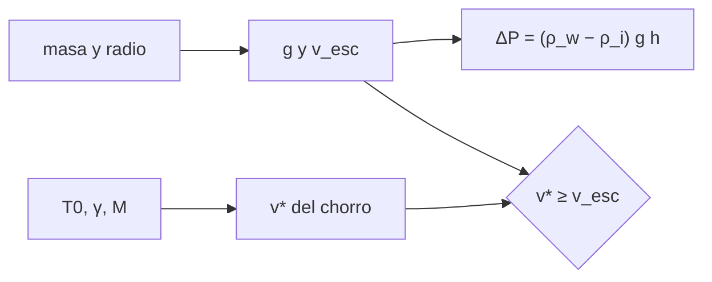

# B70-C06 — Criovulcanismo: lavas heladas y emisión de volátiles

<!-- nav:top -->
[🏠 Programa](../../../../README.md) · [📚 Bloque B70](../../../tronco-comun/B70-vulcanismo-planetario.md) · [← Anterior: B70-C05 — Actividad volcánica venusina: llanuras, coronas e indicios de actividad reciente](../B70-C05-actividad-volcanica-venusina-llanuras-coronas-e-indicios-de-actividad-reciente/CLASE.md) · [Siguiente: B70-C07 — Flujos de lava y depósitos piroclásticos →](../B70-C07-flujos-de-lava-y-depositos-piroclasticos/CLASE.md)
<!-- /nav -->

## 1. Ubicación, nivel y alcance

Clase 6 del bloque B70. Nivel N3. En los mundos helados el «magma» es agua, salmuera o mezclas con volátiles. Aquí planteas la **mecánica** de dos procesos: la **sobrepresión** que necesita el agua para subir por una capa de hielo y el **chorro de vapor** que sale por una grieta. Usas Encélado como caso, con la masa y dimensiones de la hoja de datos de la NASA; el panorama de Encélado está en [B53](../../../tronco-comun/B53-astrogeologia-y-geodesia-planetaria.md).

## 2. Por qué esta clase existe

El agua líquida es más densa que el hielo, así que no sube sola. La decisión central: **¿qué presión extra y qué mecanismo hacen falta para que el agua llegue a la superficie?**

## 3. Lo que podrás hacer al terminar

1. Calcular la gravedad y la velocidad de escape a partir de masa y radio.
2. Obtener la sobrepresión `(ρ_w − ρ_i) g h`.
3. Calcular la velocidad de un chorro estrangulado.
4. Integrar la trayectoria de un grano y compararla con la fórmula de la energía.
5. Comparar con la velocidad de escape.
6. Rotular lo calculado y lo no listado por la fuente.

La evidencia es la **ficha del criovulcanismo** del ejercicio 12 (sección 20).

## 4. Con qué llegas y cómo comprobarlo

1. ¿Qué es la presión hidrostática?
2. ¿Qué es la velocidad de escape?
3. ¿Qué es un gas ideal?
4. ¿Qué es la velocidad del sonido en un gas?
5. ¿Qué es un valor ilustrativo?

<details>
<summary>Ver respuestas</summary>

1. `ρ g h`. 2. `√(2GM/R)`. 3. Uno con `PV = nRT`. 4. `√(γRT/M)`. 5. Uno propuesto para el ejemplo.
</details>

Con cuatro o cinco aciertos, sigue; si no, repasa los prerrequisitos.

## 5. Un caso de contexto y casos de referencia

Porco et al. (2006, solo resumen) describen una región activa en el polo sur de Encélado, de la que parten partículas finas de hielo que alimentan el anillo E, llevadas por vapor de agua que probablemente sale de depósitos subterráneos de agua líquida [S2]. Crawford y Stevenson (1988) plantearon el vulcanismo de agua impulsado por gas (solo metadatos consultados [S3]). El **ejemplo conductor** es un cálculo con masa `1,08 × 10²⁰ kg` y dimensiones `257 × 251 × 248 km` [S1]: `g = 0,1135 m/s²`, `v_esc = 239,2 m/s`, `ΔP = 47,1 kPa` para `5 km` de hielo (densidades **ilustrativas**) y un chorro de `379 m/s`.

## 6. Vocabulario

El **criovulcanismo** es la erupción de volátiles helados o agua en lugar de silicatos. El **criomagma** es el material líquido o semilíquido que sube. La **sobrepresión** es la presión por encima de la hidrostática del hielo. El **flujo estrangulado** alcanza Mach 1 en la garganta. La **velocidad de escape** es la mínima para dejar el cuerpo sin resistencia.

## 7. Modelo mental: una botella de gaseosa

El líquido sube por el pitillo si se le aplica presión extra; al abrir, el gas disuelto sale expandiéndose y arrastra gotas.



*Descripción textual:* la masa y el radio fijan la gravedad; esta da la sobrepresión; la temperatura del gas da la velocidad del chorro, que se compara con la de escape.

Analogía: una botella de gaseosa. Límite: el agua de un océano subterráneo y el gas disuelto no son una gaseosa, y la salmuera cambia las densidades.

## 8. La explicación, paso a paso

### 8.1 Gravedad y escape

Con `G = 6,67430 × 10⁻¹¹ m³ kg⁻¹ s⁻²` (CODATA 2022, valor recordado, **no consultado** en línea), `M = 1,08 × 10²⁰ kg` y `R = 252,0 km` (media de las tres dimensiones): `g = GM/R² = 0,1135 m/s²` y `v_esc = √(2GM/R) = 239,2 m/s`. La hoja de datos **no lista** estas dos magnitudes: las calculamos nosotros. La integral numérica del trabajo coincide con la fórmula a `10⁻⁶`.

### 8.2 Sobrepresión

Con `ρ_w = 1000` y `ρ_i = 917 kg/m³` (ilustrativas) y `h = 5 km`: `ΔP = 83 · 0,1135 · 5000 = 47,1 kPa`. Con la gravedad lunar sería `672,3 kPa`: la baja gravedad de Encélado facilita la ascensión.

### 8.3 Chorro de vapor

Para vapor de agua (`M = 0,018015 kg/mol`, `γ = 1,33`, `T₀ = 273,15 K`, ilustrativos), el flujo estrangulado tiene `T* = 2T₀/(γ+1) = 234,5 K` y `v* = √(2γ/(γ+1) · RT₀/M) = 379,4 m/s`; coincide con `√(γRT*/M)` a `10⁻¹²`. Es `1,59` veces `v_esc`.

### 8.4 Trayectoria de un grano

Sin resistencia, la altura máxima cumple `r_max = 1/(1/R − v²/(2GM))`. Para `v₀ = 60, 120, 200, 230 m/s` da `16,9; 84,8; 585,8; 3094 km`, y el RK4 coincide a `10⁻⁶`. La fórmula de gravedad uniforme `v²/(2g)` subestima esos valores.

### 8.5 Lectura

Un chorro estrangulado supera la velocidad de escape en el modelo ideal, pero eso **no** prueba que los granos escapen: dependen del acoplamiento con el gas. Estos números son cálculos, no mediciones de Cassini.

## 9. Magnitudes, símbolos y unidades

| Símbolo | Qué es | Unidad | Valor / nota |
|---|---|---|---|
| `M`, `R` | masa y radio medio | kg, m | 1,08 × 10²⁰; 252 000 [S1] |
| `g` | gravedad | m/s² | 0,1135 (calculada) |
| `v_esc` | velocidad de escape | m/s | 239,2 (calculada) |
| `ΔP` | sobrepresión | Pa | 4,71 × 10⁴ |
| `v*` | velocidad del chorro | m/s | 379,4 |
| `γ`, `T₀` | exponente y temperatura | —, K | 1,33; 273,15 (ilustrativos) |

## 10. Convenciones y referencias

Cuerpo esférico homogéneo de radio medio, sin rotación; gas ideal, flujo isentrópico, sin resistencia. `R_gas = 8,314462618 J/(mol K)`. Tolerancias: `10⁻⁶` en escape y altura, `10⁻¹²` en el chorro.

## 11. De dónde sale lo que afirmamos

| ID | Fuente | Localizador | Respalda | Consulta | Estado |
|---|---|---|---|---|---|
| S1 | NASA/NSSDC, *Saturnian Satellite Fact Sheet* | https://nssdc.gsfc.nasa.gov/planetary/factsheet/saturniansatfact.html | masa de Encélado 1,08 × 10²⁰ kg y dimensiones 257 × 251 × 248 km (la hoja no lista gravedad ni velocidad de escape) | 2026-11-09 | Hoja de datos consultada |
| S2 | C. C. Porco et al., *Cassini Observes the Active South Pole of Enceladus, Science 311, 1393–1401 (2006)* | doi:10.1126/science.1123013 | región activa del polo sur; partículas finas de hielo que alimentan el anillo E, llevadas por vapor de agua que probablemente sale de depósitos subterráneos de agua líquida | 2026-11-09 | Solo metadatos y resumen |
| S3 | G. D. Crawford y D. J. Stevenson, *Gas-driven water volcanism and the resurfacing of Europa, Icarus 73 (1988)* | doi:10.1016/0019-1035(88)90085-1 | existencia de modelos de vulcanismo de agua impulsado por gas (solo bibliografía) | 2026-11-09 | Solo metadatos |
| S4 | BIPM, *Constantes definidas del SI (h, k, c, N_A)* | SI 2019 | h = 6,62607015 × 10⁻³⁴ J s, k = 1,380649 × 10⁻²³ J/K, c = 299 792 458 m/s | no consultado en línea | Valores definidos; no consultados en línea en esta sesión |

Límites: de Porco et al. solo el resumen; de Crawford y Stevenson solo los metadatos; `G` y las densidades no se consultaron en línea.

## 12. Cómo ver los resultados

| Magnitud | Valor |
|---|---|
| `g` | 0,1135 m/s² |
| `v_esc` | 239,2 m/s |
| `ΔP` (5 km) | 47,1 kPa |
| `v*` | 379,4 m/s |
| altura a 120 m/s | 84,8 km |

Descripción larga: la altura crece muy rápido al acercarse `v₀` a la velocidad de escape.

## 13. Ejemplo trabajado: la sobrepresión sobre 5 km de hielo

**Paso 1.** `g = 6,6743×10⁻¹¹ · 1,08×10²⁰/(2,52×10⁵)² = 0,1135 m/s²`.

**Paso 2.** `ρ_w − ρ_i = 83 kg/m³`.

**Paso 3.** `ΔP = 83 · 0,1135 · 5000 = 4,71 × 10⁴ Pa`.

**Paso 4.** `47,1 kPa` (valor ilustrativo).

## 14. Distintas formas de describir el problema

**Hidrostática:** `ΔP`. **Energética:** `v_esc` y `r_max`. **Numérica:** RK4. **Compresible:** Mach 1 en la garganta.

## 15. Práctica guiada

**Ejercicio 1 · guiado.** Gravedad de Encélado con `M` y `R` dados. *Pasos:* sección 13.

<details><summary>Solución comentada</summary>

`0,1135 m/s²`.
</details>

**Ejercicio 2 · guiado.** Velocidad de escape.

<details><summary>Solución comentada</summary>

`√(2 · 7,208×10⁹/2,52×10⁵) = 239,2 m/s`.
</details>

**Ejercicio 3 · guiado.** Sobrepresión para `h = 2 km`. *Casi autónomo.*

<details><summary>Solución comentada</summary>

`47,1 · 2/5 = 18,8 kPa`.
</details>

## 16. Práctica autónoma, transferencia e integrador

**Ejercicio 4 · autónomo.** `T*` para `T₀ = 273,15 K`, `γ = 1,33`.

<details><summary>Solución comentada</summary>

`2 · 273,15/2,33 = 234,5 K`.
</details>

**Ejercicio 5 · autónomo.** Cociente `v*/v_esc`.

<details><summary>Solución comentada</summary>

`379,4/239,2 = 1,59`.
</details>

**Ejercicio 6 · autónomo.** Altura máxima con `v₀ = 60 m/s` sin resistencia.

<details><summary>Solución comentada</summary>

`16,9 km`.
</details>

**Ejercicio 7 · autónomo.** Error relativo de `v²/(2g)` frente a la fórmula exacta para `60 m/s`.

<details><summary>Solución comentada</summary>

`15,86` frente a `16,92 km`: `−6 %`.
</details>

**Ejercicio 8 · autónomo.** Cociente de sobrepresión con gravedad lunar frente a la de Encélado.

<details><summary>Solución comentada</summary>

`1,62/0,1135 = 14,3` (`672,3/47,1`).
</details>

**Ejercicio 9 · transferencia.** **Transferencia.** Un grano a `230 m/s` llega a `3094 km` sin resistencia. ¿Escapa?

<details><summary>Solución comentada</summary>

No: `230 < 239,2 m/s`; vuelve a caer. Pero está cerca del límite.
</details>

**Ejercicio 10 · transferencia.** **Transferencia.** ¿Qué haría falta para usar este cálculo en una salmuera de amoníaco-agua?

<details><summary>Solución comentada</summary>

Datos de densidad y composición que no se consultaron aquí; con ellos cambiaría `ρ_w − ρ_i` y por tanto `ΔP`.
</details>

**Ejercicio 11 · transferencia.** **Transferencia.** ¿Qué omite la fórmula de `ΔP`?

<details><summary>Solución comentada</summary>

La resistencia del hielo, el fracturamiento y la sobrepresión por congelación o gas; es una cota hidrostática mínima.
</details>

**Ejercicio 12 · integrador.** **Integrador.** Elabora tu *ficha del criovulcanismo*: gravedad, escape, sobrepresión, chorro y límites.

<details><summary>Solución comentada</summary>

Secciones 8.1–8.5 y 18.
</details>

## 17. Laboratorio: sobrepresión, chorro y trayectoria de granos

El script [criovolcan.py](criovolcan.py) calcula `g`, `v_esc` (fórmula frente a integral numérica), la sobrepresión, el chorro (dos fórmulas) y la altura de granos (fórmula frente a RK4). **Comprueba** `10⁻⁶` y `10⁻¹²`.

**Datos:** masa y dimensiones de NASA/NSSDC (2026-11-09); `G` recordado; densidades, temperatura y `γ` **ilustrativos**. **Predice antes de ejecutar:** ¿Superará el chorro estrangulado a la velocidad de escape? (cociente ~1,6.) **Ejecución del 2026-11-09 (Python 3.12.9):**

```text
Python 3.12.9 (biblioteca estandar)
R medio = 252.0 km ; g = 0.1135 m/s^2 ; v_esc = 239.2 m/s (calculados, no listados por la hoja)
Sobrepresion para subir agua por 5 km de hielo: DeltaP = 47.1 kPa (densidades ilustrativas)
   Con la gravedad de la Luna y h = 5 km: DeltaP = 672.3 kPa (solo para comparar escalas)
Chorro de vapor estrangulado (T0 = 273.15 K, gamma = 1.33): T* = 234.5 K ; v* = 379.4 m/s ; v*/v_esc = 1.59
Altura maxima de un grano (sin resistencia) segun la velocidad inicial:
  v0 =   60.0 m/s: altura =   16.923 km (RK4   16.923) ; v0^2/(2g) =   15.858 km
  v0 =  120.0 m/s: altura =   84.769 km (RK4   84.769) ; v0^2/(2g) =   63.431 km
  v0 =  200.0 m/s: altura =  585.764 km (RK4  585.764) ; v0^2/(2g) =  176.198 km
  v0 =  230.0 m/s: altura = 3094.224 km (RK4 3094.224) ; v0^2/(2g) =  233.022 km
El vapor estrangulado (379 m/s) supera v_esc (239 m/s): el modelo ideal predice que un grano acoplado al gas puede escapar.
Pruebas superadas.
```

```bash
python programa/clases/B70/B70-C06-criovulcanismo-lavas-heladas-y-emision-de-volatiles/criovolcan.py
```

**Límites:** cuerpo esférico, gas ideal, sin resistencia.

## 18. Errores frecuentes y cómo corregirlos

**Atribuir `g` a la hoja de datos.** Se corrige en 8.1.

**Usar `v²/(2g)` cerca del escape.** Se corrige en 8.4.

**Creer que el agua sube sola por ser líquida.** Se corrige en la sección 2.

**Tomar el cálculo como medición.** Se corrige en 8.5.

## 19. Cómo sabrás que vas bien

Tras la sección 8: ¿qué resultado esperabas y cuál obtuviste? Si dudas, repasa el ejemplo 13. Tras el laboratorio: ¿qué comprueba? (ver la sección 17). 

## 20. Qué entregas y cómo se evalúa

El producto es tu **ficha del criovulcanismo** (ejercicio 12).

| Criterio | Inicial | En desarrollo | Logrado | Destacado |
|---|---|---|---|---|
| Conceptos | Los confunde | Parciales | Conceptos de la clase | Explica los límites |
| Cálculo | Sin unidades | Con errores | Tablas completas | Calcula casos nuevos |
| Numérico | Sin comprobar | Un caso | Contraste con el caso analítico | Interpreta las diferencias |
| Fuentes | Sin fuente | Sin fecha | Fuentes con fecha | Declara lo ilustrativo y lo no consultado |
| Límites | No los nombra | Uno | Tres | Discute qué falta del modelo |

**Condiciones críticas (no se compensan con promedio):** rotular lo calculado frente a lo listado por la fuente; no presentar el cálculo como medición de Cassini; citar solo lo consultado.

## 21. Ética, seguridad y límites

Clase educativa: los modelos son simplificados y no pronostican ninguna erupción ni sustituyen una evaluación de peligro volcánico. No se modela ninguna misión. Accesibilidad: tablas equivalentes a las gráficas, fórmulas en texto, ejercicios sin conexión.

## 22. Para cerrar y seguir

El agua necesita `47,1 kPa` extra para subir 5 km de hielo en Encélado y un chorro estrangulado alcanza `379 m/s`. Queda una pregunta: ¿cómo fluyen las lavas y se dispersan los piroclastos?

**Glosario español–inglés.** criovulcanismo · *cryovolcanism*; criomagma · *cryomagma*; sobrepresión · *overpressure*; flujo estrangulado · *choked flow*; velocidad de escape · *escape velocity*.

**Continuidad.** [B70-C07](../B70-C07-flujos-de-lava-y-depositos-piroclasticos/CLASE.md) estudia flujos de lava y piroclastos.

**Referencias:** ver sección 11.

<!-- nav:bottom -->
---

[← Anterior: B70-C05 — Actividad volcánica venusina: llanuras, coronas e indicios de actividad reciente](../B70-C05-actividad-volcanica-venusina-llanuras-coronas-e-indicios-de-actividad-reciente/CLASE.md) · [📚 Bloque B70](../../../tronco-comun/B70-vulcanismo-planetario.md) · [Siguiente: B70-C07 — Flujos de lava y depósitos piroclásticos →](../B70-C07-flujos-de-lava-y-depositos-piroclasticos/CLASE.md)
<!-- /nav -->
