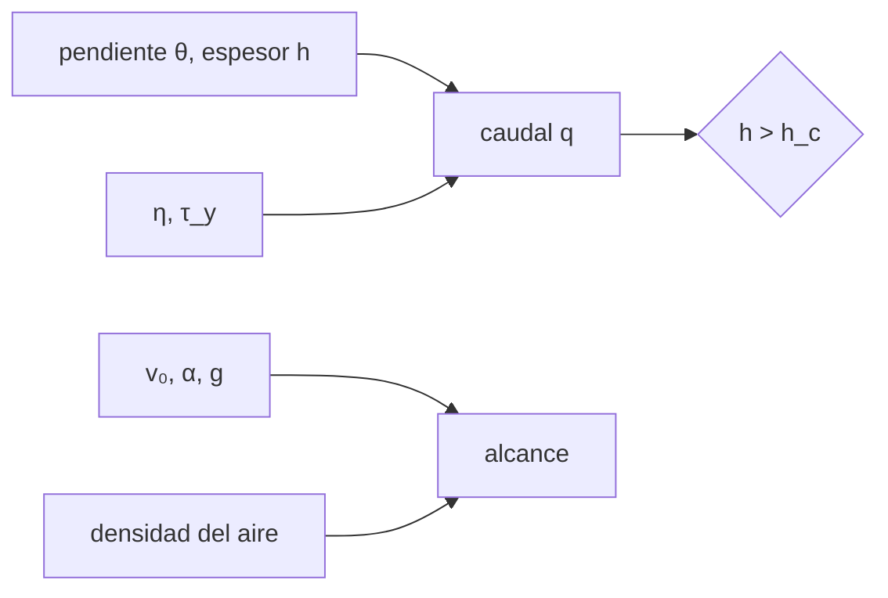

# B70-C07 — Flujos de lava y depósitos piroclásticos

<!-- nav:top -->
[🏠 Programa](../../../../README.md) · [📚 Bloque B70](../../../tronco-comun/B70-vulcanismo-planetario.md) · [← Anterior: B70-C06 — Criovulcanismo: lavas heladas y emisión de volátiles](../B70-C06-criovulcanismo-lavas-heladas-y-emision-de-volatiles/CLASE.md) · [Siguiente: B71-C01 — Leyes de Kepler →](../../B71/B71-C01-leyes-de-kepler/CLASE.md)
<!-- /nav -->

## 1. Ubicación, nivel y alcance

Clase 7 del bloque B70. Nivel N3. Cierra el bloque con dos transportes: una **colada** que desciende por una pendiente (reología newtoniana y de Bingham) y los **clastos piroclásticos** lanzados por una explosión (alcance balístico con y sin aire). Los valores son ilustrativos.

## 2. Por qué esta clase existe

La misma lava fluye distinto según la pendiente, el espesor y la reología; los piroclastos llegan más lejos si no hay aire. La decisión central: **¿cuánto fluye una colada y hasta dónde llegan los clastos en cada mundo?**

## 3. Lo que podrás hacer al terminar

1. Obtener el caudal newtoniano `q = ρ g sinθ h³/(3η)`.
2. Calcular el espesor crítico de Bingham `h_c = τ_y/(ρ g sinθ)`.
3. Verificar los caudales con la integral del perfil de velocidad.
4. Calcular el alcance balístico `v² sin 2α/g` y verificarlo con RK4.
5. Comparar el efecto de una atmósfera.
6. Rotular lo ilustrativo.

La evidencia es la **ficha de flujos y piroclastos** del ejercicio 12 (sección 20).

## 4. Con qué llegas y cómo comprobarlo

1. ¿Qué es un fluido newtoniano?
2. ¿Qué es la resistencia a la fluencia?
3. ¿Qué es un tiro parabólico?
4. ¿Qué es el arrastre cuadrático?
5. ¿Qué es un valor sintético?

<details>
<summary>Ver respuestas</summary>

1. Uno cuya tensión es proporcional a la tasa de deformación. 2. El esfuerzo mínimo para que fluya un material de Bingham. 3. El movimiento bajo gravedad uniforme sin aire. 4. Una fuerza proporcional a `v²`. 5. Uno propuesto para el ejemplo.
</details>

Con cuatro o cinco aciertos, sigue; si no, repasa los prerrequisitos.

## 5. Un caso de contexto y casos de referencia

El **ejemplo conductor** es una colada **sintética** de `3 m` de espesor en una pendiente de `3°` con `ρ = 2600 kg/m³`, `η = 1000 Pa·s` y `τ_y = 2000 Pa`, y clastos lanzados a `100 m/s` a `45°`. Wilson y Head (1994, solo resumen) sostienen que en Marte las coladas limitadas por enfriamiento podrían ser más largas y los flujos piroclásticos viajar más lejos [S4]; este laboratorio **no** reproduce esa conclusión, solo muestra qué parte de la diferencia sale de la gravedad.

## 6. Vocabulario

La **colada** es un flujo de lava sobre una superficie. El **modelo de Bingham** describe un material con resistencia a la fluencia `τ_y`. El **espesor crítico** `h_c` es aquel por debajo del cual la colada se detiene. Un **clasto balístico** sigue una trayectoria bajo gravedad y arrastre. El **depósito piroclástico** es el material fragmentado que cae o fluye tras una explosión.

## 7. Modelo mental: miel en un plano inclinado y una piedra lanzada

La miel desciende más rápido cuanto más gruesa y empinada; una piedra lanzada llega más lejos con menos gravedad y sin aire.



*Descripción textual:* la pendiente, el espesor y la reología dan el caudal si el espesor supera el crítico; la velocidad, el ángulo, la gravedad y el aire dan el alcance de los clastos.

Analogía: miel en un plano inclinado y una piedra lanzada. Límite: la lava se enfría y cambia de reología; los clastos reales tienen formas y tamaños variados.

## 8. La explicación, paso a paso

### 8.1 Colada newtoniana

El esfuerzo a la profundidad `y` bajo la superficie libre es `ρ g sinθ (h − y)`. El perfil es `u = G(hy − y²/2)/η` con `G = ρ g sinθ` y el caudal por unidad de ancho `q = G h³/(3η)`. Con los datos, en la Tierra `G = 1334 Pa/m` y `q = 12,01 m²/s` (velocidad media `4,00 m/s`).

| Cuerpo | g (m/s²) | q newtoniano (m²/s) | h_c (m) | q Bingham (m²/s) |
|---|---|---|---|---|
| Luna | 1,62 | 1,984 | 9,07 | 0 |
| Marte | 3,73 | 4,568 | 3,94 | 0 |
| Venus | 8,87 | 10,863 | 1,66 | 2,778 |
| Tierra | 9,80665 | 12,010 | 1,50 | 3,759 |

### 8.2 Colada de Bingham

La parte del flujo con esfuerzo menor que `τ_y` no se deforma: `h_c = τ_y/G`. Si `h ≤ h_c` la colada se detiene (`q = 0`); si no, `q = (G h³/(3η))(1 − 1,5ξ + 0,5ξ³)` con `ξ = h_c/h`. La integral numérica del perfil lo confirma. Con 3 m, en Marte y en la Luna `h < h_c`.

### 8.3 Caudal fijo

A caudal por unidad de ancho fijo (el terrestre), el espesor newtoniano es `h = (3ηq/(ρ g sinθ))^(1/3)`: `4,14 m` en Marte y `5,47 m` en la Luna, y la velocidad media baja de `4,00` a `2,90` y `2,20 m/s`. La gravedad sola **no** alarga la colada; en la literatura [S4] el efecto depende de caudales mayores, que este modelo no incluye.

### 8.4 Alcance balístico

En el vacío, `R = v₀² sin 2α/g`:

| Cuerpo | Alcance (m) |
|---|---|
| Luna | 6172,8 |
| Marte | 2681,0 |
| Venus | 1127,4 |
| Tierra | 1019,7 |

El RK4 coincide a `10⁻⁴`.

### 8.5 Efecto del aire

Con un aire ilustrativo de `0,0165 kg/m³` en Marte, el alcance baja a `2549,8 m` (`−4,9 %`); con `1,2 kg/m³` en la Tierra, a `461,8 m` (de `1019,7 m`). Al tender la densidad a cero el RK4 recupera el vacío.

## 9. Magnitudes, símbolos y unidades

| Símbolo | Qué es | Unidad | Valor / nota |
|---|---|---|---|
| `ρ` | densidad de la lava | kg/m³ | 2600 (ilustrativa) |
| `η` | viscosidad | Pa·s | 1000 (ilustrativa) |
| `τ_y` | resistencia a la fluencia | Pa | 2000 (ilustrativa) |
| `h`, `θ` | espesor y pendiente | m, ° | 3; 3 |
| `q` | caudal por unidad de ancho | m²/s | calculado |
| `v₀`, `α` | velocidad y ángulo de eyección | m/s, ° | 100; 45 |
| `d`, `ρ_p` | tamaño y densidad del clasto | m, kg/m³ | 0,2; 2500 (ilustrativos) |

## 10. Convenciones y referencias

Flujo laminar estacionario uniforme, isotermo; clasto esférico con `C_d = 1`, suelo plano, sin viento. Gravedades de [S1]–[S3] y `9,80665 m/s²`. Tolerancias: `10⁻⁹` en el caudal newtoniano, `10⁻⁶` en el de Bingham, `10⁻⁴` en el alcance.

## 11. De dónde sale lo que afirmamos

| ID | Fuente | Localizador | Respalda | Consulta | Estado |
|---|---|---|---|---|---|
| S1 | NASA/NSSDC, *Moon Fact Sheet* | https://nssdc.gsfc.nasa.gov/planetary/factsheet/moonfact.html | gravedad 1,62 m/s², radio medio 1737,4 km | 2026-11-09 | Hoja de datos consultada |
| S2 | NASA/NSSDC, *Mars Fact Sheet* | https://nssdc.gsfc.nasa.gov/planetary/factsheet/marsfact.html | gravedad media 3,73 m/s², radio ecuatorial 3396,2 km | 2026-11-09 | Hoja de datos consultada |
| S3 | NASA/NSSDC, *Venus Fact Sheet* | https://nssdc.gsfc.nasa.gov/planetary/factsheet/venusfact.html | gravedad media 8,87 m/s², temperatura superficial media 737 K, radio 6051,8 km | 2026-11-09 | Hoja de datos consultada |
| S4 | L. Wilson y J. W. Head III, *Mars: Review and analysis of volcanic eruption theory and relationships to observed landforms, Rev. Geophys. 32, 221–263 (1994)* | doi:10.1029/94RG01113 | efecto cualitativo de la menor gravedad y presión sobre reservorios, diques, caudales y coladas | 2026-11-09 | Solo metadatos y resumen |

Límites: de Wilson y Head solo el resumen; densidad del aire, tamaño de clastos y reología son ilustrativos.

## 12. Cómo ver los resultados

| Magnitud | Valor |
|---|---|
| `q` (Tierra, newtoniano) | 12,01 m²/s |
| `h_c` (Tierra) | 1,50 m |
| `q` (Tierra, Bingham) | 3,76 m²/s |
| alcance Luna / Tierra | 6173 / 1020 m |

Descripción larga: el caudal sube con `g` y el alcance baja con `g`.

## 13. Ejemplo trabajado: el espesor crítico de la colada

**Paso 1.** `G = 2600 · 9,80665 · sin 3° = 1334 Pa/m`.

**Paso 2.** `h_c = 2000/1334 = 1,50 m`.

**Paso 3.** Como `h = 3 m > h_c`, la colada fluye; `ξ = 0,5`, y `q = 12,01 · (1 − 0,75 + 0,0625) = 3,76 m²/s`.

**Paso 4.** La integral numérica del perfil coincide.

## 14. Distintas formas de describir el problema

**Analítica:** `q` y alcance. **Numérica:** Simpson del perfil y RK4. **Por tabla:** cuerpos. **Por escala:** `q ∝ g`, alcance `∝ 1/g`.

## 15. Práctica guiada

**Ejercicio 1 · guiado.** Caudal newtoniano en la Tierra. *Pasos:* sección 13.

<details><summary>Solución comentada</summary>

`12,01 m²/s`, velocidad media `4,00 m/s`.
</details>

**Ejercicio 2 · guiado.** Caudal newtoniano en Marte.

<details><summary>Solución comentada</summary>

`4,568 m²/s`.
</details>

**Ejercicio 3 · guiado.** `h_c` en la Tierra. *Casi autónomo.*

<details><summary>Solución comentada</summary>

`1,50 m`.
</details>

## 16. Práctica autónoma, transferencia e integrador

**Ejercicio 4 · autónomo.** Caudal de Bingham en la Tierra.

<details><summary>Solución comentada</summary>

`≈ 3,76 m²/s`.
</details>

**Ejercicio 5 · autónomo.** ¿Por qué `q = 0` en Marte con 3 m?

<details><summary>Solución comentada</summary>

Porque `h_c = 3,94 m > 3 m`: el esfuerzo basal no vence `τ_y`.
</details>

**Ejercicio 6 · autónomo.** Alcance en la Luna con `100 m/s` y `45°`.

<details><summary>Solución comentada</summary>

`10⁴/1,62 = 6172,8 m`.
</details>

**Ejercicio 7 · autónomo.** Reducción del alcance en Marte con aire ilustrativo.

<details><summary>Solución comentada</summary>

De `2681,0` a `2549,8 m`: `−4,9 %`.
</details>

**Ejercicio 8 · autónomo.** Reducción del alcance en la Tierra con aire.

<details><summary>Solución comentada</summary>

De `1019,7` a `461,8 m`: `−55 %`.
</details>

**Ejercicio 9 · transferencia.** **Transferencia.** Cociente de alcances Luna/Tierra en el vacío.

<details><summary>Solución comentada</summary>

`9,80665/1,62 = 6,05`.
</details>

**Ejercicio 10 · transferencia.** **Transferencia.** Un colega dice que la gravedad menor alarga siempre las coladas. Responde.

<details><summary>Solución comentada</summary>

A caudal fijo, la colada newtoniana es más gruesa y más lenta en Marte (`2,90` frente a `4,00 m/s`); alargarla requiere caudales mayores, como sugiere la literatura [S4].
</details>

**Ejercicio 11 · transferencia.** **Transferencia.** ¿Qué pasa en la Tierra si la pendiente baja a `1°` con `h = 3 m`?

<details><summary>Solución comentada</summary>

`G = 445 Pa/m`, `h_c = 4,49 m > 3 m`: la colada se detiene.
</details>

**Ejercicio 12 · integrador.** **Integrador.** Elabora tu *ficha de flujos y piroclastos*: caudales, espesor crítico, alcances y límites.

<details><summary>Solución comentada</summary>

Secciones 8.1–8.5 y 18.
</details>

## 17. Laboratorio: reología de la colada y alcance de clastos

El script [flujos.py](flujos.py) compara los caudales con la integral del perfil, calcula el espesor crítico y el alcance balístico (fórmula frente a RK4) con y sin aire. **Comprueba** `10⁻⁹`, `10⁻⁶` y `10⁻⁴`.

**Datos:** gravedades NASA/NSSDC (2026-11-09); reología, tamaños y aire **ilustrativos**. **Predice antes de ejecutar:** ¿Fluirá la colada de 3 m en Marte? (compara `h` con `h_c`.) **Ejecución del 2026-11-09 (Python 3.12.9):**

```text
Python 3.12.9 (biblioteca estandar)
Capa de 3.0 m en 3 grados (rho = 2600, eta = 1000 Pa s, tau_y = 2000 Pa; ilustrativos)
  Luna    g = 1.62000: newtoniano q =   1.984 m^2/s (u media  0.661 m/s) ; Bingham h_c =  9.07 m, q =   0.000 m^2/s
  Marte   g = 3.73000: newtoniano q =   4.568 m^2/s (u media  1.523 m/s) ; Bingham h_c =  3.94 m, q =   0.000 m^2/s
  Venus   g = 8.87000: newtoniano q =  10.863 m^2/s (u media  3.621 m/s) ; Bingham h_c =  1.66 m, q =   2.778 m^2/s
  Tierra  g = 9.80665: newtoniano q =  12.010 m^2/s (u media  4.003 m/s) ; Bingham h_c =  1.50 m, q =   3.759 m^2/s
A caudal por unidad de ancho fijo (el de la Tierra), espesor newtoniano h = (3 eta q/(rho g sin))^(1/3):
  Luna   : h =  5.47 m ; velocidad media =  2.197 m/s
  Marte  : h =  4.14 m ; velocidad media =  2.901 m/s
  Venus  : h =  3.10 m ; velocidad media =  3.872 m/s
  Tierra : h =  3.00 m ; velocidad media =  4.003 m/s
Alcance balistico de clastos (v0 = 100 m/s, 45 grados, d = 0,2 m, rho_p = 2500; ilustrativos)
  Luna   : vacio   6172.8 m (RK4   6172.8)
  Marte  : vacio   2681.0 m (RK4   2681.0) ; Marte con aire ilustrativo 0,0165 kg/m^3:   2549.8 m
  Venus  : vacio   1127.4 m (RK4   1127.4)
  Tierra : vacio   1019.7 m (RK4   1019.7)
Limite rho_a -> 0 (Tierra) superado.
Tierra con aire (rho_a = 1,2 kg/m^3, ilustrativo): alcance = 461.8 m frente a 1019.7 m en el vacio
Pruebas superadas.
```

```bash
python programa/clases/B70/B70-C07-flujos-de-lava-y-depositos-piroclasticos/flujos.py
```

**Límites:** flujo isotermo y uniforme; clastos esféricos sin viento.

## 18. Errores frecuentes y cómo corregirlos

**Creer que menor gravedad alarga la colada.** Se corrige en 8.3.

**Ignorar `h_c`.** Se corrige en 8.2.

**Despreciar el aire en la Tierra.** Se corrige en 8.5.

**Tomar la reología como medida.** Se corrige en la sección 10.

## 19. Cómo sabrás que vas bien

Tras la sección 8: ¿qué resultado esperabas y cuál obtuviste? Si dudas, repasa el ejemplo 13. Tras el laboratorio: ¿qué comprueba? (ver la sección 17). 

## 20. Qué entregas y cómo se evalúa

El producto es tu **ficha de flujos y piroclastos** (ejercicio 12).

| Criterio | Inicial | En desarrollo | Logrado | Destacado |
|---|---|---|---|---|
| Conceptos | Los confunde | Parciales | Conceptos de la clase | Explica los límites |
| Cálculo | Sin unidades | Con errores | Tablas completas | Calcula casos nuevos |
| Numérico | Sin comprobar | Un caso | Contraste con el caso analítico | Interpreta las diferencias |
| Fuentes | Sin fuente | Sin fecha | Fuentes con fecha | Declara lo ilustrativo y lo no consultado |
| Límites | No los nombra | Uno | Tres | Discute qué falta del modelo |

**Condiciones críticas (no se compensan con promedio):** rotular lo ilustrativo; no presentar lo simulado como observado; citar solo lo consultado (solo el resumen de Wilson y Head).

## 21. Ética, seguridad y límites

Clase educativa: los modelos son simplificados y no pronostican ninguna erupción ni sustituyen una evaluación de peligro volcánico. No se evalúa ningún peligro real. Accesibilidad: tablas equivalentes a las gráficas, fórmulas en texto, ejercicios sin conexión.

## 22. Para cerrar y seguir

La colada sintética tiene `q = 12,01 m²/s` (newtoniana) y se detiene en Marte si es de Bingham y de 3 m; los clastos llegan 6,05 veces más lejos en la Luna que en la Tierra. Con esto se cierra el bloque B70.

**Glosario español–inglés.** colada · *lava flow*; modelo de Bingham · *Bingham model*; espesor crítico · *critical thickness*; piroclasto · *pyroclast*; arrastre · *drag*.

**Continuidad.** Esta es la última clase del bloque B70; el área continúa en [B71](../../../tronco-comun/B71-mecanica-orbital-fundamental.md).

**Referencias:** ver sección 11.

<!-- nav:bottom -->
---

[← Anterior: B70-C06 — Criovulcanismo: lavas heladas y emisión de volátiles](../B70-C06-criovulcanismo-lavas-heladas-y-emision-de-volatiles/CLASE.md) · [📚 Bloque B70](../../../tronco-comun/B70-vulcanismo-planetario.md) · [Siguiente: B71-C01 — Leyes de Kepler →](../../B71/B71-C01-leyes-de-kepler/CLASE.md)
<!-- /nav -->
